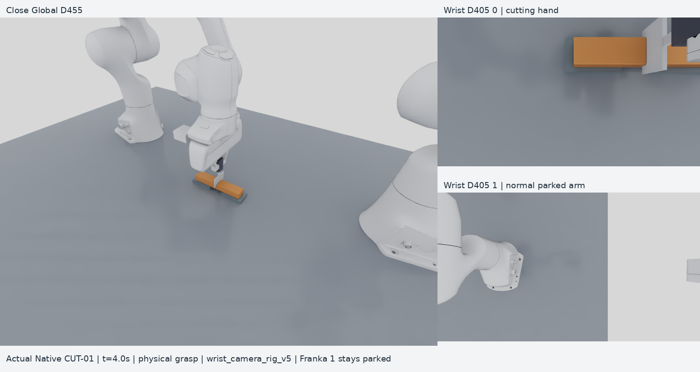
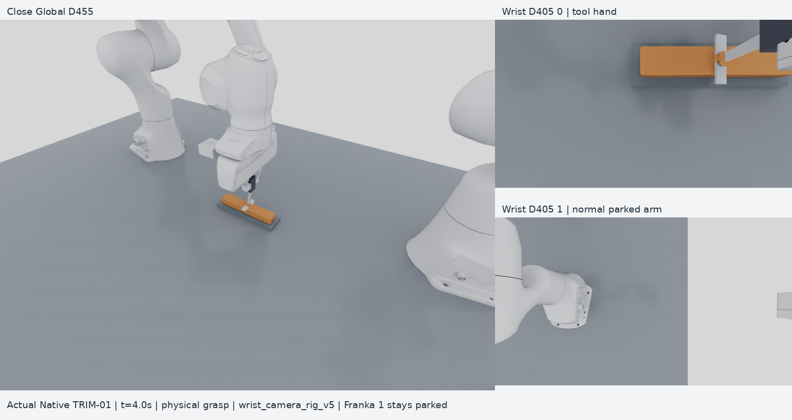

# RoboticCuttingSim

A robotic cutting research environment for **Isaac Sim 6.2 / Isaac Lab 3.0**:
dual Franka Panda, a physically grasped knife, continuous soft material and
permanent TLMPM separation. Two wrist-mounted D405 RGB-D prototypes and a close
Global D455 provide vision observations. No policy is trained.

Both wrist cameras use fixed mounts parallel to their hands; Franka 1 stays
in its normal park posture. Each scene below shows actual synchronized RGB
captures from Global D455 and both wrist D405s with camera rig v5.
[Camera v5 validation](docs/WRIST_CAMERA_V5.md). Previous images and recordings
remain preserved.

WP-10 adds opt-in ruler-knife tasks and bounded control for policies, Gym/RL
and agents. The last full CPU regression passes **461 tests**; both real Isaac
runtimes pass the 1,200-step interface fuzz, legacy regression and Gym checks,
with physical-grasp holding limits reported separately. Native ruler CUT-01-R
and CUT-02 pass strict task metrics; Lab ruler cuts and TRIM retain failures.
Work is checkpointed for Claude: C/D are partial, E–G and the required learned
controller/robot-video matrix remain unfinished. See [handoff](docs/HANDOFF_WP10_CLAUDE_20261029.md),
[the plan](docs/WP10_SPECIFICATION.md),
[control interface](docs/POLICY_CONTROL.md), [WP-10B](docs/reports/WP-10B.md),
[WP-10C](docs/reports/WP-10C.md) and [WP-10D](docs/reports/WP-10D.md).

### CUT-01 — bar cutting



Actual Native CUT-01 at **t = 4 s**.
[Image provenance](docs/media/scene_current_v5.json) ·
[Watch the episode](docs/media/wrist_v5_cut01/synchronized_multiview.mp4).

### TRIM-01 — surface trimming



Actual Native TRIM-01 at **t = 4 s**. The completed episode separates a chip;
its strict surface-quality score remains **FAIL**.
[Image provenance](docs/media/scene_trim01_v5.json) ·
[Watch the episode](docs/media/wrist_v5_trim01/synchronized_multiview.mp4).

## Tasks

| Task | Goal | Current fixed-task result | Actual RGB-D video |
| --- | --- | --- | --- |
| **CUT-01** | Cut a continuous bar into two parts | Permanent separation; strict task score **PASS** in both runtimes | [Watch v5](docs/media/wrist_v5_cut01/synchronized_multiview.mp4) |
| **TRIM-01** | Remove a continuous surface bump | Chip separation; strict surface-quality score **FAIL** | [Watch v5](docs/media/wrist_v5_trim01/synchronized_multiview.mp4) |

The knife is an independent rigid body held by finite finger contact and
friction. Material reaction acts on the tool and reaches the arm through the
gripper. The historical attachment remains selectable as `legacy_fixed_tool`.
Materials and sensors are provisional; coupling-work, contact-model and camera
limitations remain explicit in the [validation report](docs/PHYSICAL_TOOL_INDEPENDENT_VALIDATION.md).

**Evaluation v2** reports recorded-state integrity, cutting outcome and surface
quality separately. Choose Diagnostic for measurements, Research for task goals,
or Precision for the unchanged strict benchmark. Missing surface intersections
remain unknown; they are not measured knife gouges. Fixed TRIM still removes
98.5294% of target material and still fails the original precision score.
[Evaluation API, measured results and reproduction](docs/EVALUATION_V2.md).

## Quick start

Use an Ubuntu + NVIDIA RTX host with a compatible existing driver.
Bootstrap creates isolated project environments and does not change the driver.

```bash
git clone https://github.com/AnsonNing/RoboticCuttingSim.git
cd RoboticCuttingSim
bash scripts/bootstrap.sh --runtime all --managed-python --accept-eula

# Actual two-step CUT/TRIM smokes in both runtimes; this is not full cutting validation.
.venv/bin/python scripts/run_deployment_validation.py --tier smoke --runtime both \
  --gpu auto --tool-attachment-mode physical_grasp --grip-initial-position 0.0112 \
  --lab-grip-contact-profile finite_pad_patch_v3 --output-dir artifacts/smoke_NEW
```

For full episodes, GPU selection and installation details, see
[run instructions](docs/PHYSICAL_TOOL.md#reproduce) and
[portable deployment](docs/PORTABLE_DEPLOYMENT.md).

## Use the environment

Both tasks expose `reset()`, `step(action)`, `observe()`, `render()`, `evaluate()`
and `close()`. Joint and Cartesian actions share the same underlying scene.
Policy observations use RGB-D and robot proprioception; force and oracle state
stay in separate debug/evaluation data. See the [shared API](docs/SHARED_TASK_API.md).

The optional [remote viewer](docs/REMOTE_INTERACTIVE_VIEWER.md) provides the
same live simulation's GUI, task selection, gripper controls and camera views.
On the original host, open [the Tailscale viewer](http://100.111.162.17:8210)
while its server is running.

## Documentation

Start with the [documentation index](docs/README.md) for setup, physics,
validation and preserved experiments. [Progress and known issues](docs/PROGRESS.md)
record PASS / FAIL / BLOCKED / NOT_RUN separately.

Run CPU regression checks with `.venv/bin/python -m pytest -q`.
Actual GPU/runtime and physics acceptance are tested separately.
