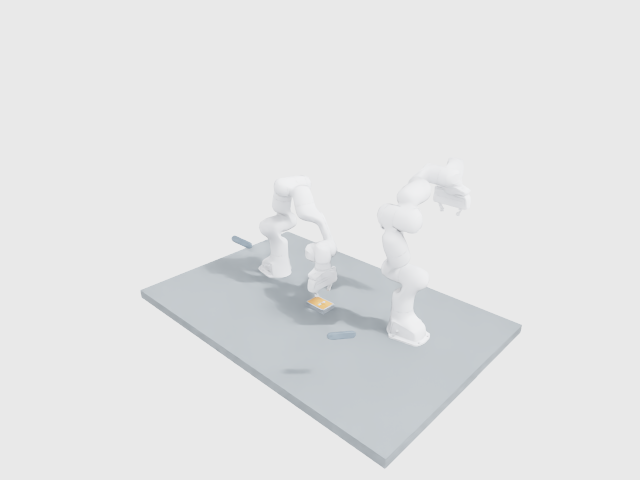

# RoboticCuttingSim

已建立可接續研究的**雙 Franka Panda 切削模擬環境**：連續軟質試件、固定治具、實際持刀控制、持久材料分離／切屑接觸、雙路 RGB-D、Global Camera，以及可執行的 D0–D3 benchmark。沒有加入 RSI 或訓練 Policy。

目前使用本機可執行的 **Warp TLMPM＋Newton/MuJoCo＋OpenUSD／NVIDIA OVRTX** standalone 組合。完整 Isaac Lab3.0／Sim6.2 runtime 仍受安裝與 CUDA13 driver 條件阻塞，沒有把 standalone 結果冒稱為完整 Isaac 驗證。



已實測：

- 刀刃通過後才產生切面歷史；切屑撤刀後獨立運動、落下及再次接觸，不刪粒子、不預分割凸起。
- 單刀形成兩個力學分量；平坦剛性支撐上的交叉兩刀實驗形成三個分量。
- Franka 關節／Cartesian／IK／碰撞與固定楔形刀具；材料反作用實際回饋手臂，明示20 ms延遲。
- 完整 live API 跑完400 steps／8 s：雙路640×480 RGB-D、量測q/qdot/tool pose、reset、截斷與時間戳。
- 機器人切削場景已有41幀實際 RTX 雙相機＋Global 輸出，獨立 mesh-depth 檢查通過。
- D0–D3 四個物理＋影像 benchmark case 完成；多凸起仍有殘留，不將執行成功當成任務成功。

材料與切削參數未實物校準，解析度／時間步探查尚未證明收斂。Native SingleView D455 的註冊與噪聲仍有已知限制，與已驗證的理想 RGB-D 分開記錄。完整科學驗收尚未完成。

本機既有隔離環境內，直接跑 live 研究環境：

```bash
cd /home/ningan/RoboticCuttingSim
.venv/bin/python -m robotic_cutting_sim.cli research-demo \
  --device cuda:0 --output-dir artifacts/my_live_cutting
```

這會實際推進機器人與材料，每步重建當下表面並產生理想 RGB-D，保存觀測、Global debug、oracle debug 與結果。本機400 steps約165 s wall，並非即時效能保證。首次下載約21.4 MB官方 USD 幾何；大型資料和資產留在 ignored cache。

```python
from robotic_cutting_sim.research_env import ResearchCuttingEnv, ResearchEnvConfig

with ResearchCuttingEnv(ResearchEnvConfig()) as env:
    obs, info = env.reset(seed=42)
    obs, reward, terminated, truncated, info = env.step()
    depth = obs["depth_m"]["d455_0"]
    joints = obs["proprio"]["q"]  # measured, shape (2, 7)
    global_rgb = env.render()     # debug only
```

`step([x,y,z,qx,qy,qz,qw], cut_index=0)` 輸入世界座標刀刃目標 pose，經 IK／動力學執行。觀測不含 force、材料粒子／應力或 Global；診斷由獨立 API 取得。接口見 [RESEARCH_ENVIRONMENT](docs/RESEARCH_ENVIRONMENT.md)。

```bash
.venv/bin/python -m robotic_cutting_sim.cli cutting-probe \
  --case cut_recontact --output-dir artifacts/my_recontact

.venv/bin/python -m robotic_cutting_sim.cli benchmark \
  --variants D0 D1 D2 D3 --seeds 42 --output-dir artifacts/my_benchmark

.venv/bin/python -m pytest -q
```

安裝與 RTX 獨立環境見 [SETUP](docs/SETUP.md)。原本 Newton implicit-MPM `CuttingEnv`、CRESSim 比較及靜態 USD 工具仍可使用。詳細證據、影片路徑、失敗和限制見 [PROGRESS](docs/PROGRESS.md)、[切削驗證](docs/reports/TLMPM_VALIDATION.md)、[機器人耦合](docs/COUPLED_ROBOT_VALIDATION.md)、[benchmark 結果](docs/BENCHMARK_REPORT.md)、[切削 RTX](docs/reports/WP-03-cutting.md)。
