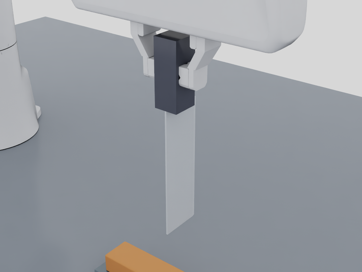
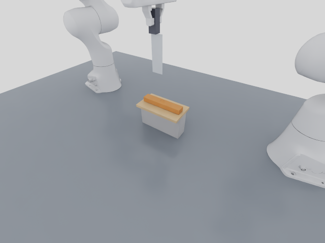
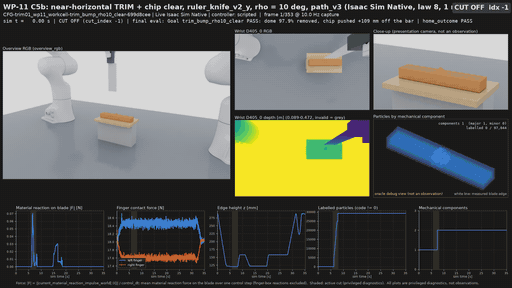
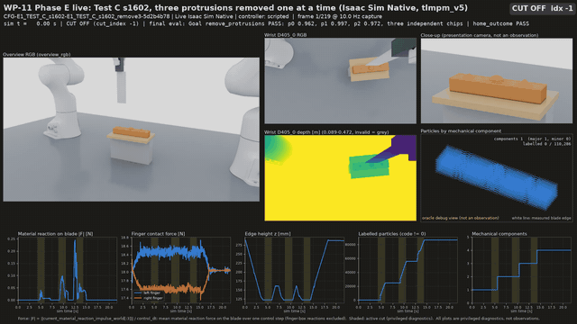
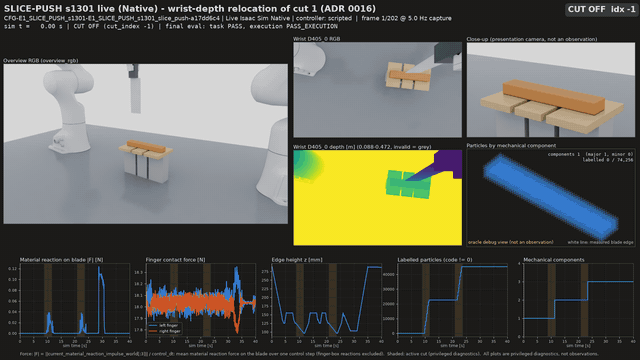
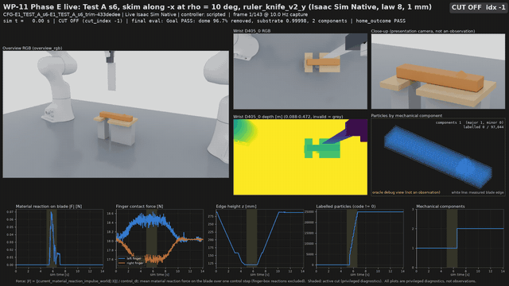

# RoboticCuttingSim

A reusable, physically interactive robotic cutting environment for
**Isaac Sim 6.2 / Isaac Lab 3.0**. Two Franka Pandas share the workcell: one
holds an end-held ruler knife in a physical two-finger friction grasp, and the
other stays parked. The workpiece is one continuous soft material. The knife
separates it permanently through total-Lagrangian MPM (TLMPM) with persistent
side labels in the style of [BladeMaster](https://arxiv.org/abs/2609.27342).
Wrist D405 and Global D455 RGB-D cameras provide the observations.

The environment is organised in separate layers:

| Layer | What it is |
| --- | --- |
| Scene | The workpiece geometry, pose, protrusions and supports, as configuration |
| Goal | What to achieve: sever, divide, remove protrusions, trim, move a piece, or a sequence |
| Controller | Any controller drives the same public API: the scripted planner, an action file, or a policy |
| Evaluation | Each goal has its own evaluator |

One episode can hold several cuts. No policy is trained, and the material
parameters are provisional and uncalibrated.

## WP-11: reusable cutting environment (live Native Isaac Sim)

Every clip below is a **live Native Isaac Sim** episode (PhysX/Kit/RTX) in
`wp11_workcell_v1`:

- **Tool:** Franka 0 holds `ruler_knife_v2_y` in a physical grasp, with no fixed
  joint and no pose sync.
- **Material:** cutting law 8 at formal resolution (1 mm particles, 4 mm grid,
  0.1 ms), seed 42.
- **Motion:** each episode ends with a **physical return to HOME**, which is
  scored separately from the task.

The particle panel in each video is an oracle debug view, not an observation.
[Plan](docs/WP11_PLAN.md) · [progress, including every failure](docs/PROGRESS.md).

### The knife: `ruler_knife_v2` (end-held, like the reference image)

| `ruler_knife_v2_y` profile | HOME: blade hanging below the fingers |
| --- | --- |
|  |  |

The two fingers pinch a 60 mm grip at one end of a flat 120 × 40 × 1.5 mm
blade with a 25° double bevel. The straight edge runs along the approach
axis. One `ToolProfile` defines everything else: the visual mesh, the PhysX
colliders, mass and inertia, the grasp frame, the edge frame and the TLMPM
blade polygon ([ADR 0013](docs/adr/0013-ruler-knife-v2-and-trim-orientation-metrics.md)).

Grasp stress tests, all Native:
- **Holds:** 30 s at HOME and in the TRIM pose, 2× reorientation speed,
  0.1–0.5 N loads, and 10× the recorded cutting reaction. Slip stays at or
  below 4.8 µm.
- **Fails as expected:** the corrected low-friction negative controls (v9) do
  lose the knife ([report](docs/reports/WP11_PHASE_F1_GRASP.md)). The first
  v8 run is still recorded as FAIL because one of its negative controls was
  designed wrongly.

### Near-horizontal trimming, then clearing the chip



**PASS.** The sequence is HOME → REORIENT → PRE-CUT → SKIM at blade rake
ρ = 10° → WITHDRAW. A disarmed near-horizontal sweep then pushes the chip off
the bar, and the arm makes a physical RETURN_HOME.
- 97.89% of the dome is removed and the substrate keeps a 0.99996 share as one body.
- The chip travels 109 mm and stays an independent piece.
- Grasp slip is 0.78 µm, and the return home passes.

Orientation is reported as four separate metrics: edge tilt τ, edge skew ψ,
blade rake ρ and motion elevation μ. ρ = 10° is the lowest rake the 25°
double bevel allows. Below 12.5° its lower face sits beneath the edge, so at
0° and 5° it would scrape 0.55 and 0.25 mm into the substrate
([Phase C report](docs/reports/WP11_PHASE_C_TRIM.md)).

The controller is `path_v3`: a planned reference plus a slowly adapting bias.
It replaced `path_v2`, which oscillated during PRE-CUT.

Known residual: 7 rim particles of the substrate end 3.4–12 mm above the
trim plane while still attached to it.
[Evidence](docs/evidence/wp11/phaseC5b_live_trim_clear_001.json).

### Several cuts in one episode (`tlmpm_v5`)

| Test B: four slices, five pieces | Test C: three protrusions removed one at a time |
| --- | --- |
|  |  |

`tlmpm_v5` keeps each cut as packed 2-bit digits, so an episode can hold up
to 15 cuts. Each grid node stores its logical fields in sparse slots, which
makes the cost independent of the number of cuts
([ADR 0014](docs/adr/0014-scalable-cut-history-sparse-logical-fields.md)).
- **Test B:** four slices give five independent pieces.
- **Test C:** 96.2%, 99.7% and 97.2% of the three protrusions are removed.
  The substrate remains one component, each chip separates during its own
  skim, and the return home passes.

| Slice, then push, with wrist-depth relocation | Test A: skim along −x |
| --- | --- |
|  |  |

**Slice-push.** After the first cut the bar slides about 1.2 mm, so without
help the second cut misses its plane. Every round-1 seed failed that way.

With the opt-in perception hook `wrist_depth_relocate_v1`
([ADR 0016](docs/adr/0016-configured-perception-relocation.md)):
- The wrist D405 depth image measures the slide of the bar's end face between
  cuts. The hook does not use simulator truth and does not aim the camera.
- The next cut is shifted by the measured amount.
- 3 of 3 live seeds pass, at workpiece yaw −6°, +18° and −14°, and every
  second cut lands on its declared plane.
- On two seeds the measured slide matched the material's actual slide at the
  cut to within 0.01 mm.
- On the third, the piece did not slide rigidly: the material at the cut moved
  0.28 mm more than the end face did. The error stayed within half a particle
  layer, but a larger non-rigid slide would not be fully corrected.

### Generalization (predeclared seeds, no silent exclusion)

| Round | Stage | Result |
| --- | --- | --- |
| [Round 1](docs/reports/WP11_PHASE_E_ROUND1.md) | 41 seeded samples (CUT, TRIM, SLICE-PUSH, Tests A–D) | Kinematic 32/41 TASK_SUCCESS, 9 CUTTING_FAILURE |
| Round 1 | Live Native, nominated seeds | 6/9 TASK_SUCCESS (2 failures as in kinematic, 1 preflight refusal); Test C after the fix: PASS; SLICE-PUSH with relocation: 3/3 |
| [Round 2](docs/reports/WP11_PHASE_E_ROUND2.md) | 40-sample sweep over wider ranges | 4 SCENE_INFEASIBLE, 8 IK_FAILURE, 28 feasible |
| Round 2 | Kinematic run of 18 of the feasible samples | 8 succeed; the failures map law-8 limits (below) |

Round 2 also introduced `goal_eval_v2`, which scores each step of a sequence
goal only on its own cuts.

### Policy-ready API

```python
from robotic_cutting_sim.live_env import open_cutting_env

with open_cutting_env(runtime="isaac_sim",           # or "kinematic"
                      output_dir="artifacts/my_run", # a fresh directory
                      preset="cutting_research_v1",  # physical grasp, HOME reset
                      scene="trim01_wp11_workcell",  # scene config
                      goal="trim_bump_rho10",        # goal config, separate from the scene
                      runtime_profile="full_physics_v1",
                      seed=42) as env:
    obs, info = env.reset(seed=42)
    obs, reward, terminated, truncated, info = env.step(
        {"type": "edge_delta", "target": [0, 0, -0.001, 0, 0, 0], "cut_enabled": False})
    result = env.evaluate()   # the goal's own evaluator
```

- **Actions:** every step reports `ACCEPTED`, `CLAMPED` or `REJECTED_<reason>`.
  A rejected action never executes.
- **Observations:** wrist D405 ×2, D455 RGB-D, joint state, end-effector
  pose, gripper state and the goal. Simulator truth (particles, codes,
  contact forces, the true tool pose) is available only with
  `observation_profile="privileged_state"`.
- **Datasets:** `scripts/collect_dataset.py` records successful and failed
  episodes, and `scripts/read_dataset.py` validates and replays them.
- **Reliability (Test F):** both the kinematic backend and Native Isaac Sim
  are **POLICY_READY**.
  - Native was checked over 8 full episodes in one process, under the
    declared v1a/v1b gates.
  - The original v1 gate still fails one check: the clamped tool shows PhysX
    velocity jitter after reset.
  - Native host memory still grows by about 49 MiB per episode.
  - Native results repeat at the verdict level only, because of GPU float32
    atomics.
- **Controller independence (Test E):** the same goal is run by the scripted
  planner and by an action program written only from scene numbers. Both pass.
- **Runtime profiles:**
  - `full_physics_v1` is the only profile valid for acceptance.
  - `research_fast_v1` runs 8–10× faster in the kinematic backend and 2.3×
    faster in Native, and marks every episode `acceptance_valid: false`.

[API](docs/POLICY_READY_API.md) · [profiling](docs/reports/WP11_PHASE_H_PROFILING.md).

### Where law 8 is validated, and where it is not

Validated in the 1 mm boundary study ([report](docs/reports/WP11_PHASE_F_LAW8.md)):
- **Plow gate:** behaves as specified. At 14° and 15° it never plows; at
  16° it plows on every step.
- **Cuts and blade motions:** vertical and 20° oblique cuts; rocking; pure
  rotation; sawing; pure draw; withdrawal; a finite edge; re-contact;
  three-cut history.
- **Negative controls:** side push, flat press, no contact and a loaded
  blunt handle never cut.

Known limits, reported and not hidden:
- Oblique cuts of 30–35° do not separate the bar.
- Skims at a rake of 45° or more never engage the law.
- A few chip particles can stay unlabelled after a sever followed by skims.
- Removal and contact force are not converged at 1.5–2 mm resolution.
- No Isaac Lab parity.

### Frozen baseline still reproduces

The `final_v4` BladeMaster set below was rerun live after the WP-11 changes
([regression report](docs/reports/WP11_PHASE_I_FINAL_V4_REGRESSION.md)):
- Every verdict is unchanged, and so is the task and protocol identity.
- The documented strict FAILs (Demo 1b location and window, Demo 2 precision 5/8) repeat.
- Metrics stay within GPU nondeterminism.

## Three BladeMaster-style demos (frozen baseline, live Native Isaac Sim)

All four episodes below are **live Native Isaac Sim** (PhysX/Kit/RTX) runs in
the same workcell, `blademaster_workcell_v1`:

- Franka 0 holds `ruler_knife_v1` in a physical two-finger grasp.
- The cutting board has real colliders and friction.
- Cameras: wrist D405 rig v5 and the Global D455.
- Material: cutting law 8 at 1 mm particles, 0.1 ms and a 4 mm grid; seed 42.
  The 1 mm acceptance matrix passed every row before these runs, negative
  controls included, under criteria declared in advance. M8a, a diagnostic
  row, fails. M2 passes only under ADR 0006 Amendment 1 (it fails the
  original 2 mm limit). The Lab replays M9c/d are report-only. A clean-tree
  confirmation of four rows finished while the live set was running.
- Control: scripted waypoint controllers.

Videos are rendered from the recorded episode: presentation overview and
close-up, wrist D405 RGB-D, a particle view coloured by mechanical component
(an oracle debug view, not an observation) and force/height/label
diagnostics. Images are captured at 10 Hz; actions and robot state are
recorded at 50 Hz. The GIFs play at 2× speed; the MP4s play in real time at
the capture rate.
[Full report](docs/reports/BLADEMASTER_DEMOS.md) ·
[all attempts, including failures](docs/evidence/phase3/demos_live_004.json).

### Demo 1 — complete cutting


**PASS.** The knife cuts the 160×30×20 mm bar into two 50/50% parts, which
stay separated after the knife is withdrawn. The frozen strict task score also
passes (cut location 1.5 mm, limit 2 mm).
Episode `live_20261029_law8_final/demo1a`, controller `path_v2` ·
[MP4](docs/media/demos/demo1a/live_20261029_law8_final_demo1a.mp4) ·
[provenance](docs/media/demos/demo1a/live_20261029_law8_final_demo1a.json).

The 20° oblique variant also **passes**. Separation is scored against the
actual swept plane: 4.78 mm, against an allowed ideal 4.44 + 1 mm. Its frozen
strict score fails two checks:
- **Location:** the vertical-plane check does not apply to a tilted cut.
- **Post-cut persistence window:** with the slower `path_v2` approach the cut
  completes at about 5.7 s, after the frozen v1 window ends at 5.6 s. Nothing
  reconnects, and separation lasts 1.8 s after withdrawal.
[GIF](docs/media/demos/demo1b/live_20261029_law8_final_demo1b.gif) ·
[MP4](docs/media/demos/demo1b/live_20261029_law8_final_demo1b.mp4).

### Demo 2 — surface trimming


**PASS (separation).** A 35° rake skim detaches 98.0% of the bump as a chip.
The substrate remains one intact body, and the measured edge stays within
0.026 mm of the target height. The separately reported precision score is
5/8 (**FAIL**): p95 surface error 0.58 mm against 0.5 mm, overcut 1.66%, and
the conservative gouge rule.
Episode `live_20261029_law8_final/demo2` ·
[MP4](docs/media/demos/demo2/live_20261029_law8_final_demo2.mp4) ·
[provenance](docs/media/demos/demo2/live_20261029_law8_final_demo2.json).

### Demo 3 — sequential slicing and manipulation


**PASS**, including the frozen SLICE-PUSH-01 report. Two cuts (`cut_index` 0
and 1) produce three independent parts (37.5/31.25/31.25%), each within one
particle layer of its declared plane. The blunt blade face, with cutting
disabled, then pushes one part 19.7 mm by real contact. The other parts do not
move, no labels are added and nothing reconnects. Between the cuts the
controller measures the bar's 1.20 mm shift from rendered wrist D405 depth,
robot kinematics and the simulator knife pose
([ADR 0009](docs/adr/0009-demo3-wrist-depth-retarget.md)). The rendered surface
is rebuilt per mechanical part; this does not affect the measured +x end face.
Episode `live_20261029_law8_final/demo3`, controller `path_v2_vision` ·
[MP4](docs/media/demos/demo3/live_20261029_law8_final_demo3.mp4) ·
[provenance](docs/media/demos/demo3/live_20261029_law8_final_demo3.json).

### The new workcell

| Demo 1 (CUT-01-R) close-up | Demo 3 (SLICE-PUSH-01) board | Demo 2 (TRIM-01-R) 35° rake |
| --- | --- | --- |
|  |  |  |

These are actual Native frames from the Phase 2 smokes
([evidence](docs/evidence/phase2/native_smokes_001.json)). The close-up is
from the 30-step smoke `artifacts/wp10_claude/phase2/s4_closeup_cut01r_30_001`. The wooden boards,
risers and relief slots are the same boxes used as PhysX colliders (friction
0.3) and as TLMPM fixtures.

### Cutting physics

Cutting law 8 builds on law 4 and law 5. It follows BladeMaster Section
III-C:

- **Cutting progress** only resists the knife.
- **Persistent side codes** are assigned only during a blade stroke that is
  actually cutting, within the finite band swept behind the moving edge.
- **Plowing strokes** are the exception: a raked edge moving at least 15° out
  of its plane, as in the TRIM skim. There, material up to 8 mm ahead of the
  edge and more than one grid cell off the swept surface is labelled early,
  so a carried chip cannot stay attached.
- **Side pushes, flat presses, stopping, withdrawal, uncontacted edges and the
  blunt handle** never cut.

The 1 mm acceptance matrix (vertical and 20° cuts, TRIM at 25°/35° and on the
board, partial cut, side push, flat press, stop and withdrawal, persistence,
two sequential cuts, Native measured-trajectory replays) passes **M1–M9**
under computed criteria. Those criteria were declared before the law-8 runs
([matrix](docs/evidence/phase1/matrix_law8_002.json)). Three caveats:

- The M8a diagnostic fails.
- M2 passes only under Amendment 1; it fails the original 2 mm limit.
- The Lab replays M9c/d are report-only (Lab cut location 4 mm, FAIL).

Earlier laws and their failures are preserved:

| Law | ADR | Failure |
| --- | --- | --- |
| 4 | [0006](docs/adr/0006-swept-band-cutting-law-4.md) | TRIM 0% removed |
| 5 | [0008](docs/adr/0008-cutting-law-5-lead-preassignment.md) | Second-cut location in the two-cut row |
| 6 | [0010](docs/adr/0010-cutting-law-6-deferred-lead-commit.md) | TRIM at 35° |
| 7 | [0011](docs/adr/0011-cutting-law-7-eq8-coupled-flip.md) | Several rows |

Law 8 is validated only for in-plane cuts and 25°/35° constant-rake skims.
Material parameters are provisional and uncalibrated.

### Reproduce the demos

```bash
# Final set: Demo 1a/1b/2 with path_v2 and Demo 3 with path_v2_vision, law 8, seed 42
.venv/bin/python scripts/run_blademaster_demos.py --demo-set final_v4 --gpu 1 --run-id NEW_ID
```

Each run writes the episode, `demo_summary.json` (execution, outcome and
quality kept separate) and rendered media under `artifacts/wp10_claude/demos/`.
It never overwrites an earlier run. Add `--publish` to copy the media into
`docs/media/demos/`.

Earlier runs are preserved and documented:

- **Law 5 runs.** They were made before the matrix gate was met. All four
  pass, and their media remain under `docs/media/demos/`.
- **First-round v1-controller failures.** Demo 2 removed only 64%. Demo 3's
  second cut landed 2.0000000670 mm from its declared plane, over the 2 mm
  bound.

## Quick start

Use an Ubuntu + NVIDIA RTX host with a compatible existing driver.
Bootstrap creates isolated project environments and does not change the driver.

```bash
git clone https://github.com/AnsonNing/RoboticCuttingSim.git
cd RoboticCuttingSim
bash scripts/bootstrap.sh --runtime all --managed-python --accept-eula

# Actual two-step CUT/TRIM smokes in both runtimes; this is not full cutting validation.
.venv/bin/python scripts/run_deployment_validation.py --tier smoke --runtime both \
  --gpu auto --tool-attachment-mode physical_grasp --grip-initial-position 0.0112 \
  --lab-grip-contact-profile finite_pad_patch_v3 --output-dir artifacts/smoke_NEW
```

For full episodes, GPU selection and installation details, see
[run instructions](docs/PHYSICAL_TOOL.md#reproduce) and
[portable deployment](docs/PORTABLE_DEPLOYMENT.md).

## Use the environment

Every environment exposes `reset()`, `step(action)`, `observe()`, `render()`,
`evaluate()` and `close()`. Joint and Cartesian actions share the same
underlying scene. Policy observations use RGB-D and robot proprioception;
force and oracle state stay in separate privileged or evaluation data.

- **New tasks from configuration, no new code:**
  - write a scene ([`configs/wp11/scenes/`](configs/wp11/scenes/), `rcs_scene_v1`)
    and a goal ([`configs/wp11/goals/`](configs/wp11/goals/), `rcs_goal_v1`);
  - open them with `open_cutting_env(scene=..., goal=..., preset="cutting_research_v1")`;
  - see [ADR 0015](docs/adr/0015-scene-goal-controller-evaluation-separation.md).
- **Further reading:** [policy-ready API and datasets](docs/POLICY_READY_API.md)
  and the older [shared API](docs/SHARED_TASK_API.md).

The optional [remote viewer](docs/REMOTE_INTERACTIVE_VIEWER.md) provides the
same live simulation's GUI, task selection, gripper controls and camera views.
On the original host, open [the Tailscale viewer](http://100.111.162.17:8210)
while its server is running.

## Documentation

Start with the [documentation index](docs/README.md) for setup, physics,
validation and preserved experiments. [Progress and known issues](docs/PROGRESS.md)
record PASS / FAIL / BLOCKED / NOT_RUN separately.

Run CPU regression checks with `.venv/bin/python -m pytest -q`.
Actual GPU/runtime and physics acceptance are tested separately.
