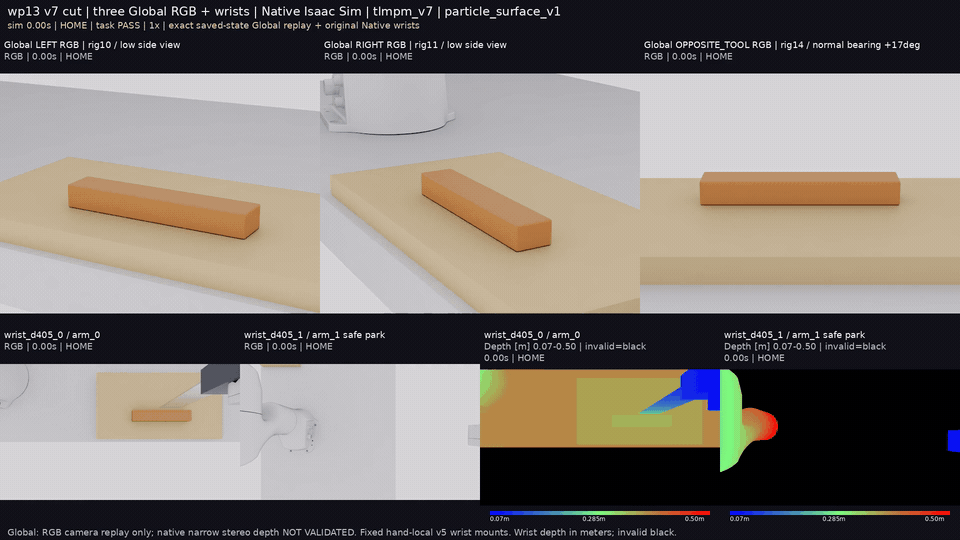

# RoboticCuttingSim

A configurable robotic cutting research environment with live **Native Isaac Sim 6.2**,
two Franka Pandas and an end-held blade in a physical two-finger grasp. One continuous
specimen supports **original v7 for the validated Straight CUT research profile**,
with **v5 / Law 8 retained as the legacy default**. Persistent cut histories, multiple
cuts and RGB-D observations use separate scene, goal, controller and evaluation APIs.
Material parameters are provisional and uncalibrated; Isaac Lab parity is unverified.

[](docs/media/three_global_v1/two_bumps_v7_2_native.mp4)

**Sequential removal of two different protrusions — real Native Isaac Sim, seed 42, 1×.**
The versioned experimental `tlmpm_v7_2` detaches the 9 mm dome and 5.5 mm asymmetric
cap in separate passes: **A/B 100%, mechanical bodies 1 → 2 → 3, substrate retained,
HOME PASS**. The movie shows **three fixed Global RGB views — LEFT, RIGHT and
OPPOSITE TOOL — plus arm_0 / arm_1 Wrist D405 RGB and Depth** at the same physics
timestamp. All external views are low-angle (17.12°), about 0.60 m away, with full
uncropped RGB. OPPOSITE TOOL looks back from the blade-tip side without sideways
yaw. Franka 1 remains at its normal park; both hand-local wrist mounts are unchanged.

Wrist depth is **optical Z in meters**, with a **0.07–0.50 m** blue→green→red
scale; black means invalid/out of range. A parked wrist may not see the specimen.
Global RGB is a Native camera replay of the exact saved live mesh and measured
robot/tool state; original wrist RGB-D is reused. These are synchronized state
views, not three new physics trials. Narrow Global stereo-depth controls remain
**BLOCKED**; no calibrated Global depth is claimed.
[Camera names, calibration, recording/replay commands and source receipts](docs/GLOBAL_CAMERA_VIEWS.md) ·
[Retained earlier gallery](https://github.com/AnsonNing/RoboticCuttingSim/blob/b9100bcd662bafcb81cefedae424856d047e9e72/docs/NATIVE_MULTIVIEW_GALLERY.md).
[Scene / goal, measured state arrays and retained failures](docs/reports/WP14_FOLLOWUP_RESULTS.md) ·
[Current v7 multiview movies](docs/NATIVE_MULTIVIEW_GALLERY.md).
This is one verified demo; single-bump kinematic T00 still fails, and general TRIM
support is not claimed. The validated original-v7 CUT profile remains separate.

## Native cutting gallery

These three v7 camera-engineering recordings show CUT, experimental TRIM and
four slices: each source has task PASS and HOME PASS. They retain all three
external RGB views and both actual wrist RGB/depth pairs, with 1 mm particles,
4 mm grid and 0.1 ms substeps. Seed 42, `particle_surface_v1`. These selected
recordings are separate from the frozen scientific denominator and do not
establish general TRIM or multi-cut support.

| Straight CUT · 1× | TRIM at rake 10° · 1× | Four slices · 3× preview |
| --- | --- | --- |
| [](docs/media/three_global_v1/wp13_v7_cut.mp4) | [](docs/media/three_global_v1/wp13_v7_trim.mp4) | [](docs/media/three_global_v1/wp13_v7_multicut.mp4) |
| Two pieces | 100% above-plane dome mass detached (experimental Native recording) | Five pieces; placement quality reported separately |

[Multiview provenance and exact capture timestamps](docs/evidence/three_global/media_001.json) ·
[WP-13 measurements and limitations](docs/reports/WP13_RESULTS.md) ·
[earlier WP-12 demonstrations](docs/reports/WP12_FINAL_VALIDATION.md).
New full clips retain every Global capture and synchronize both real wrist RGB/depth streams.
Irregular captures keep their exact presentation timestamps; previews have labelled speeds.
[Current v7 recordings and historical evidence entry](docs/NATIVE_MULTIVIEW_GALLERY.md).

## CUT research profile (WP-14)

**`v7_cut_research_v1` is a scoped Validated Research Profile using original
`tlmpm_v7`. v5 / Law 8 remains the default.** The selected CUT configurations
and predeclared Native evidence are documented in the
[research report](docs/reports/WP14_RESULTS.md).

[](docs/media/three_global_v1/wp14_walkthrough.mp4)

**Executable scene: three Global RGB views and two wrist RGB-D pairs, 1×.**
[Launch the standard or firm-offset CUT scene](docs/WP14_SCENES.md) ·
[actual three-view scene](docs/media/three_global_v1/scene_three_global.png) ·
[scene/video provenance](docs/evidence/three_global/scene_001.json).
This extra engineering replay does not add an independent adoption sample.

Standalone v7 recordings: [standard CUT](docs/media/three_global_v1/wp14_v7_standard_cut.mp4)
and [firm offset CUT](docs/media/three_global_v1/wp14_v7_firm_offset_cut.mp4)
(firm material, yaw −5°, cut at −4 mm), both at 1× simulation time.
[Native tracking, physical contacts and HOME](docs/evidence/wp14/native_001.json).

| Selection / family | Supported scope |
| --- | --- |
| Default v5 + Law 8 | Existing baseline, unchanged |
| `v7_cut_research_v1` / Straight CUT | Four validated instances; constrained reference/firm bar configuration |
| Partial / Multi-cut | Experimental; distinct-depth ligament and one four-slice pattern pass |
| TRIM | Unsupported by the CUT profile; v7 and finite v7_1 primary failures retained |
| Reverse / oblique | New adoption NOT_RUN; earlier slotted-board evidence retained |

The original held-out task denominator is **2/4 per solver**, although all four
cases truly sever into two parts. The ±6 mm cases fail the unchanged 2 mm
reference-midpoint gate (even ideal geometric labels score 2.5 mm). The wider
proposal is rejected. Final use is restricted after those failures to +x blade
direction, ±5° yaw, -4/0/+4 mm cut positions and 8 mm bar-length increments,
within the declared 1 mm particle / 4 mm grid / 0.1 ms configuration. These
finite results do not validate all combinations or a random success rate.
TRIM failure does not veto proven CUT; surface appearance does not certify it.

```python
from robotic_cutting_sim.scene_config import compile_task

task = compile_task("configs/wp12/scenes/bar_flat_board.json", "sever_mid",
                    solver_profile="v7_cut_research_v1")
# Explicit original v7, recorded path_v2 controller, 14 s completion window.
```

[Normal Scene / Goal / Environment selection](docs/V7_RESEARCH_WORKFLOW.md) is supported.
Configuration selection checks and records the solver/front/contact sources,
material, scene and numerical scope; incompatible overrides raise. New policy
actions require separate evaluation. `tlmpm_v7_1` stays Experimental and is not
selected by this profile. Its post-study pending-event lifecycle correction is CPU-verified only;
GPU outcomes are not reassigned to it. Materials are uncalibrated; forces are not converged.
[Results, all failures and exact commands](docs/reports/WP14_RESULTS.md) ·
[Profile configuration](configs/wp14/v7_cut_research_v1.json).

## Research limits and retained history

Original v7 remains opt-in; full/default promotion was rejected. The primary
kinematic TRIM stays connected and a held-out shorter/firmer CUT fails.
The later scoped CUT qualification does not rewrite those failures or establish
general TRIM support. Forces remain unconverged and materials uncalibrated.
[Frozen WP-13 results](docs/reports/WP13_RESULTS.md) ·
[Historical media and baseline evidence](docs/HISTORICAL_CAMERA_MEDIA.md).

Both surface profiles are one-way render geometry, separate from collision.
Unchanged `particle_surface_v1` and opt-in `cut_aware_surface_v1` were measured on
saved states; no plane smoothing, particle removal or visual tear splitting was
adopted. The historical WP-12 cut-aware surface gate remains FAIL.
[Original surface decision](docs/reports/WP12_PHASE3_XHIGH_DECISION.md).

## Quick start

Use Python 3.12 and the pinned, separate base/Native environments.
[Setup and hardware requirements](docs/SETUP.md) · [compatibility](docs/COMPATIBILITY.md).
The bootstrap installs project-local dependencies; it does not upgrade drivers.

```bash
bash scripts/bootstrap.sh --runtime base --managed-python
bash scripts/bootstrap.sh --runtime isaac_sim --managed-python --accept-eula
export PYTHONPATH="$PWD/src${PYTHONPATH:+:$PYTHONPATH}"
export TMPDIR="${TMPDIR:-/tmp}"

# CPU-only: compile the exact WP-12 straight-cut scene and live goal.
.venv/bin/python scripts/run_wp12_workcell_live.py prepare \
  --episode CUT --out artifacts/wp12/my_cut_inputs

# Native episode, using the existing physical-grasp runner (default GPU 0).
# Choose fresh output paths and run only when that GPU is available.
.venv/bin/python scripts/run_wp12_workcell_live.py launch \
  --episode CUT --out artifacts/wp12/my_native_cut
```

The Native runner checks the motion plan before launching, records RGB-D and
oracle data separately, and reports task and HOME outcomes separately. Output
directories are never overwritten. The prepare command is a configuration check;
it does not establish cutting success.

The same scene/goal configuration is available through the Python API:

```python
from robotic_cutting_sim.scene_config import compile_task
from robotic_cutting_sim.live_env import open_cutting_env

task = compile_task("configs/wp12/scenes/bar_flat_board.json", "sever_mid", seed=42,
                    solver_profile="v7_cut_research_v1")
# CPU-only configuration inspection:
print(task.task_id, task.solver_module, task.max_cuts)

# For interactive control, open the task in Native Isaac Sim:
# with open_cutting_env(runtime="isaac_sim", task=task,
#                       preset="cutting_research_v1",
#                       output_dir="artifacts/wp12/my_api_run", seed=42) as env:
#     obs, info = env.reset(seed=42)
#     obs, reward, terminated, truncated, info = env.step(action)
```

[Environment API and actions](docs/POLICY_READY_API.md) ·
[scene/goal/controller separation](docs/adr/0015-scene-goal-controller-evaluation-separation.md) ·
[task switching and observation isolation](docs/reports/WP12_AGENTIC_READINESS.md).
Deployable observations exclude contact force, particles and material cut codes.
The kinematic runtime has ideal tracking and no cameras; it is a physics diagnostic.

## Supported scope and retained WP-12 limits

| Capability | Evidence / boundary |
| --- | --- |
| Solid-board vertical sever, TRIM, multiple slices and mixed operations | [WP-12 Native Demos 1–6](docs/reports/WP12_FINAL_VALIDATION.md); open-loop bar sliding can move later cuts off their declared planes |
| Oblique cutting | The WP-12 20° Native demo uses an explicit slotted board; arbitrary solid-board tilt is unsupported |
| Generalization | 170 saved kinematic runs; feasible ID_validated **47/61 = 77%**, Wilson 95% [65%, 86%]; original ≥90% target **NOT MET** |
| Multi-slice family D | 0/20 benchmark successes; later cut locations fail after material slides; frozen failures retained |
| Surface quality | PARTIAL; cut-aware gate FAIL, trim spikes and thin-chip tears remain |
| Contact forces / materials | Force **NOT CONVERGED** with timestep/resolution; material uncalibrated |
| Repeatability / memory | GPU debris counts vary; Demo 5 A/B has 5 vs 9 components, cause OPEN; kinematic host-memory gate FAIL |

[Generalization and Native sample coverage](docs/reports/WP12_GENERALIZATION.md) ·
[physics envelope](docs/reports/WP12_CUTTING_PHYSICS.md) ·
[resolution study](docs/reports/WP12_RESOLUTION_STUDY.md).

## Documentation and tests

- [Documentation index and repository map](docs/README.md)
- [WP-12 final validation and acceptance matrix](docs/reports/WP12_FINAL_VALIDATION.md)
- [Current progress and preserved failures](docs/PROGRESS.md)
- [WP-11 history](docs/WP11_PLAN.md) · [frozen BladeMaster demonstrations](docs/reports/BLADEMASTER_DEMOS.md)
- [Contributing](CONTRIBUTING.md) · [asset sources](assets/ASSET_SOURCES.md)

```bash
# CPU tests; genuine local-artifact checks may explicitly skip on a fresh checkout.
.venv/bin/python -m pytest -q -rsx
```

GPU probes run separately. A skipped check is NOT_RUN; successful execution is
separate from task success, physical fidelity and real-material calibration.

## Agentic control robot seeded trimming

The opt-in [seeded trimming challenge](docs/AGENTIC_TRIM_CHALLENGE.md) provides
actual live rig14 Global RGB and wrist_0 RGB-D, explicit arm_0 actions and
independent physical scoring. Preparation is validated; autonomous research
results are tracked separately in its study report.
