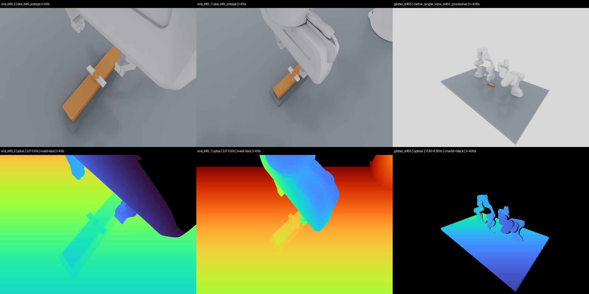

# RoboticCuttingSim

A physical cutting research environment with two Franka Panda arms: continuous soft material, a fixed tool and fixtures, persistent TLMPM material separation, two wrist-mounted D405 RGB-D prototypes, a fixed Global D455, and shared control and task-scoring APIs. The second Franka holds an observation posture; no model is trained in this phase. All repository documentation is in English.

**CUT-01 and TRIM-01 have each completed actual 400-step / 8-second runs in both Isaac Lab 3.0 GA and Isaac Sim 6.2, producing persistent material separation.** Actual Franka joint and end-effector control moves the tool; the measured blade drives the material, and material reaction feeds back to the arm. No particles are deleted and no bumps are presegmented.

| Fixed task | Actual physical result, one episode each in Lab and Sim | Independent task score |
| --- | --- | --- |
| CUT-01: completely sever a 160×30×20 mm bar | Continuous 144 g bar → two 72 g parts; cut-location error upper bound 1.5 mm | **PASS_TASK_METRICS** |
| TRIM-01: trim a continuous single-bump surface | Explicit 2 mm particle configuration; 1.608 g chip; 98.53% of initial bump material removed | Persistent separation passes; strict full-surface accuracy **FAIL_TASK_METRICS** |

Both fixed tasks preserve mass and particle count, with separation persisting for 2.4 seconds after withdrawal. The original 1 mm TRIM did not fully disconnect; its failure and the extended-path and second-cut failures are preserved. Material and fracture parameters are not calibrated against real samples, and resolution or coupling-energy convergence has not been established. Full-benchmark surface accuracy, coupling work, native-depth tails and camera reset still include FAIL results; completing an episode does not establish complete acceptance.

The current camera IDs are `wrist_d405_0`, `wrist_d405_1` and `global_d455`.
Both wrist cameras are actual `panda_hand` children, with measured hand poses
and fixed mounts checked every 20 ms. Both remain **`ideal_d405_prototype`**:
neither backend claims validated stereo, noise or hardware calibration.
Global references the official D455 asset and is now closer at
`(1.10, -1.20, 1.05)` m, observing the complete workstation. Its minimum native
valid-depth fraction improves from 6.32% to 15.83% in the preserved CUT comparison.
See [camera configuration](docs/WRIST_CAMERAS.md) and
[independent validation, including FAIL results](docs/WRIST_CAMERA_VALIDATION.md).



The new camera configuration has completed **four more full episodes**: both
tasks in both live runtimes, preserving their physical/task scores. Native
recordings below have 41 synchronized RGB-D frames and 401 measured poses per
episode. A separate actual second-arm motion probe shows 28.11 mm optical
movement with zero Global drift. All files are encoded from captured arrays.

| Current recording | Synchronized RGB / depth | Individual RGB-D videos | Measured transforms / provenance |
| --- | --- | --- | --- |
| CUT-01 | [Three views](docs/media/wrist_cut01/synchronized_multiview.mp4) | [Wrist 0 RGB](docs/media/wrist_cut01/wrist_d405_0.mp4) / [depth](docs/media/wrist_cut01/wrist_d405_0_depth.mp4); [Wrist 1 RGB](docs/media/wrist_cut01/wrist_d405_1.mp4) / [depth](docs/media/wrist_cut01/wrist_d405_1_depth.mp4); [Global RGB](docs/media/wrist_cut01/global_d455.mp4) / [depth](docs/media/wrist_cut01/global_d455_depth.mp4) | [Tracking](docs/media/wrist_cut01/camera_pose_tracking.png) / [full matrices](docs/media/wrist_cut01/camera_transforms.npz) / [source hashes](docs/media/wrist_cut01/provenance.json) |
| TRIM-01 | [Three views](docs/media/wrist_trim01/synchronized_multiview.mp4) | [Wrist 0 RGB](docs/media/wrist_trim01/wrist_d405_0.mp4) / [depth](docs/media/wrist_trim01/wrist_d405_0_depth.mp4); [Wrist 1 RGB](docs/media/wrist_trim01/wrist_d405_1.mp4) / [depth](docs/media/wrist_trim01/wrist_d405_1_depth.mp4); [Global RGB](docs/media/wrist_trim01/global_d455.mp4) / [depth](docs/media/wrist_trim01/global_d455_depth.mp4) | [Tracking](docs/media/wrist_trim01/camera_pose_tracking.png) / [full matrices](docs/media/wrist_trim01/camera_transforms.npz) / [source hashes](docs/media/wrist_trim01/provenance.json) |
| Actual secondary-arm motion probe, 2 s | [Three views](docs/media/wrist_motion_probe/synchronized_multiview.mp4) | [Wrist 1 RGB](docs/media/wrist_motion_probe/wrist_d405_1.mp4) / [depth](docs/media/wrist_motion_probe/wrist_d405_1_depth.mp4); 21 captures, no cutting-success claim | [Tracking](docs/media/wrist_motion_probe/camera_pose_tracking.png) / [full matrices](docs/media/wrist_motion_probe/camera_transforms.npz) / [source hashes](docs/media/wrist_motion_probe/provenance.json) |

During active TRIM cutting all three cameras see the knife. After withdrawal,
the secondary wrist's knife view is palm-occluded at 6.4–8.0 s, failing the
unchanged all-frame criterion. The visual mounting rod also intersects its own
adjacent wrist flange, failing the strict sampled clearance screen; housings
and other robot pairs are clear. Mount mass/contact dynamics remain unmodelled.
Native depth outliers, TRIM surface accuracy and coupling-work failures are
retained independently of usable camera views and physical separation.

## Preserved fixed-camera baseline

The videos below are encoded directly from **native camera arrays captured during live Isaac Sim execution**, with 41 frames per episode and accompanying source and SHA256 records. They are not USD replay.

| Task | Global | Dual RGB | Dual measured depth | Synchronized views / trajectory / provenance |
| --- | --- | --- | --- | --- |
| CUT-01 | [Video](docs/media/cut01/global.mp4) | [D455 0](docs/media/cut01/d455_0_rgb.mp4) / [D455 1](docs/media/cut01/d455_1_rgb.mp4) | [D455 0](docs/media/cut01/d455_0_depth.mp4) / [D455 1](docs/media/cut01/d455_1_depth.mp4) | [Synchronized](docs/media/cut01/synchronized_multiview.mp4) / [Commanded vs Actual](docs/media/cut01/trajectory.png) / [Provenance](docs/media/cut01/provenance.json) |
| TRIM-01 | [Video](docs/media/trim01/global.mp4) | [D455 0](docs/media/trim01/d455_0_rgb.mp4) / [D455 1](docs/media/trim01/d455_1_rgb.mp4) | [D455 0](docs/media/trim01/d455_0_depth.mp4) / [D455 1](docs/media/trim01/d455_1_depth.mp4) | [Synchronized](docs/media/trim01/synchronized_multiview.mp4) / [Commanded vs Actual](docs/media/trim01/trajectory.png) / [Provenance](docs/media/trim01/provenance.json) |

## Run both scenes

Use the isolated environments already installed locally and a fresh output directory; installation and versions are documented in [SETUP](docs/SETUP.md), [Isaac Lab](docs/ISAAC_LAB_INTEGRATION.md) and [Isaac Sim](docs/ISAAC_SIM_VALIDATION.md). These commands actually advance the robot and material, saving measured trajectories, physics traces, RGB-D, Global views and independent scores.

```bash
# Isaac Sim 6.2 / PhysX / native SingleView RGB-D
.deps/isaacsim-venv/bin/python scripts/run_isaac_sim_cutting.py \
  --task-id CUT-01 --steps 400 --gpu 1 --device cuda:1 \
  --camera-layout wrist_d405_global_d455 \
  --camera-mode native_single_view --output-dir artifacts/cut01_fresh

.deps/isaacsim-venv/bin/python scripts/run_isaac_sim_cutting.py \
  --task-id TRIM-01 --particle-spacing 0.002 --steps 400 --gpu 1 --device cuda:1 \
  --camera-layout wrist_d405_global_d455 \
  --camera-mode native_single_view --output-dir artifacts/trim01_fresh

# Run the same Task in Isaac Lab 3.0 / NewtonManager; Kit-less cameras use ideal Warp
.deps/isaaclab-venv/bin/python scripts/run_isaac_lab_cutting.py \
  --task-id TRIM-01 --particle-spacing 0.002 --steps 400 --reset-check \
  --camera-layout wrist_d405_global_d455 \
  --output-dir artifacts/lab_trim01_fresh

# Run fixed and randomized scenes for both tasks sequentially; no training
.venv/bin/python scripts/run_cutting_task_benchmark.py \
  --runtime isaac_sim --variants fixed randomized --seeds 42 --gpu 1 \
  --output-dir artifacts/task_matrix_fresh
```

CUT uses 1 mm particles, and physically separated TRIM uses explicit 2 mm initial sampling; both material grids are 4 mm. The original API/Task default remains 1 mm; specify `--particle-spacing 0.002` to reproduce separated TRIM. Final wrist-camera loop times are about 257 / 92 seconds for Sim CUT / TRIM and 433 / 187 seconds for Lab, excluding startup. These shared-machine measurements do not guarantee real-time performance. The recording launchers retain their legacy default; select the new layout explicitly as above. The shared API and benchmark launcher default to the new layout.

Randomization supports different lengths, local cut positions, static workpiece positions/yaw, and 1–3 continuous dome/Gaussian/ridge/irregular bumps. Native seed42 has been executed: CUT produces 66.6/59.4 g parts; TRIM's three bumps produce three chips and remove 96.28% of target material. This is a single-seed engineering validation, not a randomized-task success rate. See [Task benchmark](docs/CUTTING_BENCHMARK.md) and [randomization settings](docs/TASK_RANDOMIZATION.md).

## Shared research API

Both tasks share `reset()`, `step(action)`, `observe()`, `render()`, `close()` and `evaluate()`, supporting Cartesian blade-edge poses and joint-position actions. Official observations contain dual wrist RGB-D, calibration, timestamps and optional robot proprioception. Global RGB-D is an explicit `include_global_camera=True` option; force and material oracle stay outside observations.

```python
from robotic_cutting_sim.live_env import open_cutting_env

# Use the selected runtime's Python; full settings are in SHARED_TASK_API.md
with open_cutting_env("TRIM-01", runtime="isaac_sim",
                      particle_spacing_m=0.002,
                      include_global_camera=False,
                      output_dir="artifacts/my_trim_api") as env:
    obs, info = env.reset(seed=42)
    for _ in range(400):
        obs, reward, terminated, truncated, info = env.step()  # scripted reference
    result = env.evaluate()  # Independent scoring; complete surface criteria may still FAIL
```

Object, Material, Fixture, Robot, Camera, Physics and Task Goal are separate; targets are defined in the workpiece-local frame. Future RL/IL/VLA/Agent work can use the corresponding control and scoring adapters with the existing cutting physics. Dynamic object holding, arbitrary new cut planes and coordinated dual-arm operation still require extensions.

Details: [shared API](docs/SHARED_TASK_API.md), [task definitions and success criteria](docs/CUTTING_TASKS.md), [actual episodes and negative results](docs/reports/CUTTING_TASK_EPISODES.md), [camera validation](docs/TASK_CAMERA_VALIDATION.md), [surface representation errors](docs/REPRESENTED_TARGET_VALIDATION.md), and [full progress](docs/PROGRESS.md).

## Regression checks and existing baselines

```bash
.venv/bin/python -m pytest -q
```

CPU CI includes pinned Warp for its CPU-only reference-ray kernels; neither
Isaac nor a GPU is required. A clean isolated environment with GPUs hidden
also passes all 235 tests. The initial missing-Warp CI collection failure and
dependency correction are retained in [the CI receipt](docs/evidence/wrist_ci_validation.json).

235 CPU tests pass, counted separately from actual GPU/Isaac episodes. Fixed-seed D0–D3 specimen-sampling hashes remain unchanged; an actual 5-step Lab D0 physics-prefix regression also completed, without claiming a full rerun. All historical standalone, D0–D3, Newton implicit MPM and CRESSim evidence is preserved; see the [original benchmark](docs/BENCHMARK_REPORT.md), [TLMPM validation](docs/reports/TLMPM_VALIDATION.md), [D0 live acceptance](docs/reports/ISAAC_LIVE_ACCEPTANCE.md) and [D0 video](docs/media/live_isaac_kit_d0/synchronized_multiview.mp4). Large raw data and official assets remain in local ignored caches.
