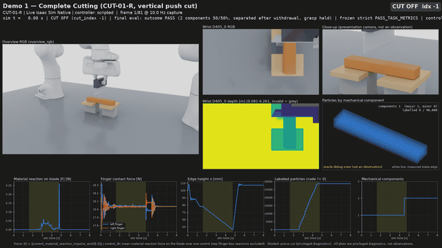
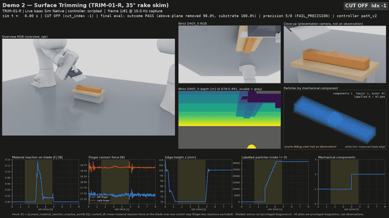
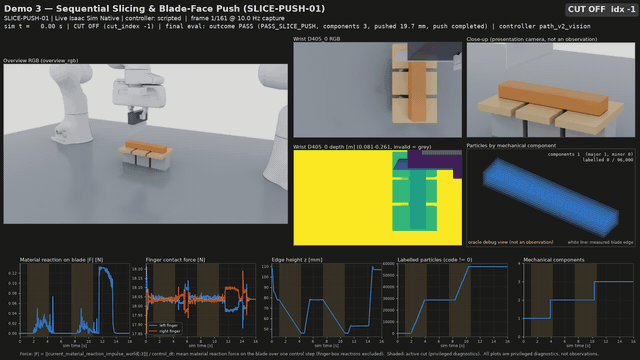
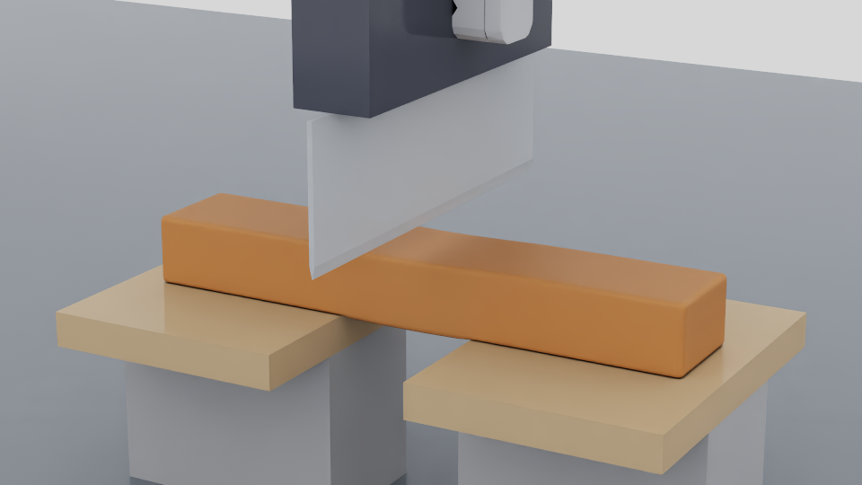
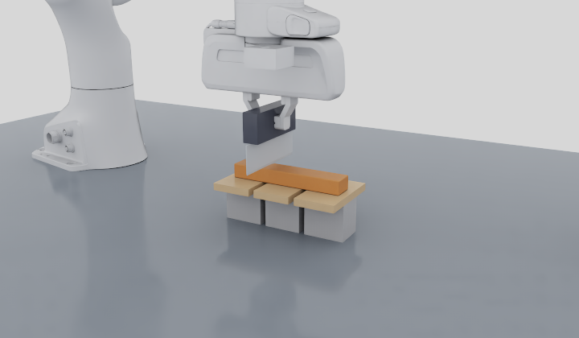
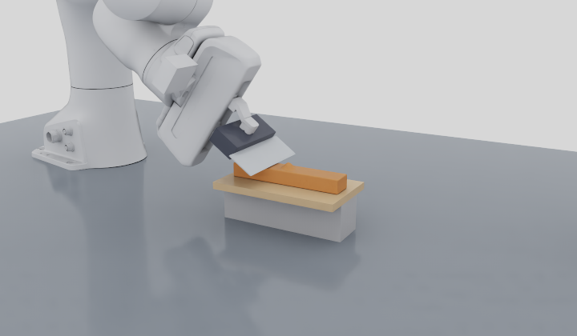

# RoboticCuttingSim

A robotic cutting research environment for **Isaac Sim 6.2 / Isaac Lab 3.0**.
It has two Franka Pandas. One holds a ruler knife in a physical two-finger
grasp; the other stays parked. The workpiece is a continuous soft material
that the knife separates permanently, using total-Lagrangian MPM (TLMPM) with
persistent side labels in the style of
[BladeMaster](https://arxiv.org/abs/2609.27342). Wrist D405 and Global D455
RGB-D cameras provide the observations. No policy is trained.

## Three BladeMaster-style demos (live Native Isaac Sim)

All four episodes below are **live Native Isaac Sim** (PhysX/Kit/RTX) runs in
the same workcell, `blademaster_workcell_v1`:

- Franka 0 holds `ruler_knife_v1` in a physical two-finger grasp.
- The cutting board has real colliders and friction.
- Cameras: wrist D405 rig v5 and the Global D455.
- Material: cutting law 8 at 1 mm particles, 0.1 ms and a 4 mm grid; seed 42.
  The 1 mm acceptance matrix passed every row before these runs, negative
  controls included, under criteria declared in advance. M8a, a diagnostic
  row, fails. M2 passes only under ADR 0006 Amendment 1 (it fails the
  original 2 mm limit). The Lab replays M9c/d are report-only. A clean-tree
  confirmation of four rows finished while the live set was running.
- Control: scripted waypoint controllers.

Videos are rendered from the recorded episode: presentation overview and
close-up, wrist D405 RGB-D, a particle view coloured by mechanical component
(an oracle debug view, not an observation) and force/height/label
diagnostics. Images are captured at 10 Hz; actions and robot state are
recorded at 50 Hz. The GIFs play at 2× speed; the MP4s play in real time at
the capture rate.
[Full report](docs/reports/BLADEMASTER_DEMOS.md) ·
[all attempts, including failures](docs/evidence/phase3/demos_live_004.json).

### Demo 1 — complete cutting



**PASS.** The knife cuts the 160×30×20 mm bar into two 50/50% parts, which
stay separated after the knife is withdrawn. The frozen strict task score also
passes (cut location 1.5 mm, limit 2 mm).
Episode `live_20261029_law8_final/demo1a`, controller `path_v2` ·
[MP4](docs/media/demos/demo1a/live_20261029_law8_final_demo1a.mp4) ·
[provenance](docs/media/demos/demo1a/live_20261029_law8_final_demo1a.json).

The 20° oblique variant also **passes**. Separation is scored against the
actual swept plane: 4.78 mm, against an allowed ideal 4.44 + 1 mm. Its frozen
strict score fails two checks:
- **Location:** the vertical-plane check does not apply to a tilted cut.
- **Post-cut persistence window:** with the slower `path_v2` approach the cut
  completes at about 5.7 s, after the frozen v1 window ends at 5.6 s. Nothing
  reconnects, and separation lasts 1.8 s after withdrawal.
[GIF](docs/media/demos/demo1b/live_20261029_law8_final_demo1b.gif) ·
[MP4](docs/media/demos/demo1b/live_20261029_law8_final_demo1b.mp4).

### Demo 2 — surface trimming



**PASS (separation).** A 35° rake skim detaches 98.0% of the bump as a chip.
The substrate remains one intact body, and the measured edge stays within
0.026 mm of the target height. The separately reported precision score is
5/8 (**FAIL**): p95 surface error 0.58 mm against 0.5 mm, overcut 1.66%, and
the conservative gouge rule.
Episode `live_20261029_law8_final/demo2` ·
[MP4](docs/media/demos/demo2/live_20261029_law8_final_demo2.mp4) ·
[provenance](docs/media/demos/demo2/live_20261029_law8_final_demo2.json).

### Demo 3 — sequential slicing and manipulation



**PASS**, including the frozen SLICE-PUSH-01 report. Two cuts (`cut_index` 0
and 1) produce three independent parts (37.5/31.25/31.25%), each within one
particle layer of its declared plane. The blunt blade face, with cutting
disabled, then pushes one part 19.7 mm by real contact. The other parts do not
move, no labels are added and nothing reconnects. Between the cuts the
controller measures the bar's 1.20 mm shift from rendered wrist D405 depth,
robot kinematics and the simulator knife pose
([ADR 0009](docs/adr/0009-demo3-wrist-depth-retarget.md)). The rendered surface
is rebuilt per mechanical part; this does not affect the measured +x end face.
Episode `live_20261029_law8_final/demo3`, controller `path_v2_vision` ·
[MP4](docs/media/demos/demo3/live_20261029_law8_final_demo3.mp4) ·
[provenance](docs/media/demos/demo3/live_20261029_law8_final_demo3.json).

### The new workcell

| Demo 1 (CUT-01-R) close-up | Demo 3 (SLICE-PUSH-01) board | Demo 2 (TRIM-01-R) 35° rake |
| --- | --- | --- |
|  |  |  |

These are actual Native frames from the Phase 2 smokes
([evidence](docs/evidence/phase2/native_smokes_001.json)). The close-up is
from the 30-step smoke `artifacts/wp10_claude/phase2/s4_closeup_cut01r_30_001`. The wooden boards,
risers and relief slots are the same boxes used as PhysX colliders (friction
0.3) and as TLMPM fixtures.

### Cutting physics

Cutting law 8 builds on law 4 and law 5. It follows BladeMaster Section
III-C:

- **Cutting progress** only resists the knife.
- **Persistent side codes** are assigned only during a blade stroke that is
  actually cutting, within the finite band swept behind the moving edge.
- **Plowing strokes** are the exception: a raked edge moving at least 15° out
  of its plane, as in the TRIM skim. There, material up to 8 mm ahead of the
  edge and more than one grid cell off the swept surface is labelled early,
  so a carried chip cannot stay attached.
- **Side pushes, flat presses, stopping, withdrawal, uncontacted edges and the
  blunt handle** never cut.

The 1 mm acceptance matrix (vertical and 20° cuts, TRIM at 25°/35° and on the
board, partial cut, side push, flat press, stop and withdrawal, persistence,
two sequential cuts, Native measured-trajectory replays) passes **M1–M9**
under computed criteria. Those criteria were declared before the law-8 runs
([matrix](docs/evidence/phase1/matrix_law8_002.json)). Three caveats:

- The M8a diagnostic fails.
- M2 passes only under Amendment 1; it fails the original 2 mm limit.
- The Lab replays M9c/d are report-only (Lab cut location 4 mm, FAIL).

Earlier laws and their failures are preserved:

| Law | ADR | Failure |
| --- | --- | --- |
| 4 | [0006](docs/adr/0006-swept-band-cutting-law-4.md) | TRIM 0% removed |
| 5 | [0008](docs/adr/0008-cutting-law-5-lead-preassignment.md) | Second-cut location in the two-cut row |
| 6 | [0010](docs/adr/0010-cutting-law-6-deferred-lead-commit.md) | TRIM at 35° |
| 7 | [0011](docs/adr/0011-cutting-law-7-eq8-coupled-flip.md) | Several rows |

Law 8 is validated only for in-plane cuts and 25°/35° constant-rake skims.
Material parameters are provisional and uncalibrated.

### Reproduce the demos

```bash
# Final set: Demo 1a/1b/2 with path_v2 and Demo 3 with path_v2_vision, law 8, seed 42
.venv/bin/python scripts/run_blademaster_demos.py --demo-set final_v4 --gpu 1 --run-id NEW_ID
```

Each run writes the episode, `demo_summary.json` (execution, outcome and
quality kept separate) and rendered media under `artifacts/wp10_claude/demos/`.
It never overwrites an earlier run. Add `--publish` to copy the media into
`docs/media/demos/`.

Earlier runs are preserved and documented:

- **Law 5 runs.** They were made before the matrix gate was met. All four
  pass, and their media remain under `docs/media/demos/`.
- **First-round v1-controller failures.** Demo 2 removed only 64%. Demo 3's
  second cut landed 2.0000000670 mm from its declared plane, over the 2 mm
  bound.

## Quick start

Use an Ubuntu + NVIDIA RTX host with a compatible existing driver.
Bootstrap creates isolated project environments and does not change the driver.

```bash
git clone https://github.com/AnsonNing/RoboticCuttingSim.git
cd RoboticCuttingSim
bash scripts/bootstrap.sh --runtime all --managed-python --accept-eula

# Actual two-step CUT/TRIM smokes in both runtimes; this is not full cutting validation.
.venv/bin/python scripts/run_deployment_validation.py --tier smoke --runtime both \
  --gpu auto --tool-attachment-mode physical_grasp --grip-initial-position 0.0112 \
  --lab-grip-contact-profile finite_pad_patch_v3 --output-dir artifacts/smoke_NEW
```

For full episodes, GPU selection and installation details, see
[run instructions](docs/PHYSICAL_TOOL.md#reproduce) and
[portable deployment](docs/PORTABLE_DEPLOYMENT.md).

## Use the environment

Both tasks expose `reset()`, `step(action)`, `observe()`, `render()`, `evaluate()`
and `close()`. Joint and Cartesian actions share the same underlying scene.
Policy observations use RGB-D and robot proprioception; force and oracle state
stay in separate debug/evaluation data. See the [shared API](docs/SHARED_TASK_API.md).

The optional [remote viewer](docs/REMOTE_INTERACTIVE_VIEWER.md) provides the
same live simulation's GUI, task selection, gripper controls and camera views.
On the original host, open [the Tailscale viewer](http://100.111.162.17:8210)
while its server is running.

## Documentation

Start with the [documentation index](docs/README.md) for setup, physics,
validation and preserved experiments. [Progress and known issues](docs/PROGRESS.md)
record PASS / FAIL / BLOCKED / NOT_RUN separately.

Run CPU regression checks with `.venv/bin/python -m pytest -q`.
Actual GPU/runtime and physics acceptance are tested separately.
