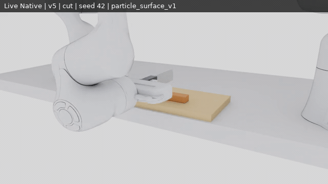
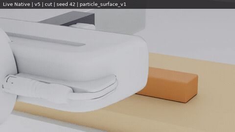
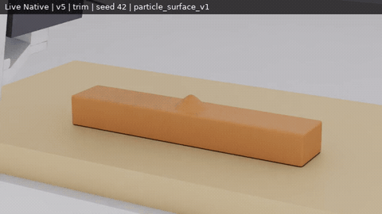
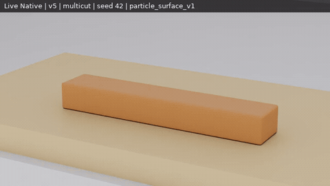
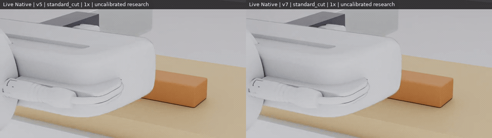
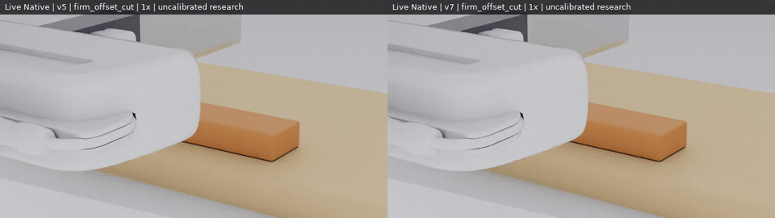
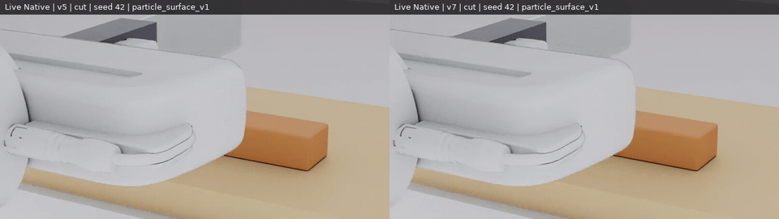

# RoboticCuttingSim

A configurable robotic cutting research environment with live **Native Isaac Sim 6.2**,
two Franka Pandas and an end-held blade in a physical two-finger grasp. One continuous
specimen is cut using **TLMPM v5 / Law 8**, with persistent side labels, multiple cuts
and RGB-D observations. Scene, goal, controller and evaluation have separate APIs.
Material parameters are provisional and uncalibrated; Isaac Lab parity is unverified.

[](docs/media/wp13/v5_cut_native.mp4)

**Live Native recording, seed 42, default v5 and `particle_surface_v1`, 1× preview.**
Click any animation for its full MP4. The `blade_master_flat_board_v1` workcell has
one wooden board directly on the table. Franka 1 stays at its normal safe park;
both wrist D405s use fixed, hand-aligned v5 mounts, with a Global D455 RGB-D view.
[Workcell geometry and cameras](docs/reports/WP12_WORKCELL.md).

## Native cutting gallery

These are six fresh WP-13 episodes: CUT, TRIM and four slices, each paired v5/v7,
**6/6 TASK_SUCCESS and 6/6 HOME PASS**. All use 1 mm particles, 4 mm grid and
0.1 ms substeps. These selected demonstrations do not establish generalization.
The following three previews show the supported v5 baseline, seed 42,
`particle_surface_v1`. Presentation cameras are separate from policy observations.

| Straight CUT · 1× | TRIM at rake 10° · 1× | Four slices · 3× preview |
| --- | --- | --- |
| [](docs/media/wp13/v5_cut_native.mp4) | [](docs/media/wp13/v5_trim_native.mp4) | [](docs/media/wp13/v5_multicut_native.mp4) |
| Two pieces | 97.51% above-plane dome mass detached | Five pieces; placement quality reported separately |

[Recording provenance and exact capture timestamps](docs/evidence/wp13/media_001.json) ·
[WP-13 measurements and limitations](docs/reports/WP13_RESULTS.md) ·
[earlier WP-12 demonstrations](docs/reports/WP12_FINAL_VALIDATION.md).
Full clips retain every captured RGB frame at the nominal 5 fps cadence;
previews use labelled crops and speeds.

## CUT research profile (WP-14)

**`v7_cut_research_v1` is a scoped Validated Research Profile using original
`tlmpm_v7`. v5 / Law 8 remains the default.** Four matched kinematic CUT instances
improve near-cut x/F P95 by **5.60–8.49×** and local physical-locus roughness by
**78.0–86.1%**. Two predeclared Native pairs complete **4/4 tasks and 4/4 HOME**.

[](docs/media/wp14/scene_walkthrough_native.mp4)

**Updated executable scene and real full recording, 1×.**
[Launch the standard or firm-offset CUT scene](docs/WP14_SCENES.md) ·
[actual scene overview](docs/media/wp14/scene_overview.png) ·
[scene/video provenance](docs/evidence/wp14/scene_refresh_001.json).
This extra engineering replay does not add an independent adoption sample.

[](docs/media/wp14/standard_cut_v5_v7_comparison.mp4)

**v5 left / v7 CUT profile right, 1× simulation time.** These are genuine Native
RGB captures with identical timestamps and the same declared scene/controller;
measured-feedback commands differ slightly under coupled dynamics. Individual
full recordings: [v5 standard](docs/media/wp14/v5_standard_cut_native.mp4),
[v7 standard](docs/media/wp14/v7_standard_cut_native.mp4).

[](docs/media/wp14/firm_offset_cut_v5_v7_comparison.mp4)

**Firm material, yaw −5°, cut at −4 mm**, 1×. Full recordings:
[v5](docs/media/wp14/v5_firm_offset_cut_native.mp4),
[v7](docs/media/wp14/v7_firm_offset_cut_native.mp4).
[Frame timestamps/source hashes](docs/evidence/wp14/media_001.json) ·
[Native tracking, physical contacts and HOME](docs/evidence/wp14/native_001.json).

| Selection / family | Supported scope |
| --- | --- |
| Default v5 + Law 8 | Existing baseline, unchanged |
| `v7_cut_research_v1` / Straight CUT | Four validated instances; constrained reference/firm bar configuration |
| Partial / Multi-cut | Experimental; distinct-depth ligament and one four-slice pattern pass |
| TRIM | Unsupported by the CUT profile; v7 and finite v7_1 primary failures retained |
| Reverse / oblique | New adoption NOT_RUN; earlier slotted-board evidence retained |

The original held-out task denominator is **2/4 per solver**, although all four
cases truly sever into two parts. The ±6 mm cases fail the unchanged 2 mm
reference-midpoint gate (even ideal geometric labels score 2.5 mm). The wider
proposal is rejected. Final use is restricted after those failures to +x blade
direction, ±5° yaw, -4/0/+4 mm cut positions and 8 mm bar-length increments,
within the declared 1 mm particle / 4 mm grid / 0.1 ms configuration. These
finite results do not validate all combinations or a random success rate.
TRIM failure does not veto proven CUT; surface appearance does not certify it.

```python
from robotic_cutting_sim.research_profiles import compile_research_task

task = compile_research_task(
    "v7_cut_research_v1", "configs/wp12/scenes/bar_flat_board.json", "sever_mid")
# Explicit original v7, recorded path_v2 controller, 14 s completion window.
```

Configuration selection checks and records the solver/front/contact sources,
material, scene and numerical scope; incompatible overrides raise. New policy
actions require separate evaluation. `tlmpm_v7_1` stays Experimental and is not
selected by this profile. Its post-study pending-event lifecycle correction is CPU-verified only;
GPU outcomes are not reassigned to it. Materials are uncalibrated; forces are not converged.
[Results, all failures and exact commands](docs/reports/WP14_RESULTS.md) ·
[Profile configuration](configs/wp14/v7_cut_research_v1.json).

## Experimental integrated solver: rejection retained

**Historical WP-13 full/default promotion decision, preserved below.** The
WP-14 CUT-only qualification above does not rewrite those recorded outcomes.

**v7 is opt-in and REJECTED FOR PROMOTION. v5 remains the default.**
Its shared MUSL position/F update, velocity-level contact and finite causal front
improve the standard kinematic CUT's near-plane consistency P95 by 6.06× and local
physical-locus roughness by 85.96%. However, the primary kinematic TRIM stays
connected, and a held-out shorter/firmer CUT also fails. Improved surfaces cannot
substitute for chip detachment. Contact forces remain unconverged and materials
uncalibrated. [Decision, paired outcomes and failures](docs/reports/WP13_RESULTS.md).

[](docs/media/wp13/cut_v5_v7_native_comparison.mp4)

**Matched Native CUT, v5 left / v7 right**, seed 42, identical captured times,
`particle_surface_v1`, 1×. This local improvement is real; it does not overturn
the kinematic TRIM failure. Native v7 TRIM itself passes (100% above-plane mass
removed). The kinematic driver dropped compiled planner overrides, including
action limits and one partial-depth change; its paired measurements describe
the recorded legacy paths. Cross-runtime differences remain unresolved.
Candidate full recordings: [CUT](docs/media/wp13/v7_cut_native.mp4),
[TRIM](docs/media/wp13/v7_trim_native.mp4),
[four slices](docs/media/wp13/v7_multicut_native.mp4).

Both surface profiles are one-way render geometry, separate from collision.
Unchanged `particle_surface_v1` and opt-in `cut_aware_surface_v1` were measured on
saved states; no plane smoothing, particle removal or visual tear splitting was
adopted. The historical WP-12 cut-aware surface gate remains FAIL.
[Original surface decision](docs/reports/WP12_PHASE3_XHIGH_DECISION.md).

## Quick start

Use Python 3.12 and the pinned, separate base/Native environments.
[Setup and hardware requirements](docs/SETUP.md) · [compatibility](docs/COMPATIBILITY.md).
The bootstrap installs project-local dependencies; it does not upgrade drivers.

```bash
bash scripts/bootstrap.sh --runtime base --managed-python
bash scripts/bootstrap.sh --runtime isaac_sim --managed-python --accept-eula
export PYTHONPATH="$PWD/src${PYTHONPATH:+:$PYTHONPATH}"
export TMPDIR="${TMPDIR:-/tmp}"

# CPU-only: compile the exact WP-12 straight-cut scene and live goal.
.venv/bin/python scripts/run_wp12_workcell_live.py prepare \
  --episode CUT --out artifacts/wp12/my_cut_inputs

# Native episode, using the existing physical-grasp runner (default GPU 0).
# Choose fresh output paths and run only when that GPU is available.
.venv/bin/python scripts/run_wp12_workcell_live.py launch \
  --episode CUT --out artifacts/wp12/my_native_cut
```

The Native runner checks the motion plan before launching, records RGB-D and
oracle data separately, and reports task and HOME outcomes separately. Output
directories are never overwritten. The prepare command is a configuration check;
it does not establish cutting success.

The same scene/goal configuration is available through the Python API:

```python
from robotic_cutting_sim.scene_config import compile_task
from robotic_cutting_sim.live_env import open_cutting_env

task = compile_task("configs/wp12/scenes/bar_flat_board.json", "sever_mid", seed=42)
# CPU-only configuration inspection:
print(task.task_id, task.solver_module, task.max_cuts)

# For interactive control, open the task in Native Isaac Sim:
# with open_cutting_env(runtime="isaac_sim", task=task,
#                       preset="cutting_research_v1",
#                       output_dir="artifacts/wp12/my_api_run", seed=42) as env:
#     obs, info = env.reset(seed=42)
#     obs, reward, terminated, truncated, info = env.step(action)
```

[Environment API and actions](docs/POLICY_READY_API.md) ·
[scene/goal/controller separation](docs/adr/0015-scene-goal-controller-evaluation-separation.md) ·
[task switching and observation isolation](docs/reports/WP12_AGENTIC_READINESS.md).
Deployable observations exclude contact force, particles and material cut codes.
The kinematic runtime has ideal tracking and no cameras; it is a physics diagnostic.

## Supported scope and retained WP-12 limits

| Capability | Evidence / boundary |
| --- | --- |
| Solid-board vertical sever, TRIM, multiple slices and mixed operations | [WP-12 Native Demos 1–6](docs/reports/WP12_FINAL_VALIDATION.md); open-loop bar sliding can move later cuts off their declared planes |
| Oblique cutting | The WP-12 20° Native demo uses an explicit slotted board; arbitrary solid-board tilt is unsupported |
| Generalization | 170 saved kinematic runs; feasible ID_validated **47/61 = 77%**, Wilson 95% [65%, 86%]; original ≥90% target **NOT MET** |
| Multi-slice family D | 0/20 benchmark successes; later cut locations fail after material slides; frozen failures retained |
| Surface quality | PARTIAL; cut-aware gate FAIL, trim spikes and thin-chip tears remain |
| Contact forces / materials | Force **NOT CONVERGED** with timestep/resolution; material uncalibrated |
| Repeatability / memory | GPU debris counts vary; Demo 5 A/B has 5 vs 9 components, cause OPEN; kinematic host-memory gate FAIL |

[Generalization and Native sample coverage](docs/reports/WP12_GENERALIZATION.md) ·
[physics envelope](docs/reports/WP12_CUTTING_PHYSICS.md) ·
[resolution study](docs/reports/WP12_RESOLUTION_STUDY.md).

## Documentation and tests

- [Documentation index and repository map](docs/README.md)
- [WP-12 final validation and acceptance matrix](docs/reports/WP12_FINAL_VALIDATION.md)
- [Current progress and preserved failures](docs/PROGRESS.md)
- [WP-11 history](docs/WP11_PLAN.md) · [frozen BladeMaster demonstrations](docs/reports/BLADEMASTER_DEMOS.md)
- [Contributing](CONTRIBUTING.md) · [asset sources](assets/ASSET_SOURCES.md)

```bash
# CPU tests; genuine local-artifact checks may explicitly skip on a fresh checkout.
.venv/bin/python -m pytest -q -rsx
```

GPU probes run separately. A skipped check is NOT_RUN; successful execution is
separate from task success, physical fidelity and real-material calibration.
