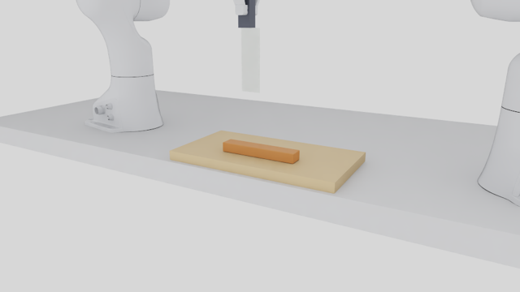
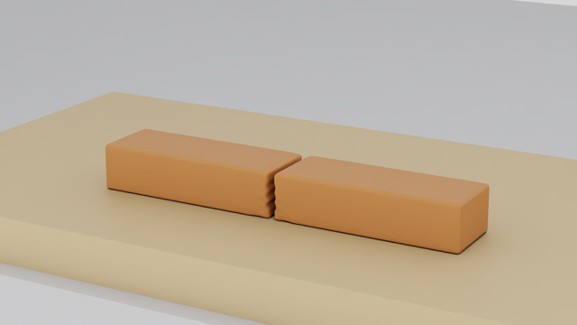
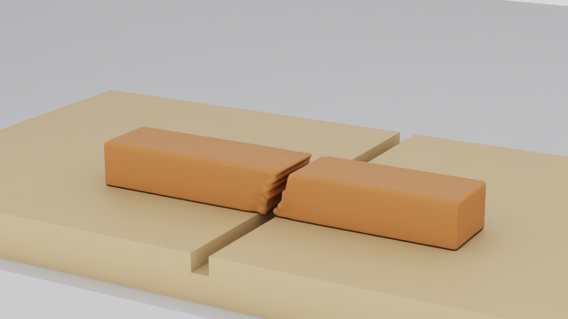
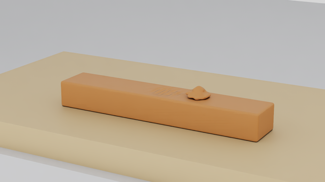
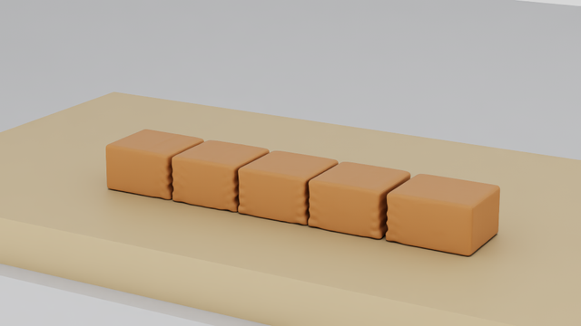
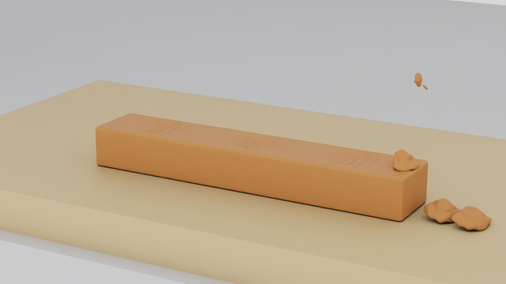
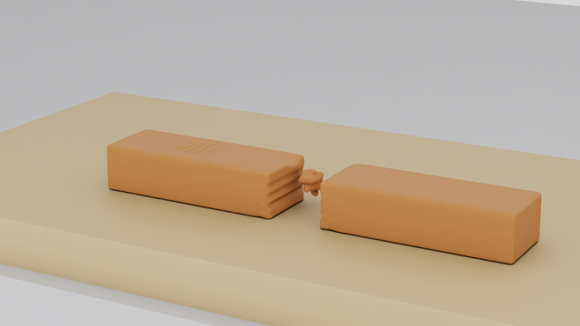

# RoboticCuttingSim

A configurable robotic cutting research environment with live **Native Isaac Sim 6.2**,
two Franka Pandas and an end-held blade in a physical two-finger grasp. One continuous
specimen is cut using **TLMPM v5 / law 8**, with persistent side labels, multiple cuts
and RGB-D observations. Scene, goal, controller and evaluation have separate APIs.
Material parameters are provisional and uncalibrated; Isaac Lab parity is unverified.



**WP-12 workcell: `blade_master_flat_board_v1`.** One wooden board directly on the table,
without risers. Franka 1 stays at its normal safe park. Both wrist D405s use the fixed,
hand-aligned v5 mount; the Global D455 provides an additional RGB-D view.
The image is a recorded Native presentation frame; presentation cameras are separate
from policy observations. [Workcell validation](docs/reports/WP12_WORKCELL.md).

## Latest Native demonstrations

All six configurations were recorded in live Native Isaac Sim, at seed 42 and
1 mm particles / 4 mm grid / 0.1 ms. Both surface profiles completed their declared
tasks and returned HOME: **12/12 TASK_SUCCESS**. This is a scoped demonstration result,
separate from generalization and numerical convergence.
[Results, commands and limitations](docs/reports/WP12_FINAL_VALIDATION.md) ·
[original evidence](docs/evidence/wp12/phase7_demos_001.json).

| Task | Recorded final frame, default ParticleSurface |
| --- | --- |
| Straight CUT: two equal pieces · [Native video](docs/media/wp12/demos/demo1_clean_cut/particle_surface_v1/demo.mp4) |  |
| Oblique 20°: **explicit slotted board**, 8 mm groove |  |
| TRIM at rake 10°: 97.9% dome removal · [Native video](docs/media/wp12/demos/demo3_trim_rho10/particle_surface_v1/demo.mp4) |  |
| Four slices: five pieces · [Native video](docs/media/wp12/demos/demo4_four_slices/particle_surface_v1/demo.mp4) |  |
| Three bumps: sequential removal |  |
| CUT → push → TRIM: trim on the stationary piece |  |

Videos combine recorded Native camera frames with labelled oracle diagnostics;
the particle/force debug panels are excluded from policy observations.
[Video provenance](docs/evidence/wp12/finalize_media_publication_001.json).
Demo 7 uses a separate outcome-blind held-out selection; its status and scope are in
the [generalization report](docs/reports/WP12_GENERALIZATION.md).

## Cut-surface comparison

Left: default `particle_surface_v1`. Right: opt-in `cut_aware_surface_v1`.
Both are render geometry; the reconstructed mesh is not the collider.

| Straight CUT | TRIM, including the cut-aware spikes |
| --- | --- |
|  |  |

Cut-aware v1 covers more of the recorded cut locus, including thin/partial faces,
with fewer triangles. It also folds and spans tears where the solver's particle
positions disagree with its deformation gradient. **Surface: PARTIAL; Phase 3 gates
FAIL under both frozen protocols.** ParticleSurface stays the default.
[Decision and measured boundaries](docs/reports/WP12_PHASE3_XHIGH_DECISION.md) ·
[reconstruction versus actual particles](docs/media/wp12/demos/demo3_trim_rho10/reconstruction_vs_particles.png).

## Quick start

Use Python 3.12 and the pinned, separate base/Native environments.
[Setup and hardware requirements](docs/SETUP.md) · [compatibility](docs/COMPATIBILITY.md).
The bootstrap installs project-local dependencies; it does not upgrade drivers.

```bash
bash scripts/bootstrap.sh --runtime base --managed-python
bash scripts/bootstrap.sh --runtime isaac_sim --managed-python --accept-eula
export PYTHONPATH="$PWD/src${PYTHONPATH:+:$PYTHONPATH}"

# CPU-only: compile the exact WP-12 straight-cut scene and live goal.
.venv/bin/python scripts/run_wp12_workcell_live.py prepare \
  --episode CUT --out artifacts/wp12/my_cut_inputs

# Native episode, using the existing physical-grasp runner (default GPU 0).
# Choose fresh output paths and run only when that GPU is available.
.venv/bin/python scripts/run_wp12_workcell_live.py launch \
  --episode CUT --out artifacts/wp12/my_native_cut
```

The Native runner checks the motion plan before launching, records RGB-D and
oracle data separately, and reports task and HOME outcomes separately. Output
directories are never overwritten. The prepare command is a configuration check;
it does not establish cutting success.

The same scene/goal configuration is available through the Python API:

```python
from robotic_cutting_sim.scene_config import compile_task
from robotic_cutting_sim.live_env import open_cutting_env

task = compile_task("configs/wp12/scenes/bar_flat_board.json", "sever_mid", seed=42)
# CPU-only configuration inspection:
print(task.task_id, task.solver_module, task.max_cuts)

# For interactive control, open the task in Native Isaac Sim:
# with open_cutting_env(runtime="isaac_sim", task=task,
#                       preset="cutting_research_v1",
#                       output_dir="artifacts/wp12/my_api_run", seed=42) as env:
#     obs, info = env.reset(seed=42)
#     obs, reward, terminated, truncated, info = env.step(action)
```

[Environment API and actions](docs/POLICY_READY_API.md) ·
[scene/goal/controller separation](docs/adr/0015-scene-goal-controller-evaluation-separation.md) ·
[task switching and observation isolation](docs/reports/WP12_AGENTIC_READINESS.md).
Deployable observations exclude contact force, particles and material cut codes.
The kinematic runtime has ideal tracking and no cameras; it is a physics diagnostic.

## Supported scope and open limits

| Capability | Evidence / boundary |
| --- | --- |
| Solid-board vertical sever, TRIM, multiple slices and mixed operations | Native Demos 1–6 above; open-loop bar sliding can move later cuts off their declared planes |
| Oblique cutting | The 20° Native demo uses an explicit slotted board; arbitrary solid-board tilt is unsupported |
| Generalization | 170 saved kinematic runs; feasible ID_validated **47/61 = 77%**, Wilson 95% [65%, 86%]; original ≥90% target **NOT MET** |
| Multi-slice family D | 0/20 benchmark successes; later cut locations fail after material slides; frozen failures retained |
| Surface quality | PARTIAL; cut-aware gate FAIL, trim spikes and thin-chip tears remain |
| Contact forces / materials | Force **NOT CONVERGED** with timestep/resolution; material uncalibrated |
| Repeatability / memory | GPU debris counts vary; Demo 5 A/B has 5 vs 9 components, cause OPEN; kinematic host-memory gate FAIL |

[Generalization and Native sample coverage](docs/reports/WP12_GENERALIZATION.md) ·
[physics envelope](docs/reports/WP12_CUTTING_PHYSICS.md) ·
[resolution study](docs/reports/WP12_RESOLUTION_STUDY.md).

## Documentation and tests

- [Documentation index and repository map](docs/README.md)
- [WP-12 final validation and acceptance matrix](docs/reports/WP12_FINAL_VALIDATION.md)
- [Current progress and preserved failures](docs/PROGRESS.md)
- [WP-11 history](docs/WP11_PLAN.md) · [frozen BladeMaster demonstrations](docs/reports/BLADEMASTER_DEMOS.md)
- [Contributing](CONTRIBUTING.md) · [asset sources](assets/ASSET_SOURCES.md)

```bash
# CPU tests; genuine local-artifact checks may explicitly skip on a fresh checkout.
.venv/bin/python -m pytest -q -rsx
```

GPU probes run separately. A skipped check is NOT_RUN; successful execution is
separate from task success, physical fidelity and real-material calibration.
