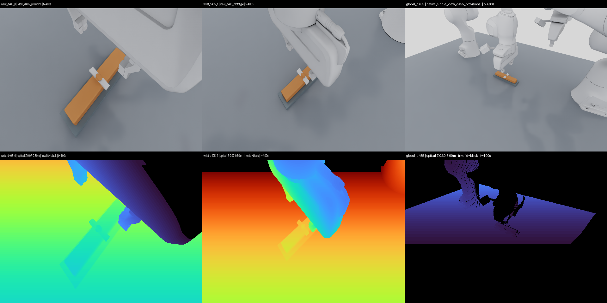
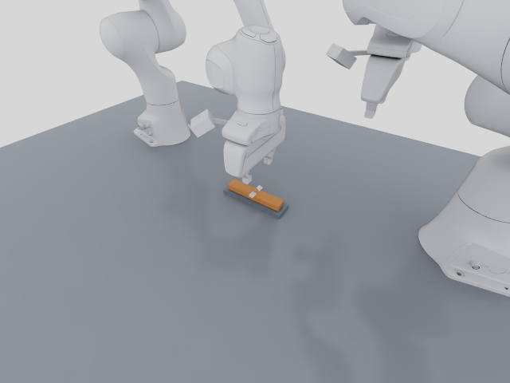

# RoboticCuttingSim

A physics-based cutting research environment with two Franka Panda arms, a rigid knife attached to the active arm, continuous Plasticine-like material, persistent TLMPM separation, two hand-mounted D405 RGB-D prototypes and a fixed Global D455. Both tasks share control, observations and independent evaluation. No policy is trained.

**Latest scene: both Wrist D405 cameras are attached to the actual articulated hands; Global D455 is now a close view of the material and cutting region.**



Global's optical centre is now **(0.28, -0.42, 0.46) m**, aimed at **(0, 0, 0.02) m**, about **0.67 m from the target**. It intentionally crops the wider workstation. Actual native recordings show **8.13× / 8.92× more minimum visible material pixels** for CUT / TRIM than the previous workcell overview. The old overview and fixed-camera recordings remain unchanged below.

The camera IDs are `wrist_d405_0`, `wrist_d405_1` and `global_d455`. Wrist mounts use fixed hand-to-camera transforms and measured articulation state checked every 20 ms. Both D405 streams remain **`ideal_d405_prototype`**; stereo, noise and hardware calibration are unvalidated. Global uses the official D455 asset and native SingleView pipeline in Sim, and ideal Warp RGB-D in kit-less Lab.

## Latest captured videos

These videos contain actual RGB-D captured during live Isaac Sim execution, with 41 synchronized captures and 401 measured poses per full episode. They are encoded from recorded arrays, not USD replay. The second arm holds an observation posture during cutting; its camera stays still because that arm stays still.

| Task | Close Global RGB / depth | Wrist D405 0 RGB / depth | Wrist D405 1 RGB / depth | Synchronized views / measured transforms / provenance |
| --- | --- | --- | --- | --- |
| CUT-01 | [RGB](docs/media/global_close_cut01/global_d455.mp4) / [depth](docs/media/global_close_cut01/global_d455_depth.mp4) | [RGB](docs/media/global_close_cut01/wrist_d405_0.mp4) / [depth](docs/media/global_close_cut01/wrist_d405_0_depth.mp4) | [RGB](docs/media/global_close_cut01/wrist_d405_1.mp4) / [depth](docs/media/global_close_cut01/wrist_d405_1_depth.mp4) | [Three views](docs/media/global_close_cut01/synchronized_multiview.mp4) / [tracking](docs/media/global_close_cut01/camera_pose_tracking.png) / [matrices](docs/media/global_close_cut01/camera_transforms.npz) / [hashes](docs/media/global_close_cut01/provenance.json) |
| TRIM-01 | [RGB](docs/media/global_close_trim01/global_d455.mp4) / [depth](docs/media/global_close_trim01/global_d455_depth.mp4) | [RGB](docs/media/global_close_trim01/wrist_d405_0.mp4) / [depth](docs/media/global_close_trim01/wrist_d405_0_depth.mp4) | [RGB](docs/media/global_close_trim01/wrist_d405_1.mp4) / [depth](docs/media/global_close_trim01/wrist_d405_1_depth.mp4) | [Three views](docs/media/global_close_trim01/synchronized_multiview.mp4) / [tracking](docs/media/global_close_trim01/camera_pose_tracking.png) / [matrices](docs/media/global_close_trim01/camera_transforms.npz) / [hashes](docs/media/global_close_trim01/provenance.json) |



An independent actual second-arm motion probe shows **28.11 mm wrist-camera translation with zero Global drift**: [wrist video](docs/media/wrist_motion_probe/wrist_d405_1.mp4), [three views](docs/media/wrist_motion_probe/synchronized_multiview.mp4), [tracking](docs/media/wrist_motion_probe/camera_pose_tracking.png) and [source proof](docs/evidence/native_wrist_motion_proof.json). This preserved motion probe uses the earlier Global overview and is not relabelled as a new close-view episode.

## Actual cutting results and limits

Both fixed tasks have completed 400 control steps / 8 simulated seconds in actual Isaac Lab 3.0 GA and Isaac Sim 6.2. The measured Franka blade drives material contact, and material reaction feeds back to the arm. No particles are deleted or bumps presegmented.

| Task | Physical result | Independent task score |
| --- | --- | --- |
| CUT-01: sever a 160×30×20 mm bar | Continuous 144 g bar → two 72 g parts; sampled persistent separation for 2.4 s after withdrawal | **PASS_TASK_METRICS** |
| TRIM-01: trim a continuous single bump | Explicit 2 mm particles; 1.608 g chip + 144.024 g base; 98.5294% target-material removal | Permanent separation passes; strict full-surface accuracy **FAIL_TASK_METRICS** |

The newest close-Global version has two new complete native episodes and two separate two-step Lab camera smokes. The earlier wrist-overview version retains four complete episodes, one per Task/runtime. See [current close-view validation](docs/GLOBAL_CLOSE_VIEW.md), [camera architecture](docs/WRIST_CAMERAS.md) and [previous four-episode audit](docs/WRIST_CAMERA_VALIDATION.md).

Material/fracture parameters remain provisional. TRIM surface accuracy and coupling-work limits still fail; resolution convergence and hardware sensor calibration are unestablished. Native invalid pixels and rare depth outliers are retained. The secondary wrist's knife view is palm-occluded after TRIM withdrawal; the primary mount rod intersects its own wrist flange at the anchor, failing the unchanged strict visual-clearance criterion. All Global/housing robot-surface checks pass at the recorded poses, without a validated camera contact/mass model. Episode completion never means every benchmark gate passes.

## Remote interactive GUI

The remote viewer streams the **full Kit GUI and viewport of the same live Isaac Sim cutting process** using NVIDIA's official WebRTC extension and web SDK. It does not run another simulator/container. Use **[http://100.111.162.17:8210](http://100.111.162.17:8210)** from Chrome on the same Tailscale network while the server is running.

The Kit control panel provides CUT-01 / TRIM-01 selection, Play, Pause, Reset, Step, explicit Cartesian / joint actions, task evaluation and Free / Global / Wrist camera views. Native physics, TLMPM, articulation and RGB-D advance together through the retained environment. Camera previews use separate viewport cameras so mouse navigation cannot edit sensor mounts. Only one browser client should connect at a time.

Setup, start/stop commands, ports, same-loop checks and actual browser/client evidence: [REMOTE_INTERACTIVE_VIEWER](docs/REMOTE_INTERACTIVE_VIEWER.md). The viewer is for operation and inspection; code development remains in VS Code Remote-SSH.

## Run the headless scenes

The original benchmark launchers remain available. Use the dedicated environments and a fresh output directory; versions/install instructions are in [SETUP](docs/SETUP.md), [Lab integration](docs/ISAAC_LAB_INTEGRATION.md) and [Sim validation](docs/ISAAC_SIM_VALIDATION.md).

```bash
# Actual Isaac Sim / PhysX / TLMPM / native Global RGB-D, newest camera rig
.deps/isaacsim-venv/bin/python scripts/run_isaac_sim_cutting.py \
  --task-id CUT-01 --steps 400 --gpu 1 --device cuda:1 \
  --camera-layout wrist_d405_global_d455 --camera-mode native_single_view \
  --output-dir artifacts/cut01_NEW

.deps/isaacsim-venv/bin/python scripts/run_isaac_sim_cutting.py \
  --task-id TRIM-01 --particle-spacing 0.002 --steps 400 --gpu 1 --device cuda:1 \
  --camera-layout wrist_d405_global_d455 --camera-mode native_single_view \
  --output-dir artifacts/trim01_NEW

# Actual kit-less Lab / NewtonManager; cameras explicitly use ideal Warp
.deps/isaaclab-venv/bin/python scripts/run_isaac_lab_cutting.py \
  --task-id TRIM-01 --particle-spacing 0.002 --steps 400 --reset-check \
  --camera-layout wrist_d405_global_d455 --output-dir artifacts/lab_trim01_NEW

# Sequential fixed / randomized matrix; no training
.venv/bin/python scripts/run_cutting_task_benchmark.py \
  --runtime isaac_sim --variants fixed randomized --seeds 42 --gpu 1 \
  --output-dir artifacts/task_matrix_NEW
```

CUT uses 1 mm particles; physically separated TRIM uses explicit 2 mm initial sampling; both grids are 4 mm. The Task/API factory retains its original 1 mm default, so specify the TRIM override. The original 1 mm TRIM and all negative controls remain FAIL. New close-Global coverage for randomized variants has not been rerun; earlier randomized physical results are separately preserved in [the benchmark](docs/CUTTING_BENCHMARK.md).

## Shared research API

Both tasks provide `reset()`, `step(action)`, `observe()`, `render()`, `close()` and `evaluate()`. Actions support Cartesian knife-edge world poses and active-arm joint positions. Observations default to both wrist RGB-D streams, calibration, timestamps and optional robot proprioception. Global RGB-D is an explicit opt-in; force and oracle material state stay outside observations.

```python
from robotic_cutting_sim.live_env import open_cutting_env

with open_cutting_env("TRIM-01", runtime="isaac_sim",
                      particle_spacing_m=0.002,
                      include_global_camera=False,
                      output_dir="artifacts/my_trim_api_NEW") as env:
    observation, info = env.reset(seed=42)
    for _ in range(400):
        observation, reward, terminated, truncated, info = env.step()
    result = env.evaluate()  # Strict surface criteria can still FAIL
```

Object, Material, Fixture, Robot, Camera, Physics and Task Goal remain separate; targets use the workpiece-local frame. Future RL/IL/VLA/Agent adapters can use the same cutting scene. Dynamic object holding, arbitrary additional cut planes and coordinated dual-arm manipulation require extensions. Details: [shared API](docs/SHARED_TASK_API.md), [task criteria](docs/CUTTING_TASKS.md) and [progress](docs/PROGRESS.md).

## Preserved overview and fixed-camera baselines

The previous v2 wrist/whole-workcell recordings are preserved: [CUT overview](docs/media/wrist_cut01/global_d455.mp4), [TRIM overview](docs/media/wrist_trim01/global_d455.mp4), [four-episode report](docs/WRIST_CAMERA_VALIDATION.md) and [v2 configuration](configs/wrist_camera_rig_v2.json). Current defaults use [v3](configs/wrist_camera_rig_v3.json); reproduce the earlier source revision to run v2 exactly.

| Original fixed cameras | Global | Dual RGB | Dual measured depth | Synchronized / commanded vs actual / provenance |
| --- | --- | --- | --- | --- |
| CUT-01 | [Video](docs/media/cut01/global.mp4) | [0](docs/media/cut01/d455_0_rgb.mp4) / [1](docs/media/cut01/d455_1_rgb.mp4) | [0](docs/media/cut01/d455_0_depth.mp4) / [1](docs/media/cut01/d455_1_depth.mp4) | [Views](docs/media/cut01/synchronized_multiview.mp4) / [trajectory](docs/media/cut01/trajectory.png) / [hashes](docs/media/cut01/provenance.json) |
| TRIM-01 | [Video](docs/media/trim01/global.mp4) | [0](docs/media/trim01/d455_0_rgb.mp4) / [1](docs/media/trim01/d455_1_rgb.mp4) | [0](docs/media/trim01/d455_0_depth.mp4) / [1](docs/media/trim01/d455_1_depth.mp4) | [Views](docs/media/trim01/synchronized_multiview.mp4) / [trajectory](docs/media/trim01/trajectory.png) / [hashes](docs/media/trim01/provenance.json) |

All original D0–D3, Newton MPM, CRESSim, TLMPM, live runtime and unsuccessful evidence remains: [original benchmark](docs/BENCHMARK_REPORT.md), [TLMPM](docs/reports/TLMPM_VALIDATION.md), [D0 acceptance](docs/reports/ISAAC_LIVE_ACCEPTANCE.md) and [D0 video](docs/media/live_isaac_kit_d0/synchronized_multiview.mp4). Large raw data and official assets stay in ignored local caches.

## Regression checks

```bash
.venv/bin/python -m pytest -q
```

CPU tests are separate from actual GPU/Isaac/WebRTC runs. Fixed-seed D0–D3 sampler hashes remain unchanged. The preserved actual five-step Lab D0 prefix regression has maximum position difference 52.15 nm; it is not a new complete D0–D3 dynamics rerun. CPU CI includes pinned Warp for CPU reference-ray kernels, without Isaac or a GPU. The earlier missing-Warp CI failure and correction are retained in [the CI receipt](docs/evidence/wrist_ci_validation.json).
