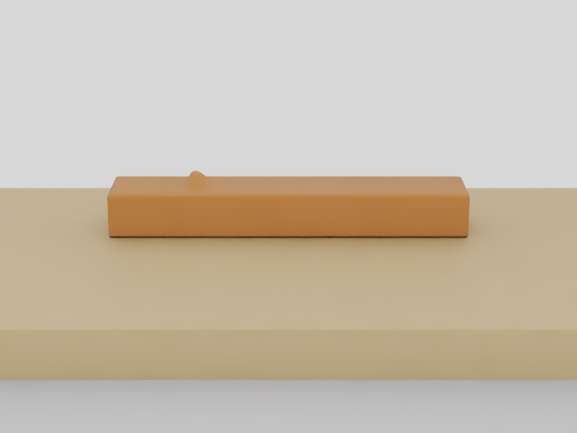
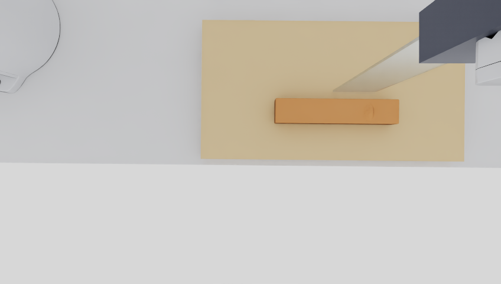

# Seeded trimming for an agentic control robot

This opt-in Native environment generates a continuous clay-like workpiece with
one or two protrusions. Scene seeds change count, family, position, radii,
height, yaw and asymmetry. The four families are dome, Gaussian, irregular and
ridge. Material parameters remain provisional and uncalibrated.

Preparation evidence: 12 seeds produced 12 different initial-particle hashes,
both counts and all four families; repeated compilation reproduced scene and
particle hashes. The original v5, v7, v7_2 solvers and physical goal evaluator
are byte-identical to the baseline. See [compact evidence](evidence/wp15/preparation_001.json).

The actual live camera smoke executed 20 Native control steps in 93.132 seconds
of outer wall time. Global rig14 RGB is 640×480 with its fixed named optics;
wrist_0 RGB-D retains the actual hand-local D405 mount and calibration. The
Global optical transform stayed fixed while the wrist camera moved with the
hand. Camera and physics timestamps matched. The Global stream has no depth
array: the existing narrow stereo-validation guard remains in place.

The smoke is an environment diagnostic with cutting disabled. Its physical
score is `FAIL_INTEGRITY` because 0.4 seconds does not satisfy the original
24-second completeness check; removed target mass is zero. An earlier startup
failure is retained. Neither attempt is an autonomous cutting result.

The controller interface accepts explicit `edge_delta`, `edge_pose` or
`joint_position` actions for arm_0 and keeps the gripper closed. It exposes
the two allowed camera streams, calibration, arm_0 proprioception, hand pose,
commanded edge pose, clock and natural-language goal. It excludes actual
generator parameters, reference waypoints, material particles, cut codes,
contact forces and measured tool truth. `step(None)` is rejected.

Each episode compiles before Native startup; a reset retains that episode's
scene and reconstructs its state. Scene, policy and simulation seeds are
separate. Invalid geometry is recorded with its reason. Raw recordings and
failed attempts stay in `artifacts/wp15/` locally.

The unchanged support-interface evaluator independently measures each target's
detached mass, substrate retention and code-zero mechanical bridges. Required
removal is at least 90% per protrusion, with at least 99% substrate retention.
Integrity, physical outcome, surface quality and HOME are separate results.
Short episodes retain their original completeness failure.

An isolated process recomputes physical results from the recorder's original
particles, packed history and stencil gradients before Native shutdown.
Every independently successful attempt automatically retains its raw Global
RGB and wrist RGB-D, encodes a complete H.264/yuv420p MP4 and verifies full
decode and SHA256. Encoding errors remain `SUCCESS_MEDIA_PENDING`; export can
resume from the same frames. No physical rerun is needed for media repair.

CPU contract tests passed 35 checks; the separate evaluator/media suite passed
8 checks, including actual ffmpeg encode/decode and resumable export. Synthetic
unit fixtures establish engineering behavior and are excluded from scientific
denominators. Native physics diagnostics and autonomous research are
`NOT_RUN` at this preparation commit. Completion requires their actual
execution and a subsequent study report; all-seed success is not required.
