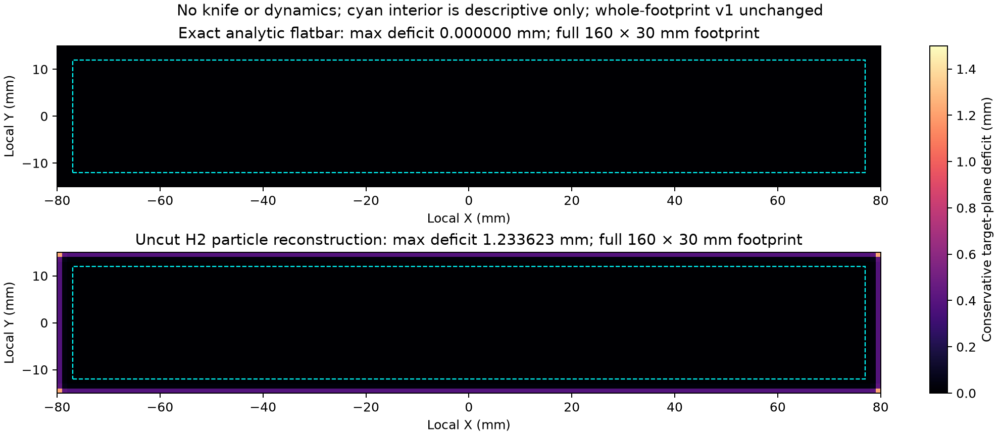

# Initial flatbar reconstruction floor

The unchanged H2 reconstruction of an **uncut, undeformed flatbar already fails
the v1 whole-footprint 1 mm gouge limit**. Maximum target-plane deficit is
1.233623 mm at the four outer corner rays. This is an initial reconstruction
boundary error; no knife or material dynamics is present. It does not establish
physical knife gouging, excuse later gouging, or promote a failed TRIM result.

The control settings and unchanged v1 thresholds were frozen in commit
`75ec819` before numerical execution. Protocol SHA256:
`d776b8324bf956cc784fe6116d9055bcc3c92bde9416ad888379eaa87aa59a08`.
The exact 160 × 30 × 20 mm flatbar uses the existing full-cell sampler:
96,000 particles at 1 mm spacing, 144 g total mass, identity total F and H2
current-volume radii of 0.5 mm. Parameters remain voxel 0.5 mm, kernel 3 mm,
density threshold 0.5, kernel scale 0.5, isotropic, with all smoothing disabled.
The unchanged `mesh_heightfield_metrics` measures the entire fixed footprint
with 160 × 30 cell-centered rays at 1 mm spacing against target Z = 20 mm.

| Whole-footprint measurement | Initial H2 mesh | Exact analytic flatbar |
|---|---:|---:|
| Valid rays / total | 4,800 / 4,800 | 4,800 / 4,800 |
| Maximum gouge/deficit | 1.233623 mm | 0 |
| Absolute plane-error p95 | 0.389392 mm | 0 |
| Plane-error RMS | 0.114579 mm | 0 |
| Maximum positive residual | 0.000229 mm | 0 |
| Rays with absolute error >0.5 mm | 4 | 0 |
| Rays with absolute error >1 mm | 4 | 0 |
| Conservative overcut-volume proxy / initial base volume | 0.166517% | 0 |
| Unchanged v1 surface-only checks | FAIL: gouge | PASS |

The four outliers are at `(±79.5, ±14.5)` mm, 0.5 mm inside both outer boundaries,
with measured top height 18.766377 mm. Every ray remains in the full-footprint
score. All four >1 mm tails, height/validity arrays, particle samples, F, masses,
triangles, source snapshots, command, packages and hashes are retained under
`artifacts/initial_flatbar_heightfield_001`. The analytic control uses a closed
box with the exact 20 mm top, evaluated by the same scorer; all errors are
exactly zero. Thus the scorer can recover a correct sharp flatbar without the
isotropic particle reconstruction.

The separately predeclared interior diagnostic excludes a fixed 3 mm band from
all four outer edges. Its 3,696 rays are all valid, with maximum absolute error
0.229 µm, p95 0.227 µm and zero deficit. This descriptive ROI does not replace
the 4,800-ray score, change v1, or provide task acceptance. Earlier H2
closed-volume/SDF controls also do not certify vertical flatness at sharp
outer corners: nearest-face distance and whole-footprint vertical deficit are
different measurements.



The [public numeric receipt](evidence/initial_flatbar_heightfield_control.json)
preserves both surface results and exact array/source hashes. Reproduce with:

```bash
.venv/bin/python scripts/probe_flatbar_heightfield.py artifacts/initial_flatbar_heightfield_001 --device cuda:0
.venv/bin/python scripts/render_initial_flatbar_control.py artifacts/initial_flatbar_heightfield_001 artifacts/initial_flatbar_heightfield_001/control.png
```

Use a fresh output path: existing artifacts are never overwritten. The probe
completed in 3.30 s wall time; surface extraction took 28.3 ms including cached
module loading. Timing is nonexclusive. No shared surface, task, solver or
acceptance source changed. The diagnostic process completing successfully is
separate from its recorded H2 `FAIL_SURFACE_ONLY` result.
