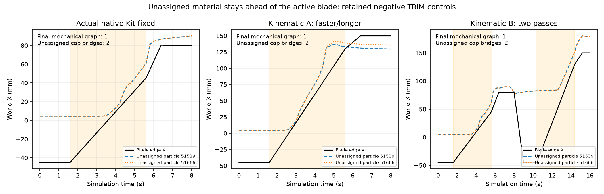

# Live Isaac Sim6.2 validation

Actual runtime initialization now succeeds on the unchanged RTX5090 host with
driver570.211.01. Isaac Sim6.2.0.0 uses Kit110.4.0, bundled USD25.11, native
PhysX110.4.4 and `omni.sensors.nv.camera`1.4.0. The dedicated environment is
`.deps/isaacsim-venv`; it does not inherit the standalone or Lab environment.
Torch2.11.0+cu128 actually allocated a CUDA1 tensor and returned its square.
Newton1.6.1 and Warp1.17.0 are retained for the existing material and IK code.

The official6.2 [Python installation instructions](https://docs.isaacsim.omniverse.nvidia.com/6.2.0/installation/install_python.html)
explicitly offer Torch2.11 with CUDA12/cu128. The
[requirements table](https://docs.isaacsim.omniverse.nvidia.com/6.2.0/installation/requirements.html)
labels595.58.03 as a tested Linux driver; it is not evidence that every lower
driver fails. The [Omniverse driver table](https://docs.omniverse.nvidia.com/dev-guide/latest/common/technical-requirements.html)
also lists Blackwell GeForce R570. No driver, OS or other project changed.

## Runtime receipts

| Actual attempt | Result |
|---|---|
| `isaacsim_startup_001` |BLOCKED:default base experience lacked optional robot-schema package; exit55 |
| `isaacsim_startup_002` |BLOCKED:minimal experience needed the upstream docstring-test dependency; exit55 |
| `isaacsim_startup_003` |Interrupted after299s:registry stalled fetching the1.494GB Vulkan shadercache |
| `isaacsim_startup_004` |PASS_BOOTSTRAP:real SimulationApp initialization, five updates, exit0; zero physics steps |
| `isaacsim_live_smoke_001/002` |FAIL:actual6.2 API/schema integration errors, retained with logs |
| `isaacsim_live_smoke_003` |Physics executed; independent camera audit FAIL_CAMERA_ALIAS. Asset products silently adopted2048×1080 and aliased both views |
| `isaacsim_live_smoke_004` |FAIL:strict runtime camera-pose check caught the unfixed housing dynamics |
| `isaacsim_live_smoke_005` |PASS_EXECUTION:2 control steps,20 native PhysX substeps, distinct640×480 RTX views and1280×960 Global |
| `isaacsim_live_native_smoke_001` |PASS_EXECUTION:same real loop with registered native SingleView measured depth, plus measured robot/material reset |
| `isaacsim_live_native_d0_001` |PASS_EXECUTION:400 control steps/4,000 actual PhysX steps/8s;41 native D455/Global captures; mechanical graph1→2 |
| `isaacsim_live_native_d0_ff_001` |PASS_EXECUTION:same400-step live recipe with explicit joint-velocity feedforward; tracking meets ROB-02 numeric limits |
| `isaacsim_live_native_d0_ff_no_feedback_001` |PASS_EXECUTION:matched feedforward controller with material wrench disabled at the robot; actual edge motion changes |
| `isaacsim_live_native_d0_ff_repeat_001` |PASS_EXECUTION:independent same-seed full repeat; ENV-01 reset/repeat tests FAIL, retained below |

The Vulkan shadercache was then fetched from the same official CDN directly,
SHA256 `ce1230814a7e3dbc32926adb5802c0c79ab09665036d54dfcbe74b57db459549`,
and installed under `.deps/isaacsim-extension-cache`. This is an installation
workaround, without a renderer/driver version substitution. Extension downloads
also use Kit's user cache under `~/.local/share/ov/data/exts/v2`.

## Live execution

```bash
.venv/bin/python -m pytest -q tests/test_isaac_sim_runner.py
.deps/isaacsim-venv/bin/python scripts/run_isaac_sim_cutting.py \
  --steps 400 --record-every 10 --camera-mode native_single_view \
  --gpu 1 --device cuda:1 --output-dir artifacts/isaacsim_native_fresh

# Explicit controller variant; retains identical gains, geometry and material.
.deps/isaacsim-venv/bin/python scripts/run_isaac_sim_cutting.py \
  --steps 400 --record-every 10 --camera-mode native_single_view \
  --velocity-feedforward --gpu 1 --device cuda:1 \
  --output-dir artifacts/isaacsim_native_ff_fresh

# Review actual captured arrays, without a USD replay or another renderer.
.venv/bin/python scripts/render_live_isaac_evidence.py \
  artifacts/isaacsim_native_ff_fresh artifacts/isaacsim_native_ff_media_fresh
```

`configs/isaac_sim_cutting.kit` selects the actual PhysX/RTX extensions rather
than loading unrelated ROS, policy or GUI workflows. Only the cached official
robot geometry is reused. In every control interval:

1. Newton computes joint **targets** from the desired edge pose; its robot
   dynamics never step.
2. Native PhysX advances both Panda articulations and applies the previous
   interval's measured material wrench at the actual hand-attached edge.
3. PhysX tensors supply the measured hand/edge pose to the retained TLMPM solver.
4. Current mechanical components produce the new USD surface. Native PhysX
   writes actual link transforms to USD; the wedge remains a fixed hand child.
5. Native RTX camera captures run while physics is held. Camera projection,
   optical pose and resolution are read back and checked; physics counters and
   measured robot state must remain unchanged during rendering.

Native camera housing rigid bodies are explicitly kinematic. Pre-authored asset
render products are deactivated in the session layer; fresh unique products
prevent the observed adoption/aliasing failure. Cached asset files are unchanged.
The initial joint-position write occurs only during reset. `step()` uses targets
and actual dynamics, with no robot/tool teleport or recorded trajectory input.

## Cameras and acceptance boundary

Native D455 optical views remain640×480; Global uses1280×960 to preserve visibility
of the small blade while showing both arms. Native SingleView uses the independently
validated [exact Kit profile](CAMERA_VALIDATION.md):95mm baseline,317.0431px focal,
confidence1, IR4m,150px maximum disparity, range.52–6m and noise.25/.25.
The runner reads the actual schema values and exact Kit/camera versions before
applying that profile. Registered depth values are bitwise retained native
measurements. Raw depth/XYZ and RTX reference depth are separate camera debug
artifacts; ideal reference depth never fills native holes.

The native smoke retained115,163 /46,829 valid initial pixels in the two views.
Its measured same-seed reset errors were zero for joints and material positions,
with zero residual cut codes. Camera reset repeatability and independent live
geometry/timestamp acceptance remain separate tests. `PASS_EXECUTION` does not
promote physical cutting, surface flattening or complete Isaac acceptance.
The400-step D0 episode is recorded in `artifacts/isaacsim_live_native_d0_001`.
Its actual detached mass is1.656g, final minimum detF.939, and maximum accumulated
plastic strain.498. It took82.74s including final reset, excluding application
initialization. Baseline position tracking fails the frozen gates:active maximum
1.256mm versus1mm, and all-phase5.715mm versus5mm. Active height error.222mm and
orientation error.0271° meet their respective.5mm/1° gates. Complete acceptance
is therefore not promoted. These values are measured diagnostics, not calibrated
physical-material validation.

Completed actual live videos are `live_global.mp4`, `live_d455_0.mp4` and
`live_d455_1.mp4` in that episode directory. They contain41 directly captured
frames at5fps and explicitly identify the Live Isaac Sim/Kit source. Remaining
surface, contact, camera synchronization and repeatability gates use the separate
independent acceptance audit.

## Controller comparison and reproducibility

The explicit `--velocity-feedforward` variant sends the finite difference of
successive commanded IK joint targets to native PhysX velocity targets. Baseline
PD remains available and its failed tracking measurements remain above. Robot
gains, desired edge path, material, cameras and transforms are unchanged.

| Measured trajectory quantity | Baseline PD | Velocity feedforward | Frozen limit |
|---|---:|---:|---:|
| Active maximum edge position error |1.25565mm|.48042mm|1mm|
| All-phase maximum position error |5.71478mm|2.16346mm|5mm|
| Active maximum height error |.22245mm|.25161mm|.5mm|
| Active maximum rotation error |.02706°|.03559°|1°|

The feedforward run still produces two actual mechanical components and a1.656g
chip. It applies a peak1.99723N material reaction. The next interval's applied
wrench equals the prior computed wrench exactly in recorded precision; current
impulse divided by20ms equals the computed next wrench exactly. In the matched
`--no-feedback` run, the solver still computes reactions up to2.06695N but the
robot receives zero material wrench. The maximum measured edge difference is
.62647mm, versus5.79µm between two feedback-enabled repeats. This establishes
measurable coupling without asserting converged interface energy.

The full same-seed repeat has a1.505mm maximum material-position difference and
.02089m/s maximum velocity difference. Final mechanical membership is identical,
but recorded cut-code histories differ. These exceed ENV-01's.1mm/.01m/s limits.
After the repeat, a real same-process reset restores q and material positions
exactly, clears every cut code, and resets the clock to zero. Native camera
reset repeatability fails: masks change at1543/580 pixels; common-valid maximum
depth differences are6.44/22.67mm. Global common-valid maximum difference is
14.313mm. For all three views the99th percentile is zero, but the frozen maximum
and exact-mask requirements are still violated. Native invalid/outlier values
are retained, without filtering to change that result. The independent gate
audit must keep this failure separate from registration-profile acceptance.
The diagnostic `isaacsim_reset_probe_002` additionally confirms all nine DOFs
and all22 measured rigid-link poses reset exactly. Initial/reset reconstructed
surfaces differ by at most3.73nm in symmetric nearest-vertex distance. The
remaining render/reset discrepancy is unresolved; native noise alone does not
explain the ideal Global difference.

Evidence is in `isaacsim_live_native_d0_ff_repeat_001/{comparison.json,
feedback_comparison.json,reset_receipt.json,camera_reset_quantiles.json}`.
The directly captured repeat videos and trajectory plot are under
`artifacts/isaacsim_live_native_d0_ff_repeat_media_002`: `live_global.mp4`,
`live_d455_0.mp4`, `live_d455_1.mp4`, `live_measured_depth.mp4`,
`live_synchronized_multiview.mp4`, and `planned_vs_actual_trajectory.png`.
Full acceptance remains false; execution, tracking and registration evidence
do not override the failed reproducibility or unfinished surface/task gates.

Artifacts include frozen source copies/hashes, native process exit/log/phase,
actual robot joints and22 link poses, commanded/measured edge poses, raw and
registered cameras, per-frame current surface provenance, full reference
stencils, final constitutive state, material-reaction diagnostics and reset
receipts. Force, material labels and Global images stay outside observations.
Native MDL packages remain uncached; explicit PreviewSurface overrides preserve
geometry/occlusion. Initial asset-loading logs retain the unresolved-MDL warnings.
The installed package freeze is `artifacts/isaacsim_runtime_freeze_001.txt`.
Two unused optional import converters require external `usd-exchange`; they are
not enabled, since injecting its standalone USD into the native Kit environment
would change the validated bundled-USD runtime.

## Shared CUT-01 / TRIM-01 task adapters

`--task-id CUT-01` and `--task-id TRIM-01` use the shared
[`CuttingTaskSpec`](../src/robotic_cutting_sim/tasks.py) and frozen
[`cutting_tasks_v1.json`](../configs/cutting_tasks_v1.json). Both start from a
continuous160×30×20mm bar sampled at1mm, with a4mm reference MPM grid. CUT-01
uses a35mm blade rotated90° around local Y and two actual support pedestals with
an open40mm central slot. TRIM-01 adds one continuous8mm dome and a support floor.
The exact TaskSpec hand-to-edge mount, dimensions, fixture boxes and world/local
transform are shared by IK, native USD geometry and the retained material.
The legacy tray is deactivated only for these tasks.

New tasks explicitly default to velocity feedforward, native sensor noise OFF,
and `current_volume_v1` surface reconstruction. That optional surface recipe was
validated on independent closed affine controls before use here; it uses the
current total deformation Jacobian and half-spacing voxels. It does not change
material state, labels, mass or separation. Legacy D0 continues to use its
original controller/noise/surface defaults. See the independent
[surface validation](SURFACE_GEOMETRY_VALIDATION.md) for its limits.

```bash
.deps/isaacsim-venv/bin/python scripts/run_isaac_sim_cutting.py \
  --task-id CUT-01 --steps 400 --record-every 10 \
  --camera-mode native_single_view --gpu 1 --device cuda:1 \
  --output-dir artifacts/isaacsim_cut01_fresh
```

The native class accepts the shared TaskAction mapping: absolute world
`cartesian_edge_pose_world` or `joint_position_rad`, plus an explicit
`cut_enabled` Boolean. A joint command can contain7 values, or2×7 with the second
arm equal to its declared park target. A moving secondary arm is rejected for
these tasks before physics advances. `step(None)` executes the scripted task
baseline. Explicit actions arm cutting at the actual action time, independently
of the scripted active interval; the material still receives the measured edge.

Actual native action probe `artifacts/isaacsim_task_actions_002/result.json`
passes Cartesian,7-joint and parked2×7-joint actions over30 native PhysX steps.
Its cutting indices are0/−1/−1 as requested, and a rejected secondary-arm target
leaves the physical clock unchanged. It captures distinct640×480 native views
and1280×960 Global. This is an API smoke test, not a full cut.

`isaacsim_cut01_smoke_001` retains the initial metadata-serialization failure.
After correcting NumPy Boolean serialization, `isaacsim_cut01_smoke_002` and
`isaacsim_trim01_smoke_001` each execute2 native control steps and3 camera
captures. Their short duration cannot score task completion. Future short runs
are explicitly labelled `PASS_SMOKE`. Full task metrics are written separately
to `oracle_debug/task_evaluation.json`; source/config byte snapshots and current
mechanical surface attribution accompany each recording.

The first full native CUT-01 recording, `artifacts/isaacsim_cut01_001`, completes
400 control steps/4,000 PhysX steps/8s and41 native captures. The shared oracle
task evaluator passes: the continuous144g bar becomes two72g mechanical parts,
with no rewritten cut digits, no minor debris and2.4s recorded persistent
disconnection. Conservative reference-stencil midpoint distance from the local
X=0 target is1.500mm, below the predeclared2mm limit. Active edge tracking error
is.21165mm, all-phase error2.16526mm, and actual edge offset from the intended
sever plane is at most.15684mm. Peak material reaction is.28041N; minimum detF
is.94464. The loop including evaluation/reset takes253.08s; application process
time is263.52s, with concurrent jobs and no isolated performance claim.

Initial robot/material reset again succeeds exactly, including all nine joints
and22 link poses. Camera reset still fails even with native noise OFF: valid
masks change80/229 pixels and Global maximum depth difference is57.943mm. Task
separation success therefore does not promote full environment acceptance.
The historical `joint_motion_max_rad` field in this first CUT recording measures
final displacement rather than the whole path; raw q records show the actual
whole-path maximum.14195rad. The writer now reports both quantities explicitly.

Actual captured CUT videos, measured depth, synchronized multiview and the
workpiece-local commanded/measured trajectory plot are in
`artifacts/isaacsim_cut01_media_001`. They use existing captured arrays only;
the source manifest and visualization code hashes are recorded alongside them.

The first full native TRIM-01 recording, `artifacts/isaacsim_trim01_001`, also
completes400/4,000 steps,8s and41 captures, but **fails task metrics**. The
conservative mechanical graph stays connected, so detached mass is zero.
Of1,044 initially above-plane particles,1,014 end with cut code2,28 with code1,
and two with code0. A cut code alone is not an independent material component.
Those two unchanged code0 particles have reference coordinates
`[4.5,±2.5,24.5]mm`; their actual positive-weight/stress-gradient support touches
both assigned sides. They remain real numerical bridges, with no post-hoc label
repair. During recorded active snapshots they stay at least4.04mm ahead of the
edge and have zero accumulated edge-work progress. Active height tracking error
is only30.94µm. The initial above-plane material COM advects62.56mm in X.

The final connected surface has7.561mm peak, .924mm p95 and.914mm RMS target-plane
error. Two of4,800 rays are missing. The frozen evaluator includes their zero
heights, producing a20mm worst gouge statistic; this does not establish a20mm
physical knife gouge. The actual loop/evaluation/reset takes271.05s and process
time281.47s. The five live videos and task-plane trajectory are retained under
`artifacts/isaacsim_trim01_media_001`, including this failed outcome.

## Frozen follow-up trajectory diagnostics

[`trim_sweep_diagnostic_v1.json`](../configs/trim_sweep_diagnostic_v1.json) was
committed in `79c92c2` before either follow-up output. The actual material,
geometry,1mm particles,4mm grid, fixtures,20.2mm edge plane, surface recipe and
goal thresholds remain unchanged. These controls use an ideal kinematic tool
and **cannot pass live Isaac or articulated reaction acceptance**.

| Diagnostic | Declared change | Actual outcome |
|---|---|---|
| A `trim_fast_sweep_diagnostic_001` |Same8s; active sweep ends X=130mm instead45mm,43.75mm/s |FAIL:one mechanical component; two above-plane code0 bridges remain;125.54s wall|
| B `trim_second_pass_diagnostic_001` |Original first8s unchanged; second sweep10.4–14.4s ends X=130mm, then withdraw and hold to16s |FAIL:one component at8s and16s; the same two bridges remain;248.06s wall|

Both preserve every particle and every previously assigned nonzero history
digit. A's above-plane code counts0/1/2 are2/23/1,019; B's are2/28/1,014.
The same two reference particles bridge the actual stencil graph in both cases.
No trajectory was promoted to a new live Isaac episode from these failures.
`run_trim_sweep_diagnostic.py` records full states, forces/contact traces, actual
reference stencils, code histories, H2 final surfaces and source/config hashes.
Its CPU tests verify B's first401 control poses equal the original episode and
A's new speed leaves the target height unchanged.



Source-recording hashes and exact negative statuses are in
[`trim_sweep_diagnostics_v1.json`](evidence/trim_sweep_diagnostics_v1.json).

## Explicit coarser-particle carry-over and actual native confirmation

The final control was frozen in `6213166` as
[`trim_particle_spacing_control_v1.json`](../configs/trim_particle_spacing_control_v1.json).
It changes the **entire initial continuous specimen's** particle spacing from1mm
to2mm, preserving the160×30×20mm geometry, dome,4mm grid, original8s path,
20.2mm edge height, material, fixtures and goal thresholds. Particle quadrature,
radius and their derived contact scales change. This is a discretization-specific
carry-over of the validated D0's8-particles-per-cell setting, not convergence.
No particle is removed or reassigned after cutting.

Kinematic diagnostic `trim_coarse_particle_diagnostic_001` passes severing:
12,136 particles start with one graph and zero codes, then form1.608g chip and
144.024g base components with98.5294% reference above-plane mass detached.
Every nonzero history digit remains unchanged. Its145.632g initial mass is the
actual coarser sampler budget, versus145.566g for1mm; no mass normalization was
used. The ideal-tool diagnostic takes32.15s and is not an Isaac result.

The subsequent actual native recording
`artifacts/isaacsim_trim01_coarse_001` completes400 control steps/4,000 PhysX
steps/8s, with41 native camera captures and the same1.608g detached component.
Disconnection persists for2.4s after the active pass. Active edge error is
.22127mm, height error34.18µm, maximum rotation error.01775° and all-phase position
error1.96383mm. Peak actual applied material reaction is.67146N, minimum detF
.91584 and maximum material speed.22355m/s. The loop/evaluation/reset takes86.33s;
the complete native process takes95.88s.

Full task metrics still **FAIL**: final substrate peak residual is.10645mm,
but p95/RMS errors are1.67509/.55189mm and measured overcut fraction2.019%.
Eight of4,800 rays are absent; their retained zero-height tail contributes the
reported20mm maximum gouge statistic. This is separate from a demonstrated20mm
physical knife gouge. Formal surface, camera-hole and repeatability limits are
not relaxed to promote these results. All1mm and trajectory-control failures
remain available.

```bash
.deps/isaacsim-venv/bin/python scripts/run_isaac_sim_cutting.py \
  --task-id TRIM-01 --particle-spacing .002 --steps 400 --record-every 10 \
  --camera-mode native_single_view --gpu 1 --device cuda:1 \
  --output-dir artifacts/isaacsim_trim01_coarse_fresh
```

The sampling override is explicit in configuration, TaskSpec receipts and child
process arguments. Omitting it retains the original1mm task; supplying it without
a shared task is rejected to protect legacy D0. Source files and protocol bytes
are frozen before each worker starts. Actual Global, both native RGB views,
measured-depth and synchronized multiview videos, plus workpiece-local trajectory,
are under `artifacts/isaacsim_trim01_coarse_media_001`.

## Complete native task camera evidence and both measured-depth videos

The complete41-frame coarse TRIM recording was independently audited on CPU in
`artifacts/live_camera_mesh_trim01_coarse_001`, followed by the descriptive
object audit `artifacts/task_object_visibility_trim01_coarse_001`. Both audits
use immutable measured PhysX link poses, the exact recorded current-component
surface and recorded task fixtures; no physics or native camera was rerun.
Object masks belong to this evaluator only and are absent from observations.

CAM03 geometric visibility, the dynamic geometry bridge and time synchronization
pass. The largest per-frame mesh-versus-RTX p95 error is0.179µm for each D455
and0.715µm for Global; the maximum physics/surface/camera timestamp span is
8.89e-16s. **Strict native CAM04 still fails.** Whole-image native valid-mask IoU
is.6431–.6531 for D4550 and.3089–.3399 for D4551. No ideal depth replaces native
holes, and every valid error tail remains in the statistics.

| Actual recorded view | All-material native depth coverage | Detached1.608g chip: valid pixels per post-split frame | Chip native depth maximum error |
|---|---:|---:|---:|
| D4550 |99.0873%|19–24|0.000358mm|
| D4551 |98.5211%|3–21|112.282mm|
| Global ideal RTX reference |100%|11–15|0.002384mm|

The chip is geometrically visible in all19 post-split captures. D4550 retains
all383 chip pixel samples; D4551 retains363/368, including two valid outliers
above5mm. Across all material, native valid maximum errors are23.660mm and
112.282mm respectively. High local coverage therefore does not establish
whole-image depth quality. The maximum native chip visibility is24 pixels,
below the existing25-pixel criterion; this failure is retained without changing
camera poses, thresholds or source data. Global is an ideal reference camera,
not an additional native D455 measurement.

Fresh media sets `artifacts/isaacsim_cut01_media_002` and
`artifacts/isaacsim_trim01_coarse_media_002` each contain six videos: Global,
D4550 RGB, D4551 RGB, D4550 measured depth (`live_measured_depth.mp4`),
D4551 measured depth (`live_d455_1_measured_depth.mp4`) and synchronized
multiview. All12 videos have41 frames at5fps; both task-plane trajectory plots
are included. The original five-video `_001` directories remain unchanged.
Both depth products use the same fixed.52–1.20m display scale, with invalid
depth shown black. The multiview retains its four explicitly labelled panels;
the D4551 depth video is delivered separately.

For frames0/20/40 of each task, the new D4551 PNG color pixels outside text and
legend match the actual D4551 measured-depth arrays exactly. Video dimensions,
frame counts, byte sizes and SHA256 values, audit source hashes and complete
object summaries are stored in
[`native_task_camera_media_v1.json`](evidence/native_task_camera_media_v1.json).
These are captured-array visualizations, not replay-rendered evidence.

```bash
PYTHONPATH=src .venv/bin/python scripts/audit_live_camera_mesh.py \
  artifacts/isaacsim_trim01_coarse_001 artifacts/camera_mesh_trim_fresh --device cpu
PYTHONPATH=src .venv/bin/python scripts/audit_task_object_visibility.py \
  artifacts/camera_mesh_trim_fresh artifacts/task_objects_trim_fresh
PYTHONPATH=src .venv/bin/python scripts/render_live_isaac_evidence.py \
  artifacts/isaacsim_trim01_coarse_001 artifacts/trim_six_video_fresh
```

The first command intentionally returns exit1 for the preserved strict CAM04
failure; its completed `result.json` distinguishes this from an audit error.
