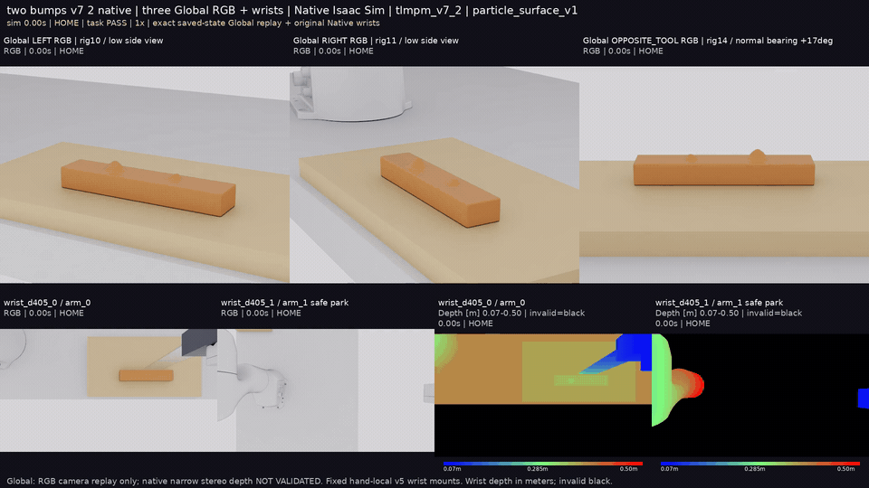

# v7 Native scenes: three Global RGB views and two wrist RGB-D pairs

The current showcase retains **LEFT rig10 / RIGHT rig11 / OPPOSITE TOOL rig14**,
with 0.60 m distance, 24° HFOV and 17.12394° elevation. The fixed opposite-tool
bearing has zero sideways obliquity. Original arm_0/arm_1 Wrist D405 RGB and Depth
share the measured-state timestamps. Wrist depth is optical Z in meters,
0.07–0.50 m; blue→green→red, invalid black.

Global RGB is Native RTX replay of exact saved live meshes and measured robot/tool
poses with zero physics steps. Narrow Global stereo remains BLOCKED; no Global
registered depth or physical sensor calibration is claimed. Actual robot/tool
occlusion is retained. Current v5 hand-local mounts and Franka1 safe park are unchanged.

## Sequential two-protrusion Hero

Two different protrusions detach in separate passes: bodies1 → 2 → 3, A/B100%,
base intact, HOME PASS. This is one verified versioned Native demo, not general
TRIM adoption. The original v7 failure and all earlier sources remain in the
[historical evidence](HISTORICAL_CAMERA_MEDIA.md#sequential-two-protrusion-demo).
[Mechanical graph/mass proof](evidence/three_global/native_two_bumps_detachment_001.json) ·
[Measured states](evidence/three_global/native_two_bumps_states_v1.npz).

## Current standalone v7 recordings

The selected source task/HOME outcomes are PASS. TRIM and multi-cut remain
experimental; kinematic T00 still fails. These engineering recordings do not
change frozen scientific denominators. Full clips use actual captured timing at1×;
the homepage's four-slice preview is explicitly3×.

| v7 scene | Full synchronized seven-pane MP4 |
| --- | --- |
| wp13_v7_cut | [MP4](media/three_global_v1/wp13_v7_cut.mp4) |
| wp13_v7_trim | [MP4](media/three_global_v1/wp13_v7_trim.mp4) |
| wp13_v7_multicut | [MP4](media/three_global_v1/wp13_v7_multicut.mp4) |
| wp14_v7_standard_cut | [MP4](media/three_global_v1/wp14_v7_standard_cut.mp4) |
| wp14_v7_firm_offset_cut | [MP4](media/three_global_v1/wp14_v7_firm_offset_cut.mp4) |
| wp14_walkthrough | [MP4](media/three_global_v1/wp14_walkthrough.mp4) |

## Sources, limits and historical evidence

[Named camera/API entry](GLOBAL_CAMERA_VIEWS.md) · [Runnable CUT scenes](WP14_SCENES.md) ·
[Current five-preview presentation manifest](evidence/three_global/presentation_002.json) ·
[Original unchanged full media manifest](evidence/three_global/media_001.json) ·
[Source/calibration readback](evidence/three_global/source_inventory_001.json).

[Historical media and baseline evidence](HISTORICAL_CAMERA_MEDIA.md) preserves
all47 full movies, original GIFs, v5 baselines, paired studies and unsuccessful
sources. Four unavailable original raw-source slots are explicitly labelled as
two new current representatives, never historical remasters. Five new engineering
FAIL_TASK_METRICS results remain visible there. Nine historical sources preserve
their original wrist calibration/poses; archived arm_1 is labelled recorded pose.
The default remains v5/Law8. [Research scope and failures](reports/WP14_RESULTS.md) ·
[Camera controls and limitations](reports/THREE_GLOBAL_CAMERA_REFRESH.md).
