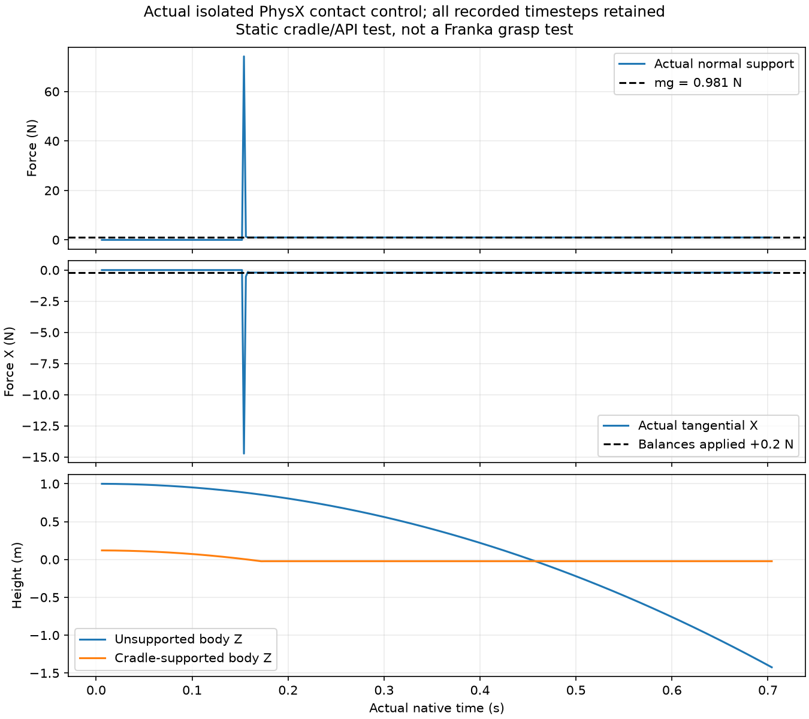

# Native physical-tool contact diagnostics

`NativeToolContacts` records privileged contact evidence for the independent
rigid tool. It does not attach, actuate or reposition the tool, and its data
does not enter the default vision observation.

The current API is supported by the installed Isaac Sim 6.2.0.0 source and
[NVIDIA's 6.2 physics sensor API](https://docs.isaacsim.omniverse.nvidia.com/6.2.0/py/source/extensions/isaacsim.sensors.experimental.physics/docs/index.html).
The experimental physics sensor API was already introduced in 6.0; the older
`isaacsim.sensors.physics` API is deprecated. See the
[6.0 release notes](https://docs.isaacsim.omniverse.nvidia.com/6.0.0/overview/release_notes.html)
and [6.2 contact sensor guide](https://docs.isaacsim.omniverse.nvidia.com/6.2.0/sensors/isaacsim_sensors_physics_contact.html).
This API audit does not establish Newton/kit-less Lab compatibility.

## Runtime use

Construct the monitor after Kit starts and the rigid bodies exist, before
physics initialization. Sample after **every 2 ms rigid step**, rather than
only at the 20 ms control boundary.

```python
from robotic_cutting_sim.physical_contacts import NativeToolContacts

contacts = NativeToolContacts(
    stage,
    "/World/Tools/CuttingTool_0",
    {"left": actual_left_finger_path, "right": actual_right_finger_path},
    actual_hand_path,
    dt=0.002,
    handle_bounds_tool_m=(handle_lower_corner, handle_upper_corner),
)

# Save the actual body pose before stepping; read the integrated pose after.
report = contacts.sample(
    tool_pose_xyzw=measured_tool_pose_after_step_xyzw,
    contact_geometry_pose_xyzw=measured_tool_pose_before_step_xyzw,
)
```

The sensor uses `Contact.create()` / `ContactSensor.get_sensor_reading()` /
`ContactSensor.get_raw_data()`. Authoring enables the native contact-report
API on the tool. Measurement thresholds are 1e-6 to 1e6 N; these are sensor
reporting settings, not gripper effort or friction limits.

Raw body IDs are decoded through `PhysicsSchemaTools.intToSdfPath()`. Both
body orders are accepted. Finger, palm, table and fixture pairs remain
distinct, including unintended tool contacts. A fixture-parent transform is
not assumed to be a contact actor: tensor filters resolve actual rigid-body
or static-collider prim paths.

Handle attribution requires the actual detection-geometry pose and
tool-frame bounds. Native discrete contact reports describe geometry before
integration; the actor pose read after stepping already includes that step's
motion. The runtime now saves both poses and passes the actual pre-step pose
explicitly. The report records `PRE_STEP_MEASURED_TOOL_POSE`, the pose itself
and its timestamp. No pose is extrapolated, corrected or written to the tool.

The helper transforms the **reported contact point** into that detection
frame. Old callers without a pre-step pose retain the explicitly labelled
`LEGACY_POST_STEP_TOOL_POSE` profile. Preserved old recordings and failed
classifications are unchanged. Without a pose/bounds the report says
`NOT_CLASSIFIED`; the presence of the tool between the fingers is never used
as contact evidence. See the new and original
[rigid control matrices](PHYSICAL_TOOL_CONTROLS.md) for the measured timing
effect and the unchanged 1 micrometre handle-region tolerance.

## Timing, force and validity

The vendor convenience `get_data()` frame can retain previous values when a
reading is invalid. This helper instead records `is_valid`, native step/time,
reading time, raw report time and the report's own positive `dt`.
Current-step freshness allows float32 timestamp roundoff; a complete previous
2 ms step is rejected. Repeated reads of the same physics step are explicitly
marked by `new_physics_step=False`.

Each raw force magnitude is `norm(impulse) / raw_dt`. The raw vector and body
ordering remain unchanged. Separate loaded-contact flags require more than
1e-6 N; zero-impulse contact reports do not certify a loaded grip. Equal and
opposite finger loads must not be discarded because their net force cancels.

The raw sensor reports in the isolated control describe normal contact
impulses. They are not labelled a complete frictional wrench. The additional
native `RigidPrim` contact view records normal forces, contact points,
separation distances and **separate tangential friction forces**. Both APIs
receive the actual rigid `dt`: their default `dt=1` would return impulses.
Optional moments are about the recorded detection-geometry **tool-frame
origin**, not an unrecorded center of mass. Forces on bodies outside the declared filters are
not included in the tensor force sum. Raw unexpected tool pairs remain
visible independently.

An invalid sensor, missing timing or nonfinite impulse cannot certify a
grasp. A nonfinite vector or malformed report raises an explicit error;
there is no fixed-tool or geometric fallback.

## Isolated controls and retained failures

```bash
.venv/bin/python -m pytest -q tests/test_physical_contacts.py
.deps/isaacsim-venv/bin/python scripts/probe_physical_contacts.py \
  --output-dir artifacts/physical_contacts_NEW --gpu 0
```

The CPU controls verify pair ordering, pressure without net cancellation,
stale/invalid reports, transformed contact-point attribution, nonfinite data,
zero-load touch and strict body-path boundaries. They do not run physics.

The actual isolated CPU-PhysX probe boots Kit on GPU 0 and advances three free
dynamic 100 g cubes: floor support, a static two-sided V-cradle, and an
unsupported gravity control. The cradle's two surfaces exercise contact
classification; they are **not articulated Franka fingers**. This probe
cannot pass physical grasp, cutting, robot load transfer or material coupling.

Preserved development attempts:

| Attempt | Result | Measured scope |
| --- | --- | --- |
| `wp08_native_contacts_001` | `BLOCKED_KIT_STARTUP`, exit 55 | Default vendor experience requests unavailable `isaacsim.anim.robot.schema`; physics never starts |
| `wp08_native_contacts_002` | `FAIL` | Repository experience starts, but the probe requests Fabric updates before enabling Fabric |
| `wp08_native_contacts_003` | `PASS_ISOLATED_NATIVE_CONTACT_CONTROL` | 350 actual steps; floor force 0.98100004196 N versus 0.981 N weight; 266 fresh bilateral cradle steps; unsupported drop 2.42397 m |
| `wp08_native_contacts_004` | `PASS_ISOLATED_NATIVE_CONTACT_CONTROL` | Adds actual tensor forces: -0.199999761 N friction balances a +0.2 N lateral load; vertical support is 0.981000054 N |

Attempt 003 observes raw contact timestamps within 30 ns of the native clock.
Its absolute final native time is 0.704 s; physics initialization precedes the
350 recorded steps. It validates the raw sensor path before the later tensor
friction extension. These scopes and source snapshots remain separate.

Enabling Fabric during attempt 003 automatically fetched the official
`omni.physx.fabric-110.4.4` extension into Kit's normal user cache. No wheel,
driver or validated source environment was changed. Both startup failures
remain preserved, including logs and the exact source copied before launch.

The [compact receipt](evidence/physical_contacts.json) retains the original
attempts and the separate tensor-friction control. Attempt 004 validates
the current helper's tensor path and force sign using that known external
load. It records 350 steps / 0.700 s after the actual native start time of
0.004 s; the final absolute clock is 0.704 s. All force vectors and points are
finite, and both cradle contacts have positive load for 266 steps.

Negative separation is retained over the entire run: maximum floor-impact
penetration is 1.87323 mm, and maximum cradle penetration is 0.37653 mm across
2,704 recorded normal-contact points. These are descriptive measurements;
the isolated force/unit test does not claim comprehensive penetration
acceptance. The CPU suite has six passing controls.



`PHYSICAL_GRASP_VALIDATED` remains unestablished by this isolated API control.
