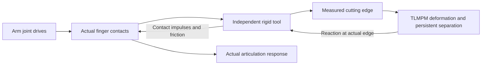

# WP-08: physical tool use

The new `physical_grasp` mode uses an independent massive knife supported by
the actual articulated Panda fingers. `legacy_fixed_tool` preserves the
hand-attached historical benchmark. There is no fallback from a failed
physical grasp to a fixed joint or a hand-following tool animation.

This is a provisional engineering model of Plasticine-like cutting. Complete
scientific physics acceptance remains separate from executing a task. See the
[supplied specification](WP08_SPECIFICATION.md), [frozen baseline](evidence/wp08_baseline.json),
[native contacts](PHYSICAL_CONTACTS.md) and [actual perturbation controls](PHYSICAL_TOOL_CONTROLS.md).

## Mechanical chain and frames



The shared tool has connected, nonoverlapping handle, shaft and wedge solids.
Closed-mesh volume integration determines mass, centre of mass and full inertia.
The CUT head weighs approximately51.51g; the TRIM head approximately40.96g,
including their shared15.49g polymer handle. Densities and friction are
uncalibrated engineering inputs. Rigid tool–finger/table/fixture contacts belong
to PhysX or Newton/MuJoCo-Warp; TLMPM alone owns soft-material contact.

The knife body is `/World/Tools/CuttingTool_0`, outside the robot articulation.
Its measured transform produces `T_world_edge = T_world_tool @ T_tool_edge`.
Nominal `T_hand_tool` is used for reset and IK planning only. Commanded edge,
measured edge, measured hand, tool COM velocity and angular velocity are recorded
separately. Material loads act on the tool, including the edge-to-COM moment
`tau_com = tau_edge + (p_edge-p_com) × F`; the physical mode injects no material
wrench directly into the hand.

Every pregrasp uses finite finger drives,20N maximum effort per finger and
friction0.6. Two seconds of real rigid settling precede material initialization
and the formal8s episode. The final0.5s window must satisfy unchanged contact,
drift, velocity and1mm penetration screens. Failed settling saves its actual
trace and stops. The newer11.2mm initial finger opening leaves200µm clearance
per side around the22mm handle; it changes no tool pose during simulation.
The original14mm cold-closure results and failures are preserved.

The operational grasp monitor measures slip relative to the **actual settled
grasp**, separately from its static nominal seating offset. Large displacement
or sustained loss of support terminates the shared episode and pauses the GUI
until reset. This monitor never moves a body or replaces the independent task
and physics evaluators.

## Actual evidence available

Candidate-v2 CUT and2mm TRIM have each completed400control steps /4,000rigid
steps in both actual runtimes, with all three RGB-D streams and explicit reset.
Both CUT scores pass unchanged task criteria. Both TRIM runs separate a chip
but retain the strict surface-quality failure. Native v2 passes all seven
frozen rigid-tool controls. The original Newton contact model passes the full
cutting paths but fails several clearance transfers; its finite finger-patch
torsion model is being investigated separately. No PhysX result is used as
Newton proof.

Native material-reaction ON/OFF runs have identical initial states, source
bytes, commanded trajectories and material recipes. Actual measured differences
reach47.68µrad in arm joints,45.88µm in tool position and0.2871N in finger
contact force. The maximum material force is0.2729N. This passes the frozen
causal-response engineering screen; it does not establish converged coupling
energy or calibrated material behaviour. The retained20ms explicit feedback
delay and historical interface-work failures remain visible.

The native contact event reports detection geometry, whereas actor reads after
a step return integrated geometry. The first post-step handle-region classifier
therefore falsely rejected some moving contacts. An independent full-trace
analysis identified the error. New runs store the actual pre-step geometry pose
and time explicitly and retain the same1µm region margin and95% contact gate.
Old failed receipts remain unchanged. See [PhysX callback semantics](https://nvidia-omniverse.github.io/PhysX/physx/5.6.1/docs/Simulation.html#callback-sequence)
and the project-specific discrete-contact timing evidence; this is not a
universal assumption for CCD or a different runtime.

Native hold/release controls show a free drop when fingers open, increased slip
under weak grip/low friction, and actual arm/contact response to a known load.
These controls advance no material and never count as cutting success.
Optional rack place/pickup demonstrations use the same rigid loop and are
scored independently. Their unsuccessful attempts are retained.

## Reproduce

Use fresh output directories and the isolated environments installed by
[bootstrap](PORTABLE_DEPLOYMENT.md). GPU0 is an example, not a required second
GPU. The commands below explicitly select the physical mode and validated
near-handle initialization rather than relying on a changing default.

```bash
.deps/isaacsim-venv/bin/python scripts/run_isaac_sim_cutting.py \
  --task-id CUT-01 --steps 400 --gpu 0 --device cuda:0 \
  --tool-attachment-mode physical_grasp --grip-initial-position 0.0112 \
  --camera-layout wrist_d405_global_d455 --camera-mode native_single_view \
  --output-dir artifacts/physical_cut_NEW

.deps/isaaclab-venv/bin/python scripts/run_isaac_lab_cutting.py \
  --task-id TRIM-01 --particle-spacing 0.002 --steps 400 \
  --device cuda:0 --material-device cuda:0 --reset-check \
  --tool-attachment-mode physical_grasp --grip-initial-position 0.0112 \
  --camera-layout wrist_d405_global_d455 --include-global-camera \
  --output-dir artifacts/physical_lab_trim_NEW

.venv/bin/python scripts/run_physical_tool_controls.py --runtime isaac_sim \
  --gpu 0 --protocol configs/physical_tool_controls_v2.json \
  --output-dir artifacts/tool_controls_NEW

.venv/bin/python scripts/audit_physical_tool.py \
  artifacts/physical_cut_NEW artifacts/physical_cut_audit_NEW

.venv/bin/python scripts/run_deployment_validation.py --tier smoke --runtime both \
  --gpu auto --tool-attachment-mode physical_grasp --grip-initial-position 0.0112 \
  --output-dir artifacts/physical_deployment_NEW
```

For historical fixed-tool experiments explicitly pass
`--tool-attachment-mode legacy_fixed_tool`. Add `--no-feedback` to a separate
identically configured full episode, then compare using
`scripts/compare_material_feedback.py --on ON_DIR --off OFF_DIR --output-dir NEW_DIR`.
Never reuse output directories or count a two-step smoke as a completed cut.

## Research interface and extension boundaries

The shared `reset/step/observe/render/evaluate/close` API retains Cartesian-edge
and seven-joint actions. Add `{"gripper":"hold"}`, `"close"`, `"open"` or
`"release"` to a command; a gripper-only command holds the arm and disables
cut activation. Invalid combined arm/gripper actions are rejected before
actuation. Default physical observations contain RGB-D, calibration, timestamps,
joint/finger position and velocity, and measured hand pose. Exact free-tool
truth, force, particle state, cut history and task scores remain privileged
debug/evaluation data. Global RGB-D is opt-in for policy observations.

`ToolSpec`, `WorkpieceSpec`, `MaterialParameters` and `CuttingTaskSpec` separate
tool geometry/inertia, connected material volume, constitutive settings and
workpiece-local goals. A rounded capsule footprint is sampled into the same
continuous TLMPM pipeline. Unsupported shapes/material laws fail explicitly;
importing a mesh visually does not make it physically cuttable. Arbitrary CAD
sampling, wood/metal/fabric fracture, moving held workpieces and general repeated
cut planes remain unsupported. No policy, VLA, RL or RSI training is included.

Both wrist streams remain `ideal_d405_prototype`; Global is provisional native
D455 in Sim and explicitly ideal Warp RGB-D in kit-less Lab. Stereo noise and
hardware calibration are unvalidated. The known secondary-wrist occlusion on
TRIM withdrawal and visual mount-clearance failures remain separate. The
same-instance GUI supports task/reset/play/pause/step, gripper commands and
camera switching; its debug tool truth is not a deployable policy observation.
