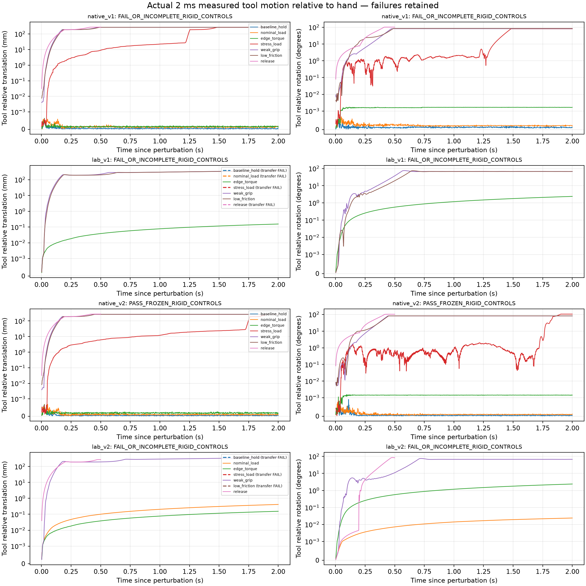

# Physical tool rigid-control matrix

The [frozen protocol](../configs/physical_tool_controls_v1.json) exercises the
same independent tool, articulated Franka fingers and actual rigid solver as
the cutting runtime. It advances rigid physics without advancing TLMPM. These
controls measure grasp and load response; they cannot establish cutting,
camera acceptance or material reaction transfer by themselves.

## Protocol and execution

Protocol commit `d17829b` predates the first control physics run. The finite
transfer lifts the measured edge, then moves it to world
`[-0.2, -0.15, 0.18]` m while preserving its measured initial orientation.
Seven joint actuator targets follow a quintic profile with at most
0.005 rad per 20 ms control step and 0.25 rad/s. The tool pose is only read.
After a 0.5 s stabilization, the measured arm joints become the fixed hold
target for each perturbation. Every case starts from a fresh pregrasp and
repeats the same transfer.

| Case | Duration | Perturbation after transfer |
| --- | --- | --- |
| Baseline hold | 2 s | 20 N per finger, friction 0.6, no external load |
| Nominal load | 2 s | Same grip, world force `[0, 0, -1]` N at the measured edge |
| Edge torque | 2 s | Same grip, world torque `[0, 0.02, 0]` N m at the measured edge |
| Stress load | 2 s | Same grip, world force `[0, 0, -10]` N; dropping is not required |
| Weak grip | 2 s | 0.5 N per finger, friction 0.6, the same 1 N downward load |
| Low friction | 2 s | 20 N per finger, friction 0.02, the same 1 N downward load |
| Release | 0.5 s | Actual finger opening, no external load |

The 1 N nominal load was selected before controls from preserved fixed-tool
CUT/TRIM reaction records. Their maximum force norms were 0.280–0.707 N;
the protocol records the four exact input hashes and values. This load is
an external control, not a replacement for a material reaction experiment.

Baseline and nominal stability require at most 2 mm relative translation,
3 degrees relative rotation, and 95% bilateral loaded handle samples.
Each finger must carry more than 0.05 N. Relative speed limits are 0.02 m/s
and 0.2 rad/s in the final 0.5 s; contact penetration is at most 1 mm.
Weak grip and low friction are compared with the matched nominal run using
the same source bytes, external load and bounded actual initial state. A
response increase of 5 mm or 5 degrees is required. Release requires more
than 20 mm independent downward motion within 0.5 s and an actually
unsupported interval of at least 30 ms whose fitted COM acceleration is
within 20% of gravity. No threshold is adjusted to the measured outcome.

```bash
.venv/bin/python -m pytest -q tests/test_physical_tool_controls.py
.venv/bin/python scripts/run_physical_tool_controls.py \
  --runtime isaac_sim --gpu 1 --protocol configs/physical_tool_controls_v2.json \
  --output-dir artifacts/wp08_native_controls_NEW
.venv/bin/python scripts/run_physical_tool_controls.py \
  --runtime isaac_lab --gpu 1 --protocol configs/physical_tool_controls_v2.json \
  --output-dir artifacts/wp08_lab_controls_NEW
```

The supervisor launches one dedicated-runtime process per case. Each child
copies and hashes its physical implementation before launch, records actual
2 ms contacts and measured tool/hand state, verifies source stability and
the unchanged material state, and exports its final composed rigid scene.
Cameras are explicitly disabled. The Native trace is JSONL; the Lab trace
is an NPZ ledger with actual contact shape IDs, pair wrenches, points,
normal, friction and separation. The index identifies both formats.

A zero process exit or populated summary never establishes acceptance.
Missing raw steps, invalid sensors, incomplete sources and C++ simulation
view invalidation errors are rejected. The matrix retains full raw data;
an independent audit is separate from this driver's engineering screen.

## Preserved development receipts

| Receipt | Result and scope |
| --- | --- |
| `wp08_native_controls_baseline_001` | Startup failure before physics: the new worker initially omitted the existing launcher's process-local EULA acknowledgement. The log is preserved. |
| `wp08_native_controls_baseline_002` | Actual 2 s hold completed. The original analysis failed after conflating out-of-handle finger points with a different supporting body. Source, raw data and that failed receipt remain unchanged. |
| `wp08_native_controls_baseline002_parser_reanalysis_001` | Separate offline correction: all 67 flagged contacts are the two actual fingers, across 14 steps; their maximum nominal handle-boundary excursion is 2.530 micrometres. They remain excluded from handle load and retained separately. There are zero loaded pairs with another body. |
| `wp08_native_controls_baseline_003` | Fresh execution with corrected analysis: all frozen hold screens pass, with 1,000 valid 2 ms samples and unchanged source/material hashes. |

Baseline 003 has 0.530 micrometres maximum relative translation,
9.346 microradians maximum relative rotation, 98.7% bilateral loaded handle
samples, and 9.930 micrometres maximum measured contact penetration. The
handle attribution retains its original 1 micrometre region tolerance.
The parser correction changes the classification of the other body, not
that geometric tolerance or the bilateral threshold. A CPU control includes
a real table-path pair together with a finger point outside the handle;
only the table is counted as another supporting body.

## Original matrix outcomes

All seven Native perturbations execute with 6,250 evaluation substeps,
unchanged implementation/material hashes and no C++ contact-view
invalidations. The **original strict aggregate is FAIL**: the nominal
1 N run has 92.6% loaded handle attribution, below 95%. Baseline and torque
are 98.7%. Independently of that spatial attribution, the actual two finger
links both carry load in every baseline, nominal and torque sample. The
maximum nominal finger-point boundary excursion is 3.700 micrometres.

| Native case | Maximum relative translation | Maximum relative rotation | Actual outcome |
| --- | --- | --- | --- |
| Baseline | 0.000530 mm | 0.000535 degrees | Frozen hold screens pass |
| 1 N nominal | 0.000588 mm | 0.000692 degrees | Strict handle fraction fails; no other loaded body |
| 0.02 N m torque | 0.000639 mm | 0.001717 degrees | Finite response screen passes |
| 10 N stress | 265.567 mm | 81.296 degrees | Slip/drop, followed by table contact |
| Weak grip | 264.901 mm | 82.549 degrees | Slip/drop under the matched 1 N load |
| Low friction | 266.821 mm | 85.281 degrees | Slip/drop under the matched 1 N load |
| Release | 274.505 mm | 102.821 degrees | Independent motion and unsupported gravity screens pass |

The nominal force changes the steady filtered tool contact force by
0.999997 N and the final arm deflection by 0.475407 mrad relative to baseline.
The torque case changes arm deflection by 0.029564 mrad. Its net contact
force change is only 8.113 micronewtons; a pure torque should not be inferred
from a force resultant alone. The raw contact points and forces are retained
for the independent wrench audit.

Weak grip and low friction have matching actual initial states and source
bytes. Both responses increase by more than 264 mm. Their comparison status
remains FAIL because the original nominal run fails its strict handle
fraction. Their fitted unsupported COM accelerations are approximately
-29.22249 m/s², consistent with gravity plus the known downward 1 N load
on the 0.0515131 kg tool; these are not labelled gravity-only release tests.
The separate release has a 192 ms unsupported interval and fitted
acceleration -9.8099895 m/s².

The original Lab matrix has four clearance-transfer failures: baseline,
nominal, stress and release. Actual pregrasp succeeds, but the tool moves
relative to the fingers during transfer. The baseline endpoint misses by
74.085 mm and 1.22657 rad; the nominal misses by 68.636 mm and 1.15458 rad.
These cases receive no perturbation result. Torque, weak grip and low
friction reach clearance and execute 1,000 evaluation substeps each.
Without a completed nominal case there is no matched weak-response claim,
and release is not validated in this Lab recipe. The weak and low-friction
drops retain maximum reported table-contact penetrations of 20.541 and
18.839 mm. Their finite-data screen is not contact-quality acceptance.

## Explicit contact timing correction and initialization candidate

An independent raw audit found that Native discrete contact positions belong
to the detection geometry **before integration**. The original classifier
combined them with the actor pose after integration. Using the separately
recorded previous actual 2 ms pose on both full task recordings gives 100%
bilateral loaded handle attribution with the same 1 micrometre tolerance;
the original post-step results and failures stay preserved.

Native implementation commit `994cff4` records both poses explicitly. The
new parser validates that `contacts.contact_geometry_tool_pose_xyzw` exactly
matches `tool_body_pose_before_step_xyzw`, and that the geometry timestamp
plus 2 ms equals the sample time. POST-step pose remains the measurement for
motion and stability. A missing or mismatched PRE-step pose is an error for
the new profile. Old recordings retain their original POST-step profile.
CPU controls move a known rigid handle after contact detection and verify
this distinction without expanding its bounds.

The separately frozen [v2 control protocol](../configs/physical_tool_controls_v2.json)
uses that explicit contact timing and the 11.2 mm initial finger clearance
candidate frozen in `6ec2303`. Grip effort, friction, task geometry, transfer,
load cases and every acceptance threshold are unchanged. New candidate
matrices remain separate from both original matrices.

## Candidate v2 results and evidence checkpoint

| Matrix | Actual perturbations completed | Frozen aggregate |
| --- | --- | --- |
| `wp08_native_controls_matrix_001` | 7/7; 6,250 evaluation substeps | FAIL: original POST-step handle attribution |
| `wp08_lab_controls_matrix_001` | 3/7; 3,000 evaluation substeps | FAIL: four clearance transfers |
| `wp08_native_controls_matrix_v2_001` | 7/7; 6,250 evaluation substeps | PASS_FROZEN_RIGID_CONTROLS |
| `wp08_lab_controls_matrix_v2_001` | 4/7; 3,250 evaluation substeps | FAIL: three clearance transfers |

The Native v2 matrix passes all seven frozen engineering controls. Baseline,
nominal and torque have 100% loaded handle attribution with independently
cross-checked PRE-step poses. Their maximum relative translations are
0.621, 0.689 and 0.691 micrometres; their maximum reported finger-contact
penetrations remain below 9.457 micrometres. The nominal steady contact-force
change is 0.999999873 N, with 0.475645 mrad final arm-response difference.
Torque gives a 0.023842 mrad arm-response difference. Weak grip and low
friction increase relative translation by 265.771 and 265.794 mm compared
with the matched nominal case. Release moves independently by 276.315 mm
and has 192 ms unsupported motion with fitted acceleration
-9.80998967 m/s². Every case has unchanged source and material hashes and
zero C++ simulation/contact-view invalidations. This remains engineering
rigid-control evidence, separate from material reaction transfer.

The Lab v2 matrix still fails baseline, stress and low-friction clearance
transfer. Its worst endpoint misses by 94.382 mm and 1.26417 rad. Nominal,
torque, weak grip and release execute actual perturbations. Nominal satisfies
the frozen stability checks and its matched weak-grip response increases by
366.644 mm. Release moves independently by 273.675 mm and has 190 ms
unsupported motion at -9.81001473 m/s². These measured positive controls do
not fill the missing cases. The raw signed-distance tails after weak-grip
and release drops are -21.579 and -11.325 mm. They are retained as reported
contact-ledger distances, without a claim of independent mesh-penetration
verification or full contact-quality acceptance.

Across these four matrices, all 28 fresh starts and their source snapshots
are preserved. Twenty-one perturbations complete, with 18,750 actual 2 ms
evaluation samples. The seven transfer failures have no invented load
response. Every stored implementation copy and every raw-trace hash matches
its case receipt. The [compact evidence](evidence/physical_tool_controls.json)
contains all cases, strict failures, source/raw hashes, runtime versions,
clearance errors and paired outcomes. Observed wall times include startup,
shutdown and trace I/O; concurrent authorized jobs prevent treating them
as an exclusive performance benchmark.



The Lab transfer instability remains a limitation of its current contact
recipe. In MuJoCo, `condim=4` adds resistance to rotation about the contact
normal; the manual describes its use for soft-finger grasp models.
[MuJoCo contact documentation](https://mujoco.readthedocs.io/en/latest/computation/#condim)
A finite pad-patch candidate is being prepared separately. It has no control
or task acceptance in this evidence checkpoint. No friction, effort,
acceptance threshold or past failure is changed by this explanation.
Full physical acceptance remains false.
