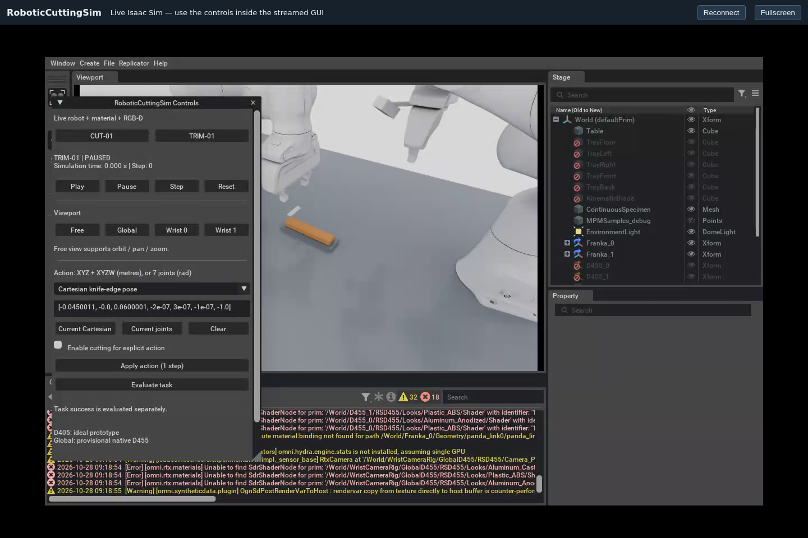

# Live remote WebRTC viewer

The viewer at **http://100.111.162.17:8210** displays the real Isaac Sim 6.2
Kit GUI from the same live robot/material/RGB-D application. It uses NVIDIA's
official WebRTC SDK, with native mouse and keyboard forwarding. CUT/TRIM,
Play/Pause, Step, Reset, camera selection and explicit actions are Kit GUI
controls; the web page does not implement another task engine or image replay.

## Source and pinned dependencies

The reference is NVIDIA's [Isaac Sim 6.2 web-viewer recipe](https://github.com/isaac-sim/IsaacSim/blob/v6.2.0/tools/docker/web-viewer/Dockerfile),
tag `v6.2.0`, commit `74a9356b20250dd60337d90b4b4d913c9454d32b`.
Its generator is `@nvidia/create-ov-web-rtc-app@2.1.5`. NVIDIA's older
`web-viewer-sample` repository is archived and points new work to
[the maintained generator](https://docs.omniverse.nvidia.com/ov-web-sdk/latest/web-sample/overview.html).

This repository's original minimal TypeScript client imports
`@nvidia/ov-web-rtc@6.8.2`, the exact published 6.x version resolved during this
implementation. Generator and SDK version numbers are independent of the
Isaac Sim version. The official generated reference, package archives and
licenses are retained under ignored `.deps/remote-viewer`; no SDK source or
compiled SDK asset is committed. The emitted reference frontend carries MIT
headers; the generator/SDK packages carry their own NVIDIA license files.
Exact URLs, SHA256/SHA512 values and provenance are in
[UPSTREAM.json](../viewer/UPSTREAM.json).

Node `v22.23.4` / npm `10.9.9` are installed only in
`.deps/remote-viewer-node`. The setup script verifies the pinned official
Linux x64 archive SHA256. System Node, drivers, other repositories and global
npm configuration are untouched. [The lock file](../viewer/package-lock.json)
pins all client dependencies; the NVIDIA registry scope is project-local.

## Start and connect

```bash
cd /home/ningan/RoboticCuttingSim
scripts/setup_remote_web_viewer.sh
.venv/bin/python scripts/serve_remote_web_viewer.py
```

The HTTP process serves the built client and configuration only. It never
launches a simulator. From a stopped deployment, start the live Kit process
separately in another terminal, using a fresh evidence directory:

```bash
.deps/isaacsim-venv/bin/python scripts/run_remote_viewer.py \
  --output-dir artifacts/remote_interactive_NEW --task TRIM-01 --gpu 0
```

The default has no wall-time limit. Persistent deployment uses two separate
tmux sessions: `rcs-web-viewer` for this HTTP service and `rcs-remote-sim` for
the live Isaac Sim application. Attach to an existing session with
`tmux attach -t rcs-remote-sim`; the currently deployed final session uses
GPU 1 explicitly, independently of the CLI's GPU 0 default.

| Connection | Address / port | Purpose |
| --- | --- | --- |
| Browser page | `100.111.162.17:8210`, TCP | Viewer HTML/JS |
| Signaling | `100.111.162.17:49100`, TCP | Official WebRTC signaling |
| Media | `100.111.162.17:47998`, UDP | Actual encoded Kit stream |

The HTTP listener binds only the Tailscale address. The browser configuration
uses that same reachable address for signaling and media. The corresponding
Kit settings are `primaryStream/publicIp`, `primaryStream/signalPort` and
`primaryStream/streamPort` under `omni.kit.livestream.app`.
[NVIDIA's streaming documentation](https://docs.isaacsim.omniverse.nvidia.com/6.2.0/installation/manual_livestream_clients.html)
describes these separate endpoints. No container or second simulator is
required by this client deployment.

Defaults request 1280×800 H.264 at 30 fps. Actual negotiated dimensions/rate are
reported by the browser probe; requested FPS is not treated as a measurement.
The first actual test decoded at 60 fps. The HTTP server can override host,
ports, width, height and FPS without rebuilding:

```bash
.venv/bin/python scripts/serve_remote_web_viewer.py \
  --host 100.111.162.17 --port 8210 \
  --signal-host 100.111.162.17 --signal-port 49100 --media-port 47998 \
  --width 1280 --height 800 --fps 30
```

Use one streaming browser client at a time. Click inside the streamed GUI
to interact. Reconnect reloads only the client page; Fullscreen changes only
the browser presentation. Stopping the HTTP tmux session does not stop Kit:

```bash
tmux kill-session -t rcs-web-viewer
```

To close the simulator gracefully later, create its recorded STOP marker:

```bash
touch artifacts/remote_interactive_003/STOP
```

Use the matching output directory for a future session. Closing the streamed
Kit application also stops that simulation; simply closing the browser only
releases the streaming client.

Request logs retain peer IP, User-Agent and ordinary HTTP request metadata
for distinguishing a real remote browser from a local automated check.
Authentication headers are not logged. `/health.json` explicitly reports
`NOT_TESTED_BY_HTTP` for the simulation connection.

## Actual browser verification

The probe uses repository-local Playwright with existing system Chrome 146,
without installing a browser or starting a simulator. It opens one page,
checks actual RTCPeerConnection and RTP decoder statistics, saves screenshots,
and closes its browser to release the streaming-client slot.

```bash
.deps/remote-viewer-node/bin/node viewer/scripts/probe_remote.mjs \
  --out artifacts/remote_browser_NEW --timeout 30000
```

Optional actions use only real browser mouse/keyboard events aimed at actual
Kit `ui_regions` from the application status receipt. No task HTTP request is
sent. Each action must produce an observed change in the recorded Kit state.
The probe supports `prepare_region`, `clear_region` and `submit_region` for
editing and applying action text through the GUI.

```bash
.deps/remote-viewer-node/bin/node viewer/scripts/probe_remote.mjs \
  --out artifacts/remote_input_NEW \
  --ui-status artifacts/LIVE_SESSION/status.json \
  --kit-events artifacts/LIVE_SESSION/events.jsonl \
  --actions artifacts/INPUT_ACTIONS.json
```

The first real session, `remote_interactive_001`, passed nine streamed mouse
actions: all three camera selections, Step to 0.02 s, Reset to 0, Play/Pause,
and CUT/TRIM switching. `remote_web_viewer_browser_live_001` records 919
decoded 1280×800 frames, 1,847,790 received video bytes, zero RTP packet loss,
and the selected remote media candidate `100.111.162.17:47998/UDP`.
The actual input data channel sent 27 messages / 828 bytes. Screenshots show the
full Kit menus, stage hierarchy, live workcell and application controls.

Failures remain preserved. The no-server control loads the HTTP page but
fails actual-video readiness. Two keyboard attempts reached the GUI but
failed text replacement using Ctrl+A and Home/Shift+End; the existing JSON
was followed by the typed JSON, and Kit correctly rejected it without a
material step. A real GUI Clear control is used for the final keyboard
follow-up. Such a client/GUI failure is not reported as a physics failure or
silently bypassed with an HTTP task command.

The final `remote_interactive_003` follow-up **passes 14 actual GUI
transactions**, including both a typed Cartesian edge target and a typed
seven-joint target. The probe clicks the real Kit Clear control, types each
complete JSON value, and clicks Apply. The new accepted command records
match the typed target arrays exactly, and actual coupled material/robot
steps advance material time to 0.02 s and 0.04 s. No direct task API is used.
Task switching and resets retain the same live application PID.

[The compact public receipt](evidence/remote_web_viewer.json) retains the
checks, target/command matches, actual physics timestamps, source hashes and
failed attempts. Raw screenshots/statistics are in
`artifacts/remote_web_viewer_browser_final_001`. The final stream decodes
**2,073 frames / 4,063,442 video bytes**, 1280×800 H.264, with zero RTP packet
loss and 12 HTML video-frame drops over about 34.7 s. Actual rate is about 60 fps;
the requested 30 fps is not substituted for that measurement. The input data
channel sends 269 messages / 7,679 bytes. Its selected remote media endpoint is
the host's Tailscale IP on UDP 47998.



The automated browser disconnects after verification. The deployed final
session is left **TRIM-01, paused, Global view, material time 0**, with no
reported application error. HTTP remains in `rcs-web-viewer` and Kit in
`rcs-remote-sim`; the remote client slot is free.

All automated checks here run in local Chrome **through the Tailscale URL**.
They do not establish an external Mac's connectivity. A separate remote
Chrome connection and user confirmation are required for that scope.
