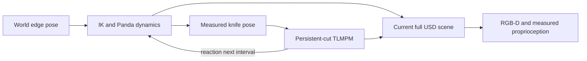

# Live articulated research environment

`ResearchCuttingEnv` combines actual dual-Panda dynamics, a fixed finite wedge,
persistent-cut material physics and two programmable ideal RGB-D observations.
The old Newton implicit-MPM `CuttingEnv` remains a separate deformation baseline.

```python
from robotic_cutting_sim.research_env import ResearchCuttingEnv, ResearchEnvConfig
with ResearchCuttingEnv(ResearchEnvConfig(device="cuda:0")) as env:
    obs, info = env.reset(seed=42)
    for _ in range(400):
        obs, reward, terminated, truncated, info = env.step()
        if truncated:
            break
```

The default controller approaches, holds, cuts and withdraws over8 s. The second
Panda stays parked under its own articulated controller. Every20 ms the robot
advances under the previous interval's material wrench;200 material steps of
100 µs use interpolation between measured robot poses. Equal-opposite impulses
become the next wrench. The **20 ms delay** is explicit, not monolithic contact.



## Actions and data

`step()` follows the reference controller. A7-vector action specifies desired
WORLD wedge-edge `[x,y,z,qx,qy,qz,qw]`, meters and XYZW, world Z up. IK and dynamics
execute it; the material receives measured poses, not a kinematic teleport.
The fixed wedge is12 mm long,4 mm upper height,0.4 mm lower rear height and50 mm
edge length. Its edge frame differs from the old box-center API.

`cut_index=None` uses the scripted1.6–5.6 s cutting window;0 enables the retained
cut digit for custom paths and-1 disables new cutting. History persists in all
cases. This articulated facade reserves one cut digit. The isolated
`supported_cross_cuts` probe exercises two cuts and does not establish two-direction
robot execution. Joint-space control is separately available in `robot.py`.

| Observation | Contract |
|---|---|
| `rgb` | `d455_0/1`,uint8,H×W×3 |
| `depth_m` | float32 optical Z[m],invalid=0 |
| `valid_mask` | Boolean depth validity |
| `calibration` | Explicit K,OpenCV +Z-forward/+Y-down extrinsics and clipping |
| `timestamp_s` | Current physics timestamp |
| `proprio` | Measured q/qdot,shape2×7,and wedge-edge tool_pose; omitted in vision_only |

Both cameras default to640×480. Their optical frames come from official D455
USD geometry. This live adapter uses ideal Warp ray tracing with authored USD
lens parameters; it does not claim native color-camera extrinsics or calibrated
stereo noise. `simulated_d455` raises an explicit capability error in this facade;
the independent native SingleView pipeline has its own registration/noise audit.
See [SINGLE_VIEW_REGISTRATION](SINGLE_VIEW_REGISTRATION.md): actual RAW-Z samples
are preserved,but the fresh1 mm slanted-plane registration criterion failed.

Each frame includes current measured robot/tool and material geometry with full
mutual occlusion. Surface partitioning follows the **current conservative MPM
mechanical graph**. Future/final labels never presegment earlier frames. Repeated
`observe()` at one timestamp returns the cached frame; each physics step creates
a synchronized new frame. Global is returned only by `render()`.

`debug_material_state()` and `debug_diagnostics()` expose oracle and reaction
information separately. Observations and ordinary step info exclude force,
stress and particle labels. Reward=0,terminated=false,max_steps controls
truncation; these are research-loop semantics, not a calibrated task score.

## Lifecycle and actual validation

D0–D3 are supported through the scenario adapter; explicit benchmark recipes
record supported/applied and unsupported/deferred fields. Default legacy D0
preserves friction0.3. Reset constructs fresh robot/material/surface state and
clears cut history. Step after truncation requires reset. Close releases physics
and surface references. Supply `scene_path` for an existing workcell or let reset
compose an isolated temporary scene using the bounded persistent asset cache.

Canonical `artifacts/research_env_full_001`:400 steps/8 s,164.55 s wall,two final
mechanical components,mean camera time0.320 s/step. Camera payloads were checked
at every step; same-seed initial joint/depth reset errors were zero. Truncation,
observation boundaries and later default-regression smoke checks passed. This is
not realtime or Isaac performance evidence.

```bash
.venv/bin/python -m robotic_cutting_sim.cli research-demo --output-dir artifacts/fresh_live
```

The recorder separates observations,Global debug,oracle debug,measured robot
proprioception,implementation copies and timings. Compact evidence:
[research_env_validation.json](evidence/research_env_validation.json).
