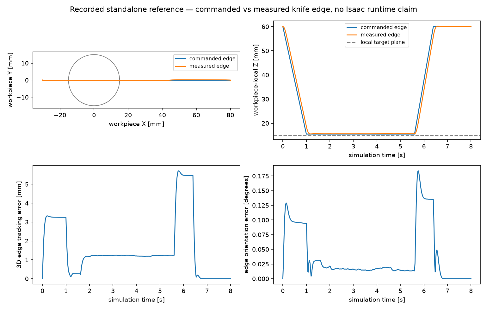

# Measured knife trajectory validation

The frozen ROB-02 limits are in [`isaac_acceptance.json`](../configs/isaac_acceptance.json), committed before new live Isaac episodes. They apply to the measured knife-edge pose composed from the actual hand, not to the desired hand pose, a kinematic copy or a replay mesh. All comparisons are synchronized and expressed in the workpiece frame.

The target plane is workpiece-local Z=15 mm. The controller requests edge Z=15.5 mm during the active interval `[1.6,5.6)` s. That 0.5 mm clearance is recorded separately from surface flattening. Position error is full 3D distance; orientation error is the quaternion geodesic angle, so equivalent quaternion signs do not create a false jump.

[`trajectory_metrics`](../src/robotic_cutting_sim/scene_validation.py) also tests a finite ±25 mm edge sweep against the analytic bump cross-section above the commanded cut plane. Adjacent recorded edges form swept quadrilaterals only when both edges satisfy the height tolerance. A path displaced laterally or vertically fails. This establishes geometric reach and orientation; physical tool contact and persistent cutting require separate solver evidence.

## Existing standalone D0 baseline

Source: `artifacts/simulation_benchmark_001/D0_seed42/physics`, 401 actual robot states over 8 s. Reproduction command and raw input hashes are recorded in [`SCENE_COORDINATE_VALIDATION.md`](SCENE_COORDINATE_VALIDATION.md) and [`scene_coordinate_validation.json`](evidence/scene_coordinate_validation.json). This is a retrospective standalone diagnostic and passes neither RT-01 nor RT-02.

| Metric | Measured | Frozen limit | Result |
| --- | ---: | ---: | --- |
| Maximum active 3D edge error | 1.249685 mm | 1 mm | FAIL |
| Maximum active height error from command | 0.217074 mm | 0.5 mm | PASS |
| Maximum active orientation error | 0.031327° | 1° | PASS |
| Maximum all-phase 3D error | 5.707793 mm | 5 mm | FAIL |
| Maximum measured edge translation per control step | 1.452538 mm | 10 mm | PASS |
| Analytic bump cross-section sweep coverage | 100% | ≥95% | PASS |

There are 200 active samples. The measured edge intersects the original continuous material, with local active height 15.640–15.717 mm and maximum normal tilt 0.031323°. This demonstrates that the knife reaches the intended bump plane. The unchanged ROB-02 outcome is **FAIL**, because tracking accuracy exceeds two limits. A visually plausible sweep does not erase those failures.

The audit saves per-time position/orientation errors, the raw measured/commanded edge poses, the matching legacy candidate hand poses and clearly labelled **derived** desired hand poses. Original recordings retain joint positions/velocities, all body poses and reaction-wrench traces. A desired hand pose derived from the command is not a measurement.

## Live episode requirements

The new runtime must retain the actual body label/index identifying the Panda hand, measured hand pose, measured edge pose and fixed mount. Numerical agreement alone cannot recover a missing link identity from a legacy file. Each full episode needs the source manifest, loaded native asset names, solver/dt, commanded and measured poses, joint state, actual physics trace and frame timestamps.

The quantitative auditor must report all 18 gates even when evidence is absent. Missing full-duration runtime, native D455 calibration, matched feedback controls, reset/repeat, penetration measurements or cross-component contact evidence is `NOT_RUN`/`BLOCKED`, rather than an inferred pass. Execution, physical component separation, chip dynamics, material removal, final flattening, camera validity and full simulation acceptance are distinct outcomes.
