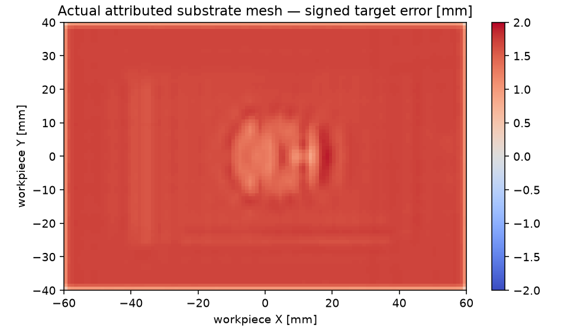

# Scene coordinates and target geometry

This document defines the project frame contract and records an offline audit of the existing standalone D0 baseline. It does not certify an Isaac runtime. The acceptance protocol was committed as [`configs/isaac_acceptance.json`](../configs/isaac_acceptance.json) in `c12aaef`, before new live Isaac episodes; its SHA256 is `ee364198b44e7720be4c065bb3b02a28ead8904c97154c32f8af619d5857441b`.

## Frame contract

All public recorded poses use metres and `[x,y,z,qx,qy,qz,qw]`. `T_destination_source` multiplies a source **column** vector. Rotation matrices must be proper orthonormal matrices; scale, reflection, nonfinite data and ambiguous quaternion conventions are rejected. Float32 FK may accumulate quaternion norm error up to `1e-6`; this input precision allowance does not alter the protocol's rotation or tracking tolerances.

| Frame | Convention and relation |
| --- | --- |
| World | Metres, Z up; gravity `(0,0,-9.81)` m/s². |
| Workpiece | D0 bottom at local Z=0; continuous base 120×80×15 mm; central dome height 8 mm and radius 15 mm. Target plane is **local** Z=15 mm, regardless of workpiece pose. |
| Robot base | Standalone bases are `(-.46,.12,-.01)` and `(.46,.12,-.01)` m; second base yaw is π. Runtime receipts must record the actual loaded bases. |
| Panda hand | A measured articulated body, identified by recorded runtime body name/index; it cannot be replaced by the command pose. Official Isaac USD has a nested `.../panda_link7/panda_hand` path. |
| TCP / knife edge | In this task TCP means the centre of the lower cutting edge. `T_hand_edge = translation(0,0,.18) · Rx(π)`. The wedge origin is this edge centre, not a box centre. |
| Edge local axes | +X is advancement, +Y lies along the edge, +Z is the cut-plane normal. Edge half-width is 25 mm. The wedge extends 12 mm behind/above its tip, with 4 mm upper height and a −0.4 mm lower rear corner. |
| USD | `Gf` matrices act on row vectors. Transpose before using the project column-vector convention; multiply translations by `metersPerUnit`. |
| USD camera | +X right, +Y up, −Z forward. |
| CV optical camera | +X right, +Y down, +Z forward. `T_world_cv = T_world_usd_camera · diag(1,-1,-1,1)`. A D455 housing's +X forward is not its child camera's optical convention. |
| TLMPM | Current particle state, fixture and gravity are authored in world coordinates. The supported runtime workpiece pose is explicitly identity. |

The new [`scene_frames.py`](../src/robotic_cutting_sim/scene_frames.py) implements composition, inverse, USD units/matrix conversion, optical conversion and `WorkpieceTarget`. Pure geometry supports arbitrary rigid workpiece translation and rotation, including the correct transformed plane and local gravity. The current TLMPM fixture cannot yet follow that arbitrary pose, so `require_backend_frame_support()` rejects nonidentity poses. Transforming only a mesh or target would produce a misleading scene.

Wrenches are `[Fx,Fy,Fz,Tx,Ty,Tz]` and twists are `[vx,vy,vz,wx,wy,wz]`. Rotating a wrench at the same physical edge point rotates force and torque. Moving its application point to the hand COM additionally requires `r × F`; the frame helper deliberately does not silently perform an origin shift.

### Verified runtime quaternion adapters

The actual installed **Isaac Lab 3.0 GA** uses **XYZW** in `AssetBaseCfg.InitialStateCfg.rot` and `utils.math.matrix_from_quat`; its default is `(0,0,0,1)`. Sources: `.deps/IsaacLab/source/isaaclab/isaaclab/assets/asset_base_cfg.py` and `utils/math.py`. An older Lab convention must not be assumed for this release.

The actual installed **Isaac Sim 6.2 experimental prim API** uses **WXYZ** for `RigidPrim.get_world_poses()` and orientation inputs. Source: `.deps/isaacsim-venv/lib/python3.12/site-packages/isaacsim/exts/isaacsim.core.experimental.prims/isaacsim/core/experimental/prims/impl/rigid_prim.py` and its base transform API. The Kit adapter explicitly converts that API's WXYZ to project XYZW. These statements are source inspection, not runtime execution receipts; runtime gates need their own complete episode.

## Offline D0 coordinate receipt

Run:

```bash
MPLBACKEND=Agg .venv/bin/python scripts/audit_scene_coordinates.py \
  --recording-dir artifacts/simulation_benchmark_001/D0_seed42/physics \
  --surface-dir artifacts/simulation_benchmark_001/D0_seed42/surface \
  --calibration-json artifacts/simulation_benchmark_001/D0_seed42/ideal_rgbd/calibration.json \
  --runtime-source standalone_reference \
  --output-dir artifacts/scene_coordinate_audit_002
.venv/bin/python -m pytest -q tests/test_scene_coordinate_validation.py
```

The audit exits **1**, preserving the measured trajectory/flattening failures. The 20 CPU tests pass; they cover known 90° rotations, mount direction, optical axes, matrix/units conversion, transformed planes, geometric negative controls, actual triangle ray measurements, missing surface regions and mechanical-component provenance.

- D0 analytic dimensions match the frozen task; the actual initial particle samples exactly match the continuous D0 sampler, and all initial cut codes are zero.
- The fixed 180 mm hand-to-edge mount uniquely matches recorded body index 8, with maximum composition error `8.33e-17` m. Legacy files omit body names, so this is a numerical diagnostic and cannot certify named-hand identity or ROB-01.
- The commanded cut is local Z=15.5 mm, explicitly 0.5 mm above the 15 mm target. Measured active-cut edge height is 15.640–15.717 mm.
- Both recorded ideal D455 optical frames point to the target (`cosine≈1`, positive optical depth, image centre). The global target cosine is 0.9923 and remains inside the image. This checks calibration geometry only; it cannot pass native camera gates.

The full numeric receipt and source/input hashes are in [`scene_coordinate_validation.json`](evidence/scene_coordinate_validation.json). The first audit directory `_001` is preserved: its overly tight quaternion representation check excluded moving FK bodies. `_002` fixes that representation handling without changing any acceptance threshold or physical data.

## Surface and task measurement boundary

[`scene_validation.py`](../src/robotic_cutting_sim/scene_validation.py) distinguishes reference above-plane mass removal from final surface quality. It assigns substrate by the initial bottom reference layer and an **explicit mechanical component partition**, never by image masks or particle displacement. Mesh statistics use only triangles attributed to that current substrate partition, at the physical timestamp, with no state or visibility edits and no future final-component labels used for earlier frames.

The local 1 mm measurement grid covers the entire base footprint. It intersects the actual recorded triangles along local +Z and takes the upper surface. Missing rays count as missing and contribute conservatively to the overcut bound; no plane fitting, height offset, blur, error-based sample rejection or particle-radius correction is applied.

The standalone D0 removes **98.571%** of initial above-target mass into the detached mechanical component, passing the numeric TASK-01 threshold. However its attributed substrate mesh has **1.915 mm** peak residual, **1.709 mm** p95 absolute error and **1.641 mm** RMS error. All surface rays are present and no gouge is measured. TASK-02 fails the frozen peak/area error limits. The 0.266 mm highest substrate **particle-centre** residual cannot substitute for this actual mesh measurement.



Live Lab, Kit, native sensor, reset, contact attribution and complete 18-gate acceptance remain separate. Neither this geometric audit nor the successful 98.571% mass removal promotes a full Isaac or flattening claim.
