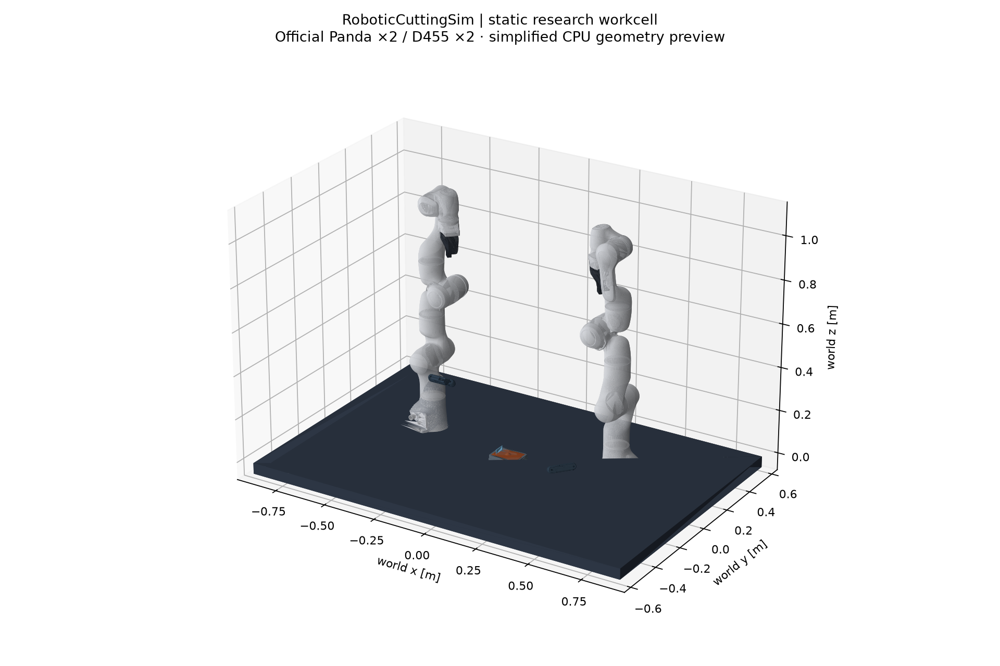

# Static dual-arm research workcell

The scene is built and locally composed from official Isaac6.2 asset hierarchy:
two Franka Pandas, two D455 bodies/native optical prims, global camera, table,
tray, continuous specimen and box knife proxy. It is a usable static research
scene, with articulation/controller/robot-tool dynamics left for subsequent work.

```bash
.venv/bin/python -m robotic_cutting_sim.cli scene --preset workcell --output-dir artifacts/workcell_fresh
```

Outputs: workcell.usda,scene_spec.json,cameras.json,static_validation.json,
manifest.json,result.json and per-URL asset_fetch.json. Default download cache is
artifacts/workcell_asset_cache.13 USD layers totaling21,418,475bytes were fetched;
Franka12 layers and D4551 self-contained composition layer. Source hierarchy is
preserved, with SHA256 receipts and no vendor USD committed to Git.

| Object | Placement / representation |
|---|---|
| Table |1.8×1.2m, topZ=-.01m |
| Tray / material |World origin, tray floorZ=0; specimen120×80×15mm plus continuous bump |
| Franka0 |Base(-.46,.12,-.01)m, yaw0;58 composed meshes |
| Franka1 |Base(.46,.12,-.01)m, yawπ;58 composed meshes |
| D4550 |Native depth optical center(0,-.5,.55)m, looking at material |
| D4551 |Native depth optical center(.5,-.4,.25)m, looking at material |
| Global |(1.65,-1.75,1.5)m, view toward(0,0,.4)m |

D455 source housing axes differ from a USD camera. Exporter measures the native
optical transform and mounts the housing accordingly. Static validation checks
both actual depth-camera optical axes align toward the material with dot product
>0.99999. Both target distances lie within the intended .6–.85m range. Native
color/depth camera prims are retained; no nominal pinhole calibration overwrites
the official lens attributes.

The imported authored Panda pose is shown. Nominal joint park values are recorded
for future controllers and explicitly not applied as simulated robot state.
Physics variant is none, so no unvalidated PhysX articulation is silently started.
The blade remains independent of the arms; its measured motion can be replayed
alongside the static robots. IK, collision-free operation and force feedback are
not claimed.

Use a complete existing hierarchy with:

```bash
.venv/bin/python -m robotic_cutting_sim.cli scene --preset workcell --asset-root /path/to/Assets/Isaac/6.2 --output-dir artifacts/workcell_local
```

This override was tested against the complete downloaded cache. Remote asset-root
references may require Isaac's resolver and are labeled unvalidated when plain
OpenUSD cannot compose them. D455 external MDL shader packages and OmniPBR/OmniGlass
are not validated by this geometry-only cache; the CPU preview uses flat colors.

```bash
CUDA_VISIBLE_DEVICES=1 bash scripts/run_research_demo.sh artifacts/research_fresh
.venv/bin/python scripts/preview_workcell.py artifacts/research_fresh/workcell/workcell.usda artifacts/research_fresh/workcell_preview.png
```

The first command runs the live MPM/RGB-D environment and combines sparse measured
surfaces/tool poses with the complete scene into research_workcell_replay.usda.
The second creates a diagnostic CPU mesh preview without Kit/RTX. Opening either
USD does not run a solver. Live Python API and offline USD replay remain distinct.
The ideal API renderer currently draws material/tool/tray/table and excludes
Franka; native workcell camera rendering is the next independent renderer integration.


