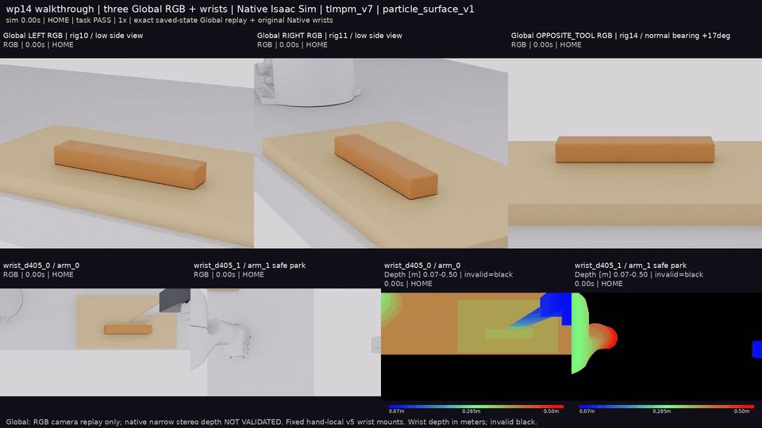
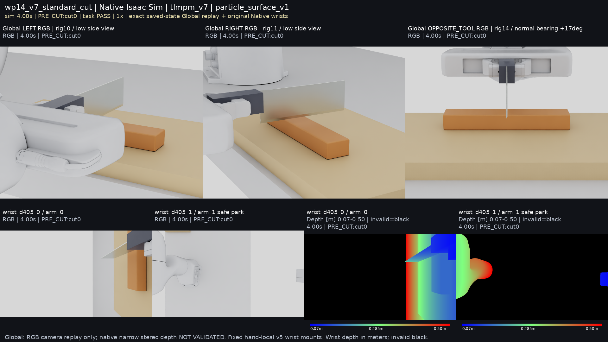

# WP-14 executable CUT scenes

These two explicit research scenes use the exact scene/goal/controller inputs
from the successful Native recordings. Both select original `tlmpm_v7` through
`v7_cut_research_v1`; the general v5 default remains unchanged. One solid board,
the physical knife grasp, the normal Franka 1 park and fixed wrist-camera v5
mounts are retained. The second arm is not aimed at the specimen.

| Scene | Workpiece / operation | Source configurations |
| --- | --- | --- |
| `standard_cut` | 160 × 30 × 20 mm reference bar, midpoint CUT | [scene](../configs/wp14/scenes/standard_cut.json) · [goal](../configs/wp14/goals/standard_cut.json) |
| `firm_offset_cut` | 128 × 32 × 16 mm firm bar, yaw −5°, cut −4 mm | [scene](../configs/wp14/scenes/firm_offset_cut.json) · [goal](../configs/wp14/goals/firm_offset_cut.json) |

The [catalog](../configs/wp14/scene_catalog_v1.json) binds the input hashes,
compiled path_v2 options, seed 42 and unchanged surface profile. Only these
declared inputs are launched; material and solver overrides are not exposed.
Materials are provisional and uncalibrated.

From this checkout, first inspect a CPU-only preparation:

```bash
export PYTHONPATH="$PWD/src${PYTHONPATH:+:$PYTHONPATH}"
.venv/bin/python scripts/run_wp14_scene.py prepare \
  --scene standard_cut --camera-rig-profile wrist_camera_rig_v9 --global-view all \
  --out artifacts/wp14/scene_prepare_NEW
```

Launch and record the actual Native scene on a free GPU:

```bash
.venv/bin/python scripts/run_wp14_scene.py launch \
  --scene standard_cut --gpu 0 --camera-rig-profile wrist_camera_rig_v9 --global-view all \
  --out artifacts/wp14/scene_run_NEW
# Use --scene firm_offset_cut for the second recorded configuration.
```

This entry runs the existing headless Native application, physical grasp,
measured-feedback controller, full plan preflight, RGB-D recording and HOME.
It does not launch the older remote interactive viewer. Use a new output path
for every attempt. `prepared.json` records the exact command/profile;
`attempt.json`, `native.log` and `run/episode_000/` preserve the actual outcome,
measured states, camera transforms and full exported `final_live_scene.usda`.
The exported stage is a recorded scene snapshot; continuing material dynamics
requires the runner, rather than a generic USD playback application.

## Latest scene and real recording

[](media/three_global_v1/wp14_walkthrough.mp4)

**Original v7 CUT profile, 1× simulation time.** The command above records the
physical task once with supported v9/v5 sensor optics, saving each exact live
mesh. It then renders LEFT rig10 / RIGHT rig11 / OPPOSITE TOOL rig14 from that
same measured state stream and retains the original wrist RGB/depth. All three
external views are fixed, low17.12degree views at0.60m. The opposite horizontal
bearing is normal to the material long side; its full3D incidence is17.12degrees.
No simulation is repeated just to obtain another view. The default remains v5
when no camera/display option is passed.



[Full recording](media/three_global_v1/wp14_walkthrough.mp4) ·
[Exact scene/frame provenance](evidence/three_global/scene_001.json) ·
[Camera names, meter depth scale, guards and recording/replay API](GLOBAL_CAMERA_VIEWS.md).

The walkthrough shares the identical-input standard-CUT engineering recording;
it adds no independent adoption sample. All prior scenes/media remain at the
[frozen previous scene page](https://github.com/AnsonNing/RoboticCuttingSim/blob/b9100bcd662bafcb81cefedae424856d047e9e72/docs/WP14_SCENES.md).
The original-v7 CUT profile still does not support general TRIM. Partial and
multi-cut remain experimental. [Frozen scientific scope](reports/WP14_RESULTS.md).
