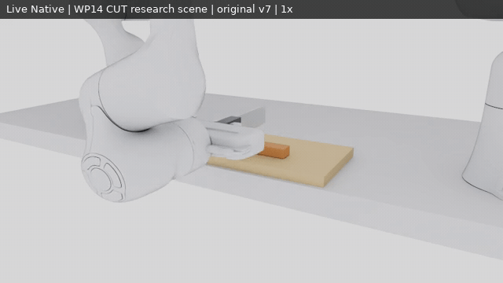
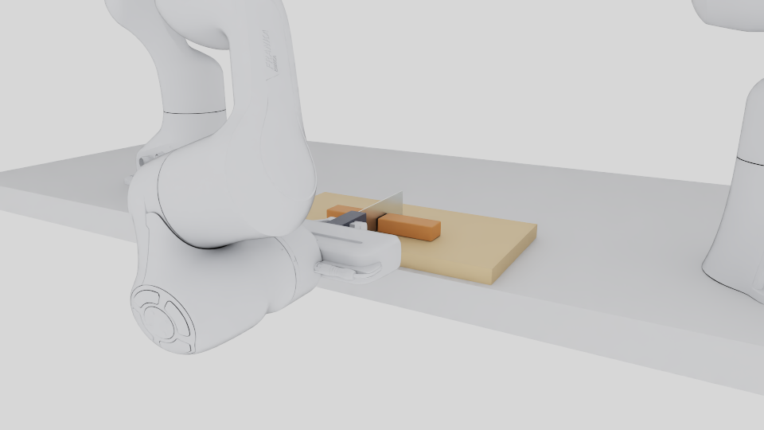

# WP-14 executable CUT scenes

These two explicit research scenes use the exact scene/goal/controller inputs
from the successful Native recordings. Both select original `tlmpm_v7` through
`v7_cut_research_v1`; the general v5 default remains unchanged. One solid board,
the physical knife grasp, the normal Franka 1 park and fixed wrist-camera v5
mounts are retained. The second arm is not aimed at the specimen.

| Scene | Workpiece / operation | Source configurations |
| --- | --- | --- |
| `standard_cut` | 160 × 30 × 20 mm reference bar, midpoint CUT | [scene](../configs/wp14/scenes/standard_cut.json) · [goal](../configs/wp14/goals/standard_cut.json) |
| `firm_offset_cut` | 128 × 32 × 16 mm firm bar, yaw −5°, cut −4 mm | [scene](../configs/wp14/scenes/firm_offset_cut.json) · [goal](../configs/wp14/goals/firm_offset_cut.json) |

The [catalog](../configs/wp14/scene_catalog_v1.json) binds the input hashes,
compiled path_v2 options, seed 42 and unchanged surface profile. Only these
declared inputs are launched; material and solver overrides are not exposed.
Materials are provisional and uncalibrated.

From this checkout, first inspect a CPU-only preparation:

```bash
export PYTHONPATH="$PWD/src${PYTHONPATH:+:$PYTHONPATH}"
.venv/bin/python scripts/run_wp14_scene.py prepare \
  --scene standard_cut --out artifacts/wp14/scene_prepare_NEW
```

Launch and record the actual Native scene on a free GPU:

```bash
.venv/bin/python scripts/run_wp14_scene.py launch \
  --scene standard_cut --gpu 0 --out artifacts/wp14/scene_run_NEW
# Use --scene firm_offset_cut for the second recorded configuration.
```

This entry runs the existing headless Native application, physical grasp,
measured-feedback controller, full plan preflight, RGB-D recording and HOME.
It does not launch the older remote interactive viewer. Use a new output path
for every attempt. `prepared.json` records the exact command/profile;
`attempt.json`, `native.log` and `run/episode_000/` preserve the actual outcome,
measured states, camera transforms and full exported `final_live_scene.usda`.
The exported stage is a recorded scene snapshot; continuing material dynamics
requires the runner, rather than a generic USD playback application.

## Latest scene and real recording

[](media/wp14/scene_walkthrough_native.mp4)

**Original v7 research scene, 1× simulation time.** This extra replay was added
for the user's scene/video update. It is an engineering replay of the already
measured standard CUT, not a new independent adoption sample.



The overview is an unmodified actual captured RGB frame at 7.2 s. Presentation
views are separate from policy observations. [Full recording](media/wp14/scene_walkthrough_native.mp4),
[source frames, hashes, scene inputs and actual result](evidence/wp14/scene_refresh_001.json).
The existing [paired Native comparisons](../README.md#cut-research-profile-wp-14)
remain available. TRIM remains unsupported by this profile; Partial and
Multi-cut remain Experimental. [Scientific scope and retained failures](reports/WP14_RESULTS.md).
