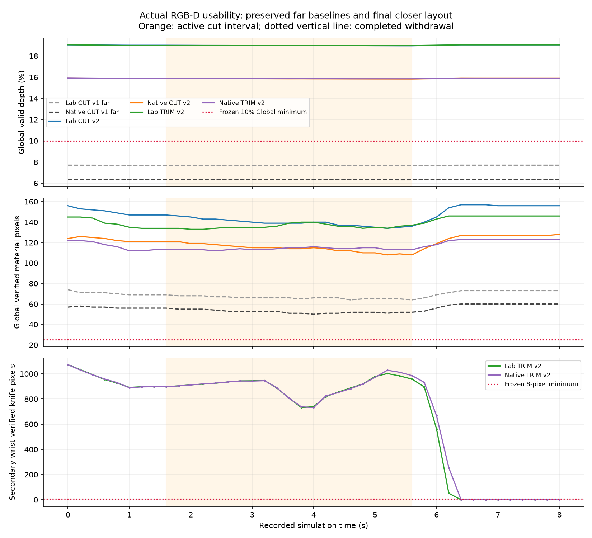

# Independent wrist-camera validation

This report separates measured camera mounting, programmable RGB-D usability,
sampled visual clearances and actual cutting physics. It does not promote the
ideal D405 prototypes to calibrated hardware models or declare the full
simulation benchmark complete. The layout and execution commands are in
[WRIST_CAMERAS](WRIST_CAMERAS.md). [The public audit receipt](evidence/wrist_camera_audit.json)
retains all four full final episodes, baseline comparisons, source/input
hashes, strict failures, actual moving-arm evidence and occlusion diagnosis.

## Frozen criteria and provenance

[The camera audit protocol](../configs/wrist_camera_audit_v1.json) was frozen in
`7c2a57d`, with the effective runtime-FOV requirement added in `07c76ff` after
the retained 640 × 480 pilot and before the final full episodes. The criteria
were not relaxed for the closer Global camera. The minimum Global valid-depth
fraction remains 10%; wrist minima are 5% each. Required depth-consistent
material pixels are 128 / 128 / 25 and knife pixels are 16 / 8 / 8 for primary
wrist, secondary wrist and Global, respectively.

The wrist profiles must have runtime horizontal FOV 87 ± 2° and vertical FOV
58 ± 2°, computed from each actual frame's dimensions and K. The selected
848 × 480 square-pixel profile has effective FOV about 87 × 56.485°, with
logical depth range 0.07–0.50 m. Authored USD lens metadata cannot pass this
check if the actual render-product intrinsics disagree. Global's distinct
native and ideal projections are recorded separately.

Each complete episode requires all 401 measured hand/camera samples at 20 ms
spacing over 8 seconds. Translation, rotation and inverse tolerances are
10 µm, 0.1 mrad and 1e-7 maximum matrix error; the fixed Global drift tolerance
is 0.1 µm / 0.1 µrad. Frame/physics/surface/pose timestamps must agree within
1 µs. At least 90% of the 1 mm reference flat-base top grid must lie inside
the union of the two wrist frusta at every recorded camera frame. This is
frustum coverage, not a guarantee of unoccluded depth at every grid point.

The independent CPU audit snapshots its own analysis sources before reading
the data, verifies they remain unchanged, hashes all consumed payloads and
resolves the recorded runtime source hashes against retained bytes or exact
Git blobs. It advances neither the solver nor a camera. Full current-scene
ray tracing uses the actual exported scene, actual saved articulated-body
poses, actual per-frame calibration and that frame's material surface.
Native USD render purposes, instance proxies and sidedness are respected;
the Lab ideal renderer's separate geometry convention is retained.

Visibility attribution is checked against actual measured depth with a 1 mm
ideal / 2 mm native-Global tolerance. Every valid depth error, mask hole and
rare silhouette tail remains in the error statistics. Counts are engineering
usability screens, not native semantic segmentation or a complete camera
accuracy acceptance. Rays begin at the actual render-near distance before
working-range filtering, so a close gripper or bracket cannot disappear as
an occluder merely because it lies nearer than the useful depth range.

For every post-split recorded frame, the physical partition is recomputed
from the actual reference stencils, positive weights, stress gradients and
current persistent codes. Its hash/counts must agree with the rendered
component ranges. Every component in that current partition needs at least
one depth-consistent pixel in some camera. Labels are not carried backwards
from the final topology. This binds partition provenance; it is not an
independent reconstruction of every saved constitutive state.

## Preserved far-Global baselines

The full v1 CUT episodes remain unchanged. Both have 400 actual control
intervals, 8 seconds, 41 recorded three-camera frames, and 401 pose samples.
Their FK, inverse, time, runtime wrist optics and current-component visibility
checks pass. Their Global valid-depth fraction fails the unchanged 10%
requirement, motivating the separately versioned closer placement.

| Actual v1 recording | Minimum Global valid depth | Minimum Global material / knife pixels | Camera usability |
| --- | --- | --- | --- |
| `isaac_lab_wrist_cut01_001` | 7.6771% | 64 / 10 | FAIL: Global valid-depth fraction |
| `isaacsim_wrist_cut01_001` | 6.3249% | 50 / 8 | FAIL: Global valid-depth fraction |

The primary / secondary wrist material-pixel minima are 13,022 / 5,699 in Lab
and 13,086 / 5,717 in native Kit; knife minima are 2,903 / 755 and 2,905 / 755.
Both wrists pass the frozen usability screens throughout. Hard depth tails
are retained: Lab wrist maxima are 230.12 / 153.85 mm despite sub-micrometre
p95 agreement; native Kit's secondary wrist maximum is 274.91 mm and native
Global maximum is 609.08 mm. These tails are not removed to make an accuracy
claim. CPU geometric attribution and native sensor fidelity remain separate.

Raw baseline audits are `artifacts/wrist_lab_cut_camera_audit_001` and
`artifacts/wrist_native_cut_camera_audit_001`; independent Task audits are
`artifacts/wrist_lab_cut_task_audit_001` and
`artifacts/wrist_native_cut_task_audit_001`. Both CUT Task scores recompute as
PASS with two 72 g mechanical components and unchanged 144 g reference mass.
Camera usability failure does not erase that physical result.

The v2 smoke `isaacsim_wrist_rig_smoke_003` is only two control intervals /
three camera frames. Its separate audit
`artifacts/wrist_camera_native_pilot003_audit_001` reports Global valid depth
15.908–15.913%, first-frame material 122 / knife 12 verified pixels and passing
scoped FK/optics/visibility checks. It retains a rare native depth tail of
about 0.85 m. It is not a full-episode acceptance result.

## Closer v2 full episodes

The final rig uses the corrected 42 × 42 mm front / 23 mm depth D405 visual
housing and a closer fixed Global placement. The wrist optical mounts,
physics recipes and audit thresholds are not changed to improve a score.
The v1 recordings remain their original version; their housing dimensions
and far Global pose are not retroactively relabelled.

| Final actual recording | FK / inverse / time | Optics and usability | Global minimum valid depth | Global material / knife minima |
| --- | --- | --- | --- | --- |
| `isaac_lab_wrist_cut01_002` | PASS | PASS | 18.9570% | 134 / 23 |
| `isaacsim_wrist_cut01_002` | PASS | PASS | 15.8337% | 108 / 19 |
| `isaac_lab_wrist_trim01_001` | PASS | FAIL: postwithdrawal secondary knife | 18.9844% | 133 / 9 |
| `isaacsim_wrist_trim01_001` | PASS | FAIL: postwithdrawal secondary knife | 15.8490% | 112 / 9 |

All four runs have 401 pose samples and 41 three-camera RGB-D frames each, with all recorded
runtime implementation bytes resolved and unchanged independent analysis
sources. Every current post-split physical component is visible in at least
one camera at every recorded post-split frame. This minimal pixel condition
does not imply every component is fully visible in both wrist views.
All 4,800 reference footprint points lie in the union of the two wrist frusta
at every saved frame. The per-frame worst-component best-view pixel minima
are 4,749 / 4,751 for Lab / native CUT and 462 / 453 for TRIM.

The native CUT Global maximum valid depth discrepancy is **849.09 mm**, while
the maximum framewise p95 is 0.477 µm. Its secondary wrist maximum is
274.91 mm; the primary wrist maximum is 0.0131 mm. Lab's corresponding maxima
are 0.0133 mm Global, 32.10 mm secondary and 0.0054 mm primary. These maxima,
mask differences and all error tails remain in the receipts. A usability
PASS therefore does not mean tail-free depth or calibrated native sensing.

Native TRIM retains maximum valid depth discrepancies of 12.38 / 314.18 /
849.09 mm for primary, secondary and Global; Lab TRIM retains 205.45 /
0.0121 / 0.0093 mm. These are full untrimmed maxima, including rare silhouette
errors. Raw actual RTX reference comparisons remain separate from public
native Global depth, so geometric synchronization does not substitute for
native sensor quality.

TRIM's secondary knife falls below the frozen 8-pixel all-frame requirement
only at the nine saved postwithdrawal times **6.4,6.6,…,8.0 s**. It has zero
knife pixels in both backends then. A knife-only current-pose reference still
projects 1,389–1,401 working-range pixels, but the active arm's actual palm
occludes every one in the whole-scene first-hit calculation. Native
`panda_hand/hand_3` occlusion agrees with actual raw RTX depth on those pixels
within 0.172 µm maximum, with no pixel above 1 mm error. Lab's ideal renderer
also includes its `hand_c` guide geometry; that backend distinction is kept.
This diagnosis changes neither the full-episode FAIL nor the mount.

Descriptively, every one of the 21 recorded active-interval frames from
1.6–5.6 s sees the knife in **all three** TRIM cameras: minimum counts are
1,633 / 732 / 9. Their per-view material minima are 9,749 / 2,317 / 133 in
Lab and 9,788 / 2,322 / 112 in native Kit. During active cutting, the worst
current component has at least 515 / 518 pixels in some Lab / native view.
After withdrawal the primary and Global continue seeing the knife, both
wrists continue seeing material, and every physical component remains
visible somewhere. These role-specific measurements are not newly fitted
PASS thresholds. The strict all-frame secondary-knife gate stays FAIL.



## Independent physical task regression

The camera audit never infers cutting success from an image. Separate offline
Task audits use the actual immutable mass vector, particles, reference
stencils, stress gradients, persistent cut history and final current mesh.
Every recorded check, metric dictionary and Task status matches independent
recomputation exactly. All four final episodes retain their earlier fixed-camera
reference stencils, particle counts, initial mass, final component masses,
zero history rewrites and strict Task status. This is fixed-resolution task
regression evidence, not bitwise trajectory/state equality or convergence.

| Final task | Particle spacing | Physical graph and masses | Strict Task score | Active max edge error | Interface-work residual |
| --- | --- | --- | --- | --- | --- |
| Lab CUT | 1 mm | 1 → 2; 72 + 72 g | PASS | 0.22164 mm / 0.02664° | 17.17% |
| Native CUT | 1 mm | 1 → 2; 72 + 72 g | PASS | 0.21165 mm / 0.02530° | 17.59% |
| Lab TRIM | 2 mm | 1 → 2; 1.608 + 144.024 g | FAIL: surface quality | 0.26894 mm / 0.02170° | 38.14% |
| Native TRIM | 2 mm | 1 → 2; 1.608 + 144.024 g | FAIL: surface quality | 0.22112 mm / 0.01771° | 33.05% |

CUT preserves the original 96,000-particle / 144 g bar. TRIM explicitly uses
the resolution-dependent 12,136-particle / 145.632 g follow-up, removing
98.5294% of reference mass initially above the plane. This does not erase the
earlier 1 mm TRIM failure. Both final tasks retain sampled disconnected
topology for 2.4 s after the scheduled cut; sample cadence is 20 ms in Lab
and 200 ms in native Kit. No particle deletion or render-mask proxy supplies
the graph or mass result. Baselines are the original `*_cut01_001` and
`*_trim01_coarse_001` recordings described in
[the fixed-task report](reports/CUTTING_TASK_EPISODES.md).

Strict TRIM mesh p95 / RMS plane errors remain 1.66841 / 0.62377 mm in Lab
and 1.67224 / 0.55190 mm in native Kit; integrated overcut remains 2.04360%
/ 2.01925%. Raw full-footprint maximum gouge remains 20 mm, including the
preserved boundary/missing-column behavior. The original analytic geometry
goal is not replaced by a fitted or cropped target.

All saved states/reactions are finite and the available broad numerical
contact screens pass. Minimum interval det(F) is at least 0.91474; maximum
tool/material penetration is at most 0.43750 mm. Actual Lab non-tool native
rigid penetration is at most 32.494 µm; native Kit rigid-contact distances
remain unrecorded. The partitioned interface-work residuals above still
fail the unchanged 10% screen. Whole-task same-source determinism, matched
feedback controls, calibrated material/fracture behavior and full 18-gate
acceptance are not promoted.

## Visual clearance hierarchy

The camera OBB audit checks each 20 ms sample against the actual table,
task fixtures and measured knife envelope. A positive separating-axis gap
certifies a conservative distance lower bound; an OBB overlap needs finer
inspection and is not measured physical penetration. The required bound is
2 mm. V1 CUT's minimum certified table/fixture/knife gap is 154.638 mm in both
backends.

[A separate robot-surface protocol](../configs/wrist_camera_clearance_audit_v1.json)
was committed in `60d1058` before the final v2 full outputs were opened.
It assigns nested visual meshes to their closest actual rigid-body ancestor,
excludes the attached camera/tool geometry from robot meshes, and checks
each camera housing/bracket OBB against official robot triangles at every
saved pose. Only **Bracket against its exact own parent palm** is an intentional
attachment exception; its intersections remain counted. Housing, fingers,
the opposite arm and all other links receive no attachment exception.

Zero unexcepted triangle/OBB intersections is a sampled visual-surface result.
Closed-volume containment, exact minimum mesh distance, collision between
sample times, native contacts and camera inertia remain unmeasured by this
check. The visual-only camera parts have no native contact colliders. A
clear visual mount therefore does not imply calibrated robot–camera contact
physics. Earlier rejected mounts and the corrected mechanical-axis versions
remain in their own rig geometry receipts.

The sampled robot-surface screen remains **FAIL** in both v1 and v2 CUT.
The sole unexcepted pair is the primary wrist **Bracket against its own
`panda_link7`**: 73 triangles in v1, 74 in v2, at every one of the 401 samples.
Every housing and all remaining robot-body pairs have zero sampled surface
intersections. The prefrozen exception covers only the exact parent palm,
so it is not expanded after observing the flange attachment.

For v2 CUT, actual triangle clipping locates the intersected visual surfaces
within hand-frame bounds X −39.7707 to −34.8493 mm, Y 23.6399 to 32.7328 mm,
Z −19.2167 to −12.0081 mm. The nominal bracket anchor is (−40,30,−15) mm.
Along the rod toward its housing, the intersected region spans −4.000 to
+1.3352 mm from that anchor, compared with a 73.3377 mm nominal rod span.
The −4 mm end is the rod's explicit end padding. The bounds vary by at most
45.4 nm in native Kit and 19.3 nm in Lab over the full motion, consistent with
an attachment to the fixed wrist assembly. This is descriptive evidence of
where the visual overlap occurs, not an authored CAD allowance or a relaxed
PASS. No native attachment contact, mass or inertia model is present.

The v2 CUT conservative camera/table/fixture/knife gap is at least 154.964 mm.
Thus the own-wrist bracket finding is separately retained from the much
larger certified separation from the cutting tool and workpiece supports.
Both TRIM runs have the same sole 74-triangle bracket/link7 finding and a
camera/table/fixture/knife certified gap of at least 185.964 mm. All four
retain the literal sampled robot-surface FAIL.

## Actual moving secondary wrist control

The separate native `isaacsim_wrist_motion_probe_001` records 100 actual
control intervals / 2 s, 101 measured pose samples and 21 three-camera
frames. Its independent trace/FK/inverse/time/optics audit passes. The second
arm actually changes its joints by up to 0.081217 rad; its camera moves
28.113 mm and rotates 0.081440 rad from its initial pose. The primary wrist
camera also moves 40.849 mm, while measured Global translation/rotation drift
is exactly zero. Both moving cameras stay fixed to their actual measured
hands under the same immutable local mounts. This is an executed motion
control, not a formula-only or static parked-arm demonstration. It remains
a partial probe with no CUT/TRIM Task success claim.

## Reproduction and interpretation

Use fresh output directories; existing artifacts are never overwritten.

```bash
.venv/bin/python -m pytest -q \
  tests/test_wrist_camera_audit.py tests/test_wrist_camera_clearance.py
.venv/bin/python scripts/audit_wrist_camera_rig.py \
  --episode artifacts/EPISODE --output-dir artifacts/wrist_rgbd_audit_NEW
.venv/bin/python scripts/audit_wrist_camera_clearance.py \
  --episode artifacts/EPISODE --output-dir artifacts/wrist_robot_clearance_NEW
.venv/bin/python scripts/audit_cutting_task_episodes.py \
  --recording-dir artifacts/EPISODE --output-dir artifacts/wrist_task_audit_NEW
```

Eleven analytic CPU controls cover stale camera poses, Global drift, missing
control samples, effective runtime projection, near/far/behind-camera rejection,
untrimmed errors and holes, rigid-covariant OBB separation, nested mesh ownership,
the attachment exception, triangle crossings, metric intersection tolerance
and rigid-covariant clipped intersection bounds.

Force and material oracle state remain analysis data outside policy
observations. The unchanged strict TRIM surface-quality goals, contact/work
screens, repeated-run determinism, real D405 calibration and the complete
18-gate simulator acceptance retain their own statuses; a camera-usability
PASS cannot promote them.
