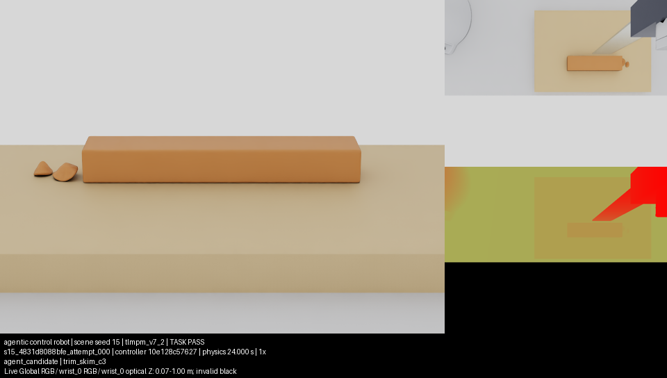

# Agentic control robot: Native recovery and continued cutting research

Status: **EVALUATION COMPLETE**. The agentic control robot's authored C3 scored
**4/4 development successes and 4/4 fresh formal successes**, reported as
separate cohorts. All eight autonomous successes retain complete verified
MP4s. The previous bounded study remains a separate, unchanged record.
Publication and exact-version CI are tracked in [PR9](https://github.com/AnsonNing/RoboticCuttingSim/pull/9).
The [compact result and evidence inventory](../evidence/wp15/recovery_summary_001.json)
records every completed scene and its source/result/media hashes.

## Runtime changes and actual validation

The opt-in streamed recorder writes the original reference positions, masses,
stencil nodes, weights and gradients once, then appends sampled time, positions,
velocities and cut codes. Each committed sample is flushed before an atomic
checkpoint update. Read-only memory maps recover the committed prefix after an
interruption; incomplete recordings cannot pass integrity. A subprocess
interruption check and exact legacy-versus-streamed evaluator comparison pass.
The default legacy recorder remains available.

This mode also retains only the latest live material sample, avoiding duplicate
unbounded histories and final stacking. Recorded precision, TLMPM v7_2 physics,
goal thresholds, support-interface connectivity and code-zero bridges are
unchanged. Whole-process Native memory measurements include rendering and
other runtime allocations; they do not isolate the recorder's causal effect.
Host headroom also improved relative to the previous study. Historical cgroup
OOM counters did not identify every victim and remain qualified accordingly.

Some Native/file-evaluator report pairs differ only by two float64 ULPs
(5.55e-17 kg) in the reported total mass. The evidence audit allows at most
four ULPs for this single diagnostic and reports both original values. All
outcome values, decisions, types and other fields must match exactly; original
scores, recording files and the media-to-result identity check are preserved.

The versioned `isaac62_physx_offline_v1` profile presents byte-verified official
registry metadata through episode-owned local registries. It enables the
installed registry extension, configures the actual process registry provider,
and activates the installed contact extension. Vendor payloads, manifests,
shared installations and required sensors are preserved. Runtime receipts pin
Isaac Sim 6.2.0.0, Kit 110.4.0 build 187cf21b, physics sensor 4.0.0 and the
original PhysX 110.4.4 dependencies. Sensor activation and actual fresh
post-physics updates are checked separately.

Three preserved startup failures preceded the first complete episode:

| Attempt | Actual evidence | Result |
| --- | --- | --- |
| 001 | Startup completed; primary reset exception was obscured during Kit teardown. Premature registry-module import is a probable cause, not a confirmed original exception. | FAIL initialization; no scored transition |
| 002 | The real offline provider read its official metadata, then a literal URL comparison rejected equivalent local file URLs. Error receipts persisted before teardown. | FAIL initialization; no scored transition |
| 003 | Actual contact extension and native plugin started offline. The fresh frozen checkout lacked the ignored official Franka USD cache. | FAIL asset provisioning; no scored transition |

Semantic local-URL comparison fixed attempt002. The official asset cache was
copied from the preserved previous frozen environment and every file verified
for attempt004. No seed, controller, physics or scoring change accompanied
that retry. Provenance now records the actual frozen solver commit in Native,
and inherited controls retain their original controller commit and parent run.

## Complete scripted feasibility reference

Seed0, with two irregular protrusions, completed **1200 actions / 24 seconds**
under the real offline sandbox and GPU1 device isolation. Frozen runtime source
is `fdaffffb99ffc3433f921fac2741e234cd38ae11`. The original read-only physical
evaluator actually executed both before Native teardown and independently in
the external file-evaluation process; both results were PASS.

| Measurement | Result |
| --- | --- |
| Complete physical stream | 121 samples, 0–24 seconds, 103581 particles; finalized and complete |
| Integrity / mechanical outcome | PASS / PASS |
| Detached target mass | 100% for each protrusion; three mechanical components |
| Detached mass below the plane | 0%; original substrate thresholds pass |
| Surface quality / HOME | Measured separately / NOT_RUN |
| Native contact updates | All 13000 settling/coupled readings valid and fresh, with advancing steps and time |
| Live cameras | 121 synchronized Global RGB-only and wrist_0 RGB/depth/mask pairs; recorded calibration agrees |
| Parked arm_1 | Command unchanged; maximum measured joint error below 1e-10 rad |
| Captured process RSS | 5581384–6403528 KiB; no new observed cgroup OOM counter |
| RSS before/after recording finalization | 5654000 / 5654040 KiB; no final-stack spike at these measured boundaries |
| Full MP4 | Entire decode PASS; frame, physical-recording and source identities PASS |
| Episode wall time | 939.54 seconds, including the independent external evaluation |

The full MP4 SHA256 is
`30c4fca85323b01d70c9ca2290a28770c4493f46d307b05f19b2ca5924ff0601`.
Complete raw frames, physical arrays and failed attempts are retained locally.
This controller is the existing scripted diagnostic and **is excluded from
every autonomous success rate**. Mechanical disconnection does not require a
detached chip to disappear from the camera; images are never the task scorer.
Descriptive surface measurements remain separate: p95 absolute plane error
0.480 mm, reconstructed overcut-volume fraction 1.38%, and maximum gouge-depth
proxy 20 mm. These values do not establish complete surface-quality acceptance.
Material parameters and simulated camera calibration remain provisional and
uncalibrated against physical hardware.

## Autonomous continuation

The exact inherited C2 completed the one-protrusion seed1 through the same
frozen adapter and offline sensor namespace: 1200 explicit actions, including
137 cut-enabled actions, and 24 seconds. Recording integrity and runtime
readiness PASS; mechanical outcome FAIL. Its true detached target fraction is
64.8%, below the unchanged 90% threshold. Substrate retention passes, with no
detached mass below the plane. There were no rejected actions. Complete raw
failure data and the controller's own observations and events are preserved.

The existing researcher continuation started with exact inherited
C1/C2 sources, prior reasoning and the completed C2's own sensor/proprioception
diagnostics plus sanitized independent outcome feedback. It analyzed its
observations and completed paired inherited comparisons on seeds15 and29.
Supervision supplies environment repairs and evaluation, without providing a
successful trajectory or privileged material state.

The inherited C1 revision completed both development scenes with the same
frozen controller SHA256
`8202b0cd3060feaa64a13418baf112cc7fe808bbeb37e83158d2812c89c341b3`.
These are inherited-baseline results, not a new revision or held-out evidence.

| Development seed | Protrusions | Complete actions / duration | Integrity | Detached mass per protrusion | Mechanical outcome |
| --- | --- | --- | --- | --- | --- |
| 15 | 2 | 1200 / 24 s | PASS | 70.10%, 69.69% | FAIL |
| 29 | 2 | 1200 / 24 s | PASS | 60.27%, 75.02% | FAIL |

Both scenes retain the required substrate mass, with no detached mass below
the plane. All requested actions were accepted. The original evaluator finds
connected target residue extending roughly 0.39–0.44 mm above the cut plane,
although the controller's final depth survey reports no elevated clusters.
This is a measured discrepancy between its perception summary and physical
outcome, rather than evidence of runtime failure. It does not by itself
identify a causal remedy. Surface quality remains descriptive and HOME is
NOT_RUN.

The matched inherited C2 comparison also completed both scenes with full
1200-action, 24-second recordings and independent evaluation:

| Development seed | Integrity | Detached mass per protrusion | Mechanical outcome | Wall time (s) |
| --- | --- | --- | --- | --- |
| 15 | PASS | 70.10%, 0.00% | FAIL | 1758.96 |
| 29 | PASS | 0.00%, 0.00% | FAIL | 1942.37 |

Both local strokes returned completion with zero rejected actions in each
scene. Substrate retention passes with no detached mass below the plane.
The physical evaluator still finds target material connected, including both
entire targets in seed29; successful motion commands do not establish cutting
success. The inherited paired baselines are therefore C1 **0/2** and C2
**0/2**, with four complete/scored episodes on two distinct scenes and no
Native infrastructure error.
The separate preflight failure remains recorded below.

These seeds change the sampled solid geometry, verified against the recorded
initial particles and static references; they are not cosmetic variants.

| Seed | Bump families | Heights (mm) | Centers along the bar (mm) |
| --- | --- | --- | --- |
| 15 | irregular / irregular | 7.858 / 7.776 | -29.236 / 47.447 |
| 29 | dome / irregular | 5.646 / 9.914 | -36.355 / 30.479 |

Radii, transverse positions, yaw and asymmetry also vary. Both comparison
scenes have two bumps. Material, solver, goal and controller hashes agree,
and all 131 recorded source hashes match the frozen checkout. This establishes
development geometry diversity; the separate fresh formal results follow
below.

The first comparison submission failed before Native startup because the
frozen checkout's Git alternates referred outside the research sandbox. Its
objects were made self-contained, the retired alternates file retained, and
the exact source commit/tree verified with the original Git check inside the
actual research namespace. The agent independently prepared a temporary
development-only index check while that repair was in progress; this wrapper
and its limitation are retained. It changes no controller, physics, GPU guard
or external evaluator. The independent canonical source check also passes.

The agent then authored and committed C3 as a child of the exact inherited C1
revision. Its method change moves the cut plane from 0.5 mm above the measured
surface to 0.1 mm below it; its other control logic is retained. The agent's
card attributes this development choice to the residual target layer and
incomplete local-stroke results. Supervisors supplied no trajectory. C3's
controller SHA256 is
`10e128c57627a6f304471c7d9c9ddeecf7b2206a10add218776ce039f8efa506`.
Its committed source matches the submitted bytes; the parent remains intact.

C3 seed15 completed **1200 actions / 24 seconds**. Independent integrity and
mechanical outcome both PASS: **100% detached mass for each target**, required
substrate retention, and zero detached mass below the plane. This is the
first true autonomous task success in the continuation. Its complete MP4
decodes and all frame, source, controller and physical-result identities pass.
MP4 SHA256:
`4834b95b24b5828c5517e6187a188ba047cc008ed0e481b57d6c5d256908c448`.
Full raw evidence is retained. Its wall time was 949.98 seconds.

This is the unchanged final frame from the retained episode. The original
material-state evaluator supplies the mechanical verdict; the image documents
the scene and camera evidence.

The same completed episode contains 287 accepted, actually executed
cut-enabled actions, with zero IK failures, rejections or clamps. All 13000
contact readings are fresh and valid; all 121 live camera pairs and calibration
timestamps agree. The original parked arm_1 and fixed wrist mounts pass.
Quality remains descriptive: p95 plane error 0.486 mm, overcut-volume proxy
0.774%, maximum gouge-depth proxy 20 mm, and missing surface fraction 0.0391%.
HOME is NOT_RUN; complete surface-quality acceptance is not established.

The paired C3 development batch completed both scenes: **2/2 complete/scored,
2/2 mechanical successes, zero infrastructure errors**. Seed29 also removes
100% of both targets, retains the required substrate, and has no detached mass
below the plane. Its full MP4 hash is
`a15add7b489806e8a47823899391700a24e47959623e8ad22e42912817b6c3a2`;
entire decode and all source/frame/result identity checks pass. Its surface
p95 error is 0.482 mm, overcut-volume proxy 0.784%, and maximum gouge-depth
proxy 20 mm; these remain descriptive. HOME is NOT_RUN.

This paired development result improves over the inherited parent's 0/2 on
the same two geometries. The agent independently submitted two additional
development seeds, 7 and 512, with unchanged C3 controller bytes. Seed7 has
two protrusions (irregular and dome) and
completed 1200 actions / 24 seconds, including 291 requested and executed
cut-enabled actions. Independent integrity and mechanical outcome PASS, with
100% removal of each target, required substrate retention and no detached mass
below the plane. Its complete MP4 decodes and all source/frame/result checks
pass; SHA256 is
`1b77522c068e77c9a40b918fc9777c5dfb3abdeb1929f3d05a1fb96d2a8c3394`.
Seed512 also completed 1200 actions / 24 seconds, including 141 requested and
executed cut-enabled actions. It has one dome target; independent integrity and
mechanical outcome PASS with 100% removal, required substrate retention and no
detached mass below the plane. Its complete MP4 passes full decode and all
source/frame/result checks; SHA256 is
`5d583ad1092386180ce0fd1fed10f13f7a10c7b3e1bab10133e086b248471e44`.
Its p95 plane error is 0.483 mm, overcut-volume proxy 0.706%, and maximum
gouge-depth proxy 1.401 mm. Quality is descriptive and HOME remains NOT_RUN.

The additional development batch is **2/2 complete/scored and 2/2 successful**.
C3 therefore has **4/4 development successes**, on four distinct seeds
including both one- and two-protrusion scenes, with zero Native infrastructure
errors. These exposed scenes remain development data.

## Fresh independent evaluation

The researcher selected node n3 at controller commit
`87e2a5642d4642ad3b09384e176530cc2603e2d0`. The staged controller and declaration
pinned its bytes before independent seed assignment. Comparison against the
committed source confirms the same SHA256. The agent's pre-submission hash
command lost its visible output through a shell redirection; it saw the
confirmation after submission. That limitation is retained separately from
the actual source freeze and does not change the recorded controller. The standard
formal path declared four fresh seeds: **210456, 227441, 266178, 299491**.
They do not overlap the development or previous study's exposed formal seeds.
This evaluation uses the original canonical frozen-source check, original
physical evaluator and GPU1 lock, with the authorized capacity-wait waiver.
All four declared scenes completed and were independently scored, with no
missing seeds, infrastructure errors, retries or replacements. Every scene
contains 1200 explicit actions / 24 seconds and 121 material-state samples.

| Fresh formal seed | Bumps / families | Detached target mass | Integrity / mechanical outcome | Executed cut-enabled actions | Wall time (s) |
| --- | --- | --- | --- | --- | --- |
| 210456 | 1 / dome | 100% | PASS / PASS | 165 | 702.211 |
| 227441 | 2 / gaussian, dome | 100%, 100% | PASS / PASS | 325 | 937.859 |
| 266178 | 2 / irregular, irregular | 100%, 100% | PASS / PASS | 305 | 612.977 |
| 299491 | 1 / irregular | 100% | PASS / PASS | 191 | 550.219 |

Across C3's eight development/formal scenes, all eight geometry hashes,
recorded static-reference hashes and original initial-particle hashes differ.
These actual scenes contain 13 protrusions: three one-bump and five two-bump
scenes, with dome, gaussian and irregular families and heights 5.153–9.914 mm.
Size, location, yaw and asymmetry vary while material, solver, goal, controller
and all 131 recorded source-file hashes remain fixed. This verifies changed
solid geometry rather than cosmetic variation.

The selected controller's fresh formal result is **k=4 successes / n=4
complete-scored episodes**, out of **4 declared**, with **0 infrastructure
errors**. The original ledger's 95% Wilson interval is **51.01%–100%**.
This is evidence of generalization to four fresh scenes from the same seeded
geometry distribution. It does not establish performance across the full seed
range, new material parameters, arbitrary workpiece poses or physical hardware.
Development results are not pooled into this formal rate.

Every formal scene retains substrate mass share `0.9999999999991656`, with zero
detached mass below the plane. Formal surface p95 plane error spans
0.479–0.487 mm and reconstructed overcut-volume proxy 0.725–0.771%.
The maximum gouge-depth proxy remains 20 mm in all four scenes, with missing
surface fraction 0.0195–0.0391%; these original quality measurements are
retained and do not establish surface-quality acceptance. HOME is NOT_RUN.

The complete formal MP4 SHA256 values are:

- Seed210456: `97ea598357e676ea71f4ed0cdf09ec412696012d38a03564d184be634f8c2b8a`.
- Seed227441: `f45739beffa178ce5a52799e6684a7959ed0c9d8e498f0c1f872be9d8da1cb12`.
- Seed266178: `eaa8ae4708f6ff3c5ff305e38ea4c4429c234f0630ebc8fcaa484a7a834edf77`.
- Seed299491: `fa4287215d61297424e655653803ba040ec4d0beccdba1b7ae1f36640802f253`.

All four pass entire decode and frame, recording, controller, source and
original physical-result identity checks. Across this recovery, all **nine**
independently successful Native episodes have complete verified MP4s: eight
autonomous C3 episodes and one separately labelled scripted reference.
All **14** complete Native episodes retain original physics and independent
scores, including the five inherited-controller mechanical failures. The
three startup failures and separate Git preflight failure are preserved and
excluded from mechanical denominators. Large media and full raw provenance
remain local; no successful physics was rerun for media verification.
Original pending-start marker files are retained as history; finalized success
manifests and full verification receipts establish the complete media state.
