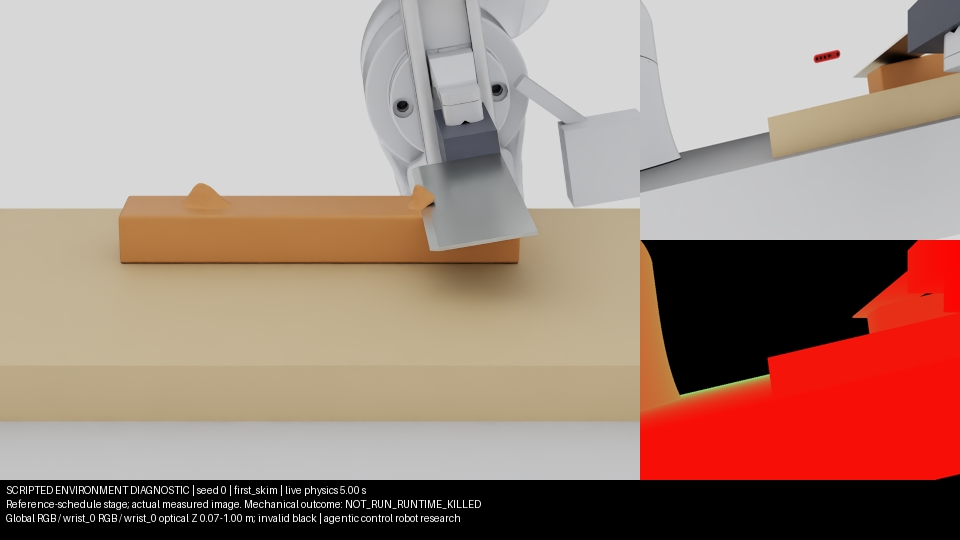

# Agentic control robot: seeded trimming study

This bounded study ran on 2026-11-02–03. The existing agentic control robot
research runtime authored two cutting methods, revised its first controller,
submitted matched development experiments, selected a frozen candidate and
completed a fresh held-out batch. No autonomous cutting success was established.
All completed study attempts ended during startup or runtime, before a complete
physics recording. Mechanical success rate and physical generalization are
**NOT_RUN**, rather than measured zero-percent cutting performance.

The seeded scene generator, actual live camera smoke and CPU contracts are validated.
These engineering results do not establish either controller's cutting ability.
The [compact outcome inventory](../evidence/wp15/study_summary_001.json) retains
the scene seeds, controller hashes, original errors and measured attempt costs.

## Frozen environment and observations

Study simulator commit: `9b91d3556f6b0fac102e58b37bdbf3db6bce887f`.
Scene protocol: `rcs_trim_random_sim_v1`; policy seed 0; simulation seed 42.
Each scene seed compiles a fresh, initially continuous specimen with one or two
protrusions from dome, Gaussian, irregular and ridge families. Twelve preparation
seeds produced twelve distinct actual initial-particle hashes; both counts and
all families were represented, and same-seed compilation reproduced full hashes.
Material parameters remain provisional and uncalibrated.

Actual Native observations are fixed rig14 Global RGB and hand-mounted wrist_0
RGB-D, calibration and synchronized clocks, plus arm_0 proprioception and public
task/action limits. Global depth is absent. The parked second arm has no policy
observation or action channel. Explicit actions are required; reference playback,
generator truth, particles, cut codes, force and measured tool truth are excluded.
The existing camera-depth guard, v5/v7/v7_2 solvers and physical thresholds remain
unchanged. Details and actual smoke images: [environment contract](../AGENTIC_TRIM_CHALLENGE.md).

The unchanged independent scorer requires at least 90% detached mass for every
protrusion, at least 99% substrate retention and no code-zero support bridges.
Integrity, outcome, surface quality and HOME are separate. A full episode is
24 physical seconds; missing final physics cannot be replaced by a visual judgment.

## What the agent wrote

| Version | Agent commit | Controller SHA256 prefix | Proposed method |
|---|---|---|---|
| C1 initial | `05858ab73ecdc969674d3a80a27fd72257bdd240` | `dba5a7a3a534` | Wrist-depth survey, one whole-bar skim, optional residue pass |
| C1 revised | `2f515e5cf7dae059b1138a356707da8c9f592525` | `8202b0cd3060` | Same method, slower commands respecting observed action limits, fewer survey moves |
| C2 selected | `2c589e2559715a41dc26e45e1fa91864991c5acc` | `e34cea86c160` | Separate slower local strokes, more substrate margin and a HOME step reserve |

The agent wrote the controller code, cards, tests, research nodes and its own
analysis. Supervisors implemented the environment and corrected operational
job/cache issues; they supplied no successful cutting path. C1's original raw
recording contains 59 explicit Native actions through 1.18 seconds. Its own
flushed diagnostic log contains 50 steps. Observed clamping motivated the
agent's revision. C2 was a competing hypothesis, with no cutting feedback
available to support it. Physics-free stubs checked interface and step accounting.

Selection was a design prior, not an empirically demonstrated improvement.
The selected node n2 and exact committed controller bytes were independently
verified at 00:58:42, before the 00:58:46 held-out declaration. The full selected
controller SHA256 is
`e34cea86c160a4d9f7e545eb7f26e904b1b5d1166fadc3734f88eeeb2f159a3b`.
No controller was tuned after that declaration.

## Executed experiments

| Group | Seeds / attempts | Recorded result |
|---|---|---|
| Scripted feasibility diagnostics | Seeds 0, 1; 2 attempts | Both exit 137; physical outcome NOT_RUN |
| C1 initial development | Seeds 15, 29; 2 attempts | Both exit 137; one partial live controller recording |
| C1 revised development | Same seeds; 2 attempts | Both exit 137 |
| Identical-controller infrastructure retry | Same seeds; 2 attempts | Both exit 137; retained separately |
| Same-controller cache-mitigation pair | Same seeds; 2 attempts | Both exit 137; cached kernel reads observed |
| C2 development | Same seeds; 2 attempts | Both exit 137 |
| Frozen C2 formal | 8 fresh seeds; 16 attempts including existing retry-once | Original operational ledger 0/8; no complete physics recording |
| Frozen C2 OOD | Predeclared seeds 300001, 300002; 2 attempts | Both exit 137; first retained 17 actions through 0.34 seconds |

The study therefore contains 30 attempts: 2 scripted, 10 development, 16 formal
and 2 OOD. Scripted diagnostics are excluded from every agent denominator.
No seed was replaced. Formal errors were eight exit-137 interruptions, six
contact-sensor dependency-resolution errors and two provenance-collection errors.
The trusted formal file evaluator did not execute: no attempt supplied a final
physics recording. The ledger's operational 0/8 is preserved without treating
it as a mechanical success-rate estimate. OOD remains a separate denominator.

The initial plan had four development episodes; all six extra attempts are
retained. A runtime-driven reduction of formal size from eight to four was
proposed before held-out exposure. The agent submitted the original eight;
the already declared batch was retained in full. No exposed ledger was shortened.
The original $12 / five-hour research budget was extended to an eight-hour time
envelope for finite completion; the agent actually finished in 4.476 hours at
an exact recorded LLM cost of **$6.2541**. No extra development search followed.

Development attempt wall time totals 3,047.340 seconds, formal attempt wall time
11,131.285 seconds and OOD attempt wall time 1,524.299 seconds. These sums exclude
queue/setup/accounting overhead and are distinct from whole-job lock duration.

## Failure attribution and retained evidence

- **Runtime:** kernel OOM kills were recorded in the session, with low available
  RAM and full swap. Exit 137 proves SIGKILL; individual kernel victim records
  were unavailable, so per-attempt OOM attribution remains qualified.
- **Dependency resolution:** formal sensor activation could not resolve its
  optional dependency graph with inaccessible HTTP extension registries.
  This occurred before candidate control. Existing sensor source was installed.
- **Provenance:** a timed-out Git command lacked a `stdout` key, masking the
  original error with `KeyError`. Delivery commit `fb40f177` preserves command
  errors and unknown provenance. The frozen study copy and original failures
  remain unchanged; Native verification of that delivery fix is NOT_RUN.
- **Vision/control:** one live C1 survey and partial commands were observed.
  Action clamping was corrected by the agent. Full reachability, contact,
  cutting-front behavior, separation and surface quality were not established.

Generic Warp cache reuse was observed but did not prevent termination. A local
mirror of official registry metadata passed 674 official-client CPU reads and
hash checks. Its future-cache provisioning passed, but Native still logged
HTTPS registries: an offline Native repair was **not established**. Contact
startup in supervisor OOD used its online namespace; it does not validate formal
offline activation. No vendor code, physics, shared environment or other job was changed.

The recorder persisted camera frames and actions incrementally, but held physics
samples until finalization. Abrupt kills therefore left no final physics state.
That durability limitation prevents mechanical scoring; no final state is invented.

This original live frame is a scripted schedule stage. Its episode was interrupted;
the final mechanical outcome is NOT_RUN. Scripted seed 0 retained 789 actions
through 15.78 seconds and 79 original camera captures through 15.6 seconds.

Raw scenes, actions, camera/depth frames, stage hashes, interrupted attempts,
source/version receipts, research history and independent audits remain local
under `/mnt/data/ningan/lab_records/wp15_agentic_trim_20261102` and the associated
research artifact store. They are not uploaded as public raw transcripts.

## Success media and validation

There are **zero independently established study successes**. Consequently no
Native success MP4 can be claimed. The automatic exporter requires an independent
success, retains the original synchronized Global/wrist RGB/depth, encodes complete
H.264/yuv420p with actual capture times and verifies hash plus full decode.
Its success trigger was not exercised by a successful Native candidate in this
study. Synthetic encode/decode/resume tests establish engineering behavior only.
The final all-attempt audit reports required, present and pending media separately.

Disjoint CPU subsets completed **1,782 PASS, 9 SKIP and 6 expected failures**.
The provenance correction passed 22 focused tests, including missing-command and
timeout cases that retain unknown state. Skips and expected failures are not passes.
The real camera smoke passed sensor checks; its separate 0.4-second physical
recording honestly failed the original 24-second completeness requirement.

## Conclusions

The agent autonomously proposed and revised executable skills, inspected its own
observations and froze a candidate for genuinely different seeded scenes.
Autonomous task completion, skill improvement and physical geometric
generalization were **not established**. Most attempts never reached control,
and none established a cut-enabled candidate step or a complete physical outcome.
This study cannot attribute those missing outcomes to cutting skill or to v7_2
material separation. Existing fixed-geometry physics evidence remains historical
and unchanged. A future experiment needs reliable runtime capacity and durable
physics recording before it can compare the frozen methods scientifically.
