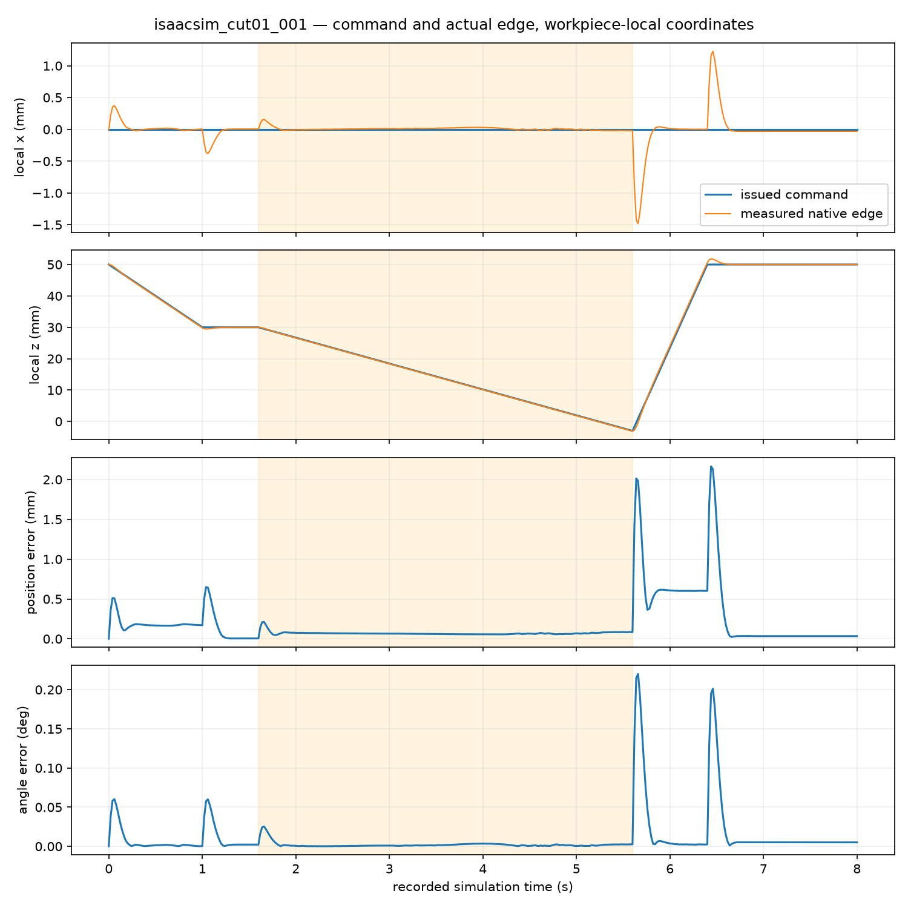
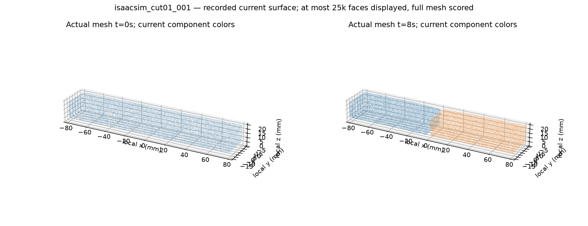
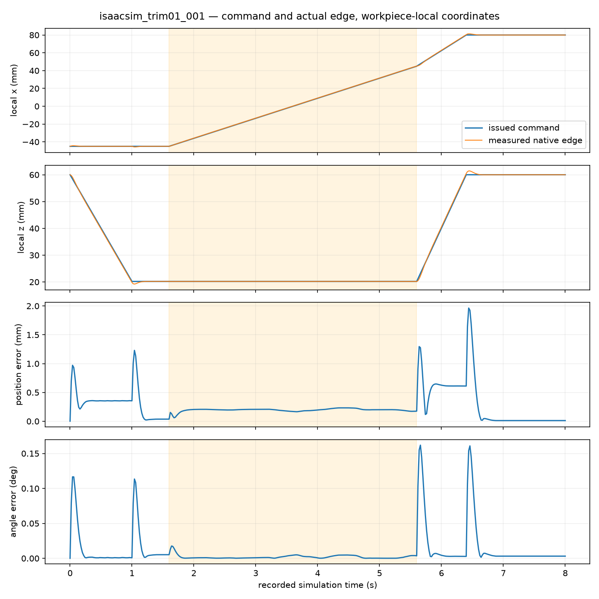
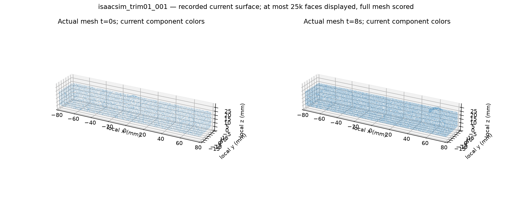

# Fixed CUT-01 / TRIM-01 live episode audit

Both live backends physically divide the fixed CUT-01 bar into two substantial parts under the prefrozen task protocol. Both fixed TRIM-01 episodes execute but fail to remove the bump or meet the surface goal. These are separate recorded task results; the complete 18-gate simulator acceptance and randomized benchmark remain incomplete.

The independent audit is `artifacts/cutting_task_episode_audit_002/result.json`; [the public receipt](../evidence/cutting_task_episode_audit.json) retains input hashes, source verification, checks and measurements. All four records have 400 actual control intervals and 8 seconds of robot and material time. Lab records material at 20 ms and native Kit at 200 ms, with both recording actual robot poses at 20 ms. Hardware timings were not exclusive performance measurements.

| Actual recording | Execution | Independently recomputed task score | Material graph / masses | Wall time |
| --- | --- | --- | --- | --- |
| `isaac_lab_cut01_001` | PASS_EXECUTION | PASS_TASK_METRICS | 1 → 2; 72 g + 72 g | 458.14 s |
| `isaacsim_cut01_001` | PASS_EXECUTION | PASS_TASK_METRICS | 1 → 2; 72 g + 72 g | 253.08 s |
| `isaac_lab_trim01_001` | PASS_EXECUTION | FAIL_TASK_METRICS | 1 → 1; 145.566 g | 472.22 s |
| `isaacsim_trim01_001` | PASS_EXECUTION | FAIL_TASK_METRICS | 1 → 1; 145.566 g | 271.05 s |

Task thresholds were committed in `02e427f` before task episodes; the complete fixed definitions were committed in `075c6de`. The recorded and audited protocol SHA256 is `feb3a8ddb99504ccabee122615b841c844fd8a0527fc1eec713cd70c9d7013a1`. The auditor verifies every manifest implementation hash against retained source bytes or Git blobs, snapshots its analysis sources before reading data, and checks they remain unchanged through analysis. All four task check dictionaries, metric dictionaries and statuses exactly match an independent recomputation from the saved particles, masses, eight-node reference supports, stress gradients, codes and final current surfaces. No solver is run by the auditor.

## Physical outcome and task geometry

CUT retains all 96,000 particles and the full immutable reference mass, starting with zero cut codes and one actual compatible MPM component. Both runs finish with two 48,000-particle components of 72 g each, with no minor-component mass or nonzero code rewrites in the saved history. The graph includes zero-code bridges, positive weights and nonzero stress-gradient couplings; it is not a six-neighbour or image-segmentation proxy. Final current-surface code/stencil hashes match the recorded physical state and declare no future component labels or rendering changes to physics.

The maximum distance of a severed reference particle-pair/node midpoint from the **workpiece-local** target plane is 1.50000004 mm, within the frozen 2 mm threshold. There are 54 shared interface reference nodes and 2,009,088 cross-component particle-pair/node incidences. Two-component topology persists for every recorded postcut sample from 5.6 to 8.0 s (2.4 s). This is actual sampled persistence, with the recorder cadences stated above.

Once the blade completes withdrawal at 6.4 s, final-component COM displacement by 8 s is only 14.64 / 16.38 µm for Lab's two supported halves and 12.49 / 16.54 µm for Kit. These small motions are measured; CUT does not require the two supported halves to fly away. They do not establish a chip-motion or cross-component recontact gate. Raw particle-pair contact counters include interactions within a component.

TRIM retains all 97,044 particles with unchanged 145.566 g reference mass, starts continuous, and has no nonzero-code rewrites, but remains one actual MPM component. Detached reference above-plane mass is **0%**, versus the frozen 90% goal. The actual recorded mechanical-substrate mesh is scored over the 160 × 30 mm footprint at 1 mm XY spacing, with no target offset fitting or error-tail removal:

| Actual surface measurement | Frozen requirement | Lab TRIM | Native Kit TRIM |
| --- | --- | --- | --- |
| Maximum positive height residual | ≤1 mm | 7.5616 mm | 7.5606 mm |
| p95 absolute plane error | ≤0.5 mm | 0.9019 mm | 0.9243 mm |
| RMS plane error | ≤0.5 mm | 0.9281 mm | 0.9145 mm |
| Maximum gouge depth | ≤1 mm | 20 mm | 20 mm |
| Integrated overcut / initial base volume | ≤1% | 1.0885% | 1.0532% |
| Missing surface bins | ≤1% | 0.04167% | 0.04167% |

The 20 mm worst gouge is the raw footprint-wide vertical-intersection result, including rare boundary/tail bins. It is not silently clipped or reinterpreted as a calibrated physical knife gouge. The complete metric implementation and raw surface meshes remain available for diagnosis.

## Actual control and contacts

These tracking measurements compare the recorded issued edge pose with the actual native measured edge. Active flags come from the intervals actually armed for cutting, rather than inferring contact from the command. Coordinates are converted into the workpiece frame. The issued commands agree with the fixed task schedule to numerical precision.

| Recording | Active max position / local-Z error | Active max angle | All-phase max position / angle |
| --- | --- | --- | --- |
| Lab CUT | 0.2216 / 0.1521 mm | 0.02661° | 2.3151 mm / 0.2362° |
| Native Kit CUT | 0.2117 / 0.1474 mm | 0.02530° | 2.1653 mm / 0.2201° |
| Lab TRIM | 0.2812 / 0.03337 mm | 0.02163° | 2.1600 mm / 0.1748° |
| Native Kit TRIM | 0.2326 / 0.03094 mm | 0.01762° | 1.9643 mm / 0.1619° |

The active path errors are much smaller than the remaining TRIM bump. Gross edge-path tracking therefore does not explain the task failure; this comparison does not itself diagnose the remaining fracture/support coupling mechanism. Full episode joint minima, maxima, velocities and excursions are retained. Parked-arm maximum drift is 1.34×10⁻⁹ rad in Lab and 1.00×10⁻¹⁰ rad in native Kit. Runtime joint-limit tensors were not exported; the static/rendered USD supplied to this audit does not expose the expected revolute-joint bounds, so a quantitative joint-limit acceptance is **NOT_RUN**.

| Recording | min det(F), all control intervals | Max interval material speed | Actual tool-contact particle/substep events | Peak reaction | Max tool/material penetration |
| --- | --- | --- | --- | --- | --- |
| Lab CUT | 0.94472 | 0.07076 m/s | 6,539,198 | 0.2854 N | 0.4358 mm |
| Native Kit CUT | 0.94464 | 0.06385 m/s | 6,537,666 | 0.2804 N | 0.4376 mm |
| Lab TRIM | 0.66587 | 0.33086 m/s | 1,733,499 | 0.6179 N | **1.6898 mm** |
| Native Kit TRIM | 0.66503 | 0.32797 m/s | 1,733,352 | 0.6046 N | **1.6884 mm** |

All saved particle/constitutive states and recorded forces are finite. CUT passes the available unchanged broad ENV-02 numerical/contact screens. TRIM fails the unchanged 1 mm tool/material penetration screen. Fixture penetration is 0.071–0.258 mm and pair overlap is 0.122–0.806 mm. Fixture-particle penetration is distinct from robot contact: Lab additionally records actual native rigid contact distances through all substeps/boundaries, with maximum non-tool rigid penetration 32.494 µm; equivalent native Kit rigid-contact distances were not recorded and remain **NOT_RUN**.

The actually applied wrench is the previous interval's recorded material reaction, with zero carry error and a declared 20 ms delay. Force-times-interval and recorded reaction impulse agree to floating-point precision. Partitioned interface-work residuals remain 17.16% / 17.60% for Lab / Kit CUT and 36.46% / 34.31% for TRIM. They do not pass the earlier 10% coupling-work screen, and no matched task feedback OFF control, task repetition, grid/time convergence, or calibrated fracture validation is claimed. Contact counters are substep events, not unique contacts or physical sensor measurements. Force stays diagnostic and is not added to future policy observations.

## Plots and reproduction

The raw audit directory contains both PNG and SVG command/actual X-Z-time/error plots, exact per-sample error NPZs, postwithdraw component COM NPZs and recorded before/after surface plots for all four episodes. Surface colors use each frame's current mechanical partition; at most 25,000 triangles are displayed in the figure, with the full mesh used for scoring.









```bash
.venv/bin/python -m pytest -q tests/test_task_episode_audit.py
.venv/bin/python scripts/audit_cutting_task_episodes.py \
  --recording-dir artifacts/isaac_lab_cut01_001 \
  --recording-dir artifacts/isaacsim_cut01_001 \
  --recording-dir artifacts/isaac_lab_trim01_001 \
  --recording-dir artifacts/isaacsim_trim01_001 \
  --output-dir artifacts/cutting_task_episode_audit_NEW
```

Four meaningful analytic controls pass: translated/rotated workpiece pose tracking; mass-weighted actual-component COM motion; delayed-force/actual-displacement work and impulse attribution; and explicit unknown interval instrumentation. The first auditor attempt (`cutting_task_episode_audit_001`) preserved a strict-JSON failure because Lab's interval det(F) is in `trace.json`, rather than `diagnostics.json`. The corrected reader uses the actual trace and keeps missing metrics as unknown. This involved no experiment, physics or acceptance-threshold change.

Native Task RGB-D/visibility audits are separate receipts owned by the camera validation work. A successful CUT score does not promote native camera mask coverage, full repeatability, randomized task variants, or the complete 18-gate benchmark.
