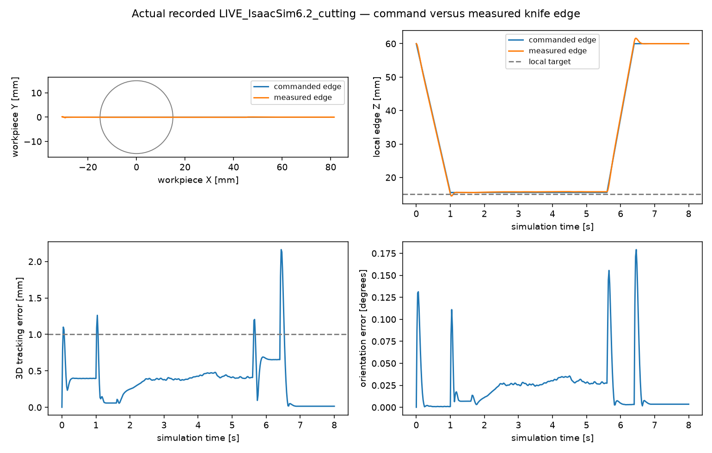

# Independent acceptance of actual Isaac D0 episodes

Actual Isaac Lab 3.0 GA and Isaac Sim 6.2/Kit episodes each completed 400 control steps and 8 s. Both use measured native articulated hand poses to drive the retained material, and both produce two mechanically disconnected components. These execution and cutting results do **not** pass the complete frozen 18-gate protocol: measured flatness, repeatability and delayed-coupling work errors remain visible below.

The protocol is [`isaac_acceptance.json`](../../configs/isaac_acceptance.json), committed as `c12aaef` before these episodes, SHA256 `ee364198b44e7720be4c065bb3b02a28ead8904c97154c32f8af619d5857441b`. No limit was relaxed after observing these results. Lab and Kit runtime gates refer to separate execution paths; an episode cannot substitute for the other runtime's gate.

## Recorded episodes and reproducible audit

| Episode | Actual runtime | Recording | Independent receipt |
| --- | --- | --- | --- |
| Lab baseline | GA `DirectRLEnv` / `InteractiveScene` / `NewtonManager`, native MuJoCo Warp articulation; kit-less ideal Warp cameras | `artifacts/isaac_lab_d0_001` | `artifacts/isaac_lab_d0_audit_006/result.json` |
| Lab velocity feedforward | Same runtime and material; commanded IK joint-velocity feedforward, original gains and geometric edge path | `artifacts/isaac_lab_d0_feedforward_001` | `artifacts/isaac_lab_d0_feedforward_audit_002/result.json` |
| Kit baseline | Sim `6.2.0.0`, live native PhysX, 4,000 rigid steps, 41 actual native camera captures | `artifacts/isaacsim_live_native_d0_001` | `artifacts/isaacsim_live_native_d0_audit_002/result.json` |
| Kit velocity feedforward | Same native PhysX / SingleView path; paired feedback OFF and independent same-seed repeat | `artifacts/isaacsim_live_native_d0_ff_001` | `artifacts/isaacsim_live_native_d0_ff_audit_003/result.json` |

Baseline Lab wall time is 193.169 s including recording. Baseline Kit's recorded episode loop is 82.741 s; its worker process takes 92.094 s including startup/reset. These scope differences and concurrent GPU use preclude a clean runtime performance comparison. Nominal control/material steps are 20 ms / 0.1 ms; native rigid steps are 2 ms.

Lab's installed distribution version `28.0.0` is retained separately from the actual GA checkout's `VERSION=3.0.0`, source `e3f7d9ff1f5d7f8280de3ece9000b7117f66bcf4`. The project did not rename a development package to manufacture GA compatibility. The actual Lab APIs own both articulations and advance the clock. Kit records actual PhysX tensor state and native captures, with zero standalone robot dynamics steps and no replay inputs.

Hash-matching Lab baseline source is recoverable from Git `c03e152`. Lab feedforward source was reconstructed/copied after launch and independently matched to its recorded SHA256 `1b8c23f67abace2019dae72008c400cebe17f6e4275424acaa663140dbefa2ce`; `source_recovery.json` records this provenance. It is not represented as a pre-launch byte snapshot. The old manifest hashes `src` modules but omits its wrapper script, a remaining provenance limitation. Kit captures implementation byte snapshots before starting the worker. Audit outputs include their own validator snapshots and hashes.

```bash
.venv/bin/python -m pytest -q tests/test_scene_coordinate_validation.py tests/test_live_acceptance.py

MPLBACKEND=Agg .venv/bin/python scripts/audit_live_cutting.py \
  --recording-dir artifacts/isaac_lab_d0_001 \
  --feedback-off-dir artifacts/isaac_lab_d0_feedback_off_001 \
  --standalone-reference-dir artifacts/coupled_robot_cut_002 \
  --contact-device cuda:0 --output-dir artifacts/lab_audit_fresh

MPLBACKEND=Agg .venv/bin/python scripts/audit_live_cutting.py \
  --recording-dir artifacts/isaacsim_live_native_d0_ff_001 \
  --feedback-off-dir artifacts/isaacsim_live_native_d0_ff_no_feedback_001 \
  --repeat-dir artifacts/isaacsim_live_native_d0_ff_repeat_001 \
  --native-camera-controls artifacts/single_view_kit_audit_003/result.json \
  --contact-device cuda:0 --output-dir artifacts/kit_audit_fresh
```

31 meaningful CPU tests pass. The audit exits **1** while full acceptance is false; that is an assessment result, not a runtime crash. Omitting `--contact-device` avoids GPU work and leaves unmeasured contact attribution explicit. Do not run an uncoordinated GPU probe during another job's exclusive timing measurement.

## All 18 gates

`NR` means required evidence was not recorded for that episode, rather than an inferred pass. Camera geometry controls are scoped to native virtual RGB and SingleView depth, not hardware/color-imager calibration. The live scene's camera visibility/mesh consistency audit is independent work and remains NR in this checkpoint.

| Gate | Lab baseline | Lab feedforward | Kit baseline | Kit feedforward |
| --- | --- | --- | --- | --- |
| RT-01 actual Lab | PASS | PASS | NR | NR |
| RT-02 actual Sim/Kit | NR | NR | PASS | PASS |
| SC-01 frame/units/optical direction | PASS | PASS | PASS | PASS |
| SC-02 continuous D0 configuration/samples/initial graph | PASS | PASS | PASS | PASS |
| ROB-01 named hand and fixed physical knife | PASS | PASS | PASS | PASS |
| ROB-02 measured edge tracking/sweep | FAIL | PASS | FAIL | PASS |
| PHY-01 matched constitutive deformation control | NR | NR | NR | NR |
| PHY-02 permanent mechanical separation | PASS | PASS | PASS | PASS |
| PHY-03 post-withdraw motion and attributed recontact | PASS | FAIL | PASS | FAIL |
| PHY-04 reaction/delay/work/matched OFF | PASS | FAIL | NR | FAIL |
| CAM-01 native camera 0 geometry controls | NR | NR | PASS | PASS |
| CAM-02 native camera 1 geometry controls | NR | NR | PASS | PASS |
| CAM-03 complete scene visibility | NR | NR | NR | NR |
| CAM-04 live mesh/camera consistency | NR | NR | NR | NR |
| TASK-01 reference above-plane particle mass removal | PASS | PASS | PASS | PASS |
| TASK-02 measured substrate mesh flatness | FAIL | FAIL | FAIL | FAIL |
| ENV-01 reset and independent repeat | NR | NR | NR | FAIL |
| ENV-02 complete finite/penetration screen | NR | NR | NR | NR |

Counts are respectively 8 PASS/2 FAIL/8 NR, 7/3/8, 9/2/7 and 9/4/5. Full benchmark readiness remains false; these four D0 episodes do not certify integrated D0–D3 research performance.

## Measured motion, cutting and surface quality

The workpiece-local target is Z=15 mm. The requested edge plane is explicitly Z=15.5 mm, with a 0.5 mm clearance. Native Panda hand state, a rigid 180 mm mount and a fixed Rx(π) blade frame define the **measured** edge. The selected native hand and physical knife body indices agree. Full finite-edge sweeps cover 100% of the analytic bump cross-section in all four episodes.

| Metric | Lab baseline | Lab feedforward | Kit baseline | Kit feedforward |
| --- | ---: | ---: | ---: | ---: |
| Active max 3D edge error, mm (limit 1) | 1.23558 | 0.50725 | 1.25565 | 0.48042 |
| All-phase max 3D error, mm (limit 5) | 5.70398 | 2.36897 | 5.71478 | 2.16346 |
| Active max height error, mm (limit 0.5) | 0.22005 | 0.25058 | 0.22245 | 0.25161 |
| Active max angle error, degrees (limit 1) | 0.03131 | 0.03543 | 0.02706 | 0.03559 |
| Substrate mesh peak residual, mm (limit 1) | 1.90413 | 1.97413 | 1.92020 | 1.96195 |
| Mesh p95 absolute error, mm (limit 0.5) | 1.70866 | 1.74297 | 1.70790 | 1.73911 |
| Mesh RMS error, mm (limit 0.5) | 1.64261 | 1.61962 | 1.64361 | 1.61926 |



Every material run starts with one component, 19,340 positive-mass particles and zero cut codes. The auditor recomputes the actual eight-node reference transfer graph using **both positive shape weights and nonzero stress gradients**, including unassigned-code particles; it does not substitute six-neighbour or visual connectivity. Final graph partitions agree with the recorded partitions, giving 1.656 g detached material and 230.424 g substrate, with unchanged particle count and the recorded immutable per-particle mass vector. No nonzero ternary digit is overwritten in the sampled histories.

TASK-01's 98.571% means **1.656 g of the 1.680 g reference particles whose centres initially lay above local Z=15 mm** is detached. It is not an analytic continuous-volume clipping calculation. The coarse D0 sampler has +6.2043% reference-volume error and a 16 mm full-cell base support for the nominal 15 mm base; the analytic dome mass differs from this centre-selected region. [`SURFACE_GEOMETRY_VALIDATION.md`](../SURFACE_GEOMETRY_VALIDATION.md) separates quadrature from the default reconstruction's volume inflation. No correction, vertical shift, alternative isovalue, smoothing or mass rescaling was fitted to the cutting result.

TASK-02 uses actual final triangle ray intersections at a 1 mm workpiece-local grid, covering the full 120×80 mm footprint. Substrate triangles are attributed through the **current** mechanical partition and code/stencil hashes, not deletion, a screen mask or future component labels. All grid rays are present; no gouge is measured. Peak, p95 and RMS nevertheless fail. Low particle-centre residuals cannot substitute for the measured mesh.

## Recontact and delayed reaction are separate findings

At 6.4 s, the measured blade is geometrically clear of every material particle sphere; the AABB lower-bound clearance exceeds 32 mm. Original material pair counts include self-pairs within a component and are never all described as cross-component contacts. The auditor invokes the unchanged actual CUDA `_particle_contacts` kernel on saved post-withdraw states, without integration, force injection or state edits. Equal/opposite component-net impulses prove exchange across the disconnected components while cancelling within-component pairs. This is a retrospective kernel reevaluation, not an original-substep pair log.

The two baseline episodes show 1.386/1.453 mm post-withdraw chip COM motion and peak component-net impulses `5.47e-8`/`5.69e-8` Ns. In the feedforward paths, Lab shows 1.242 mm motion but only roundoff-level cross-component impulse, while Kit shows 0.688 mm motion and zero cross-component impulse. Those paths fail PHY-03 despite permanent separation. A trajectory that does not cause recontact cannot prove that event from nonzero intracomponent contact counts.

The Lab baseline matched reaction-OFF control uses identical dynamics source, recipe, seed and command poses; camera readout is disabled in OFF and does not advance or edit dynamics. Feedback changes the measured edge by 0.344325 mm. Peak reaction is 1.04125 N, previous-interval carry error is zero, and the declared delay is 20 ms. The interface ledger has +14.0894 mJ material boundary work and −13.7640 mJ actual applied-wrench work: residual 2.3093%, within the frozen 5% limit.

Kit feedforward's matched OFF changes the actual edge by 0.626465 mm, proving an applied reaction affects native dynamics. Its work residual is **18.4337%**, and Lab feedforward's is **19.1454%**. Improving tracking did not establish acceptable interface work balance. These failures are retained. Boundary-work agreement is not a total-energy conservation or monolithic-coupling claim.

## Native camera and reset boundaries

Actual Kit noise-OFF plane/feature controls are independently frozen and held out. The auditor checks their raw input hashes, exact native runtime/model recipe, helper-source hash, per-frame application of the validated profile and preservation of native sample values. Camera 0 worst p95 plane error is 0.231 µm; the two-camera controls cover 92.81–96.73% of the known planes, and feature boundary p95 is 0 pixels. There is no error-based rejection or ideal-Z substitution. See [`CAMERA_VALIDATION.md`](../CAMERA_VALIDATION.md). These are virtual RGB/SingleView geometry controls, not separate physical D455 color-imager, hardware-noise realism or live mesh/time consistency acceptance.

Lab feedforward's same-process reset reports exact q/material/depth reconstruction and identical valid masks; a complete independent same-source repeat was not yet available in that receipt. Kit's actual repeat fails the frozen numerical limits: all-frame particle position difference **1.50456 mm** (limit 0.1 mm), final component COM difference **0.76351 mm** (limit 0.05 mm), velocity difference **0.02089 m/s** (limit 0.01). Five particle-frame cut codes differ, although the final component partition agrees. Bitwise equality is false and is not conflated with tolerance-based repeatability.

Kit repeat q/material reset and zero cut history pass. Re-reading the actual initial/reset NPZ camera arrays independently confirms changed masks of **1,543 / 580** pixels for cameras 0/1. The all-pixel max depth differences are **1.147 / 1.661 m**, largely including valid/invalid transitions. Common-valid p99 error is zero, but common-valid maxima remain **6.440 / 22.672 mm**; global max difference is **14.313 mm**. Exact mask/depth reset therefore fails. Zero p99 must not hide these tails.

ENV-02's available material screens pass: finite states, minimum detF≥0.906, speed≤0.207 m/s, retained material-floor/tray penetration≤104 µm, knife penetration≤403 µm and material overlap≤364 µm in the baseline episodes. Those retained material statistics are **not** comprehensive native Panda self/robot-table/fixture penetration measurements, so full ENV-02 remains NR in this checkpoint.

The first CPU contact-audit attempt is preserved in `artifacts/isaac_lab_d0_audit_001/FAILED.json`: Warp 1.17 whole-module CPU compilation emits an unrelated C++ member called `new`, rejected by Clang. An isolated unchanged-function CPU diagnostic was preserved in `_002`, but the reported final attribution uses the original unchanged CUDA kernel. Administrative reader/source-provenance corrections and all intermediate audit directories remain available; none changes physical data or thresholds.

Machine-readable checkpoint: [`isaac_live_acceptance.json`](../evidence/isaac_live_acceptance.json). Full per-episode hashes, missing-evidence lists, detailed contact samples, plots and source snapshots are retained in the artifact paths above. No policy or RSI training was run.

## Later native-contact, repeat and live-camera receipts

The earlier four receipts remain unchanged. Two fresh audits append evidence without promoting a previous failure:

- Lab `artifacts/isaac_lab_d0_feedforward_002`, paired with the complete same-source `isaac_lab_d0_feedforward_repeat_001`: `artifacts/isaac_lab_d0_feedforward002_audit_002/result.json`.
- The same Kit feedforward episode as above, now bound by hashes to the complete41-frame independent visual/native camera audit: `artifacts/isaacsim_live_native_d0_ff_audit_005/result.json`. The camera reference is `artifacts/live_camera_mesh_ff_002/result.json` and its pre-analysis snapshots/input hashes.

Both new audits confirm the validator bytes remained unchanged during analysis. Their saved historical TLMPM source exactly matches each episode's hash and supplies the unchanged actual CUDA contact kernel; subsequent CUT/TRIM fixture extensions in the current working tree do not silently change this recheck. All51 related CPU tests pass, including18 task-schema controls; these are distinct from the actual runtime episodes.

| Gate | Later Lab feedforward002 | Kit feedforward with full camera audit |
| --- | --- | --- |
| RT-01 | PASS | NR |
| RT-02 | NR | PASS |
| SC-01 | PASS | PASS |
| SC-02 | PASS | PASS |
| ROB-01 | PASS | PASS |
| ROB-02 | PASS | PASS |
| PHY-01 | NR | NR |
| PHY-02 | PASS | PASS |
| PHY-03 | FAIL | FAIL |
| PHY-04 | FAIL | FAIL |
| CAM-01 | NR | PASS scoped native geometry controls |
| CAM-02 | NR | PASS scoped native geometry controls |
| CAM-03 | NR | PASS geometric first-hit attribution |
| CAM-04 | NR | FAIL actual native masks |
| TASK-01 | PASS | PASS |
| TASK-02 | FAIL | FAIL |
| ENV-01 | FAIL | FAIL |
| ENV-02 | PASS | NR |

Lab now has8 PASS/4 FAIL/6 NR. The native MJWarp recorder samples actual active contact slots before every2 ms rigid substep and after the final substep, including a nonintegrating position/contact refresh at reset. Maximum native non-tool rigid penetration is **32.494 µm**, native knife-rigid penetration is0, minimum material detF is0.90545 and maximum speed0.30953 m/s. Retained material-tray, knife-material and material-material maxima are292.2/428.4/167.5 µm. These actual native measurements close the earlier ENV-02 evidence gap for this Lab episode.

Lab's same-process initial q/material/depth reset remains exactly equal with matching masks. Its complete same-source repeat nevertheless fails ENV-01: all-frame particle difference **1.00137 mm**, final component COM difference **0.10754 mm**, velocity difference **0.13365 m/s** and28 differing code-particle frames. Neither bitwise identity nor the frozen tolerance-based repeat test passes. The interface work residual is19.1383%; improving observation/penetration instrumentation does not erase that coupling limitation.

Kit now has10 PASS/5 FAIL/3 NR. Across every global frame, independently reconstructed first-hit geometry agrees with actual RTX depth at at least **18,610 / 27,791 / 26 / 608 / 161,311** pixels for arm0/arm1/knife/material/table. Those are depth-verified geometric attributions, not captured native semantic labels. The current dynamic visual mesh/pose bridge passes: worst area p95 error **0.715 µm**, minimum mask IoU **0.99996236**, and timestamp span≤`8.9e-16` s. Up to36 actual native-valid chip pixels are visible.

The **actual registered native SingleView output** still fails CAM-04. Minimum valid-mask IoUs are **0.44510 / 0.20547** for cameras0/1, well below0.99. Their p95 errors on common valid pixels are small (≤0.358 µm), while retained maximum errors reach **620.7 / 1003.6 mm**. Rare global silhouette tails also remain in the receipt. The passing visual geometry bridge is not substituted for the native data. No error-tail rejection, hole filling or ideal-depth replacement is used to obtain a sensor pass.

Latest machine-readable receipts: [`isaac_live_acceptance_latest.json`](../evidence/isaac_live_acceptance_latest.json). Execution, durable mechanical separation and geometric camera synchronization are supported capabilities. Complete native-sensor, reset/repeat, delayed-work, flatness and calibrated material acceptance remain unachieved under the unchanged protocol.
