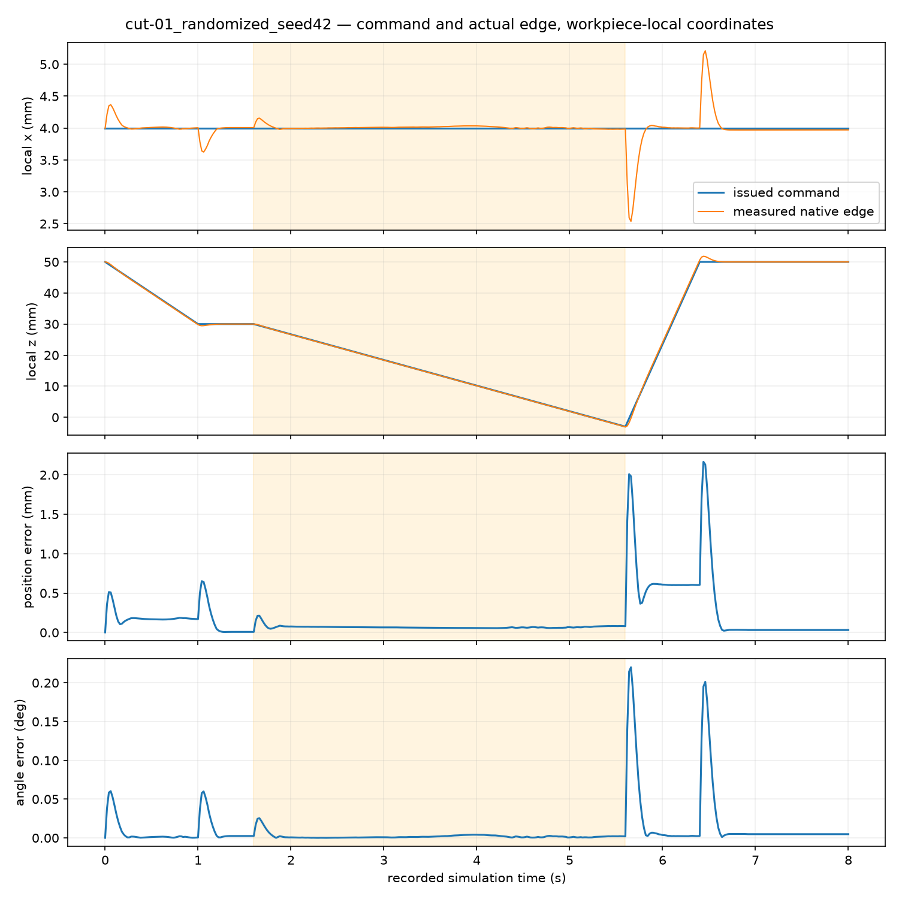
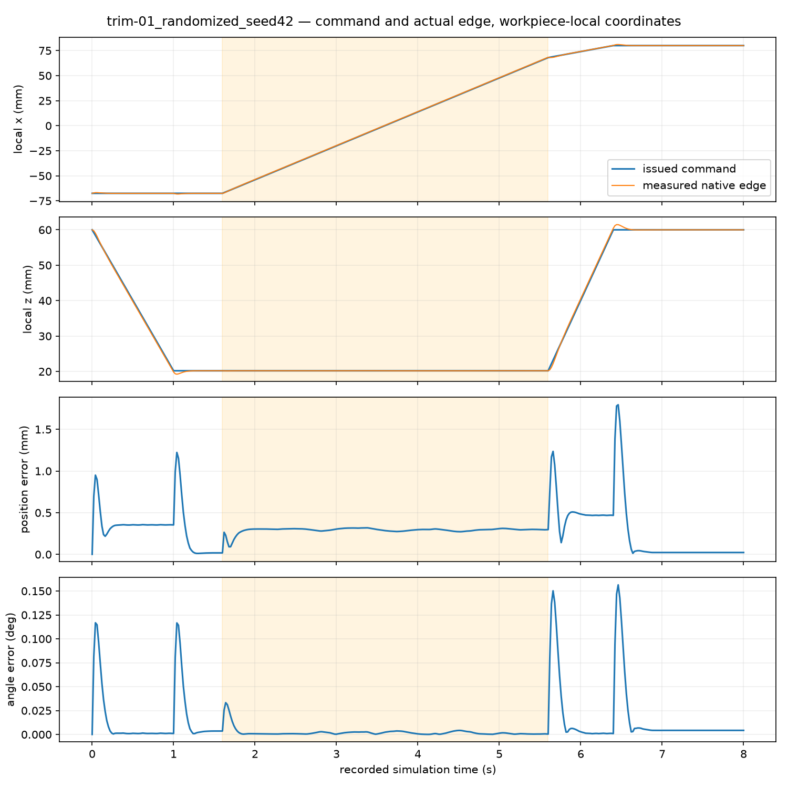

# Actual native randomized tasks: seed 42

The native Isaac Sim 6.2 episodes execute both seeded tasks, with actual PhysX robot dynamics, retained TLMPM material and 41 native RGB-D frames per episode. CUT-01 passes its recorded task metrics. TRIM-01 produces three physically disconnected chips and removes 96.2791% of reference above-plane material, but fails the unchanged strict surface-quality metrics. This is **one seed per task**, rather than a success-rate or generalization result.

The independent raw-state audit is `artifacts/randomized_native_task_episode_audit_002/result.json`; [the public receipt](../evidence/randomized_native_task_episode_audit.json) retains complete actual TaskSpecs, numerical overrides, seeds, source/input hashes, physical graph checks, tracking and contact measurements. All manifest implementation bytes resolve to retained sources or Git blobs. Analysis sources were copied before reading the records and remained unchanged. Task check, metric and status dictionaries exactly match recomputation from actual recorded data.

| Native recording under `isaac_native_randomized_benchmark_001` | Actual sampling / grid | Execution | Recomputed task result | Actual physical partition |
| --- | --- | --- | --- | --- |
| `cut-01_randomized_seed42` | 1 / 4 mm | PASS_EXECUTION; 400 control / 4,000 PhysX steps; 8 s | PASS_TASK_METRICS | 1 → 2; 66.6 g + 59.4 g |
| `trim-01_randomized_seed42` | Explicit 2 / 4 mm | PASS_EXECUTION; 400 control / 4,000 PhysX steps; 8 s | FAIL_TASK_METRICS | 1 → 4; three chips + substrate |

Both use the protocol defined in `ff1187a`, with a 140 × 30 × 20 mm bar and workpiece translation (−1.2224, +7.1720) mm / yaw +3.94736°. CUT's plane is local X=+4 mm. TRIM has the dome / irregular / dome geometry and a local sweep from approximately −67.468 to +68 mm. Actual CUT sampling is finer than the earlier standalone CPU example; TRIM's coarser spacing is explicitly recorded. Neither resolution result establishes convergence.

## Physical separation and strict surface score

CUT retains every one of its 84,000 particles and the full 126 g immutable reference mass. Its two actual components contain 44,400 / 39,600 particles (52.857 / 47.143% of mass). The maximum severed reference particle-pair/node midpoint distance from the local cut plane is 1.500000085 mm, within the frozen 2 mm location threshold. All initial codes are zero, the actual initial graph is continuous, no nonzero history digits are rewritten, and both components persist at all saved samples from 5.6 through 8 s.

TRIM retains all 10,715 particles and 128.580 g. The recomputed actual graph contains:

| Physical component | Particles | Reference mass |
| --- | --- | --- |
| Chip 0 | 56 | 0.672 g |
| Chip 1 | 64 | 0.768 g |
| Chip 2 | 87 | 1.044 g |
| Substrate | 10,508 | 126.096 g |

The detached 207 / 215 initially above-plane particle centres correspond to 2.484 / 2.580 g, or **96.2791% removal**. Eight above-plane particles remain connected to the substrate. The four-component graph persists throughout the saved 2.4 s postcut window with zero nonzero-digit rewrites. Partitions use the actual eight-node reference MPM support, including positive weights, stress gradients and unassigned zero-code bridges; they are not render labels or six-neighbour proxies. Final current-surface stencil/code hashes match the recorded physical state, with no use of future labels or changes to physics from rendering.

The original full-footprint target is scored on all 4,200 fixed 1 mm XY rays of this 140 × 30 mm specimen:

| TRIM actual mechanical-substrate mesh statistic | Measurement | Frozen limit | Outcome |
| --- | --- | --- | --- |
| Maximum positive height residual | 0.18366 mm | 1 mm | PASS |
| p95 absolute plane error | 1.60387 mm | 0.5 mm | FAIL |
| RMS plane error | 0.55036 mm | 0.5 mm | FAIL |
| Raw footprint-wide maximum gouge | 20 mm | 1 mm | FAIL |
| Integrated overcut / initial base volume | 1.95407% | 1% | FAIL |
| Missing surface bins | 8 / 4,200 = 0.19048% | 1% | PASS |

Rare boundary/intersection tails remain in these measurements. The 20 mm extreme is not silently clipped or reinterpreted as calibrated physical knife gouging. The independently versioned 160 mm represented-target control from the fixed coarse experiment is not reused as a passing target for this different randomized geometry.

## Actual control and available contact evidence

| Measured quantity | Randomized CUT | Randomized TRIM |
| --- | --- | --- |
| Active maximum edge position / local-Z error | 0.21367 / 0.14866 mm | 0.31864 / 0.03940 mm |
| Active maximum edge rotation error | 0.02547° | 0.03322° |
| All-phase maximum edge position / rotation error | 2.16620 mm / 0.22006° | 1.79448 mm / 0.15640° |
| Minimum det(F), all control intervals | 0.94504 | 0.93796 |
| Maximum interval material speed | 0.07283 m/s | 0.24815 m/s |
| Tool-contact particle/substep events | 6,371,789 | 344,255 |
| Peak material reaction | 0.25765 N | 0.10583 N |
| Maximum tool/material penetration | 0.44229 mm | 0.57299 mm |
| Partitioned interface-work residual | **15.9132%** | 2.3633% |
| Nonexclusive episode wall time | 216.00 s | 79.15 s |

All saved material/constitutive states and recorded wrenches are finite. Both pass the available unchanged broad numerical/material-contact screens; native non-tool rigid penetration and runtime joint-limit tensors were not recorded and remain **NOT_RUN**. Recorded applied-wrench carry error is zero, with the declared 20 ms feedback delay, and force-times-interval matches the actual reaction impulse to floating-point precision. CUT fails the earlier 10% interface-work screen. TRIM is below that single screen, but matched feedback OFF, repetition and convergence controls remain absent; it is not promoted to complete coupling acceptance.

After the reference withdrawal ends at 6.4 s, CUT has zero further tool-contact events. Its two component COM displacements are 8.14 µm and 0.058 µm by 8 s. TRIM still records tool contacts in all 80 subsequent intervals, totalling 66,488 particle/substep events. Its chip COM displacements are 10.07, 9.02 and 529.29 µm. Thus reference-path withdrawal does **not** prove every detached chip is clear of the blade or in free flight. Raw particle-pair counters also do not attribute cross-component recontact. Physical graph separation and reference-mass removal are supported; stronger independent-chip/recontact gates are not claimed.

Actual robot poses are recorded every 20 ms; full material snapshots are every 200 ms. Persistence and COM claims use that material sampling cadence. Force and all oracle data remain diagnostic, outside policy observations. Per-episode native-camera geometry/visibility/noise acceptance was not independently scored by this task auditor. No new policy or training was introduced.

## Reproduction and preserved evidence

```bash
.venv/bin/python scripts/audit_cutting_task_episodes.py \
  --recording-dir artifacts/isaac_native_randomized_benchmark_001/cut-01_randomized_seed42 \
  --recording-dir artifacts/isaac_native_randomized_benchmark_001/trim-01_randomized_seed42 \
  --output-dir artifacts/randomized_native_task_episode_audit_NEW
```

The audit directory contains PNG/SVG command-versus-measured X/Z/time/error plots, before/after recorded-current-surface plots, exact error arrays and per-component COM traces. Initial/current colors follow each frame's physical partition. Plotting may display at most 25,000 faces; the complete mesh is scored.





The first independent audit, `randomized_native_task_episode_audit_001`, is retained. It produced identical checks/statuses with scalar metric differences of at most 3.47×10⁻¹⁸ from inverse/composition roundoff in reconstructing the seeded frame. The canonical reader validates the seeded reconstruction and then scores with the exact recorded frame. No physical recording, recipe, threshold or experimental outcome changed. Fixed 1 mm failures, explicit coarse follow-ups, and all earlier audit receipts are preserved.
