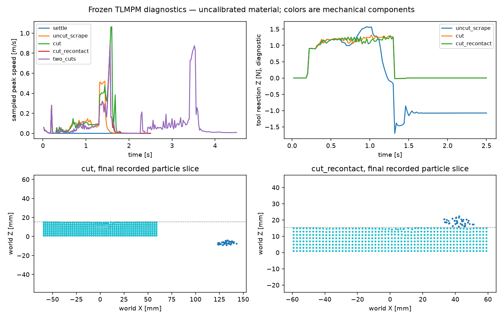

# Frozen TLMPM validation matrix

2026-10-28, Asia/Seoul. **The standalone prototype demonstrates persistent single-cut
mechanical separation, independent chip motion and cut-face contact. The frozen
second-cut trajectory does not produce another separated piece. Formal convergence,
full impulse/energy balance and complete integrated benchmark acceptance remain open.**

No solver, topology or probe source was changed by this validation work. Results
are uncalibrated engineering evidence for the independent TLMPM implementation,
not validation of real plasticine or the authors' BladeMaster implementation.
`PHYSICS_PROVEN=false` and `BENCHMARK_READY=false` remain appropriate formal flags.

## Frozen sources, protocol and retained failure

The first eleven-attempt matrix used commit
`74406767f2469d825a259680489c20f8eb91e34a`. Before any run, the runner saved the
five physics/probe source hashes, exact arguments, seed, matrix and tolerances in
`artifacts/TLMPM_validation_001/frozen_plan.json`. Each subprocess verified those
hashes before starting. Other agents' unrelated dirty files were recorded, not
silently treated as part of the frozen physics source.

The original `two_cuts` attempt failed before physics because the installed SciPy
rejected a one-axis Euler batch with one-dimensional angle input. The full traceback
is retained at `artifacts/TLMPM_validation_001/two_cuts_solver.log`; it was not
reclassified as a numerical solver failure or overwritten.

A separately frozen fresh run used commit
`855d1dbfc74dd6c0d33be3e2cefaa2c26639534d` in
`artifacts/TLMPM_validation_two_cuts_001`. Its only changed frozen file is the probe:
the Euler batch was made explicitly `(N,1)`. Solver/topology files were identical.
This 4.5 s second-cut run completed and is reported below alongside the failed
setup attempt.

All runs used physical GPU1, RTX5090, driver570.211.01, project Python3.12,
Warp1.17.0 and its CUDA12.9 runtime. `CUDA_VISIBLE_DEVICES=1` made the isolated
process device `cuda:0`. No driver, package, other repository or policy changed.

Common recipe: seed42, connected D0 dome, density1500 kg/m³, E50 kPa, ν0.3,
J2 yield1000 Pa, PIC fraction0.05, provisional cutting/contact parameters from
the saved manifest. Default grid4 mm, particle spacing2 mm, solver dt100 µs,
recording interval20 ms, duration2.5 s. The orthogonal two-cut case uses two
retained ternary digits and4.5 s. Cases launch fresh processes and preserve every
NPZ, trajectory, trace, source manifest, log and memory sample.

## T1–T10 findings

| Test | Status | Measured scope |
|---|---|---|
| T1 rest / support | PASS | Full2.5 s supported settling; active finite-blade-band noncontact control leaves every code zero and records zero tool contacts |
| T2 indentation / unload | PASS, scoped | Actual tool contacts, accumulated plastic strain and residual deformation; no calibrated material or elastic-law control in this matrix |
| T3 single cut | PASS, scoped | One initial conservative mechanical component becomes two through online blade passage; uncut scraping remains one |
| T4 withdrawal persistence | PASS | Nonzero digits never change/reset; two-component conservative stencil graph persists after withdrawal |
| T5 chip motion / recontact | PASS, scoped | Chip moves independently; separate recontact run has original postwithdraw contact activity and actual cross-component kernel impulses on saved states, without healing |
| T6 second direction | FAIL | Second digit assigned and first preserved, but the finite partial trajectory leaves two components rather than producing another separated piece |
| T7 convergence | NOT_RUN | Three spatial settings and a half-step probe ran; these are exploratory and do not establish convergence |
| T8 reset / repeat | PASS within frozen tolerances; exact FAIL | Fresh-process numeric repeat limits pass; one intermediate label entry differs, although final labels/components match |
| T9 mass / numerical budgets | PASS, scoped | Immutable ID/mass ledger, component partition and local GPU impulse controls; full-run impulse and energy balances are NOT_EVALUATED |
| T10 separated surface / RGB-D | NOT_RUN here | This matrix records physical states, not renderer/sensor integration; separate visual evidence must be assessed independently |

The matrix returns aggregate engineering FAIL because T6 does not meet the stated
additional-piece objective. Numeric guards passing do not turn T6 into a physical
cut pass. A new later trajectory/control is a separate experiment and must not
replace this frozen result.

## Executed matrix and performance

All eleven completed physics runs passed the probe's broad finite-state, speed,
support and determinant screens. Those screens are failure detectors, not
calibrated physical acceptance thresholds. Maximum speeds below are sampled at
recording frames; contact penetration counters include solver substeps.

| Case | Particles | Final mechanical components | Peak sampled speed m/s | Minimum detF | Chip mass g | Physics wall s |
|---|---:|---:|---:|---:|---:|---:|
| settle | 19,340 | 1 | 0.05855 | 0.99258 | 0 | 3.857 |
| no_contact, cut band active100 mm higher | 19,340 | 1 | 0.05855 | 0.99258 | 0 | 7.548 |
| indent | 19,340 | 1 | 0.20069 | 0.90711 | 0 | 7.546 |
| uncut_scrape | 19,340 | 1 | 0.52093 | 0.75205 | 0 | 8.451 |
| cut | 19,340 | 2 | 1.06406 | 0.91939 | 1.680 | 7.599 |
| cut_repeat | 19,340 | 2 | 1.06419 | 0.91938 | 1.680 | 7.593 |
| cut_recontact | 19,340 | 2 | 0.87884 | 0.93195 | 1.680 | 7.648 |
| two_cuts, fresh probe-only fix | 19,340 | 2 | 0.87910 | 0.73123 | 1.680 | 14.562 |
| cut, grid3 mm / dt100 µs | 42,890 | 2 | 1.03502 | 0.85465 | 2.379 | 16.085 |
| cut, grid2 mm / dt50 µs | 145,656 | 2 | 1.08691 | 0.92980 | 2.091 | 89.918 |
| cut, grid4 mm / dt50 µs | 19,340 | 2 | 1.18024 | 0.86260 | 1.584 | 15.048 |

Physics timing excludes setup/export; complete subprocess timing is also saved.
The GPU-memory sampler observed696–2278 MiB across the full physical device,
including display/baseline/other activity. The actual sampler interval was100 ms
(`--loop-ms=100`); this is a device-level sample, not a solver-only allocation.
Runs were serialized on GPU1; these timings are not an Isaac/RTX or Newton speed
comparison. Recording rate and simulation step are distinct.



The figure displays recorded physical particles and diagnostic force traces.
Final component colors are oracle debug labels; they are not observations,
visibility masks or a source of material deletion.

## Mechanical separation and its limits

Each particle starts with code0 and the entire reference-stencil graph is connected.
The online blade sweep assigns a previously unset ternary digit according to the
current finite blade passage. The logical-grid compatibility changes future
mechanical transfers; particle position, velocity, F, Fpi and mass do not jump
when the digit is assigned. An actual GPU-kernel control verified this bitwise,
including first codes `[1,2]` and second codes `[4,8]`.

The graph audit uses the actual linear reference supports and compatibility,
including unassigned code0 bridges and nonzero stress-gradient supports. It is
not a six-neighbor lattice or visible-gap classifier. Independently reconstructed
supports reproduced every stored final component partition. Gradient-only entries
were absent in these particular cell-centered samples; they are nevertheless
included by the audit. The graph is conservative: a nonzero possible continuum
coupling joins components even if an instantaneous force happens to be zero.

The main cut separates140 particles, mass1.680 g, from the19,200-particle,
230.400 g reference-substrate group. No particle is removed, spawned or hidden.
At withdrawal the graph already has two components; all subsequent recorded codes
are bitwise unchanged. The chip's COM moves85.91 mm afterward, clears the finite
tray, and ends at approximately `[132.768,-0.00379,-7.173]` mm on the surrounding
support table. This is integrated particle motion, not a prescribed fragment pose.

The model is an ideal sharp-blade logical discontinuity with provisional contact
work/resistance and plasticity, not a calibrated fracture or damage law. T1–T5
passes establish the specific prototype mechanisms and observed dynamics. They
do not imply validated cutting forces, arbitrary materials, arbitrary crack paths,
mesh convergence, or production-ready robot coupling.

Indentation's maximum accumulated plastic strain was0.4162. After unload, the
initial above-plane diagnostic subset had mean Z0.8010 mm lower than its settling
control. The subset is selected only for analysis; it was not a presegmented
physical chip. Without an elastic-law control and material calibration, this is
evidence of the implemented plastic response rather than real-plasticine accuracy.

## Recontact evidence and impulse accounting

The `cut_recontact` trajectory withdraws vertically above the remaining specimen.
Its140-particle chip remains mechanically disconnected and moves41.50 mm in COM
after withdrawal. The original solver trace records176,511 postwithdraw material
contact pairs using `trace.time_s >=1.45`. This count includes nonlocal contacts
within a component; it is not presented as an all-cross-component count.

To identify cross-component contact, the actual frozen `_particle_contacts` GPU
kernel was reevaluated on saved postwithdraw particle positions, velocities,
codes and masses. No physics state was advanced or altered. Internal pair impulses
cancel when summed within a component. At saved time1.56 s, the two component net
impulses were approximately:

```text
chip:      [-8.32368e-7, +5.87045e-9, +9.25274e-6] N s
substrate: [+8.32368e-7, -5.87045e-9, -9.25274e-6] N s
closed pair budget residual norm: 5.73e-14 N s
```

This demonstrates actual contact-kernel response across the disconnected material
components on recorded states, alongside original integration contact activity.
It is retrospective frame sampling, not an original-substep component-pair impulse
log. The component graph stays disconnected and persistent labels remain intact.

All recorded tool forces are finite. Local GPU controls additionally verify
equal/opposite wedge/material impulses and separated particle-pair impulses.
However fixture reaction impulses are absent from the run ledger. The report saves
material momentum change, integrated tool reaction and gravity impulse, and labels
the remaining vector as unresolved fixture/numerical impulse. It does not call
that residual a closed conservation balance. Strain energy, plastic/contact
dissipation and complete tool/fixture work accounting also remain unfinished.

Contact error is material: primary cut maximum tool penetration0.299 mm and maximum
particle overlap0.324 mm; recontact overlap reaches0.809 mm; uncut scrape tool
penetration reaches2.209 mm. These nonzero errors are retained and constrain any
claim about force accuracy or fine geometric quality.

## Sequential history: what failed and what worked

The fixed probe's second orthogonal trajectory assigns the second digit to6,588
particles. The first digit is exactly retained throughout the second pass; neither
nonzero digit ever changes to another value or zero. Thus sequential history
storage works in the actual4.5 s run.

The finite partial second cut does not span the base boundary, and compatible
material paths remain. Final connectivity is still two components, with the same
first chip and one substrate, despite new second-digit labels. Therefore additional
physical-piece separation fails this T6 objective. The trajectory and thresholds
were not tuned after observing the result. Later full-span or fixture-free controls
must be recorded separately and cannot retroactively promote this partial cut.

## Frozen repeat and refinement findings

The following three engineering limits were saved **before either cut repeat**:
all-frame maximum position difference100 µm, final component-COM distance50 µm,
all-frame maximum velocity difference0.01 m/s. They were not relaxed.

| Quantity | Actual fresh-process difference | Frozen limit |
|---|---:|---:|
| Maximum position-coordinate difference | 10.595 µm | 100 µm |
| Maximum final component-COM distance | 5.419 µm | 50 µm |
| Maximum velocity-coordinate difference | 0.0045161 m/s | 0.01 m/s |

Those three limits pass. Positions and velocities are not bitwise equal. One
particle's code differs at intermediate frame64, time1.28 s; final codes and final
component IDs are identical. Exact trajectory/history reproducibility is therefore
FAIL, reported independently from the frozen numeric-tolerance PASS. Each individual
run's nonzero digits remain exactly persistent after assignment.

Spatial probes change particle quadrature as well as grid spacing. Initial masses
are232.080 g at4 mm,217.131 g at3 mm, and218.484 g at2 mm. Particle support radius,
contact regularization, blade-assignment band and sampling also vary with spacing.
Detached mass changes from1.680 g to2.379 g /2.091 g. Halving dt on the same4 mm
grid gives1.584 g. No extrapolation or convergence pass follows from these results;
a volume-consistent frozen discretization/refinement study remains necessary.

## Actual GPU analytic controls

Seven controls call the frozen implementation's kernels directly and all passed.
These test numerical mechanisms, not full cutting acceptance.

| Control | Measured error |
|---|---:|
| Force-free uniform translation,10 steps | 3.26e-9 m maximum position error |
| Force-free linear momentum | 1.05e-7 relative error |
| Rigid rotation, zero stress | 0.02384 Pa maximum first-Piola stress |
| Affine reference velocity gradient | 2.72e-8 maximum F error |
| Tool/material equal-opposite impulse | 4.56e-13 N s budget residual |
| Separated material pair impulse | 0 N s budget residual |
| Two online digit assignments | x/v/F/Fpi/mass bitwise unchanged; first digit retained |

## Commands and evidence

The committed runner is `scripts/check_cutting_physics.py`. It rejects mismatched
frozen core/probe files and writes new analysis directories instead of overwriting
old analyses. With the five physics/probe files matching855d1db, a fresh complete
matrix can be reproduced with:

```bash
CUDA_VISIBLE_DEVICES=1 OMP_NUM_THREADS=4 MPLBACKEND=Agg \
  .venv/bin/python scripts/check_cutting_physics.py \
  --source-ref 855d1db --output-dir artifacts/TLMPM_validation_fresh
# Expected aggregate exit1 because the finite partial T6 cut fails.
```

If the main checkout's physics has advanced, use an isolated checkout matching the
specified source hashes; do not weaken the guard or silently test a newer solver.
The exact historical execution used `--source-ref7440676 --phase run`; the fresh
probe-only delta used `--source-ref855d1db --phase run --only-case two_cuts`.
They were then analyzed with:

```bash
CUDA_VISIBLE_DEVICES=1 OMP_NUM_THREADS=4 MPLBACKEND=Agg \
  .venv/bin/python scripts/check_cutting_physics.py \
  --output-dir artifacts/TLMPM_validation_001 --phase analyze \
  --supplemental-two-cuts artifacts/TLMPM_validation_two_cuts_001
```

Compact evidence:
[`tlmpm_validation_evidence.json`](tlmpm_validation_evidence.json).
Raw matrix evidence is retained locally in `artifacts/TLMPM_validation_001` and
the separate two-cut delta directory. `analysis_001` includes per-case numerical
reports, exact repeat differences, saved-frame contact impulses, actual GPU
microcontrols, the figure, source plans and executed validator snapshots.
NPZ/CSV/log hashes are recorded. Large raw states, official assets and third-party
binaries are not added to Git. No failed result was overwritten or removed.
