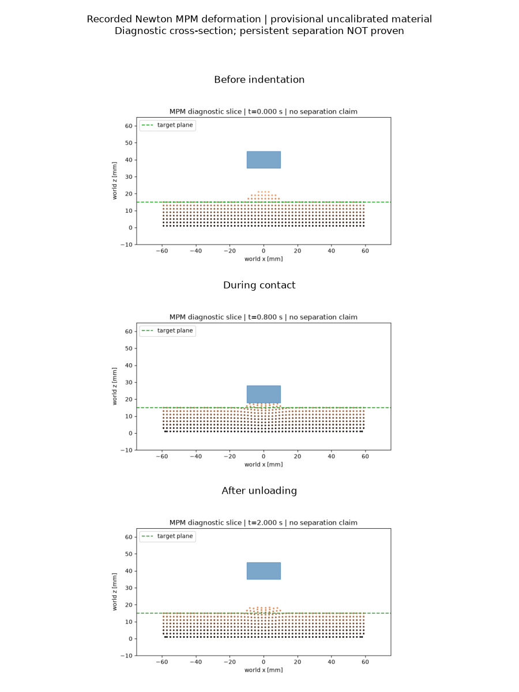

# WP-01 — Continuous specimen and blade-only Newton testbed

State: **implemented and exercised as an uncalibrated prototype**. This is not
PHYSICS_PROVEN cutting. All acceptance evidence below uses the corrected rigid
state synchronization in commit `465e444` or later. Earlier runs remain local
and are classified in `artifacts/RUN_VALIDITY.json`.

The testbed samples one connected height-function volume into particles. It has
a 120×80×15 mm base, one smooth dome, rigid tray floor and four walls; no particles
are pinned or deleted. D0/D1 seeded variants and dome/Gaussian/ellipsoid/ridge
families have CPU connectivity tests. Default grid is 4 mm, particle spacing
2 mm, density 1500 kg/m³: 19,340 particles and 0.232080 kg sampled mass. Sampled
mass is quadrature-dependent, not the exact analytic specimen mass.

Newton implicit MPM uses E=50 kPa, nu=.3, deviatoric yield=1 kPa and a prescribed
kinematic box blade or flat indentation punch. Parameters are provisional. The
CSV trajectory and all state/trace outputs are self-contained per run.

```bash
CUDA_VISIBLE_DEVICES=1 OMP_NUM_THREADS=4 MPLBACKEND=Agg .venv/bin/python -m robotic_cutting_sim.cli physics-probe --case settle --output-dir artifacts/newton_settle_002
CUDA_VISIBLE_DEVICES=1 OMP_NUM_THREADS=4 MPLBACKEND=Agg .venv/bin/python -m robotic_cutting_sim.cli physics-probe --case indent_unload --output-dir artifacts/newton_indent_002
CUDA_VISIBLE_DEVICES=1 OMP_NUM_THREADS=4 MPLBACKEND=Agg .venv/bin/python -m robotic_cutting_sim.cli physics-probe --case through_bump_cut --output-dir artifacts/newton_scrape_002
CUDA_VISIBLE_DEVICES=1 OMP_NUM_THREADS=4 MPLBACKEND=Agg .venv/bin/python -m robotic_cutting_sim.cli physics-probe --case indent_unload --material configs/materials/elastic_control.yaml --output-dir artifacts/newton_elastic_indent_002
```

Use fresh paths when reproducing. Each case is 120 frames / 2 s, control dt 1/60 s,
four implicit substeps per frame. Timings below exclude scene construction and
movie generation; complete receipts include both. Device memory is sampled total
VRAM, including baseline, rather than allocator peak.

| Run | Physics wall s | Peak speed m/s | Peak solver blade force N | Final all-particle RMS displacement mm |
|---|---:|---:|---:|---:|
| supported settle | 4.080 | .00119 | 0 | .1124 |
| indentation/unload | 5.029 | .0445 | .649 | .1903 |
| tangential scrape | 5.788 | .2009 | .398 | 3.5785 |
| indentation, high-yield elastic control | 4.691 | .0887 | 1.322 | .1245 |

Sampled physical-GPU-1 memory peaked at 726 MiB for these runs. No nonfinite
states or particle deletion/spawn were recorded; global constant-particle mass
drift is 0 in the exported precision. This does not constitute chip/substrate
mass classification.

After unloading at 2 s, the central bump maximum is 2.424 mm below its settled
0.3 s reference; the high-yield control is .937 mm below its reference. The
additional 1.486 mm residual is evidence of the configured yield-dependent
response. The elastic control also has numerical/contact residual, so this is
not a calibrated plasticity measurement. Jp remains 1 because the observed
plastic response can be isochoric; no claim of volumetric plastic strain is made.

The scrape has .837 mm maximum **pre-projection particle-center** blade
penetration and .393 mm after projection. Maximum positional projection correction
over all colliders is .959 mm. Solver impulse forces omit this projection's extra
corrections and are debug/calibration outputs, not robot reaction-force proof.

Fresh-process/model/solver reconstruction repeated all 121 indentation states:
maximum position and velocity difference were both 0 on this GPU/seed. This
validates this reset route, not in-place multi-world reset or cross-GPU equality.

| Grid / substeps | Particles | Sampled initial mass kg | Physics wall s / 2 s sim | Peak force N | Final RMS displacement mm |
|---|---:|---:|---:|---:|---:|
| 4 mm / 4 | 19,340 | .232080 | 5.788 | .398 | 3.579 |
| 3 mm / 6 | 42,890 | .217131 | 9.117 | .368 | 5.050 |
| 2 mm / 8 | 145,656 | .218484 | 18.691 | .365 | 4.640 |

These are three resolution probes, **not a convergence pass**. Both particle
quadrature and dt change; mass and displacement differ materially. The 4 mm
sampling places a particle center on the 15 mm base boundary, overweighting the
top layer. The 1 mm case and multi-seed frozen convergence protocol are NOT_RUN.
Memory for 3/2 mm probes peaked at 790/950 MiB total on physical GPU 1.

Every valid run contains `manifest.json`, `specimen.json`, `blade_trajectory.csv`,
`trace.csv`, `trace.png`, `physics_state.npz`, `preview.mp4` and low-rate frames.
Compact hashes and result values are committed in
[`validation_summary.json`](../evidence/validation_summary.json).



Unresolved: calibrated material law, refined sampling/convergence, separation
history and chip dynamics, full solver residual instrumentation. The case name
`through_bump_cut` describes the input trajectory; its Newton result establishes
deformation/contact only and does not certify a physical cut.
