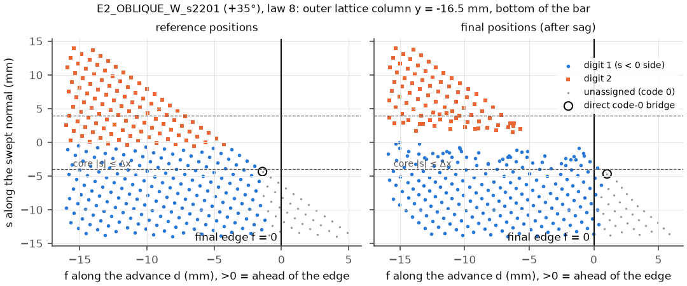
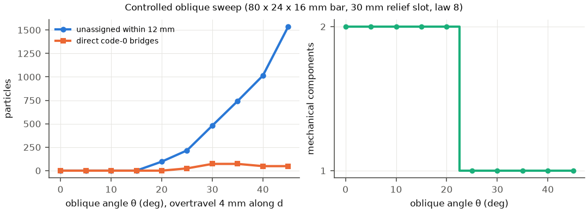
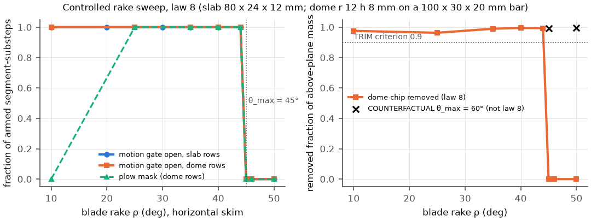
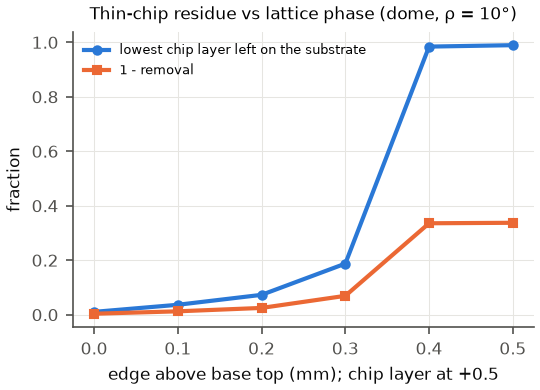

# WP-12 Phase 4a — law-8 failure regions: root cause (draft)

Date: 2026-10-31 (KST). Branch `claude/wp12-physical-cut-surfaces`, runs at `f53dc78` with this step's untracked
tools (`git_dirty`: other agents' Native files plus this step's new files; no solver or law file changed). Spec:
[WP12_SPECIFICATION.md](../WP12_SPECIFICATION.md) §4.1–4.3. Evidence:
[`docs/evidence/wp12/phase4a_law8_rootcause_001.json`](../evidence/wp12/phase4a_law8_rootcause_001.json).
Figures: [`docs/media/wp12/phase4/`](../media/wp12/phase4/).

**Scope.** This step only diagnoses. There is no new law and no threshold change. `tlmpm*.py`, the law-8 records,
`final_v4` and the WP-11 evidence are unchanged. Every run is **kinematic ideal tracking** at the formal resolution
(1 mm particles, 4 mm grid, 0.1 ms) with the provisional, uncalibrated WP-11 material (E 50 kPa, ν 0.3, yield
1 kPa, ρ 1500 kg/m³, μ 0.3, G_c 0.05 J/m²) and `ruler_knife_v2_y` (double bevel 25°, 1.5 mm thick), seed 42.
Rows marked **COUNTERFACTUAL** override one law parameter on the solver instance to test what that condition
decides. They are never law-8 or acceptance results.

> **Read with the corrections.** The xhigh review ([WP12_PHASE4_XHIGH_REVIEW.md](WP12_PHASE4_XHIGH_REVIEW.md),
> `81a9626`) corrected parts of this draft. The original text below is unchanged. The dated section
> [Corrections after the xhigh review (2026-10-31)](#corrections-after-the-xhigh-review-2026-10-31) at the end
> supersedes it where they differ. In particular, the §8 law-9 recommendation is withdrawn.

## Result at a glance

| Class (task item) | Reproduced | Root cause (spec §4.2 class) | Decisive evidence |
| --- | --- | --- | --- |
| (a) oblique ±30–35° through-cut, bottom layers connected | yes: s2201, s2202, s2203 stay 1 component (frozen: same) | **Missing side assignment** at the exit face. Contributing: **support** (the overhang over the 30 mm relief slot sags about 1.1 mm and moves about 2 mm along d) and **tool trajectory** (4 mm overtravel along d) | every unassigned particle within 12 mm (684 / 616 / 314) is on the uphill side, 4–12 mm off the plane, and failed **only** "ahead of the edge (f > 0)"; the decisive direct code-0 bridges (2 / 84 / 6) were behind the final edge in their reference positions and ahead only after sagging 2.1–2.4 mm along d; giving only those particles their plane side separates all three (2 components) |
| (b) ρ = 45° rake, 0 labels | yes: s2307, 0 labels | **Unsupported cutting orientation**: the motion is 45.0000006° out of the blade plane, on θ_max = 45° (float32 decides); the law-4 motion gate is closed on 120/120 segments for all 17,200 armed substeps, so the stroke never starts. Behind it, a second mechanism (class c) | 13,406 particle-substeps of directional cutting work and 1.2 mm penetration with the gate closed. COUNTERFACTUAL θ_max = 60°: gate open, plowing, 24,563 labels, but still 1 component because **one** dome-apex particle rode 0.75 mm ahead of the edge in the core band and was carried 30 mm; relabelling it separates |
| (c) residual particles inside sequential cuts | yes: TEST_D2 s2501 (frozen FAIL reproduced, 3 components) | **Contact: core-band carry.** 2 (p0) and 1 (p1) chip particles 2.5 mm above the plane (inside the core \|s\| ≤ Δx) stayed 0.10–0.43 mm ahead of the edge for the whole skim, were carried 40–80 mm and ejected; neither the band (needs f ≤ 0) nor the lead rule (needs \|s\| > Δx, and plowing) can label them | relabelling those 3 particles as chip gives 4 components (p0 and p1 separate). Test B s1502: 0 code-0 particles within 4 mm of any of its 4 planes (no residual). Phase M bumps3 chip merge: 49 substrate top-layer particles **lifted** 0.9–1.05 mm by the 25° rake before the edge passed (assigned on the chip side), then carried 52 mm; the chips merge because chips cut by different digits carry compatible codes |
| (d) TRIM thin-chip residue, local depression | yes: TRIM-02-K2-R10 removal 0.957 (frozen 0.957) | **Contact (wedge depression) at a lattice-phase margin** (numerical resolution) | 45 of 316 lowest-layer chip particles (0.3 mm above the edge) were pushed 0.47 mm down (median) before the edge passed, so they were 0.30 mm below the swept plane at assignment and took the substrate digit; the substrate top layer under the dome ends 0.36 mm lower (P05 1.73 mm, min 2.1 mm) versus 0.13 mm elsewhere |
| (e) swept-normal float32 fallback | checked in every run | **Numerical, latent**: 0 affected digits in every reproduced run; it bites only for a pure draw at a generic orientation | see §6 |

**Recommendation.** A versioned **law 9 is warranted for class (a) only**, as *law 8 plus a breakthrough-gated lead
rule* (§8). Classes (b) and (c) need separate candidate studies; (d) is contact and resolution, not a labelling
fault; (e) needs a corrected fallback whenever the law is next versioned, but it changes no current result.

## 1. Diagnostics tool: `cut_diagnostics_v1`

[`src/robotic_cutting_sim/cut_diagnostics.py`](../../src/robotic_cutting_sim/cut_diagnostics.py) is a read-only,
opt-in recorder for `tlmpm_v4` (ternary codes, K ≤ 2) and `tlmpm_v5` (packed codes), laws 4, 5 and 8. It brackets
the unchanged `bed.step()` with `before_step()` (four device copies: code, contact work, x, v) and `after_step()`
(three read-only kernels). Everything is on the device, so it runs inside the runtime's CUDA graph. It writes no
solver array and changes no solver module. The CPU test `tests/test_cut_diagnostics.py` checks this: a law-8
through-cut with the recorder on equals the run with it off **bit for bit** (every snapshot array, reaction and
stroke state) on both `tlmpm_v5` and `tlmpm_v4`.

What it records (spec §4.2):

| Level | Quantities |
| --- | --- |
| per edge segment and control step (`SEGMENT_COLUMNS`) | armed substeps; law-4 motion gate `seg_ok` (moving or drawing, within θ_max of the blade plane); law-8 plow mask; segment motion along d (advance), e (edge tangent) and n (blade normal); blade-contact particles and their normal impulse (`_contact_impulse` recomputed at the pre-step x and v, before the cutting release); directional cutting work (the solver's own `contact_work` increment); work done while the gate was closed; contact particles with complete progress; new digits by rule (band / lead) and side (1 / 2); swept-normal conditioning |
| per substep (`SUBSTEP_COLUMNS`) | trajectory index, cut digit, stroke S, engagement W, any_motion, travel, gate / plow counts, new band and lead digits, contact particles, impulse, work, edge-centre motion (d, e, n), swept-normal flags, digits a corrected fallback would flip |
| per particle and digit | for every armed substep in which the digit is still 0 after the step: the **first failing** law-4 band condition in the solver's own order (`stroke_off`, `outside_edge_width`, `ahead_of_edge` f > 0, `beyond_rear_limit`, `segment_gate_closed`, `outside_band` \|s\| > h) and the substeps in which it was the **only** failing condition; substeps in which the law-5 lead rule held except for the law-8 plow mask; the closest approach min f (with the stroke on, and while armed); for each new digit its substep, rule, s, f, position and swept-normal flags |

Host helpers: `classify_unassigned` (the decisive class of an unassigned particle), `direct_bridges` (the
`law8_validation.bridge_report` rule returning particle indices). Runners and analyses (all read-only):

- `scripts/run_wp12_phase4a_diagnose.py -- <unchanged WP-11 runner …>` attaches the recorder to every
  `tlmpm_v4`/`tlmpm_v5` the runner builds. `--counterfactual KEY=VALUE` overrides one law parameter on the
  instance; such a run is labelled COUNTERFACTUAL.
- `scripts/run_wp12_phase4a_sweep.py` runs the controlled sweeps (§7).
- `scripts/analyze_wp12_phase4a.py`, `analyze_wp12_phase4a_chips.py` and `analyze_wp12_phase4a_contact.py` do the
  per-digit, chip-region and contact analyses. `plot_wp12_phase4a.py` draws the figures and
  `summarize_wp12_phase4a.py` writes the evidence.
- **Relabel tests** give chosen digit-0 particles their side and recount the components. They are diagnostics that
  identify the *decisive* particles, never results.

## 2. Reproductions (original WP-11 configs and seeds, kinematic, law 8)

All runs used `cuda:1`, two at a time, `TMPDIR=/mnt/data/ningan/tmp`. Every run's exit status is 0 (GNU time).
Verdicts equal the frozen WP-11 verdicts.

| Run (`artifacts/wp12/…`) | Runner and solver | Verdict now (frozen) | Key numbers | Wall |
| --- | --- | --- | --- | --- |
| `phase4a_002/s2201` | round 2 OBLIQUE_W s2201, +35°, `tlmpm_v4` | CUTTING_FAILURE, 1 component (same) | 26,788 labels (frozen 26,788) | 6:20 |
| `phase4a_002/s2202` | s2202, −35° | CUTTING_FAILURE (same) | 23,744 labels | 5:35 |
| `phase4a_002/s2203` | s2203, +30° | CUTTING_FAILURE (same) | 22,338 labels | 5:58 |
| `phase4a_002/s2307` | TRIM_W s2307, dome, ρ 45° | CUTTING_FAILURE, 0 labels (same) | gate closed throughout | 3:19 |
| `phase4a_002/s2307_cf_thetamax60` | same, **COUNTERFACTUAL θ_max = 60°** | CUTTING_FAILURE | 24,563 labels, 1 component | 3:55 |
| `phase4a_002/s2501` | TEST_D2 s2501, sever 0° → remove all, `tlmpm_v5` S16 K3 | CUTTING_FAILURE `step1:remove_all` (same) | 3 components 0.769 / 0.230 / 0.0009 | 13:41 |
| `phase4a_004/trim_k2_r10_law8_001` | C4 TRIM-02-K2-R10 skim | PASS, removal 0.957 (frozen 0.957) | 45 / 316 lowest-layer particles left | 6:04 |
| `phase4a_004/bumps3_law8_v5_001` | Phase M `probe_v5_multicut.py --scenario bumps3` | PASS (same) | chips 1+2 one body with 49 substrate particles (frozen 49) | 2:52 |
| `phase4a_005/f2_6_pure_draw_law8_001`, `f2_6_saw_cut_…`, `f2_4_rocking_…`, `f2_5_pure_rotation_…` | Phase F rows, formal | PASS ×4 (same) | swept-normal check (§6) | 5:38 / 5:34 / 4:55 / 4:09 |

Failed launch attempts are preserved and listed in the evidence. The first TRIM and Phase F launches went to
directories without `law8`; their runners refuse such names (exit 2 in 0.4 s), and they were rerun under the names
above. `phase4a_002/queue.log` prints the exit code of `$(date)`, so it always shows 0; the logs' GNU-time
`Exit status` lines are authoritative.

## 3. Class (a): oblique ±30–35° through-cuts — missing side assignment at the exit face



**What blocks separation.** Law 4 labels a particle only behind the edge: f = (x − o)·d ≤ 0, the half-space bounded
by the plane through the edge **perpendicular to the advance d**. In a vertical cut that plane is parallel to the
bar bottom, so an edge that ends below the bottom has passed every bottom particle. In an oblique cut the plane is
tilted by θ against the bottom. On the uphill side (s < 0 for +θ), a bottom particle at distance |s| from the cut
plane is passed only after the edge travels about |s|·tanθ − z_b/cosθ beyond the section bottom. Code 0 is
compatible with both sides, so any such particle that still shares a 4 mm stencil node with both sides is a bridge.

| Seed | Unassigned within 12 mm | Class (all of them) | Ahead of the final edge: in reference / final positions | Decisive direct bridges | Bridge displacement along d | Relabel bridges only → components |
| --- | --- | --- | --- | --- | --- | --- |
| s2201 (+35°) | 684, s −4…−12 mm, z 0.5–3.5 mm | `edge_never_passed_while_stroke_on`; the **only** failing condition at every armed substep is f > 0 | 408 / 684 | 2 (z 0.5, y ±16.5, s ≈ −5 mm) | 2.4 mm (reference f < 0, final f = +1.0 mm) | **2** |
| s2202 (−35°) | 616, s +4…+12 mm | same | 308 / 616 | 84 (z 0.5–1.5, s 4–8 mm) | 2.3 mm | **2** |
| s2203 (+30°) | 314, s −6…−12 mm | same | 112 / 314 | 6 (z 0.5, s −6…−8 mm) | 2.1 mm | **2** |

- **Not insufficient cutting depth.** The edge ends 3.15–3.27 mm below the bar bottom (4 mm overtravel along d). No
  unassigned particle lies within |s| ≤ 4 mm of the plane: the swept surface spans the whole section.
- **Not orientation, gate or band.** The gate is open on 100% of the armed segment-substeps. The plow mask is never
  on (0°). No particle fails on `outside_band`, `beyond_rear_limit`, `segment_gate_closed` or `stroke_off` alone.
- **Support and trajectory decide the margin.** The bridges were *behind* the final edge in their reference positions
  and ended ahead only because the side over the 30 mm relief slot sags (bottom layer −1.1 mm in z, about +2 mm along
  d). Every unassigned particle met the law-5 lead conditions (0 < f ≤ 2Δx, Δx < |s| ≤ 6Δx, stroke on) at some
  substep: `lead_rule_blocked_by_plow_gate` = 684 / 616 / 314. Law 5 would have labelled them; law 8 gates the lead
  rule to plowing strokes.
- **Lattice phase.** It matters only at the margin. s2201 hangs on 2 corner particles, s2202 on 84.

## 4. Class (b): ρ = 45° rake — unsupported orientation at the θ_max boundary, then core carry

- **s2307 law 8.** The dome skim moves horizontally at 25 mm/s with the blade raked 45°. The segment motion is
  45.0000006° out of the blade plane, against θ_max = 45°. The gate test
  (v·n)² ≤ tan²θ_max[(v·d)² + (v·e)²] fails in float32 on all 120 segments for all 17,200 armed substeps, so W is
  never set and the stroke never starts: 0 labels.
- **Contact without labels.** The blade still contacts, penetrates 1.2 mm and does directional cutting work (13,406
  particle-substeps of work with the gate closed). The progress release lets it plough through, and the material
  closes behind it.
- **Classification.** Unsupported cutting orientation: the declared θ_max boundary, decided by float32 rounding at
  exactly 45°.
- **COUNTERFACTUAL θ_max = 60° (not law 8).**
  - The gate opens and the plow mask is on everywhere: 10,298 band and 14,265 lead labels.
  - The bar still stays 1 component, because of **one** dome-apex particle at reference (7.5, 5.5, 16.5) mm. It sat
    inside the core band (\|s\| ≤ Δx) and came no closer than f = +0.75 mm to the edge. It was carried 29.8 mm and
    ended at f = 8.07 mm, just beyond b_lead.
  - Relabelling it separates the bar (2 components). The second blocker is class (c).
- **The controlled dome sweep isolates the gate (§7.2).** ρ = 10–44° separates (removal 0.963–0.995). ρ = 45, 46 and
  50° give 0 labels. COUNTERFACTUAL θ_max = 60° separates ρ = 45° and 50° (0.993, 0.996) on that dome, with no
  carried particle.

## 5. Class (c): residual particles inside sequential cuts — core-band carry and chip re-merge

- **TEST_D2 s2501 (sever 0° → remove both caps, ρ = 10°, no plowing).**
  - The sever (digit 0) is clean: 0 unassigned within 12 mm, 0 bridges.
  - **Digit 1 (cap p0).** Of 1,817 chip particles, 1,812 are on the chip side, 3 took the substrate side, and
    **2 stayed 0**. The 2 are at reference (16.5, 0.5 / 1.5, 24.5) mm, 2.5 mm above the plane, inside the core.
  - **Digit 2 (cap p1).** Of 614 chip particles, 558 are on the chip side, 55 took the substrate side, and **1
    stayed 0**: (57.5, 1.5, 24.5) mm.
  - **Mechanism.** All three rode ahead of the edge for the whole skim (closest approach f = +0.10, +0.15 and
    +0.43 mm; class `edge_never_passed_while_stroke_on`). They were carried 39–80 mm and ejected with the chip, and
    they bridge where the chip lands.
  - Neither rule can reach them. The band needs f ≤ 0. The lead rule needs \|s\| > Δx and, under law 8, a plowing
    segment.
  - **Relabel test.** Giving the 3 particles the chip digit gives 4 components (p0 and p1 both separate).
  - The 3 and 55 chip particles on the substrate side are class (d): they were pushed 0.41–0.68 mm down before the
    edge passed.
- **Test B s1502 (baseline extract).** 0 code-0 particles within 4 mm of any of its 4 planes, so there is no
  residual.
- **Phase M bumps3 (rerun, PASS).**
  - The chips 1+2 body holds exactly 49 substrate top-layer particles (reference z = 11.5 mm; codes 32 / 36 / 40),
    carried 52 mm.
  - **Assignment.** The 25° raked edge **lifted** them 0.92–1.05 mm (median) before passing under them. So they were
    0.2–0.35 mm above the swept plane at assignment and correctly took the chip side of the current geometry.
  - **Why the chips merge.** The chips themselves carry codes 42 / 40 / 32: every later skim labels the chips it
    pushes ahead as positive. Chips cut by different digits therefore never conflict, and they merge where they touch
    (minimum gap 0.30–0.39 mm).
  - **Classification.** Contact (carry and lift) plus a representation limit (code compatibility of separately
    removed chips), not a separation failure of the target.

## 6. Classes (d) and (e)

**(d) TRIM thin-chip residue and local depression (TRIM-02-K2-R10, PASS, removal 0.957).**

- **Residue.** The edge runs at 20.2 mm, 0.3 mm below the lowest chip layer (20.5 mm). 45 of 316 particles in that
  layer took the substrate digit.
  - At assignment they were 0.47 mm (median) below their reference height, at s = −0.30 mm.
  - The 271 that took the chip digit were +0.10 mm above their reference height, at s = +0.28 mm.
  - All 45 lie under the loaded centre of the dome (x −4.5…+9.5 mm). They end as a one-layer residue at z = 19.5 mm.
- **Depression.** The substrate top layer under the dome ends 0.36 mm lower (median; P05 1.73 mm, min 2.12 mm). The
  same layer elsewhere ends 0.13 mm lower. The next layer down, under the dome, ends 0.19 mm lower.
- **Classification.** Contact: the wedge and the chip reaction depress the soft material before the edge passes, and
  the band labels where material *is*, which is physically consistent. Numerical resolution: whether the depressed
  layer falls below the edge depends on the 0.3 mm lattice-phase gap (§7.3).

**(e) Swept-normal float32 fallback.** The solver uses n_s ∝ m × e and falls back to the blade normal only if
|m × e|² ≤ 1e-20 (absolute). The diagnostic flags new digits with |m × e| ≤ 1e-5 |m| (`ill_float`) or ≤ 1e-2 |m|
(`ill_geom`, motion within 0.57° of the edge line) and recomputes the side with the blade-normal fallback.

| Run | New digits | Flagged `ill_float` / `ill_geom` | Digits a corrected fallback would flip |
| --- | --- | --- | --- |
| s2201, s2202, s2203, s2307 (and its COUNTERFACTUAL), s2501, TRIM, F2.4 rocking, F2.5 rotation, F2.6 saw | all | 0 / 0 | **0** |
| F2.6 pure draw (axis-aligned) | 14,400 (904 during the draw) | 904 / 904, all with the solver's own exact fallback (m × e = 0) | **0** |
| CPU test, pure draw at a generic 97° yaw (`test_pure_draw_flags_swept_normal_conditioning`) | 28 during the draw | 28 / 28 | **15 of 28** |

- **Classification.** Numerical, latent. It corrupts digits only in a pure draw whose edge is not axis-aligned. In
  that case m × e is float32 noise just above the 1e-20 threshold, and the side is decided by a random plane through
  the edge.
- **No recorded run is affected.** F2.6 saw has 72,000 `ill_geom` segment-substeps (direction reversals), but no
  digit was written in them.

## 7. Controlled sweeps (diagnostics, not acceptance runs)

The sweeps use `scripts/run_wp12_phase4a_sweep.py` on `cuda:1`, `tlmpm_v5`, law 8, with the same kinematic
interpolation as `LiveCuttingMaterial`. The support is a 10 mm board on risers. The output is
`artifacts/wp12/phase4a_003/sweep/summary.json` (36 rows plus 15 dome rows); the wall times were 32:44 and 7:45. A
dome family was added after the slab rows (the reason is under §7.2). The slab and oblique rows ran from the script
version before that addition; the addition changed no existing row.

### 7.1 Oblique angle, overtravel, support and lattice phase

The bar is 80 × 24 × 16 mm, with a 30 mm relief slot centred where the plane meets z = −6 mm (round-2 rule). The
armed cut runs at 10 mm/s from 8 mm before the section top to 4 mm past the section bottom, measured along d.



| Row | Components | Mass fractions | Labels | Unassigned within 12 mm | …ahead of final edge (reference / final) | Direct bridges | Bottom-layer Δz, s < 0 / s ≥ 0 (mm) | Wall (s) |
| --- | --- | --- | --- | --- | --- | --- | --- | --- |
| obl_00 | 2 | 0.500 / 0.500 | 18240 | 0 | 0 / 0 | 0 | −0.12 / −0.12 | 71 |
| obl_05 | 2 | 0.512 / 0.488 | 18120 | 0 | 0 / 0 | 0 | −0.15 / −0.06 | 67 |
| obl_10 | 2 | 0.506 / 0.494 | 18408 | 0 | 0 / 0 | 0 | −0.02 / −0.00 | 76 |
| obl_15 | 2 | 0.504 / 0.496 | 18288 | 0 | 0 / 0 | 0 | −0.05 / 0.02 | 76 |
| obl_20 | 2 | 0.505 / 0.495 | 18336 | 96 | 0 / 96 | 0 | −0.25 / 0.02 | 70 |
| obl_25 | **1** | 1.000 | 18192 | 216 | 72 / 216 | 24 | −0.15 / −0.05 | 62 |
| obl_30 | **1** | 1.000 | 17702 | 480 | 192 / 480 | 72 | −0.29 / −0.07 | 68 |
| obl_35 | **1** | 1.000 | 17402 | 742 | 336 / 700 | 72 | −0.39 / −0.07 | 72 |
| obl_40 | **1** | 1.000 | 17250 | 1014 | 504 / 893 | 48 | −0.47 / −0.04 | 75 |
| obl_45 | **1** | 1.000 | 16632 | 1536 | 720 / 1320 | 48 | −0.51 / −0.04 | 82 |
| obl_m35 (−35°) | **1** | 1.000 | 17402 | 742 | 336 / 700 | 72 | −0.07 / −0.39 | 77 |
| obl_35_ot06 (overtravel 6 mm) | 2 | 0.513 / 0.487 | 18334 | 362 | 96 / 336 | 0 | −0.39 / −0.07 | 81 |
| obl_35_ot08 | 2 | 0.513 / 0.487 | 19104 | 96 | 0 / 72 | 0 | −0.39 / −0.07 | 69 |
| obl_35_ot10 | 2 | 0.513 / 0.487 | 19132 | 96 | 0 / 0 | 0 | −0.39 / −0.07 | 92 |
| obl_35_nograv (gravity off) | 2 | 0.514 / 0.486 | 19200 | 48 | 48 / 48 | 0 | +2.38 / +1.24 (the unweighted bar lifts) | 72 |
| obl_35_slot12 (12 mm slot) | 2 | 0.513 / 0.487 | 18168 | 432 | 336 / 432 | 0 | −0.12 / −0.04 | 66 |
| obl_35_phase025 (plane +0.25 mm) | **1** | 1.000 | 17598 | 690 | 360 / 676 | 72 | −0.39 / −0.07 | 49 |
| obl_35_phase050 | **1** | 1.000 | 17496 | 720 | 312 / 704 | 96 | −0.34 / −0.05 | 56 |
| obl_35_phase075 | **1** | 1.000 | 17496 | 696 | 312 / 654 | 96 | −0.34 / −0.05 | 64 |

- **Angle.** With the planner's 4 mm overtravel, unassigned bottom material appears from 20° and the bar stays
  connected from **25°**. The ±35° rows are exact mirrors.
- **Not lattice phase.** Shifting the plane by 0.25–0.75 mm does not rescue 35°: 72–96 bridges in every phase.
- **It is the exit-face coverage.** 6 mm of overtravel, a 12 mm slot (overhang sag 0.12 instead of 0.39 mm) or no
  gravity each separate 35° **with law 8 unchanged**. Unassigned particles remain, but none bridges. The bridges need
  code-0 bottom particles within about 6 mm of the plane, and the margin is a few tenths of a millimetre of sag or
  overtravel.

### 7.2 Rake (motion gate) and the dome chip

The **slab** rows (80 × 24 × 12 mm, a 2.8 mm chip along the whole length) isolate the gate. The removal outcome is not
meaningful there:

- The 80 mm continuous chip piles up ahead of the edge (class c) and never separates (removal 0 at every ρ).
- At ρ ≥ 30° the unrestrained slab is pushed off the board: substrate Δz −78 to −109 mm.

The **dome** rows (r 12 mm, h 8 mm, 563 particles on a 100 × 30 × 20 mm bar, skim x = −30…+30 mm at 25 mm/s,
edge 0.2 mm above the base top) were added to give the outcome.



| Dome row | Gate open | Plow | Stroke-on substeps | Band / lead labels | Work with gate closed (particle-substeps) | Components | Removal | Substrate | Max penetration (mm) |
| --- | --- | --- | --- | --- | --- | --- | --- | --- | --- |
| ρ 10 | 1.000 | 0.000 | 16772 | 30473 / 0 | 0 | 2 | 0.975 | 1.00000 | 0.43 |
| ρ 25 | 1.000 | 1.000 | 16772 | 10654 / 24349 | 0 | 2 | 0.963 | 1.00000 | 0.43 |
| ρ 35 | 1.000 | 1.000 | 16772 | 11192 / 24659 | 0 | 2 | 0.989 | 1.00000 | 1.05 |
| ρ 40 | 1.000 | 1.000 | 16772 | 11588 / 24945 | 0 | 2 | 0.995 | 1.00000 | 1.19 |
| ρ 44 | 1.000 | 1.000 | 16772 | 11964 / 25229 | 0 | 2 | 0.993 | 1.00000 | 1.11 |
| **ρ 45** | **0.000** | 0.000 | 0 | 0 / 0 | 26177 | 1 | **0.000** | 1.00000 | 0.74 |
| ρ 46 | 0.000 | 0.000 | 0 | 0 / 0 | 27245 | 1 | 0.000 | 1.00000 | 0.71 |
| ρ 50 | 0.000 | 0.000 | 0 | 0 / 0 | 28986 | 1 | 0.000 | 1.00000 | 0.69 |
| ρ 45 COUNTERFACTUAL θ_max 60° | 1.000 | 1.000 | 16772 | 11867 / 25472 | 0 | 2 | 0.993 | 1.00000 | 1.11 |
| ρ 50 COUNTERFACTUAL θ_max 60° | 1.000 | 1.000 | 16772 | 12712 / 25714 | 0 | 2 | 0.996 | 1.00000 | 1.08 |

The slab rows give the same gate cliff: gate open fraction 1.000 at ρ = 10–44°, 0.000 at 45, 46 and 50°. Work with
the gate closed is 119,312, 21,428 and 12,113 particle-substeps at 45, 46 and 50°.

### 7.3 Lattice phase of the lowest chip layer (dome, ρ = 10°)



| Edge above the base top (gap to the 20.5 mm layer) | Lowest layer left on the substrate | Its Δz at assignment (median) | Removal | Substrate min Δz (mm) |
| --- | --- | --- | --- | --- |
| 0.0 mm (0.5) | 2 / 192 | −0.04 | 0.996 | −0.91 |
| 0.1 mm (0.4) | 7 / 192 | −0.02 | 0.988 | −0.96 |
| 0.2 mm (0.3), the planner default | 14 / 192 | +0.02 | 0.975 | −1.08 |
| 0.3 mm (0.2) | 36 / 192 | 0.00 | 0.931 | −1.59 |
| 0.4 mm (0.1) | 189 / 192 | −0.28 | **0.664** | −0.28 |
| 0.5 mm (0.0) | 190 / 192 | −0.24 | **0.663** | −0.30 |

The residue is a lattice-phase effect. At a 0.3 mm gap (the 0.2 mm planner clearance on a 1 mm lattice), 7% of the
lowest layer stays here and 14% on TRIM-02-K2. At a gap of 0.1 mm or less, the whole layer stays and the 0.9 removal
criterion fails.

## 8. Candidate remedies and the law-9 recommendation

| Class | Candidate | Physical assumption | Predicted effect | Must still hold (negative controls) | Verdict |
| --- | --- | --- | --- | --- | --- |
| (a) | Planner: overtravel ≥ \|s_reach\|·tanθ − z_b/cosθ + sag margin (≥ 6 mm at 35°) | the edge must pass the stencil reach on the uphill side | 35° separates at 6–10 mm (§7.1) | unchanged law | Opt-in for slotted boards only. **Impossible on the flat board**: Phase 2 Option A ends the cut on the board top, so overtravel is 0, and ±30–35° obliques already bind on handle clearance |
| (a) | Support: narrower relief slot | less overhang sag | 12 mm slot separates 35° | unchanged law | scene-dependent, not general |
| (a) | Law 5 (lead always) | carried or ejected material is pre-assigned | labels all 684 / 616 / 314 | — | already rejected (M8b: the bar pushed 2.3 mm) |
| (a) | Wider band h or rear b_back | — | **none**: no particle fails on \|s\| > h or the rear limit | — | rejected (threshold change with no effect) |
| (a) | **Law 9: breakthrough-gated lead** (rule below) | once no unseparated material remains in a cutting segment's process zone ahead (the edge broke through the free surface or reached the support), the section along that segment is severed and the nearby material belongs to its side | s2201 / s2202 / s2203: the relabel tests on exactly these particles give 2 components; obliques ending on a solid board; bumps3-style bar-end exits | flat press, side push, blunt handle v2, no contact, withdrawal (no stroke, unchanged); M4 half-depth ligament (core ahead not empty); F2.8 finite edge (\|l\| ≤ L kept); M8a sagging cantilever stays connected (sagged bottom layer in the core) | **recommended** |
| (b) | Declare the envelope: law 8 supports ρ ≤ 44° | — | — | — | **do now** (reporting) |
| (b) | Motion gate from tool clearance: M_k iff the edge leads the cross-section, m⊥·(p_j − edge) < 0 for every profile vertex (\|α\| < 77.5° for the 25° double bevel; asymmetric for the chisel) | a blade cuts whenever its edge, not a face, meets material first | dome ρ 45/50° separate (as the COUNTERFACTUAL); s2307 still blocked by one carried apex particle | flat press and side push (α = 90°) stay closed; a new face-first control at α ≈ 80° must stay closed | candidate for a later variant, after (c) |
| (b) | θ_max 45 → 60° | — | same as the COUNTERFACTUAL | — | rejected: a threshold relaxation without a physical rule |
| (c) | Carried-material rule: a code-0 particle in the core ahead of a cutting segment that has travelled ≥ 2Δx with the edge (relative to the substrate) takes the side of its s | a ligament cannot travel with the tool; carried material is detached chip | s2501: the 3 decisive particles (4 components); s2307 COUNTERFACTUAL apex | M4 ligament (does not travel); an unclamped bar sliding with the blade must not be split (requires motion *relative* to the substrate) | study as a separate variant; **not** in law 9 |
| (c) | Chip re-merge across digits (bumps3) | — | — | — | representation / evaluation topic (chips of different digits never conflict); not a law change |
| (d) | none in the law; planner clearance relative to the lattice; resolution study (§4.7); material calibration | the band labels material where it is when the edge passes (consistent) | — | — | report as a resolution limit |
| (e) | Relative fallback: blade normal when \|m × e\|² ≤ max(1e-20, (1e-5 \|m\|)²) | a pure draw has no swept-surface normal of its own | 0 changes in every recorded run; fixes generic-yaw draws (15 / 28 flips in the CPU case) | all rows | include in law 9 as a numerical correction |

**Recommendation.** A versioned **law 9** is warranted, because a diagnosed mechanism, not a threshold, blocks
valid cuts:

- The band front is the plane through the edge perpendicular to d. For obliques ending on a solid board (the Phase 2
  workcell) no planner overtravel is available.
- **Law 9 = law 8 (ADR 0012) with exactly two changes**; laws 4, 5 and 8 stay bitwise unchanged:
  1. **Breakthrough mask B_k.** After the deformation update (before assignment), for each edge segment k with M_k
     while S = c + 1: B_k = 1 iff no particle whose digit c is 0 lies in that segment's strip ahead of the edge,
     {l in segment k, 0 < f ≤ b_lead = 2Δx, \|s\| ≤ s_core = Δx} (s from `_swept_side`). This needs one counting launch
     and one segment pass.
  2. **The lead pre-assignment** (law-5 rule, unchanged parameters b_lead = 2Δx, s_core = Δx, h = 6Δx) runs on
     segments with **plow_k OR B_k**. The swept-normal fallback becomes relative (table, row e). No new physical
     parameter is added.
- **Expected behaviour (to be verified, not assumed).**
  - In-plane vertical cuts, and skims inside a bar (substrate in the core), are unchanged until breakthrough.
  - Vertical through-cuts gain nothing at the exit, because no material lies ahead of the edge beyond the bottom.
  - Obliques and bar-end exits gain the uphill bottom labels.
  - (b), (c) and (d) are not addressed by law 9.
- **Acceptance before use.**
  - The full ADR 0006 / Amendment 1 matrix M1–M9.
  - The Phase F boundary and negative-control rows, including F2.9 v2 (blunt handle), M4 and F2.8.
  - New declared rows: oblique 20/25/30/35/45° on the slotted board and on the solid flat board; bumps3; the
    breakthrough-specific negative control, an armed edge whose stroke persists into air beside material
    (B_k true while particles lie in the lead region of an empty segment).
  - Energy, contact reaction and momentum checks, in-plane CUT and TRIM non-regression, and a fair comparison against
    law 8 on every row.

**Supported orientation (diagnostic, 1 mm kinematic, these geometries only).**

- **Oblique through-cuts with law 8 and the planner's 4 mm overtravel over a 30 mm relief slot:** separate at
  θ ≤ 20°; known failure at 25–45°.
- **Raked skims of a dome:** separate at ρ = 10–44°; known failure at ρ ≥ 45° (gate).
- **Neither result is a validated envelope.** The envelope study (§4.4) remains.

## 9. Commands

```
# reproductions (cuda:1, two lanes; queue scripts artifacts/wp12/phase4a_00{2,4,5}/queue.sh)
TMPDIR=/mnt/data/ningan/tmp .venv/bin/python scripts/run_wp12_phase4a_diagnose.py -- scripts/run_generalization.py \
    --config configs/wp11/generalization_round2.json material --family OBLIQUE_W --seed 2201 --device cuda:1 \
    --expect-task-id CFG-E2_OBLIQUE_W_s2201-E2_OBLIQUE_W_s2201_sever-9e29a817 --out artifacts/wp12/phase4a_002/s2201
#   same for OBLIQUE_W 2202 / 2203, TRIM_W 2307 (+ --counterfactual theta_max_deg=60 before --), TEST_D2 2501,
#   run_phase_c4_trim_material.py --task TRIM-02-K2-R10 --control skim, probe_v5_multicut.py --scenario bumps3,
#   run_phase_f_material.py --row F2.6_pure_draw | F2.6_saw_cut | F2.4_rocking | F2.5_pure_rotation --variant formal
# sweeps
TMPDIR=/mnt/data/ningan/tmp .venv/bin/python scripts/run_wp12_phase4a_sweep.py --rows oblique rake phase --device cuda:1 \
    --out artifacts/wp12/phase4a_003/sweep
TMPDIR=/mnt/data/ningan/tmp .venv/bin/python scripts/run_wp12_phase4a_sweep.py --rows dome --device cuda:1 \
    --out artifacts/wp12/phase4a_003/sweep
# analyses, figures, evidence (CPU)
.venv/bin/python scripts/analyze_wp12_phase4a.py artifacts/wp12/phase4a_002/s2201 …
.venv/bin/python scripts/analyze_wp12_phase4a_chips.py artifacts/wp12/phase4a_002/s2501
.venv/bin/python scripts/analyze_wp12_phase4a_contact.py trim artifacts/wp12/phase4a_004/trim_k2_r10_law8_001
.venv/bin/python scripts/analyze_wp12_phase4a_contact.py bumps3 artifacts/wp12/phase4a_004/bumps3_law8_v5_001
.venv/bin/python scripts/plot_wp12_phase4a.py --runs artifacts/wp12/phase4a_002 --sweep artifacts/wp12/phase4a_003/sweep \
    --out docs/media/wp12/phase4
.venv/bin/python scripts/summarize_wp12_phase4a.py --notes <notes.json> --out docs/evidence/wp12/phase4a_law8_rootcause_001.json
# tests
.venv/bin/python -m pytest -q tests/test_cut_diagnostics.py tests/test_cut_events.py tests/test_repo_naming.py
```

## 10. Limits of this diagnosis

- **Kinematic ideal tracking only.** There is no Native, Lab or live tracking noise. The swept-normal result in
  particular may differ under tracking noise.
- **Material.** It is provisional, at the formal resolution only. Forces are not converged (WP-11 F3).
- **The sweep geometries are simplified.** The dome is an ellipsoidal cap of 563 particles; TRIM-02-K2's dome has
  1,044.
- **The slab rows' outcome is confounded.** Its chip piles up, and at ρ ≥ 30° the slab slides off the board. It is
  reported, not used for removal claims.
- **Relabel tests and COUNTERFACTUAL rows only point at the decisive condition.** They do not simulate law 9's
  dynamics after the extra labels. Law 9's effect must be measured, never inferred from them.
- **The breakthrough condition was checked at the final armed pose only.** There, no unassigned particle lay within
  \|s\| ≤ 4 mm and every unassigned particle had f ≤ 5.05 mm. It was not checked per segment at every substep.

## Corrections after the xhigh review (2026-10-31)

Added 2026-10-31 (KST) after the `rcs-xhigh` review [WP12_PHASE4_XHIGH_REVIEW.md](WP12_PHASE4_XHIGH_REVIEW.md)
(`81a9626`, verdict **REJECT law 9 as proposed**). Sections 1–10 above stay as written. Where they differ from
this section, this section applies.

The review re-ran the draft's numbers from the saved runs (its §1). The (a) counts and bridges, the static B_k at
the final pose, the (b) gate tie, the θ_max = 60° counterfactual and the (e) zero-flip result all reproduce. One
claim does not: "unchanged until breakthrough" (C4 below).

### C1. Class (a): root cause restated

**Root cause.** The law-4 front f = (x − o)·d ≤ 0 (`tlmpm_v5.py:630`) is the plane through the edge, normal to
the advance d. At a tilted exit face, the uphill material beside the swept surface is never behind the edge when
the edge leaves the bar.

**What sets the margin.** Sag and overtravel. With overtravel t along d, a bottom-layer particle at height z_b is
passed only if |s| ≤ z_b/sinθ + t/tanθ:
- **Overtravel.** The WP-11 4 mm came from the action workspace (`cut_extent = plane_section`), not from physics.
- **Sag.** The overhang over the 30 mm relief slot sags. That decided the reproduced bridges, which had
  f_reference < 0. This support does not exist on `blade_master_flat_board_v1`.

**The law-8 plow gate is not a root cause.**
- It matters only once overtravel moves the wedge outside the core (|s| > Δx).
- So "law 5 would have labelled them" (§3, `lead_rule_blocked_by_plow_gate` = 684 / 616 / 314) holds only on
  the slotted/relief-slot support.
- The "Root cause" cell of the at-a-glance table for (a) should read: missing side assignment because the f ≤ 0
  front meets a tilted exit face, with the margin set by support sag and overtravel.

### C2. The handle-clearance claim was a misreading

- **Withdrawn.** The §8 table says ±30–35° obliques "already bind on handle clearance" and calls planner
  overtravel "Impossible on the flat board".
- **What the source says.** WP11_PHASE_E_ROUND2.md:237 names `knife_handle_clearance` as the *binding* (active)
  constraint, with 5.6–6.1 mm of margin. That is a margin, not a failure.
- **Flat-board reachability is unmeasured.** E1.3 measures it.
- **The slotted variant was never tested.** ADR 0017:121 and WP12_WORKCELL.md:193 keep oblique planes on the
  explicit slotted variant (Option D), so overtravel is not impossible in the WP-12 workcell. No oblique has yet run
  on its 8 mm grooves.

### C3. (a) on the flat board is undemonstrated until E1

- **Status: NOT_RUN.** The draft ran no oblique on `blade_master_flat_board_v1`, so (a) on that board is NOT_RUN.
- **The reviewer's CPU probe is only a prediction.** It is `artifacts/wp12/phase4_xhigh_review_001/cpu_flat_oblique.py`:
  a 40 × 12 × 12 mm bar on a solid box, law 8, edge ending on the board top. It predicts:
  - failure from 5–10° by a margin (two bottom-layer particles 0.01–0.05 mm ahead of the edge);
  - robust failure from 15–20° to 35°, where the unassigned wedge lies inside the core strip.
- **Withdrawn from §8.** Obliques "ending on a solid board" are no longer claimed as an effect of the proposed
  law 9.
- **Scope of the §3 and §7.1 diagnosis.** It stands for the WP-11 relief-slot support only.

### C4. Law 9 as proposed (breakthrough-gated lead + relative fallback): REJECTED

The §8 recommendation is withdrawn. The review's reasons (its §3):

1. **Wrong test.** "No digit-0 particle in {0 < f ≤ 2Δx, |s| ≤ Δx}" asks whether there is *material* in the core
   ahead. The question that matters is whether a *ligament straddles* the swept surface.
2. **It blocks itself at a supported oblique exit.**
   - The one-sided uphill wedge, which holds the very particles that need labels, sits in the core strip.
   - The reused law-5 rule excludes |s| ≤ Δx anyway.
3. **It still needs overtravel.** About Δx·tanθ − z_b/cosθ (≈ 1.3–2.2 mm at 25–35°), which Option A does not
   provide. Its only proven gain is cutting the slotted-board overtravel from about 6–10 mm to about 2–4 mm.
4. **"Unchanged until breakthrough" is refuted.** On snapshots, B_k = 1 fires mid-cut on 2–4 material segments with
   an empty core, and lags the exit by about 1–3 mm. The draft checked the breakthrough condition at the final pose
   only (§10).
5. **Not safe:**
   - **Empty space beside material.** S persists for 2Δx, so any moving segment with an empty core gets B_k = 1.
     The lead rule then labels material the edge never reached, which voids ADR 0008's safety argument.
   - **Digit-0 counting.** Re-entered kerfs, labelled chips and the rule's own labels all count as "empty".
   - **Unmeasured field-split dynamics.** About 2.4–3.7 thousand particles would be labelled at once at the exit,
     with untested effects on the FLIP transfer (law 5 failed M8b this way).
   - **Strip sampling.** One stray particle blocks the mask, and one void opens it.
   - **Multi-cut and intersecting cuts.** Labels can land on separate bodies.
6. **No new press-versus-directional distinction.** The rule inherits law 4's S/M_k gate.

**Next.** No law code until D1 is decided at xhigh.
- E1 (`configs/wp12/phase4_e1_protocol_v1.json`) runs law 8 unchanged, with a read-only offline evaluator.
- The evaluator scores the rejected breakthrough mask and the two-sided exit-ligament rule L9-EL (review §3.3) on
  the recorded per-substep states.
- It never writes a label into the physics run.
- L9-EL is a candidate under evaluation, not an approved law.

### C5. (e) ships as its own variant

- **Withdrawn.** The §8 row (e) wording "include in law 9 as a numerical correction".
- **The relative fallback ships alone.** |m×e|² ≤ max(1e-20, (1e-5|m|)²) becomes its own opt-in numerical variant,
  "law 8 + swept-normal fallback v2".
- **Acceptance:**
  - CPU bitwise equality with law 8 wherever no `ill_float` digit exists;
  - the generic-yaw pure-draw test;
  - a recorder matrix rerun, predicted equal within GPU nondeterminism.
- **Scope limit.** It repairs float noise (`ill_float`) only. Near-pure draws under tracking noise (`ill_geom`; in
  Phase F, 0.3 mm/s turns n_s by about 45°) need their own study.
- **Not bundled.** It is not part of any (a) law. A later exit law builds on it with an ablation row.

### C6. (b): envelope wording (replaces the §8 "Supported orientation" paragraph)

Scope: law 8, `ruler_knife_v2_y`, kinematic ideal tracking, 1 mm. ρ ≤ 44° is declared now, and the motion gate
is unchanged.

| Status | Rake |
| --- | --- |
| Validated cutting | ρ = 10° (F3/C4); 14, 15, 16° (F2.1); 25° (M3a); 35° (M3b/M3c) |
| Partially validated | ρ = 10–44° (dome sweep, diagnostic) |
| Known failure / unsupported | ρ = 45°. The motion lies on θ_max and float32 decides the gate (s2307, 0 labels; the frozen FAIL stands) |
| Unsupported by law | ρ > 45°. The gate is closed by design: contact and directional work, no labels |
| Physically infeasible | ρ ≈ 5° at 0.2 mm clearance |
| Physically feasible, not validated | edge-first contact up to 77.5° |

**Sampling rule.** Generators and planners sample ρ ≤ 44°. Live tracking needs an extra margin equal to the
measured out-of-plane motion noise (NOT_RUN).

**The bevel-derived gate** (|α| < 77.5°) is only a necessary condition, and it would not rescue s2307. It is
studied only after (c), with face-first controls at α = 80/85/90° and a 70° wedge press without draw.

### C7. Unchanged

- (b), (c) and (d) stand as written, with the (d) remark that "planner clearance relative to the lattice" can at
  most be a declared, resolution-specific planner rule, never a physics fix.
- No solver, law, threshold, frozen record or WP-11 evidence was changed by these corrections.
