# WP-12 final validation — engineering delivery and scientific limits

Date: 2026-10-31 (KST). Finalization branch `codex/wp12-finalize`, inherited WP-12 baseline `1344688`.
This release delivers the current flat-board workcell, supported Native demonstrations, API, evidence and documentation.
It does **not** turn the original scientific failures into passes. Material parameters remain provisional and uncalibrated.
The authorized finish plan reduces additional experiments; the frozen physics, protocols, thresholds and verdicts stay intact.

## Acceptance matrix (spec §7.4)

| Area | Verdict | Evidence and limit |
| --- | --- | --- |
| Workcell | **PASS (scoped)** | One board directly on the table, no risers/hidden supports; Native Demos 1–6; [workcell report](WP12_WORKCELL.md) |
| Board physics | **PARTIAL** | Actual tool/board contact, edge stops at the board; transient material-centre penetrations in Demo 5 remain disclosed below |
| Grasp | **PASS (scoped)** | 12 existing Native demo episodes with physical friction grasp, 0 task-phase IK failures/workspace clamps, return HOME PASS |
| Straight cut | **PASS (scoped)** | Demo 1 A/B: two equal mechanical components, 600/600 conflicting links, no direct bridges; surface fidelity assessed separately |
| Oblique cut | **PARTIAL** | Demo 2 +20° only on the explicit 8 mm slotted board; arbitrary solid-board oblique cutting unsupported |
| TRIM | **PASS (scoped)** | Demo 3 A/B removes 0.979/0.977 of the dome; geometric precision/spikes are separate limitations |
| Multi-cut | **PARTIAL** | Demo 4 has five pieces with persistent history; randomized Family D is 0/20 due to later cut locations |
| Surface | **PARTIAL** | Cut-aware v1 is opt-in, event-consistent but folds/spans tears at inconsistent solver states; comparison gates **FAIL** under both frozen protocols |
| Deformation | **PASS (scoped)** | No target-plane flattening/smoothing in cut-aware v1; pressed zones and curved cuts retained in S1–S8 + four Native episodes; not a certificate of near-face physical fidelity |
| Negative controls | **PARTIAL** | Frozen law-8 controls retained; controls after prior real cuts not exhaustively rerun; no new controls invented for finalization |
| Generalization | **FAIL / original target NOT MET** | Reused 170 kinematic runs; ID_validated feasible 47/61 = 0.77 [0.65, 0.86], original ≥0.90 target retained; Native sample reported separately |
| Evaluation | **PASS (scoped)** | Independent integrity/outcome/quality, frozen v1 unaffected; missing Native receipts now prevent a success certificate |
| API | **PASS (scoped)** | Phase 6 reset/step/evaluate/task-switch and observation isolation evidence reused, focused local regression below |
| Recording | **PASS (scoped)** | Saved Native camera/oracle separation and manifests; 12/12 existing demos pass the new [complete-receipt audit](../evidence/wp12/finalize_native_demo_integrity_001.json); held-out inputs committed before outcomes |
| Reliability | **PARTIAL** | State-isolation checks and Native CUT→TRIM→CUT pass; kinematic host-RSS gate **FAIL** retained, GPU debris repeatability OPEN |
| Performance | **PARTIAL** | [Measured breakdown](WP12_PERFORMANCE.md), shared-GPU limits and lost per-step profiler stages disclosed; no fresh quiet-GPU study |
| Regression | **PASS (CPU code regression)** | [Full CI on `0a5a8fd`](https://github.com/AnsonNing/RoboticCuttingSim/actions/runs/41174478144): 1634 passed, 12 skipped/NOT_RUN, 5 historical xfailed; final remote main CI required before DONE |
| Reproducibility | **PARTIAL** | Frozen commands/hashes/seeds and tracked media, genuine artifact checks skip explicitly when absent; no independent-host WP-12 Native rerun |

Completion criterion 4 (no major physics/surface contradiction) remains **OPEN**: near-face particle positions and
F disagree, and thin chips can tear without cut codes. Contact force is **NOT CONVERGED** with timestep/resolution.
Law 8 / `tlmpm_v5` stays unchanged; the rejected `tlmpm_v6` candidate is not promoted.
[Surface decision](WP12_PHASE3_XHIGH_DECISION.md) · [physics](WP12_CUTTING_PHYSICS.md) ·
[resolution](WP12_RESOLUTION_STUDY.md).

## Finalization validation and provenance

Existing evidence reused without reruns: 170 kinematic benchmark episodes (16.28 job-hours), Native Demo 1–6
A/B pairs (12/12 task success), Phase 0–4 studies, Phase 6 API/reset/recording studies. These are distinct from
new finalization work. [Generalization, Native coverage and Family D cause](WP12_GENERALIZATION.md).

New checks use `.venv/bin/python`, Python 3.12.12, worktree `src` first in `PYTHONPATH`,
`TMPDIR=/mnt/data/ningan/tmp`; exact commands/timing/logs are retained under
`/mnt/data/ningan/lab_records/rcs_wp12_codex_20261031/commands.jsonl`.

| New execution | Verdict | Timing / scope |
| --- | --- | --- |
| Debug-viewer, gridpos metadata/genuine receipts, naming tests | **PASS** | 18 passed, 1.10 s pytest; actual matplotlib installed through locked test extra |
| Core API/scene/goal/step fields/generalization/flat-board/cut events/topology/naming | **PASS** | 166 passed, 18 `cpu_sim` deselected, 37.60 s; deselected simulations **NOT_RUN** |
| Native receipt-completeness and gzip tests | **PASS** | 37 passed, 8.76 s pytest; includes genuine historical Phase 2b comparison |
| Fresh-checkout launcher portability | **PASS** | 5 tests, 0.88 s pytest; actual CPU child, newly created log directory, caller TMPDIR and fallback; no Native simulation |
| README prepare + API compile | **PASS** | CPU-only exact CUT inputs compiled; launch CLI help verified; no cosmetic Native rerun |
| Family D read-only diagnosis | **PASS (diagnostic execution)** | 0.73 s process; first ID+OOD saved histories, census of all 20; benchmark remains 0/20 FAIL |
| Held-out ID feasibility and outcome-blind selection | **PASS (classification/selection)** | 40 configurations, 268.50 s; 38 feasible, 2 collision-constrained; 45 OOD feasibility rows **NOT_RUN** |
| Selected Demo 7 kinematic seed 54501, material seed 42 | **FAIL (outcome)** | 150.66 s process, 142.88 s episode, cuda:1; second cut 4.0 mm > frozen 2.0 mm; preserved without redraw |
| Selected Demo 7 Native default profile | **NOT_RUN (scheduled)** | Waits for original Native driver; same selected sample, no concurrent Native process |
| Extra Demo 7 Native surface profile / full 85 held-out episodes / reproducibility repeats | **NOT_RUN (scope reduced)** | Authorized lightweight finalization; no claim of held-out success/generalization |
| README/docs/media links and protected identity | **PASS (initial check)** | 179 local links; renderable PNG/MP4; 92/92 protected Git blobs unchanged; final check follows final report update |
| Full CPU regression | **PASS** | 1634 passed, 12 skipped/NOT_RUN, 5 xfailed, 3593.75 s on reviewed code `0a5a8fd`; [receipt](../evidence/wp12/finalize_cpu_ci_001.json); no local full-suite rerun |

One initial smoke invocation referenced nonexistent `tests/test_cut_events_v1.py` and collected no tests (exit 4).
It was corrected to `tests/test_cut_events.py`; the failed command/log is preserved. No test result was fabricated.
The original failed CI run [41146127558](https://github.com/AnsonNing/RoboticCuttingSim/actions/runs/41146127558)
had 3 failures (2 matplotlib dependency errors, 1 local artifact assumption); both causes are fixed.

The independent xhigh review found a missing-evidence false-success path in the Native adapter.
The release guard requires recorded actions (plain/gzip), nonempty finite positions/velocities and task-phase
grasp/control measurements before certifying success. Missing evidence gives an integrity failure; frozen numerical
classification gates/failure precedence and historical results remain unchanged. Synthetic negative tests and genuine
Phase 2b receipts validate the guard. No controller, simulation physics, evaluator or threshold changed.
The second review also found that the quick-start launcher assumed an existing log directory and the original
host temporary path. It now creates the log parent, honors a writable caller TMPDIR, and otherwise uses the
existing declared directory or a local system fallback; frozen protocol bytes are unchanged.

## Open items and research backlog

- Surface comparison gates FAIL; first-layer position/F inconsistency, crack-front folds and thin-chip tears remain.
- Force/timestep/grid non-convergence and provisional uncalibrated material prevent real-material fidelity claims.
- Solid-board oblique capability is limited; the successful 20° Native example requires its explicit slot.
- Family D open-loop sliding breaks later cut locations; future work can evaluate wrist-depth relocation/replanning.
- Demo 5 debris mismatch (5 vs 9 components) remains **OPEN**; neither GPU nondeterminism nor a profile effect is isolated.
- Kinematic host-memory gate FAIL; short Native mixed-task sequences do not establish a memory bound.
- Demo 6 push reaches about 15 mm of 20 mm commanded; passes its 10 mm goal minimum, cause not isolated.
- Larger held-out coverage, independent-host Native reproduction and post-cut negative controls remain future research.

No new law, solver replacement, surface v3, training, threshold adjustment or large rerun is part of this release.

## Native demonstrations

Date: 2026-10-31 (KST). Demos 1–6 of the PREDECLARED [`configs/wp12/phase7_demos_v1.json`](../../configs/wp12/phase7_demos_v1.json)
(decision: [`WP12_PHASE5_FREEZE_DECISION.md`](WP12_PHASE5_FREEZE_DECISION.md) §3, E-4), run exactly as declared, with no
change to any config, threshold, physics, evaluator or frozen record. Demo 7 is **NOT_RUN** here. It is drawn later
from the Phase 5 held-out selection.

Evidence: [`docs/evidence/wp12/phase7_demos_001.json`](../evidence/wp12/phase7_demos_001.json). Each run records its
config hashes, commit, seed, versions, command, wall time, ms/step, physical metrics, geometry metrics and runtime
profile. Media: [`docs/media/wp12/demos/`](../media/wp12/demos/). Runs: `artifacts/wp12/demos_001/<DEMO>_<A|B>`, where
A = `particle_surface_v1` and B = `cut_aware_surface_v1`.

### How the demos ran

- **Runtime.** Every run is a live Native Isaac Sim 6.2.0.0 episode (`runtime_source = live_isaac_sim`, never a
  kinematic replay) on GPU 0, one Native process at a time. It uses the unchanged Phase 2b path
  `scripts/run_wp10_live.py --runtime isaac_sim --scene/--goal`:
  - Franka with the physically grasped `ruler_knife_v2_y` on `blade_master_flat_board_v1`;
  - `tlmpm_v5`, law 8, 1 mm particles, 4 mm grid, 0.1 ms steps; `cutting_tasks_v1`; seed 42;
  - flags `--controller scripted --edge-feedback measured --hold-until-time-limit --return-home --record-cameras --overview-camera`,
    record every 10 steps;
  - history stride `max(5, ceil(steps/40))`;
  - planner overrides 1°, 1 mm, `path_v2`;
  - duration ⌈(1.1 × plan end + 1 s)/0.5 s⌉ × 0.5 s; the live goal differs from the source goal only in
    `episode.duration_s`;
  - the runner's C2 plan preflight passed before every launch.
- **Launcher:** `scripts/run_wp12_phase7_demos.py` (new). Before launch it:
  - checks the demo file status and the declared scene/goal sha256 (all 12 match);
  - checks the solver, law and resolution;
  - for Demos 1, 3, 4 and 5, checks that the live task id equals the Phase 2b record;
  - for B, checks that `scene.json`, `goal.json`, task id, steps and stride are byte-equal to A.

  It adds `--surface-profile <P> --surface-timing-log` to both profiles, as `surface_live_v1` did. That trace is
  in-memory and record-only.
- **Order.** Demo 2, then 6, 1, 3, 4, 5, with A before B for each demo. Every run is kept.
- **Commands** (TMPDIR=/mnt/data/ningan/tmp, `.venv/bin/python`):

  ```
  scripts/run_wp12_phase7_demos.py check
  scripts/run_wp12_phase7_demos.py queue --root artifacts/wp12/demos_001 --demos DEMO2 DEMO6 DEMO1 DEMO3 DEMO4 DEMO5
  scripts/report_wp12_phase7_demos.py analyze --run artifacts/wp12/demos_001/<DEMO>_<A|B>
  scripts/report_wp12_phase7_demos.py media --root artifacts/wp12/demos_001 --demo <DEMO> --media docs/media/wp12/demos/<name>
  scripts/report_wp12_phase7_demos.py summarize --root artifacts/wp12/demos_001 --out docs/evidence/wp12/phase7_demos_001.json
  ```

- **Success** is the declared definition: `workcell_live_v1.json task_success_requires`, classified by the unchanged
  Phase 2b tool `scripts/run_wp12_workcell_live_analysis.py`. That tool applies `classify_live` with the grasp warning
  gates (2 mm / π/60 rad) and the task-phase IK-not-ok and workspace-clamp counts, plus each goal's own evaluator
  thresholds.
- **Commits.** Demo 2 A ran at `177faae`; the other 11 runs ran at `a960dc6`. Between them are two commits
  (`99ae6ae`, `a960dc6`) that touch only docs, the `tlmpm_v6` evidence and `summarize_wp12_gridpos.py`; no runtime
  code changed. The new Phase 7 scripts were untracked during the runs (recorded as `git_dirty`).
- **GPU contention.** The Phase 5 kinematic queue and other users' jobs ran on both GPUs at the same time (GPU 0 at
  98–100 % before most launches). Wall times are therefore about 2× the uncontended Phase 2b times; they are not
  profiling numbers.

### Results (one seed per run, no repeat statistics)

| Demo | Profile | Class / verdict | Key physical result | Grasp slip / rotation (task phase) | IK not ok / workspace clamp | Home | Process wall | ms/step |
| --- | --- | --- | --- | --- | --- | --- | --- | --- |
| 1 Straight sever (`sever_mid`) | A | **TASK_SUCCESS** / PASS | 2 pieces 0.500 / 0.500; 600/600 cross-plane links conflicting; 0 direct bridges; kerf on the declared plane | 2.9 µm / 0.29 mrad | 0 / 0 | PASS | 941 s | 971 |
| | B | **TASK_SUCCESS** / PASS | same; final codes bitwise identical to A | 3.4 µm / 0.29 mrad | 0 / 0 | PASS | 1084 s | 1147 |
| 2 Oblique, **Option D slotted board** (8 mm groove), θ = +20° (`SLOT_p20`) | A | **TASK_SUCCESS** / PASS | 2 pieces 0.520 / 0.480; 0 direct bridges; blade 3.9 mm below the board top **inside the groove** with 0 tool–board contact steps | 1.3 µm / 0.14 mrad | 0 / 0 | PASS | 468 s | 462 |
| | B | **TASK_SUCCESS** / PASS | 2 pieces 0.520 / 0.480 (equal to A) | 1.3 µm / 0.14 mrad | 0 / 0 | PASS | 616 s | 644 |
| 3 Trim ρ = 10° (`trim_bump_rho10`, path_v2) | A | **TASK_SUCCESS** / PASS | dome removed 0.979 | 0.7 µm / 0.09 mrad | 0 / 0 | PASS | 827 s | 984 |
| | B | **TASK_SUCCESS** / PASS | dome removed 0.977 | 0.7 µm / 0.09 mrad | 0 / 0 | PASS | 946 s | 1165 |
| 4 Four slices (`divide_5_slices`) | A | **TASK_SUCCESS** / PASS | 5 pieces 0.219 / 0.200 / 0.194 / 0.194 / 0.194; every kerf 600/600 conflicting; 0 direct bridges | 11.2 µm / 0.82 mrad | 0 / 0 | PASS | 2478 s | 1034 |
| | B | **TASK_SUCCESS** / PASS | same; final codes bitwise identical to A | 9.5 µm / 0.80 mrad | 0 / 0 | PASS | 2728 s | 1155 |
| 5 Three bumps (`remove_all_protrusions_rho10`) | A | **TASK_SUCCESS** / PASS | removed p0 0.954, p1 0.975, p2 0.960; substrate share 0.99998; 5 mechanical components | 0.8 µm / 0.09 mrad | 0 / 0 | PASS | 1533 s | 1091 |
| | B | **TASK_SUCCESS** / PASS | removed 0.958 / 0.978 / 0.968; substrate share 0.99998; 9 mechanical components | 0.8 µm / 0.09 mrad | 0 / 0 | PASS | 1021 s | 776 |
| 6 Mixed: cut → push → trim (`CUT_PUSH_TRIM`) | A | **TASK_SUCCESS** / PASS | sever 2 pieces; pushed piece moved 14.8 mm, the other piece 3 µm; trim of p0 on the **stationary** piece removed 0.968; 3 components | 2.1 µm / 0.27 mrad | 0 / 0 | PASS | 1881 s | 982 |
| | B | **TASK_SUCCESS** / PASS | same; push 15.0 mm; final codes bitwise identical to A | 5.1 µm / 0.18 mrad | 0 / 0 | PASS | 2074 s | 1117 |

All 12 runs:

- finished the plan (`CONTROLLER_DONE`) with finite state;
- had `PASS_STABLE_GRASP` at HOME (`run/runtime/grasp_reset_00.json`) and Return-to-Home PASS;
- passed the plan preflight;
- had 0 IK-not-ok steps and 0 workspace clamps.

The per-step translation and rotation limits (1 mm / 1°, the declared planner overrides) bind in 31–288 steps per run.
These are rate limits, not workspace clamps, and they are recorded in the evidence. The task id recompiled on CPU
equals the recorded one in every run.

**Verdict: Demos 1–6 PASS under the declared Native success definition for both surface profiles (12/12
TASK_SUCCESS). Demo 2 and Demo 6 are the first Native runs of these configurations** (before this, both were
kinematic CONFIRMED only).

### Physics agreement A vs B (identical inputs)

The phase7 demo file declares the pairing but no tolerance. The rule applied here is the one from
`surface_live_v1.json physics_unchanged_rule`: task id, class and verdict equal, piece counts equal, and
mass/removal fractions within 0.02 absolute. Labelled particles and conflicting links are reported but not scored.

| Demo | Rule | Class / verdict equal | Pieces equal | Max fraction diff | Labelled A / B | Conflicting links A / B | Final codes identical |
| --- | --- | --- | --- | --- | --- | --- | --- |
| 1 | PASS | yes | yes | 0 | 28 500 / 28 500 | 600 / 600 | **yes** |
| 2 | PASS | yes | yes | 0 | 29 135 / 29 085 | 810 / 810 | no |
| 3 | PASS | yes | yes | 0.0019 | 25 014 / 25 014 | 344 / 340 | no |
| 4 | PASS | yes | yes | 0 | 84 300 / 84 300 | 2 400 / 2 400 | **yes** |
| 5 | **FAIL** (piece count) | yes | **no: 5 vs 9 components** | 0.0086 | 86 716 / 86 652 | 1 278 / 1 272 | no |
| 6 | PASS | yes | yes | 0.0002 (push) | 53 712 / 53 712 | 888 / 888 | **yes** |

**Demo 5 diagnosis (kept as FAIL of the pair rule; the task verdict is PASS in both runs).** Final component sizes in
particles:

| Run | Components | Sizes |
| --- | --- | --- |
| A | 5 | 96 114 / 1 020 / 1 002 / 951 / 45 |
| B | 9 | 96 098 / 1 011 / 941 / 722 / 301 / 54 / 2 / 2 / 1 |
| Phase 2b `workcell_live_005` (same inputs, `particle_surface_v1`) | 8 | 96 104 / 1 026 / 1 002 / 941 / 54 / 2 / 2 / 1 |

- **The difference is all in removed chip material.** In both runs the p1 chip is carried away on the blade
  (A: final x ≈ 69 mm; B: 26–91 mm), and the following p2 skim relabels it on digit 2.
- **In A** the chip holds 333 particles with digit-2 = 1 and 681 with digit-2 = 2, still joined through 6 unlabelled
  particles.
- **In B** no unlabelled bridge survives, so the chip is two components (722 + 301).
- **Unaffected:** substrate share, the per-protrusion removal (which counts reference footprints; |Δ| ≤ 0.0086) and
  the verdict.
- **Same profile, different counts.** The A run itself differs from its Phase 2b A record in debris components
  (5 vs 8), so the component count of carried chips is not repeatable on GPU even within one profile.
- **Not proven.** These data cannot show that B's split is GPU nondeterminism rather than an effect of the surface
  profile. The surface is one-way render geometry and the `cut_events_v1` recorder is read-only (Phase 3 Layer 6), and
  the other five pairs agree, three of them bit for bit. A repeat of the pair would settle it; it is not run here.

### Disclosures (as declared in the demo file, and new findings)

- **Demo 2 (Option D).**
  - The tilt runs only on the explicit slotted board. The solid-board tilt is not supported (ID cell solid θ = 0), and
    the optional E2 `SOLID_p05` KNOWN FAILURE still was not produced (NOT_RUN).
  - The blade's lowest point is 3.5–3.9 mm below the board top at the end of the armed stroke and in HOLD. The tool is
    then inside the 8 mm groove (4 mm overtravel), with 0 tool–board contact steps. The analysis tool's
    "max penetration into board" field (3.9 mm) is measured from the board top and does not know the groove, so it is
    not board penetration here.
  - The x-link kerf statistic does not apply to a 20° plane (90/600 conflicting at the best column). The separation
    evidence is 2 mechanical components and 0 direct code-0 bridges.
  - The geometry normal metric is poor for this oblique cut (A P95 79°, B 66°, below).
- **Demo 3.** The report-only measured-path C2 clearance fails at PRE_CUT, exactly as Phase 2b `workcell_live_003`
  (path_v2): the blade is 0.177 mm below the uncut bar top with cutting disabled, sample 200, identical in A and B.
  B shows the known TRIM spikes on the trimmed face and the chip (`ab_final_closeup.png`, `ab_cutface_closeup.png`).
  Its final mesh has 3 shells for 2 mechanical components.
- **Demo 4.** The bar slides between cuts: the kerfs land 0, −1, −2 and −3 mm from the declared planes (same as
  Phase 2b). The report-only measured C2 is −0.07 mm against the board in `contact_allowed` mode (Phase 2b −0.01 mm).
- **Demo 5.**
  - Particle centres went transiently below the board top: in A, 2 particles in 4 frames, minimum −2.27 mm
    (Phase 2b: 2 particles, −0.6 mm); in B, 1 particle in 1 frame, −0.02 mm.
  - At the final frame every centre is at least +0.11 mm above the board top.
  - Measured C2: the unstaged check fails against the removed bump (−8.2 mm); the staged check is −0.21 mm at
    PRE_CUT:p2, identical to Phase 2b.
  - B's final mesh has 23 shells for 9 components: carried chips and tears.
- **Demo 6.** The other piece was moved and the trimmed piece is the stationary one. The push moved the +x piece
  14.8 mm (A) / 15.0 mm (B) of the commanded 20 mm; the E2 kinematic run moved it 19.9 mm. The goal minimum is 10 mm,
  so the step passes, but 5 mm short. Measured C2 is −0.13 mm against the workpiece base during the trim approach.
  Both runs have 4 mesh shells for 3 components.
- **Contact with the board.** Tool–board contact pairs occur only at the end of through-cuts: 19 / 77 / 20 steps in
  Demos 1 / 4 / 6, with the knife at most 0.03 µm under the board top. There were none in Demos 2, 3 and 5, and no
  tool–table contact in any run.

### Geometry (report-only; final staged mesh vs final particle state)

Method:

- `surface_metrics_v1.surface_report` runs in current space on the final recorded frame against
  `/World/ContinuousSpecimen` of `final_live_scene.usda` (the rendered surface, never the collider).
- The Native record holds no F, so the side locus is translation-only and there is no reference-space pull-back.
- The locus is the labelled link midpoint for both profiles, so A and B are comparable. B's own recorder-Hermite locus
  is also in the evidence (P95 distances within 0.05 mm of these numbers).

These are not the Phase 3 S-metrics and are not a gate.

| Demo | Profile | Triangles | Cut-face distance P95 | Locus → mesh P95 | Coverage | Normal P95 | Mesh shells / components | B audit errors / extractions |
| --- | --- | --- | --- | --- | --- | --- | --- | --- |
| 1 | A / B | 151 852 / 36 800 | 0.36 / 0.35 mm | 0.89 / 0.44 mm | 0.953 / 1.000 | 27° / 30° | 2/2 · 2/2 | 0 / 741 |
| 2 | A / B | 154 344 / 37 640 | 0.95 / 0.68 mm | 2.07 / 0.67 mm | 0.633 / 0.995 | 79° / 66° | 2/2 · 2/2 | 0 / 795 |
| 3 | A / B | 147 220 / 36 512 | 0.54 / 0.52 mm | 2.44 / 0.46 mm | 0.881 / 1.000 | 23° / 42° | 2/2 · 3/2 | 0 / 638 |
| 4 | A / B | 187 220 / 44 000 | 0.69 / 0.39 mm | 1.60 / 0.61 mm | 0.809 / 1.000 | 30° / 38° | 5/5 · 5/5 | 0 / 1 898 |
| 5 | A / B | 159 060 / 41 744 | 0.70 / 0.62 mm | 6.32 / 0.55 mm | 0.736 / 0.994 | 24° / 45° | 6/5 · 23/9 | 0 / 1 116 |
| 6 | A / B | 156 880 / 38 656 | 0.50 / 0.37 mm | 1.76 / 0.48 mm | 0.890 / 0.998 | 37° / 33° | 4/3 · 4/3 | 0 / 1 497 |

Reading (consistent with the Phase 3 closure, [`WP12_PHASE3_XHIGH_DECISION.md`](WP12_PHASE3_XHIGH_DECISION.md) §4):

- **Where B is better.** B covers the material cut locus (coverage 0.99–1.00 vs 0.63–0.95; locus-to-mesh P95
  0.44–0.67 mm vs 0.89–6.32 mm, because A drops thin chips and partial faces) with about ¼ of A's triangles.
- **Where B is worse.** B's matched-scale normal is worse than A's on the trims (Demos 3 and 5), where it spans
  solver tears with stretched triangles (the spikes). It has extra shells on torn chips.
- **Audit.** B's surface audit had 0 errors in 6 687 extractions.
- **Hermite sources.** All B Hermite points came from the recorder, except 2 sign-inconsistent midpoints in Demo 5.

No claim of a physically accurate or smooth cut is made. The Phase 3 comparison gate stays FAIL under the frozen
protocols v1 and v2, and `particle_surface_v1` stays the default.

### Runtime (contended GPU; per step means from `runtime_timing_trace.json`)

| | TLMPM material | Surface update | Camera capture (per recorded frame) |
| --- | --- | --- | --- |
| A | 302–791 ms | 78–214 ms | 0.47–2.13 s |
| B | 303–822 ms | 239–337 ms | 0.46–2.27 s |

- **Surface cost.** In the four pairs run under similar contention (Demos 1, 3, 4, 6), B's surface update is
  +79 to +156 ms per step over A's (A 111–192 ms, B 239–279 ms). Process wall time is +10 to +15 % (941→1084,
  827→946, 2478→2728, 1881→2074 s).
- **Contention.** Demo 2 A/B and Demo 5 B ran at lower contention (material about 300–360 ms), so their wall times
  are not comparable to the others.
- **GPU memory.** 6.1–6.9 GB per Native process.
- **Disk.** Run directories hold 0.47–1.23 GB each before gzip. `actions.jsonl`, `camera_pose_trace.json` and
  `final_live_scene.usda` were gzipped after analysis; see `GZIPPED_TRACES.txt`.

### Media ([`docs/media/wp12/demos/`](../media/wp12/demos/), 36 MB total)

Per demo directory (`demo1_clean_cut`, `demo2_oblique_slot_p20`, `demo3_trim_rho10`, `demo4_four_slices`,
`demo5_three_bumps`, `demo6_cut_push_trim`):

- **Per profile** (`particle_surface_v1/`, `cut_aware_surface_v1/`):
  - start / progress / final presentation close-ups and overviews;
  - start/final global D455 and both wrist D405 RGB + depth;
  - Local `demo.mp4` recordings rendered by `scripts/render_packed_episode.py` from the recorded frames, with a
    particle debug panel coloured by mechanical component. Finalization publishes the existing default-profile
    clips for Demos 1, 3 and 4 (0.98–2.55 MB each); the other local MP4s are not Git-tracked.
    [Published video hashes/provenance](../evidence/wp12/finalize_media_publication_001.json).
- **A | B, same view and frame:** `ab_start_closeup.png`, `ab_progress_closeup.png`, `ab_final_closeup.png`,
  `ab_final_overview.png`.
- **`ab_cutface_closeup.png`:** an offline close-up of the final staged mesh around cut 0, A | B. Only one piece is
  drawn, so the other piece does not hide the face.
- **`reconstruction_vs_particles.png`:** a "geometric reconstruction vs actual particle state" section panel. It
  shows particle centres of one lattice layer, coloured by mechanical component, with the rendered mesh section
  overlaid, for the whole workpiece and for a 30 mm window on cut 0, A and B.
- `phase7_media_receipt.json`.

The presentation close-up and overview cameras are never observations.

| Demo | Final close-up A \| B | Cut-face close-up | Reconstruction vs particles |
| --- | --- | --- | --- |
| 1 | 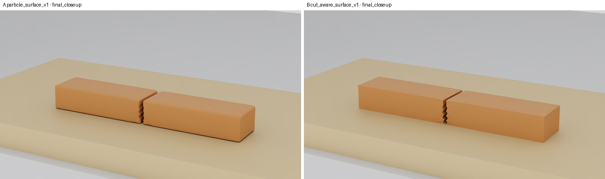 | 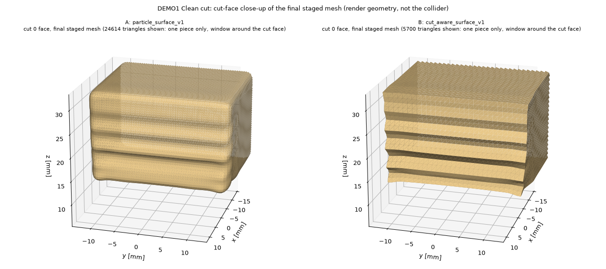 | 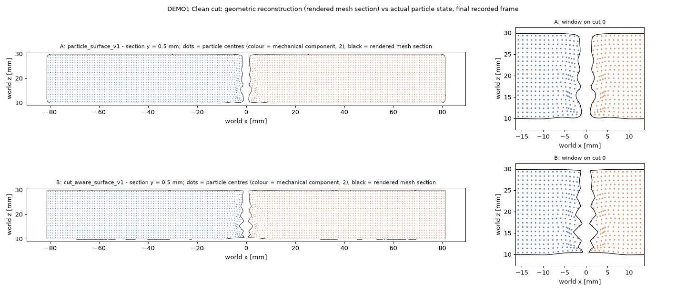 |
| 2 | 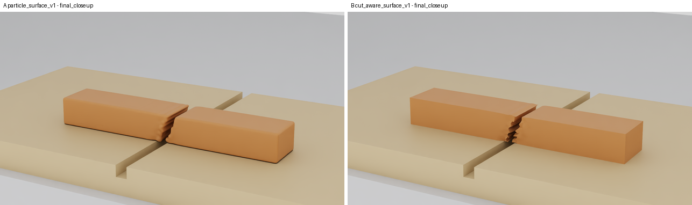 | 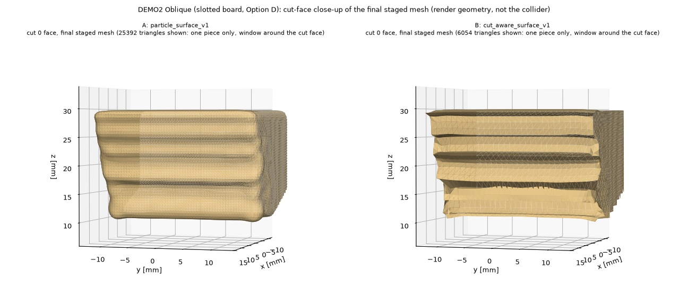 | 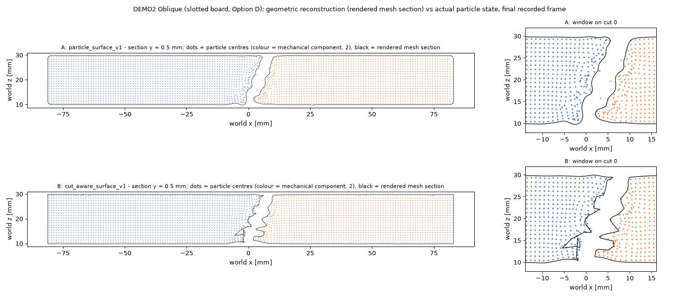 |
| 3 | 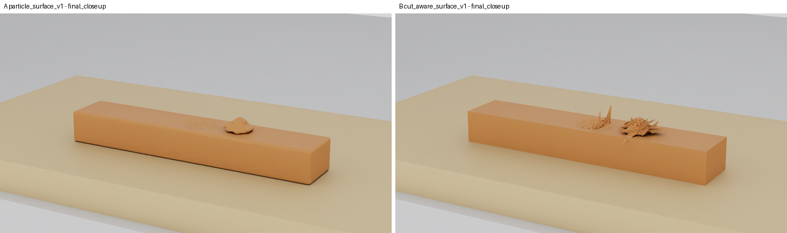 | 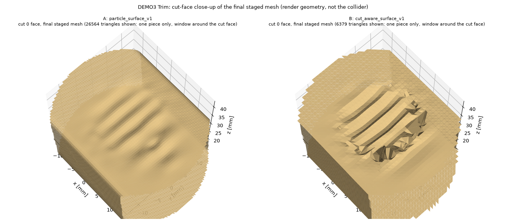 | 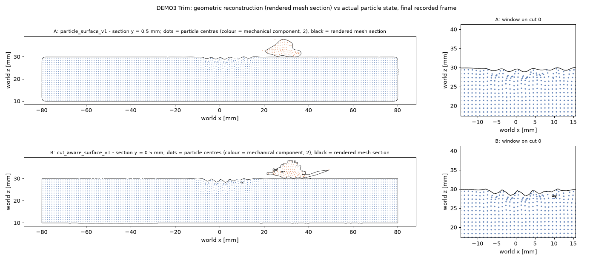 |
| 4 | 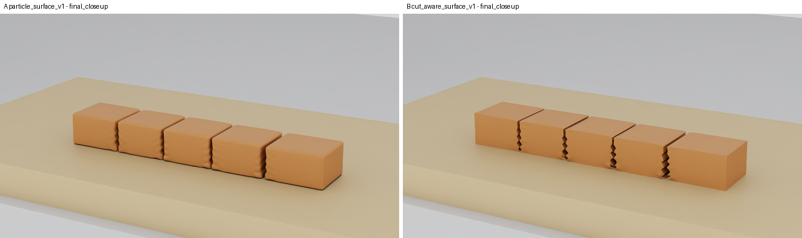 | 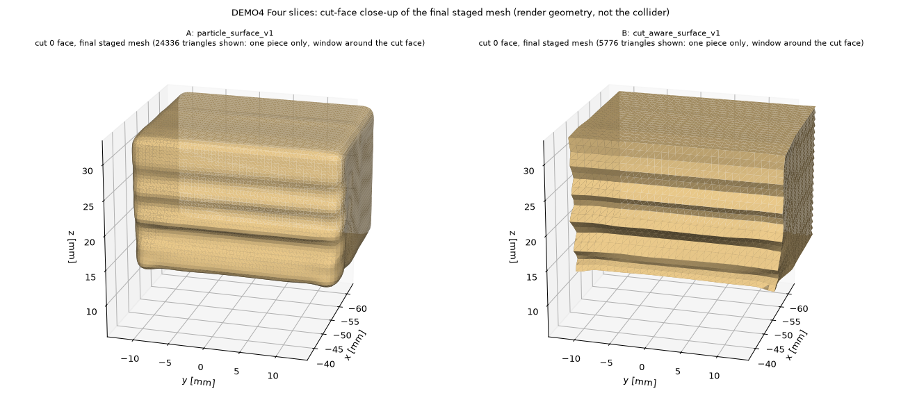 | 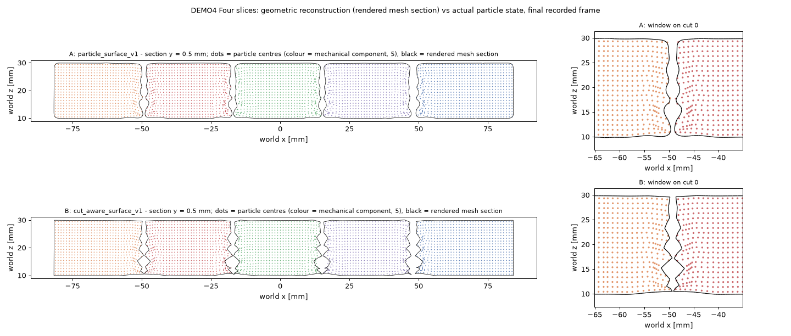 |
| 5 | 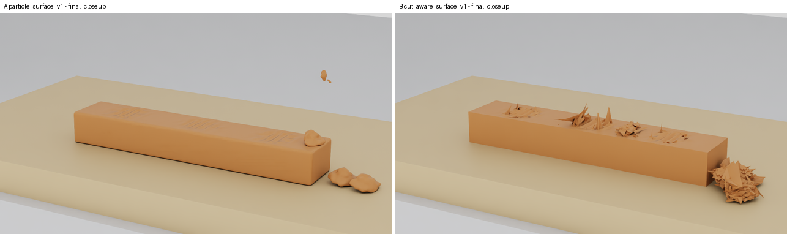 | 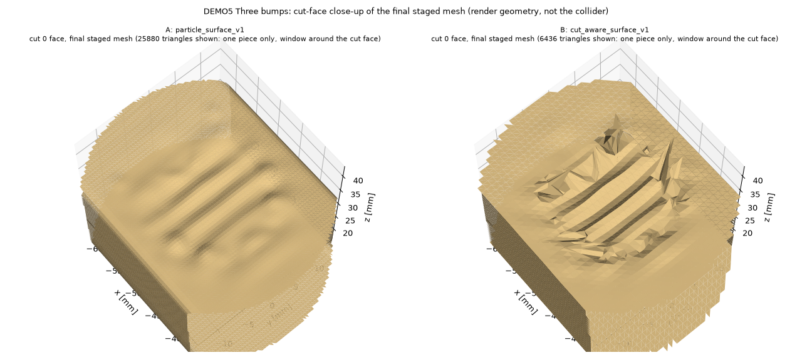 | 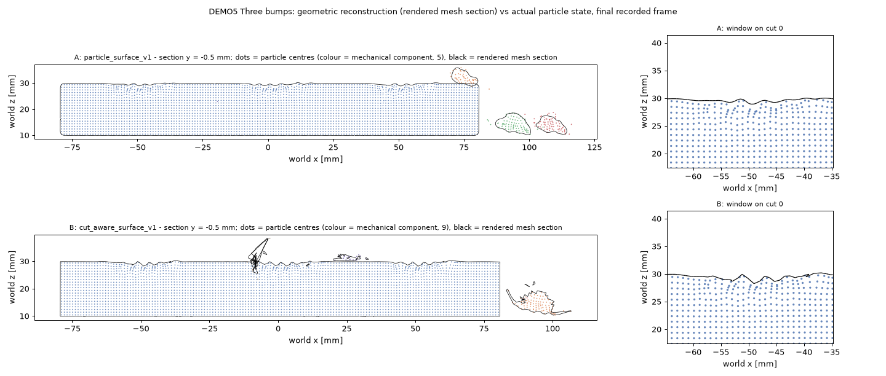 |
| 6 | 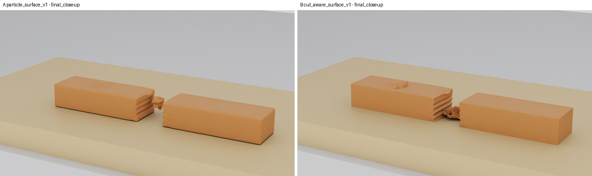 | 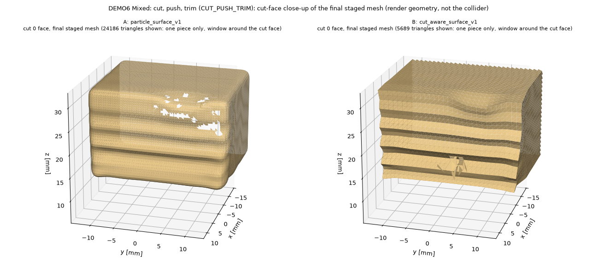 | 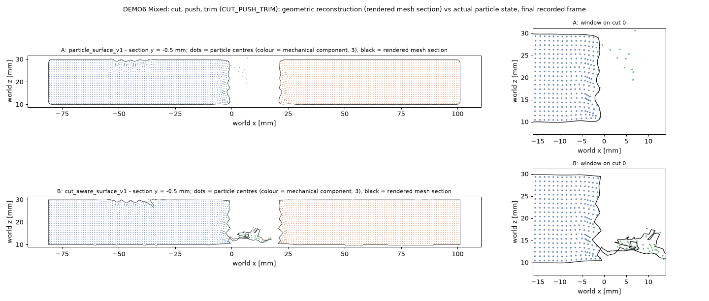 |

### Open items

- **Demo 7:** the frozen selection is committed; kinematic outcome FAIL retained, Native scheduled; see finalization above.
- **Demo 5 A vs B piece-count mismatch** (above): cause not isolated. A same-input repeat (A and B) would separate GPU
  nondeterminism from a profile effect. It needs a declared rerun.
- **Optional Demo 2 still** of the E2 `SOLID_p05` KNOWN FAILURE: not produced.
- **Demo 6 push shortfall** (15 mm of 20 mm commanded in Native vs 19.9 mm kinematic): passes the 10 mm minimum, cause
  not analysed.
- **Wall times and the A→B runtime cost** were measured under GPU contention; an uncontended profile is in
  [`WP12_SURFACE_LIVE.md`](WP12_SURFACE_LIVE.md) §5.
