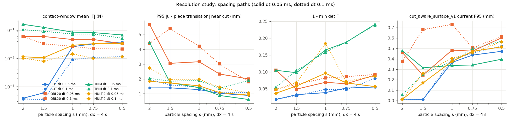
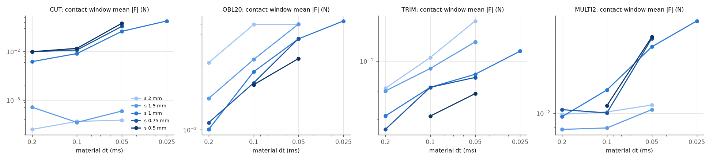
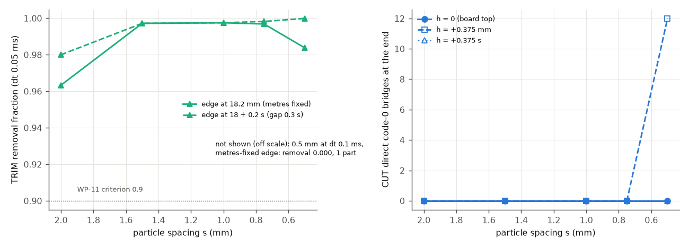
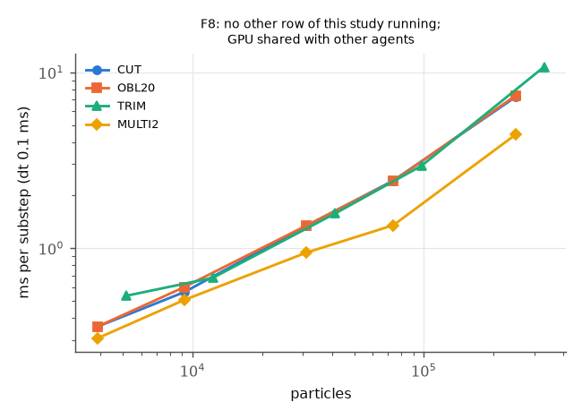

# WP-12 Phase 4 §4.7 — resolution and numerical stability study (draft)

Date: 2026-10-31 (KST). Branch `claude/wp12-physical-cut-surfaces`. Spec: [WP12_SPECIFICATION.md](../WP12_SPECIFICATION.md)
§4.7 and §4.1 item 5. This is a draft for the xhigh review. It reports the measurements and the protocol's verdicts. It
claims no convergence beyond what the frozen rules give.

| Item | Value |
| --- | --- |
| Protocol | [`configs/wp12/resolution_protocol_v1.json`](../../configs/wp12/resolution_protocol_v1.json), frozen in `5efbfa0` before any formal row (sha256 `d5134bff…`; every row records it, 0 mismatches) |
| Amendment | [`resolution_protocol_v1_amendment_001.json`](../../configs/wp12/resolution_protocol_v1_amendment_001.json) (`cce4944`): execution only (cuda:0 and cuda:1, at most 2 rows per device, cap 24 GPU-h / 18 h). The science is unchanged. It was decided from wall-time contention after 6 rows, with no result inspected. |
| Runner | `scripts/run_wp12_resolution.py`, committed in `bbd7b60`. Every row has runner sha256 `a7e34259…`, equal to `git show bbd7b60:…`. `scripts/run_wp12_resolution_queue.py` (two-device lanes added for the amendment, uncommitted). `scripts/summarize_wp12_resolution.py` (read-only). CPU tests: `tests/test_wp12_resolution.py`. |
| Runs | `artifacts/wp12/resolution_002/<row>/` (`result.json`, `state.npz`, `steps.npz`, `manifest.json`), `queue.jsonl`; logs `artifacts/wp12/logs/resolution_002_<row>.log` (GNU time) |
| DEV runs (not results) | `artifacts/wp12/resolution_001/` (7 feasibility rows before the freeze, listed in the protocol's `dev_findings_before_freeze`) |
| Evidence and figures | [`docs/evidence/wp12/phase4_resolution_001.json`](../evidence/wp12/phase4_resolution_001.json), [`docs/media/wp12/resolution/`](../media/wp12/resolution/) |
| Scope | Kinematic ideal tracking (no robot, PhysX or cameras). `tlmpm_v5` with cutting law 8, unchanged. Provisional, uncalibrated WP-11 material (E 50 kPa, ν 0.3, yield 1 kPa, ρ 1500 kg/m³, μ 0.3, G_c 0.05 J/m²). `ruler_knife_v2_y`. The `blade_master_flat_board_v1` board geometry. Seed 42. Forces are model diagnostics, not calibrated loads. |

## Verdicts at a glance

- **Execution: 110 / 110 declared rows COMPLETED.**
  - Exit status 0 in every GNU-time log. Stability screen passed in every row: 0 non-finite, min det F > 0, max speed
    < 5 m/s.
  - No ERROR, no slot overflow, no budget NOT_RUN.
  - Summed row wall 8.48 h; queue wall 2.53 h (02:48–05:21 KST); 66 rows on cuda:0, 44 on cuda:1.
- **Separation outcomes are resolution-stable for these geometries; the forces are not.**
  - CUT, MULTI2 and TRIM separate at every resolution of the main grid. The one exception is TRIM at 0.5 mm / 0.1 ms,
    which stays one part (an edge-gap confound, §4.2).
  - OBL20 (20° on the solid board) stays one part at **every** resolution. This is the class (a) exit-face failure of
    [WP12_CUTTING_PHYSICS](WP12_CUTTING_PHYSICS.md), so refinement does not remove it.
- **Contact force: NOT_CONVERGED in all four cases.**
  - In dt it grows as dt shrinks from 0.1 to 0.05 ms in every case at every spacing ≤ 1 mm, and further at 0.025 ms
    (1 mm), with no sign of saturation. The one flat step is MULTI2 at 0.75 mm from 0.2 to 0.1 ms.
  - Across spacing at dt 0.05 ms the cases disagree:
    - CUT jumps 43–65× between 1.5 and 1 mm (0.4–0.6 mN against 26–38 mN);
    - MULTI2 rises 2.7×;
    - TRIM (162 → 68 mN) and OBL20 (60 → 33 mN) fall with refinement.
- **The TRIM residue is controlled by the edge-to-lowest-layer gap, not by refinement.**
  - With the gap fixed at 0.3 s, removal is 0.980–0.9999 at every spacing.
  - With the edge fixed in metres, the gap shrinks to 0.1 s at 0.5 mm. Removal then falls to 0.984 (dt 0.05 ms) or
    0 (dt 0.1 ms, one part).
- **The 1 mm clean-cut window does not transfer in metres.**
  - h = +0.375 mm leaves 12 bridges and one part at 0.5 mm.
  - h = +0.375 s separates at every spacing.
- **Surfaces.**
  - Particle_surface_v1 current-space P95 falls slowly with s (log-log order 0.56 for CUT and MULTI2; not monotone
    for OBL20 and TRIM).
  - Cut_aware_surface_v1 current-space P95 *rises* with refinement (CUT 0.37 → 0.47 mm from 1 to 0.5 mm at dt
    0.05 ms; 0.01 s at 2 mm to 0.94 s at 0.5 mm).
  - Cut_aware_surface_v1 reference-space P95 is at float level for CUT (≤ 3e-6 m) and falls with s for the others.

Headline per metric, as the protocol defines it: CONVERGED only if the primary spacing path (P_s_primary, dt
0.05 ms, dx = 4 s) and the dt path at 1 mm (P_dt_s100, dt 0.1 / 0.05 / 0.025 ms) are both CONVERGED. Each cell shows
"headline (P_s_primary / P_dt_s100)". All paths are in the evidence (`convergence`).

| metric | CUT | OBL20 | TRIM | MULTI2 |
|---|---|---|---|---|
| components | CONVERGED (CONV/CONV) | CONVERGED (CONV/CONV) | CONVERGED (CONV/CONV) | CONVERGED (CONV/CONV) |
| criterion | CONVERGED (CONV/CONV) | CONVERGED (CONV/CONV) | CONVERGED (CONV/CONV) | CONVERGED (CONV/CONV) |
| bridges_zero | CONVERGED (CONV/CONV) | CONVERGED (CONV/CONV) | CONVERGED (CONV/CONV) | CONVERGED (CONV/CONV) |
| severed_line_fraction | CONVERGED (CONV/CONV) | CONVERGED (CONV/CONV) | CONVERGED (CONV/CONV) | CONVERGED (CONV/CONV) |
| severed_line_fraction_layer0 | CONVERGED (CONV/CONV) | CONVERGED (CONV/CONV) | n/a | CONVERGED (CONV/CONV) |
| removal_fraction | n/a | n/a | CONVERGED (CONV/CONV) | n/a |
| substrate_retained | n/a | n/a | CONVERGED (CONV/CONV) | n/a |
| contact_force_mean_abs_N | NOT_CONVERGED (NOT/NOT) | NOT_CONVERGED (NOT/NOT) | NOT_CONVERGED (NOT/NOT) | NOT_CONVERGED (INCO/NOT) |
| contact_force_steady_mean_abs_N | NOT_CONVERGED (INCO/NOT) | NOT_CONVERGED (NOT/NOT) | NOT_CONVERGED (NOT/NOT) | NOT_CONVERGED (INCO/NOT) |
| contact_force_peak_abs_N | NOT_CONVERGED (NOT/NOT) | NOT_CONVERGED (NOT/NOT) | NOT_CONVERGED (CONV/NOT) | NOT_CONVERGED (NOT/NOT) |
| column_p95_minus_piece_translation_m | NOT_CONVERGED (CONV/NOT) | NOT_CONVERGED (INCO/NOT) | NOT_CONVERGED (NOT/NOT) | NOT_CONVERGED (INCO/NOT) |
| trim_p95_depression_m | n/a | n/a | NOT_CONVERGED (NOT/NOT) | n/a |
| one_minus_min_det_F | INCONCLUSIVE (INCO/INCO) | NOT_CONVERGED (NOT/NOT) | NOT_CONVERGED (NOT/CONV) | NOT_CONVERGED (INCO/NOT) |
| max_fixture_overlap_m | NOT_CONVERGED (NOT/CONV) | CONVERGED (CONV/CONV) | NOT_CONVERGED (NOT/CONV) | NOT_CONVERGED (NOT/CONV) |
| centres_below_board_zero | CONVERGED (CONV/CONV) | CONVERGED (CONV/CONV) | CONVERGED (CONV/CONV) | CONVERGED (CONV/CONV) |
| surface_A_current_p95_m | NOT_CONVERGED (CONV/NOT) | NOT_CONVERGED (NOT/NOT) | NOT_CONVERGED (NOT/NOT) | NOT_CONVERGED (CONV/NOT) |
| surface_A_reference_p95_m | NOT_CONVERGED (CONV/NOT) | NOT_CONVERGED (CONV/NOT) | NOT_CONVERGED (CONV/NOT) | NOT_CONVERGED (CONV/NOT) |
| surface_B_current_p95_m | NOT_CONVERGED (NOT/NOT) | NOT_CONVERGED (NOT/NOT) | NOT_CONVERGED (NOT/NOT) | NOT_CONVERGED (NOT/NOT) |
| surface_B_reference_p95_m | CONVERGED (CONV/CONV) | NOT_CONVERGED (CONV/NOT) | NOT_CONVERGED (CONV/NOT) | NOT_CONVERGED (NOT/NOT) |

How to read this table:

- **Discrete outcomes** (components, criterion, bridges = 0, severed lines, centres below the board = 0) are CONVERGED
  in the sense of the protocol: identical at the three finest points of both headline paths.
  - For OBL20 that means "fails identically".
  - For TRIM the headline hides the formal-dt path. On P_s_formal_dt the TRIM components, criterion and removal are
    NOT_CONVERGED, because 0.5 mm / 0.1 ms is one part.
- **Removal fraction CONVERGED for TRIM** comes from the protocol's insensitivity branch: 0.9975 / 0.9968 / 0.9838
  lie within tol_abs 0.02. The finest point is the lowest, and the trend is the gap confound of §4.2, not a converged
  value.
- **No continuous mechanical metric is CONVERGED on both headline paths.** CUT near-cut deformation converges in
  spacing (order 2.88, GCI 0.088) but not in dt.

## 1. Setup (summary; the protocol is authoritative)

**Cases.** Each case is fixed in metres. Every workpiece dimension is a multiple of 6 mm, so all spacings tile the
same box and the CUT and MULTI2 planes lie between particle columns at every spacing.

- **CUT.** A 72 × 24 × 18 mm bar.
  - Vertical through-cut at x = 0, armed at 10 mm/s from 8 mm above the top down to the board top (h = 0, Option A).
  - Then a 0.3 s disarmed hold, a 20 mm/s withdrawal and a 0.5 s settle.
- **OBL20.** The same bar, blade plane turned 20° about y. It is armed along the advance until the edge reaches the
  board top; a solid board allows no overtravel.
- **TRIM.** A 72 × 30 × 18 mm base with an ellipsoidal dome (r 12 mm, h 8 mm).
  - The dome's lattice volume is within 0.6% of the analytic value at every spacing.
  - Rake 10°, skim at 25 mm/s from x = −30 to +30 mm, edge at 18.2 mm (F4: 18 + 0.2 s), then a 0.4 s hold.
- **MULTI2.** Two sequential CUT-style through-cuts at x = −12 and +12 mm (digits 0 and 1), giving 3 pieces. This is a
  reduced Test B.

**Resolution axes.**

- Spacing s ∈ {2, 1.5, 1, 0.75, 0.5} mm.
- Grid dx = 4 s, plus dx fixed at 4 mm for s = 0.75 and 0.5 (F3).
- dt ∈ {0.2, 0.1, 0.05} ms, plus 0.025 ms at 1 mm (F2). Every dt divides the 20 ms control step: 100 / 200 / 400 /
  800 substeps. The 0.15 ms of WP-11 F3, which did not divide it, is not used.
- Grid CFL dt·c_p/dx with c_p = 6.70 m/s:
  - ≤ 0.2 (ADR 0005 nominal) on the primary path;
  - ≤ 0.5 for every non-probe row (s 0.75 / dt 0.2 is 0.45);
  - the F7 probe (s 0.5, dx 2 mm, dt 0.2) is at 0.67.

**Families.**

| Family | Rows |
| --- | --- |
| F1 main grid | 56 |
| F2 dt 0.025 ms | 4 |
| F3 fixed dx 4 mm | 8 |
| F4 TRIM gap fixed in s | 4 |
| F5 CUT edge stop h = 0.375 mm / 0.375 s | 9 |
| F6 repeats | 8 |
| F7 stability probe | 1 |
| F8 timing | 20 |

**Controlled variables.** These stay fixed:

- the material, tool polygon, board and workpiece;
- the blade path, speeds and durations, in metres (`tests/test_wp12_resolution.py::test_blade_path_is_fixed_in_metres`);
- the contact window and every metric region.

These change by construction:

- the lattice (bottom layer at s/2) and the contact radius (0.45 s);
- the law-4/5/8 lengths, which the solver defines in units of dx (band 6 dx, rear 2 dx, lead 2 dx, core dx), and the
  cutting-zone half thickness s;
- the number of edge segments.

The blade cross-section, including the 0.15 mm drop of the lower bevel at ρ = 10°, stays in metres.

**Metrics.** These are exactly as declared:

- separation: stencil-graph components and mass fractions;
- direct code-0 bridges;
- severed-line fraction within 4 mm of each declared plane;
- TRIM removal and substrate share;
- contact-window mean, peak (20 ms means) and steady-window force on the tool;
- near-cut P95 of |u − piece translation| (TRIM: P95 depression under the dome);
- min det F over all particles at every 20 ms step;
- board contact overlap and particle centres below the board top;
- `surface_metrics_v1` P95 for `particle_surface_v1` (A) and `cut_aware_surface_v1` (B) in current and reference
  space, on the final state;
- runtime and memory.

## 2. Execution and integrity

- **Order and timing.** Rows ran in the declared order from 02:48:31 to 05:20:33 KST.
  - The first 6 rows (1 mm / 0.1 ms CUT, OBL20 and TRIM, with repeats) ran on cuda:1 under the original queue.
  - The queue process was then stopped and restarted under amendment 001 to use both GPUs. The two TRIM rows that
    were running finished normally, and the queue log records a `note` event.
  - Both GPUs were shared with other agents' jobs throughout. That includes a Native Isaac run on cuda:0, and cuda:1
    was at 99–100% utilisation.
- **GPU contention.** Row wall times and ms/substep therefore include contention. The F8 timing rows ran with no other
  row of this study, but not on an idle GPU. A 1 mm CUT took 0.56 ms/substep in DEV and 1.34 ms/substep in F8.
- **Repo state during the run.** The repository HEAD moved during the run as other agents committed: 11 distinct
  `git_sha` values, all runs `git_dirty`. The runner file was the committed `bbd7b60` version in every row (sha256
  above). No solver or law file changed during the run.
- **Repeats (F6).** Same seed; GPU float atomics only.
  - At (1 mm, 0.1 ms), all four cases agree to ≤ 0.07% in force and ≤ 0.04% in min det F, with identical components
    and bridges.
  - At (1 mm, 0.05 ms), OBL20 has 120 vs 127 bridges and 0.931 vs 0.933 min det F. The other cases agree as at
    0.1 ms.
  - Two repeats ran on the other GPU (MULTI2 0.1 ms, CUT 0.05 ms), which amendment 001 allows. Their agreement is
    the same.
  - The noise band nu = max(nu0, 2 × repeat difference) is therefore at nu0 for almost every metric.

## 3. Results

Columns:

- **parts:** mechanical components at the end.
- **bridges:** direct code-0 bridges at the end, summed over cuts.
- **severed lines:** the fraction of lattice lines crossing the declared plane that have a conflicting link within
  4 mm, all layers (bottom layer 0 in brackets).
- **F:** contact-window mean / peak / steady mean of |F| on the tool, in mN.
- **P95 near-cut:** P95 of |u − piece translation| within 3 mm of the plane, at the end of the last armed cut (TRIM:
  P95 substrate depression under the dome).
- **overlap:** maximum material–board contact overlap.
- **A and B:** `particle_surface_v1` and `cut_aware_surface_v1` cut-face P95 in current / reference space (mm).
- **ms/substep:** median, CUDA graph plus wait, recorder on, GPUs shared.

### 3.1 CUT

| row (s mm / dt ms) | parts | bridges | severed lines (L0) | mean / peak / steady F (mN) | removal | P95 near-cut (mm) | min det F | fixture overlap (µm) | A cur / ref P95 (mm) | B cur / ref P95 (mm) | particles | ms/substep | wall (s) | device |
|---|---|---|---|---|---|---|---|---|---|---|---|---|---|---|
| 2 / 0.05 | 2 | 0 | 1 (1) | 0.387 / 10.4 / 0.599 | – | 1.392 | 0.982 | 19 | 0.622 / 1.609 | 0.014 / 0.0000 | 3888 | 0.74 | 82 | cuda:0 |
| 1.5 / 0.05 | 2 | 0 | 1 (1) | 0.596 / 7.06 / 0.482 | – | 1.396 | 0.967 | 39 | 0.608 / 1.101 | 0.010 / 0.0000 | 9216 | 1.03 | 118 | cuda:0 |
| 1 / 0.05 | 2 | 0 | 1 (1) | 26 / 95.5 / 32.7 | – | 1.278 | 0.961 | 28 | 0.377 / 0.709 | 0.365 / 0.0003 | 31104 | 2.10 | 230 | cuda:0 |
| 0.75 / 0.05 | 2 | 0 | 1 (1) | 32.8 / 89.1 / 47.8 | – | 1.020 | 0.948 | 27 | 0.287 / 0.380 | 0.435 / 0.0004 | 73728 | 4.10 | 486 | cuda:1 |
| 0.5 / 0.05 | 2 | 0 | 1 (1) | 38.1 / 69.1 / 50.8 | – | 0.882 | 0.945 | 26 | 0.253 / 0.230 | 0.472 / 0.0002 | 248832 | 11.18 | 1189 | cuda:0 |
| 2 / 0.1 | 2 | 0 | 1 (1) | 0.365 / 6.92 / 0.158 | – | 1.956 | 0.980 | 60 | 0.742 / 1.588 | 0.011 / 0.0000 | 3888 | 0.59 | 36 | cuda:0 |
| 1.5 / 0.1 | 2 | 0 | 1 (1) | 0.348 / 6.74 / 0.248 | – | 1.596 | 0.970 | 70 | 0.569 / 1.299 | 0.010 / 0.0000 | 9216 | 0.93 | 54 | cuda:0 |
| 1 / 0.1 | 2 | 0 | 1 (1) | 9.05 / 31.8 / 14.5 | – | 1.438 | 0.952 | 76 | 0.462 / 0.945 | 0.395 / 0.0001 | 31104 | 2.27 | 127 | cuda:1 |
| 0.75 / 0.1 | 2 | 0 | 1 (1) | 10.7 / 36.5 / 14.1 | – | 1.056 | 0.953 | 70 | 0.348 / 0.579 | 0.455 / 0.0001 | 73728 | 4.14 | 250 | cuda:1 |
| 0.5 / 0.1 | 2 | 0 | 1 (1) | 11.6 / 28.8 / 16 | – | 1.068 | 0.919 | 85 | 0.369 / 0.365 | 0.521 / 0.0004 | 248832 | 12.90 | 760 | cuda:1 |
| 2 / 0.2 | 2 | 0 | 1 (1) | 0.25 / 5.25 / 0.141 | – | 3.224 | 0.963 | 164 | 0.926 / 2.049 | 0.010 / 0.0000 | 3888 | 0.50 | 17 | cuda:0 |
| 1.5 / 0.2 | 2 | 0 | 1 (1) | 0.715 / 8.62 / 0.3 | – | 2.281 | 0.959 | 138 | 0.701 / 1.804 | 0.015 / 0.0000 | 9216 | 0.99 | 30 | cuda:0 |
| 1 / 0.2 | 2 | 0 | 1 (1) | 6.18 / 16.4 / 6.79 | – | 1.726 | 0.966 | 162 | 0.660 / 1.222 | 0.276 / 0.0029 | 31104 | 2.08 | 63 | cuda:0 |
| 0.75 / 0.2 | 2 | 0 | 1 (1) | 9.88 / 31 / 11.7 | – | 1.613 | 0.912 | 219 | 0.400 / 0.728 | 0.437 / 0.0007 | 73728 | 4.07 | 120 | cuda:1 |
| 0.5 / 0.2 | 2 | 0 | 1 (1) | 9.9 / 24.9 / 13.2 | – | 0.976 | 0.899 | 297 | 0.407 / 0.298 | 0.533 / 0.0004 | 248832 | 11.74 | 336 | cuda:0 |
| 1 / 0.025 | 2 | 0 | 1 (1) | 42.4 / 132 / 52.1 | – | 0.936 | 0.961 | 14 | 0.464 / 0.550 | 0.316 / 0.0005 | 31104 | 1.70 | 381 | cuda:0 |
| 0.75 / 0.1, dx 4 mm | 2 | 0 | 1 (1) | 8.55 / 33.8 / 14.5 | – | 2.024 | 0.918 | 78 | 0.575 / 1.022 | 0.493 / 0.0001 | 73728 | 3.20 | 180 | cuda:1 |
| 0.5 / 0.1, dx 4 mm | 2 | 0 | 1 (1) | 8.15 / 22 / 12.4 | – | 1.641 | 0.923 | 147 | 0.406 / 0.460 | 0.386 / 0.0001 | 248832 | 10.11 | 558 | cuda:1 |

### 3.2 OBL20

| row (s mm / dt ms) | parts | bridges | severed lines (L0) | mean / peak / steady F (mN) | removal | P95 near-cut (mm) | min det F | fixture overlap (µm) | A cur / ref P95 (mm) | B cur / ref P95 (mm) | particles | ms/substep | wall (s) | device |
|---|---|---|---|---|---|---|---|---|---|---|---|---|---|---|
| 2 / 0.05 | 1 | 74 | 1 (1) | 59.5 / 311 / 76.9 | – | 5.698 | 0.895 | 41 | 0.924 / 2.065 | 0.460 / 0.1228 | 3888 | 0.58 | 69 | cuda:0 |
| 1.5 / 0.05 | 1 | 144 | 1 (1) | 59.9 / 211 / 77 | – | 3.055 | 0.951 | 32 | 0.923 / 1.453 | 0.244 / 0.1405 | 9216 | 1.22 | 135 | cuda:1 |
| 1 / 0.05 | 1 | 120 | 1 (1) | 46.6 / 176 / 59.3 | – | 3.163 | 0.931 | 64 | 0.846 / 0.981 | 0.483 / 0.1555 | 31104 | 2.07 | 236 | cuda:0 |
| 0.75 / 0.05 | 1 | 38 | 1 (1) | 46.8 / 106 / 54.3 | – | 2.329 | 0.935 | 45 | 0.601 / 0.482 | 0.474 / 0.0927 | 73728 | 4.98 | 570 | cuda:0 |
| 0.5 / 0.05 | 1 | 214 | 1 (1) | 33.4 / 69.9 / 40.3 | – | 2.002 | 0.910 | 35 | 0.593 / 0.362 | 0.601 / 0.0529 | 248832 | 12.08 | 1332 | cuda:1 |
| 2 / 0.1 | 1 | 72 | 1 (1) | 59.4 / 210 / 59.7 | – | 4.404 | 0.951 | 80 | 1.002 / 2.200 | 0.377 / 0.0866 | 3888 | 0.73 | 44 | cuda:0 |
| 1.5 / 0.1 | 1 | 88 | 1 (1) | 32.8 / 166 / 31.5 | – | 5.412 | 0.937 | 130 | 0.873 / 1.791 | 0.679 / 0.1807 | 9216 | 0.92 | 56 | cuda:0 |
| 1 / 0.1 | 1 | 54 | 1 (1) | 26.7 / 87.6 / 27.5 | – | 4.211 | 0.918 | 121 | 1.048 / 1.133 | 0.731 / 0.1600 | 31104 | 2.27 | 134 | cuda:1 |
| 0.75 / 0.1 | 1 | 262 | 1 (1) | 22.1 / 61.8 / 27.2 | – | 3.013 | 0.914 | 118 | 0.599 / 0.890 | 0.506 / 0.1115 | 73728 | 4.21 | 258 | cuda:1 |
| 0.5 / 0.1 | 1 | 292 | 1 (1) | 21.4 / 40.6 / 25.6 | – | 1.803 | 0.908 | 106 | 0.697 / 0.438 | 0.612 / 0.0447 | 248832 | 12.68 | 729 | cuda:0 |
| 2 / 0.2 | 1 | 96 | 1 (1) | 31.2 / 129 / 26.2 | – | 8.961 | 0.919 | 261 | 1.323 / 2.188 | 0.269 / 0.1760 | 3888 | 0.53 | 19 | cuda:0 |
| 1.5 / 0.2 | 1 | 100 | 1 (1) | 17 / 78.7 / 17.6 | – | 7.114 | 0.928 | 329 | 0.887 / 1.767 | 0.668 / 0.1809 | 9216 | 0.99 | 31 | cuda:0 |
| 1 / 0.2 | 1 | 128 | 1 (1) | 10.1 / 32.6 / 12.8 | – | 3.271 | 0.943 | 273 | 0.955 / 1.299 | 0.549 / 0.1494 | 31104 | 2.29 | 71 | cuda:1 |
| 0.75 / 0.2 | 1 | 118 | 1 (1) | 11.3 / 27.9 / 12 | – | 2.373 | 0.953 | 235 | 0.719 / 0.866 | 0.517 / 0.0887 | 73728 | 4.09 | 123 | cuda:1 |
| 1 / 0.025 | 1 | 134 | 1 (1) | 63.1 / 245 / 80.1 | – | 3.296 | 0.864 | 49 | 0.893 / 1.119 | 0.415 / 0.1892 | 31104 | 1.67 | 365 | cuda:1 |
| 0.75 / 0.1, dx 4 mm | 1 | 650 | 1 (1) | 23.5 / 77.5 / 22.8 | – | 4.591 | 0.901 | 225 | 0.698 / 0.712 | 0.505 / 0.0952 | 73728 | 3.16 | 181 | cuda:1 |
| 0.5 / 0.1, dx 4 mm | 1 | 944 | 1 (1) | 17.8 / 49.9 / 19.1 | – | 3.157 | 0.915 | 262 | 0.727 / 0.508 | 0.592 / 0.0572 | 248832 | 10.37 | 587 | cuda:1 |

### 3.3 TRIM

| row (s mm / dt ms) | parts | bridges | severed lines (L0) | mean / peak / steady F (mN) | removal | P95 near-cut (mm) | min det F | fixture overlap (µm) | A cur / ref P95 (mm) | B cur / ref P95 (mm) | particles | ms/substep | wall (s) | device |
|---|---|---|---|---|---|---|---|---|---|---|---|---|---|---|
| 2 / 0.05 | 2 | 0 | 1 | 162 / 372 / 186 | 0.9633 | 2.724 | 0.895 | 45 | 1.154 / 2.018 | 0.478 / 0.6151 | 5160 | 0.78 | 58 | cuda:0 |
| 1.5 / 0.05 | 2 | 0 | 0.99 | 126 / 308 / 156 | 0.9972 | 1.795 | 0.902 | 31 | 0.801 / 1.502 | 0.314 / 0.4426 | 12236 | 1.47 | 103 | cuda:1 |
| 1 / 0.05 | 2 | 0 | 1 | 85.5 / 127 / 105 | 0.9975 | 1.455 | 0.835 | 14 | 0.609 / 0.711 | 0.336 / 0.2078 | 41292 | 2.59 | 184 | cuda:1 |
| 0.75 / 0.05 | 2 | 0 | 0.995 | 82.3 / 131 / 104 | 0.9968 | 0.938 | 0.813 | 18 | 0.340 / 0.385 | 0.341 / 0.1529 | 97860 | 6.12 | 450 | cuda:0 |
| 0.5 / 0.05 | 2 | 0 | 0.996 | 67.8 / 112 / 84.5 | 0.9838 | 0.631 | 0.759 | 28 | 0.353 / 0.212 | 0.396 / 0.0356 | 330300 | 13.31 | 1103 | cuda:1 |
| 2 / 0.1 | 2 | 0 | 1 | 104 / 207 / 131 | 1.0000 | 2.094 | 0.945 | 37 | 0.858 / 1.852 | 0.057 / 0.0464 | 5160 | 0.94 | 38 | cuda:0 |
| 1.5 / 0.1 | 2 | 0 | 0.981 | 91.6 / 146 / 114 | 0.9944 | 1.949 | 0.896 | 37 | 0.708 / 1.345 | 0.249 / 0.1722 | 12236 | 1.00 | 40 | cuda:0 |
| 1 / 0.1 | 2 | 0 | 1 | 73.1 / 113 / 90.5 | 0.9975 | 1.950 | 0.842 | 54 | 0.832 / 0.937 | 0.376 / 0.0877 | 41292 | 2.61 | 98 | cuda:1 |
| 0.75 / 0.1 | 2 | 0 | 0.988 | 73.1 / 111 / 94 | 0.9975 | 1.430 | 0.813 | 66 | 0.445 / 0.632 | 0.497 / 0.1329 | 97860 | 6.57 | 242 | cuda:0 |
| 0.5 / 0.1 | 1 | 4 | 0.994 | 51.9 / 92 / 64.5 | 0.0000 | 0.968 | 0.763 | 92 | 0.468 / 0.390 | 0.567 / 0.0521 | 330300 | 17.00 | 629 | cuda:0 |
| 2 / 0.2 | 2 | 0 | 1 | 72.3 / 121 / 86 | 1.0000 | 2.602 | 0.944 | 104 | 1.052 / 2.031 | 0.028 / 0.0357 | 5160 | 0.61 | 15 | cuda:0 |
| 1.5 / 0.2 | 2 | 0 | 0.971 | 69.9 / 105 / 88.8 | 0.9916 | 2.592 | 0.887 | 132 | 0.937 / 1.620 | 0.271 / 0.2541 | 12236 | 1.10 | 23 | cuda:0 |
| 1 / 0.2 | 2 | 0 | 1 | 51.9 / 80.9 / 60.2 | 0.9975 | 2.692 | 0.836 | 180 | 1.030 / 1.157 | 0.659 / 0.0964 | 41292 | 2.62 | 53 | cuda:1 |
| 0.75 / 0.2 | 2 | 0 | 0.978 | 44.2 / 79.6 / 57.3 | 0.9796 | 1.860 | 0.805 | 226 | 0.665 / 0.937 | 0.602 / 0.1108 | 97860 | 5.13 | 106 | cuda:0 |
| 1 / 0.025 | 2 | 0 | 1 | 113 / 169 / 139 | 0.9983 | 1.114 | 0.827 | 7 | 0.550 / 0.805 | 0.285 / 0.1858 | 41292 | 1.95 | 273 | cuda:1 |
| 0.75 / 0.1, dx 4 mm | 2 | 0 | 0.995 | 49.5 / 91.5 / 62 | 0.9937 | 2.054 | 0.852 | 65 | 0.653 / 0.917 | 0.501 / 0.1354 | 97860 | 3.79 | 136 | cuda:1 |
| 0.5 / 0.1, dx 4 mm | 2 | 0 | 0.993 | 40.5 / 72 / 48.8 | 0.9836 | 1.812 | 0.836 | 87 | 0.650 / 0.610 | 0.490 / 0.0676 | 330300 | 13.46 | 495 | cuda:0 |

### 3.4 MULTI2

| row (s mm / dt ms) | parts | bridges | severed lines (L0) | mean / peak / steady F (mN) | removal | P95 near-cut (mm) | min det F | fixture overlap (µm) | A cur / ref P95 (mm) | B cur / ref P95 (mm) | particles | ms/substep | wall (s) | device |
|---|---|---|---|---|---|---|---|---|---|---|---|---|---|---|
| 2 / 0.05 | 3 | 0 | 1 (1) | 11.4 / 135 / 9.43 | – | 1.838 | 0.963 | 23 | 1.019 / 1.901 | 0.011 / 0.0034 | 3888 | 0.57 | 125 | cuda:0 |
| 1.5 / 0.05 | 3 | 0 | 1 (1) | 10.6 / 86.2 / 8.55 | – | 1.725 | 0.942 | 61 | 0.700 / 1.190 | 0.168 / 0.0023 | 9216 | 0.90 | 200 | cuda:0 |
| 1 / 0.05 | 3 | 0 | 1 (1) | 29 / 95.8 / 33.6 | – | 1.530 | 0.904 | 47 | 0.607 / 0.836 | 0.374 / 0.1100 | 31104 | 2.48 | 529 | cuda:1 |
| 0.75 / 0.05 | 3 | 0 | 1 (1) | 33.2 / 89.2 / 44.3 | – | 1.074 | 0.932 | 51 | 0.431 / 0.477 | 0.471 / 0.0120 | 73728 | 4.22 | 991 | cuda:1 |
| 0.5 / 0.05 | 3 | 0 | 1 (1) | 34 / 68.8 / 43.8 | – | 0.901 | 0.944 | 65 | 0.404 / 0.222 | 0.515 / 0.0052 | 248832 | 9.56 | 2060 | cuda:0 |
| 2 / 0.1 | 3 | 0 | 1 (1) | 10.2 / 89.6 / 7.64 | – | 2.745 | 0.953 | 75 | 1.025 / 1.816 | 0.013 / 0.0061 | 3888 | 0.73 | 84 | cuda:0 |
| 1.5 / 0.1 | 3 | 0 | 1 (1) | 7.88 / 59.3 / 6.36 | – | 1.951 | 0.932 | 131 | 0.784 / 1.540 | 0.261 / 0.0025 | 9216 | 1.05 | 120 | cuda:0 |
| 1 / 0.1 | 3 | 0 | 1 (1) | 14.5 / 62.7 / 16.5 | – | 1.974 | 0.816 | 181 | 0.720 / 1.069 | 0.404 / 0.1772 | 31104 | 2.12 | 237 | cuda:0 |
| 0.75 / 0.1 | 3 | 0 | 1 (1) | 10 / 34.1 / 12 | – | 1.426 | 0.928 | 152 | 0.623 / 0.575 | 0.458 / 0.0150 | 73728 | 4.25 | 506 | cuda:1 |
| 0.5 / 0.1 | 3 | 0 | 1 (1) | 11.3 / 41.9 / 14.1 | – | 1.047 | 0.912 | 205 | 0.383 / 0.375 | 0.564 / 0.0118 | 248832 | 10.14 | 1238 | cuda:0 |
| 2 / 0.2 | 3 | 0 | 1 (1) | 9.81 / 62.8 / 7.28 | – | 5.509 | 0.915 | 327 | 0.835 / 2.116 | 0.037 / 0.0089 | 3888 | 0.58 | 37 | cuda:0 |
| 1.5 / 0.2 | 3 | 0 | 1 (1) | 7.7 / 65 / 5.35 | – | 2.872 | 0.914 | 358 | 0.835 / 1.917 | 0.388 / 0.0035 | 9216 | 0.92 | 56 | cuda:0 |
| 1 / 0.2 | 3 | 0 | 1 (1) | 9.44 / 87.1 / 10 | – | 3.899 | 0.901 | 2819 | 0.932 / 1.293 | 0.416 / 0.1127 | 31104 | 2.14 | 131 | cuda:0 |
| 0.75 / 0.2 | 3 | 0 | 1 (1) | 10.6 / 47.7 / 11.7 | – | 1.612 | 0.906 | 500 | 0.391 / 0.765 | 0.417 / 0.0477 | 73728 | 5.30 | 295 | cuda:0 |
| 1 / 0.025 | 3 | 0 | 1 (1) | 43.9 / 132 / 52.2 | – | 1.069 | 0.900 | 35 | 0.745 / 0.644 | 0.327 / 0.1409 | 31104 | 1.80 | 769 | cuda:0 |
| 0.75 / 0.1, dx 4 mm | 3 | 0 | 1 (1) | 14 / 45 / 15.5 | – | 3.116 | 0.903 | 178 | 0.801 / 0.983 | 0.456 / 0.0796 | 73728 | 3.27 | 357 | cuda:1 |
| 0.5 / 0.1, dx 4 mm | 3 | 0 | 1 (1) | 11.5 / 29 / 14.3 | – | 2.992 | 0.902 | 607 | 0.586 / 0.503 | 0.419 / 0.0494 | 248832 | 10.60 | 1331 | cuda:1 |





## 4. Findings

### 4.1 Separation and bridges

- **CUT and MULTI2.** Both separate at every row with the edge stop at the board top (F1, F2, F3, F6, F7): 2 parts
  0.500 / 0.500, and 3 parts.
  - Every such row has 0 bridges and a severed-line fraction of 1.0, including the bottom layer.
  - This includes 0.5 mm, fixed dx 4 mm and the F7 probe.
  - The one CUT row that stays connected is F5 h = +0.375 mm at 0.5 mm (§4.3).
  - The second MULTI2 cut is realised about 1 mm off its reference plane, because the first cut displaced the
    material (DEV finding). The severed-line band captures it.
- **OBL20.** One part at all 19 full OBL20 rows (F1, F2, F3, F6; the F8 timing rows stop before the cut).
  - The severed-line fraction is 1.0 at every row: every lattice line through the plane has a conflicting link
    within 4 mm. The pieces are held together by code-0 bridges.
  - The bridge count is not monotone: 38–292 on dx = 4 s and 650 / 944 on dx = 4 mm.
  - This is the WP12_CUTTING_PHYSICS class (a) mechanism. The edge must pass the stencil reach on the uphill side.
    The reach is about dx, so refinement shrinks it, but the uphill exit face also has 0 overtravel on a solid board.
  - More particles per stencil (dx = 4 mm at s 0.5) gives more bridges.
  - The failure is resolution-stable over 2–0.5 mm; refinement does not cure it.

### 4.2 TRIM removal and the edge-gap confound (F4)



| s (mm) | gap, metre-fixed edge (s units) | removal, dt 0.05 / 0.1 / 0.2 ms (metre-fixed) | lowest layer attached (dt 0.05) | removal, gap 0.3 s (dt 0.05, F4) | attached (F4) |
| --- | --- | --- | --- | --- | --- |
| 2 | 0.40 | 0.963 / 1.000 / 1.000 | 11 / 108 | 0.980 | 6 / 108 |
| 1.5 | 0.37 | 0.997 / 0.994 / 0.992 | 2 / 208 | 0.997 | 2 / 208 |
| 1 | 0.30 | 0.9975 / 0.9975 / 0.9975 | 6 / 448 | (same row) 0.9975 | 6 / 448 |
| 0.75 | 0.23 | 0.997 / 0.9975 / 0.980 | 16 / 812 | 0.998 | 8 / 812 |
| 0.5 | 0.10 | **0.984** / **0.000 (1 part, 4 bridges)** / – | 312 / 1804 | 0.9999 | 2 / 1804 |

- **The gap decides the outcome at 0.5 mm.** With the edge fixed in metres, the lowest dome layer sits only 0.05 mm
  above the edge at 0.5 mm.
  - At dt 0.05 ms, 312 of its 1804 particles stay on the substrate.
  - At dt 0.1 ms all 1804 stay, and the dome stays attached (one part).
  - With the gap held at 0.3 s, 2 of 1804 stay.
  - This reproduces the Phase 4a lattice-phase sweep (§7.3 there) across resolutions. The residue is a gap and contact
    effect at the lattice margin, not a refinement error that vanishes with s.
- **Reading of the F4 path.** On the gap-fixed path, removal is ≥ 0.980 at every spacing; the coarsest point is the
  lowest. It is not a protocol convergence path.
- **Not explained here.** The dt dependence at 0.5 mm (0.984 vs 0) is a margin effect: more wedge depression at the
  coarser dt, see §4.5. Its mechanism is not isolated in this study.

### 4.3 CUT edge-stop window (F5)

| s (mm) | h = 0 | h = +0.375 mm | h = +0.375 s |
| --- | --- | --- | --- |
| 2 | 2 parts, 0 bridges | 2, 0 | 2, 0 (h 0.75 mm) |
| 1.5 | 2, 0 | 2, 0 | 2, 0 (h 0.56 mm) |
| 1 | 2, 0 | 2, 0 | (same row) |
| 0.75 | 2, 0 | 2, 0 | 2, 0 (h 0.28 mm) |
| 0.5 | 2, 0 | **1 part, 12 bridges** | 2, 0 (h 0.19 mm) |

- **The window is 1 mm-specific.** The +0.375 mm clean-cut window of [WP12_WORKCELL §5](WP12_WORKCELL.md) is
  measured at 1 mm. In metres it does not hold at 0.5 mm.
  - At 0.5 mm, +0.375 mm is 0.75 s, and the edge stops above the bottom layer's centre.
  - The window scales with s: +0.375 s works at every spacing tested, and +0.375 mm works for s ≥ 0.75 mm.
  - A live controller tuned to 0.375 mm would therefore fail on a finer lattice.

### 4.4 Contact force: not converged

| CUT, 1 mm, dt (ms) | 0.2 | 0.1 | 0.05 | 0.025 |
| --- | --- | --- | --- | --- |
| mean \|F\| (mN) | 6.18 | 9.05 | 26.0 | 42.4 |
| peak (mN) | 16.4 | 31.8 | 95.5 | 132 |
| armed blade work / (G_c · A) | 5.2 | 7.6 | 21.9 | 35.7 |
| max blade overlap / contact radius | 2.67 | 0.96 | 0.26 | 0.08 |

- **dt.** The force grows as dt shrinks in every case at s ≤ 1 mm, with no plateau (one flat step: MULTI2 at
  0.75 mm, 0.2 → 0.1 ms).
  - On the 1 mm path the observed order is at the lower bisection bound (p ≤ 0.05): the 0.05 → 0.025 change is as
    large as 0.1 → 0.05.
  - TRIM: 73 → 85 → 113 mN. MULTI2: 14.5 → 29.0 → 43.9 mN.
  - This reproduces and extends WP-11 F3, where halving dt raised the CUT mean 2.6×.
- **Spacing (dt 0.05 ms).**
  - CUT: 0.39 / 0.60 mN at 2 / 1.5 mm, against 26 / 33 / 38 mN at 1 / 0.75 / 0.5 mm.
  - MULTI2: 11 / 11 / 29 / 33 / 34 mN.
  - TRIM falls (162 / 126 / 85 / 82 / 68 mN), and so does OBL20 (60 / 60 / 47 / 47 / 33 mN).
  - On the finest triplet the protocol gives order 1.80 with GCI 0.16 > 0.10: NOT_CONVERGED.
  - At 2 and 1.5 mm the armed blade work is 0.17–0.59 × G_c·A (A = 24 × 18 mm²). The coarse lattices cut at about
    the fracture energy. At s ≤ 1 mm the work is 5–32 × G_c·A, so contact and deformation work dominates.
  - Evidence: `blade work armed / G_cA` for every CUT row, computed from `steps.npz` stats[2].
- **Candidate mechanism (a hypothesis, not tested here).**
  - The penalty contact removes a fixed fraction (0.1) of the predicted overlap per substep. Its effective stiffness is
    therefore about 0.1·m/dt², which scales as 1/dt².
  - The peak blade overlap falls with dt and rises as s shrinks: up to 4.3 contact radii at 0.5 mm / 0.1–0.2 ms.
  - Law 4/8 also removes the advance component of the contact impulse once a particle's cutting progress is complete
    (by design). So a large overlap partly reflects released, cut particles, and is not by itself a contact failure.
  - Separating the two needs a dedicated diagnostic: a per-particle overlap split by progress state. That is not part
    of this protocol.
- **Consequence.** Every force number from the formal resolution (1 mm, 0.1 ms) is a dt-dependent diagnostic. That
  includes the law-8 force rows, the flat-press thresholds and the WP-11 contact windows. They are not resolution
  properties of the material model. The spec §4.1 item 5 statement "contact force not yet shown resolution-converged"
  is confirmed and strengthened: the force does not converge in dt down to 0.025 ms at 1 mm.

### 4.5 Deformation, det F, board contact

- **Near-cut deformation** (P95 of |u − piece translation|) falls with refinement in every case.
  - CUT (dt 0.05 ms): 1.39 / 1.40 / 1.28 / 1.02 / 0.88 mm, CONVERGED on the spacing path (order 2.88, GCI 0.088).
  - CUT at 1 mm across dt: 1.73 / 1.44 / 1.28 / 0.94 mm, NOT_CONVERGED.
  - The TRIM depression P95: 2.72 / 1.80 / 1.46 / 0.94 / 0.63 mm (dt 0.05 ms), order 2.55, GCI 0.34, NOT_CONVERGED.
- **Fixed grid (F3).** The deformation follows dx more than s. At dx 4 mm, CUT P95 is 2.02 / 1.64 mm at s 0.75 /
  0.5, against 1.06 / 1.07 mm at dx = 4 s, dt 0.1 ms.
- **det F.** No inversion anywhere: min det F ≥ 0.757 over all 110 rows.
  - TRIM compression deepens with refinement: min det F 0.895 at 2 mm to 0.759 at 0.5 mm (dt 0.05 ms), NOT_CONVERGED.
  - CUT stays ≥ 0.899 (0.945–0.982 on the primary path).
- **Board contact.** With h = 0, no particle centre ends below the board top except in these rows:
  - MULTI2 at dt 0.2 ms, 1 mm: 18 centres, min z −2.37 mm, during WITHDRAW1, HOLD1 and SETTLE after the second cut;
  - MULTI2 at dt 0.2 ms, 0.75 mm: 14 centres, −0.13 mm;
  - the fixed-grid 0.5 mm rows: OBL20 3 centres, MULTI2 48 centres, −0.38 mm;
  - the F7 probe: all 6,912 bottom-layer particles at −0.065 mm.
- **Why the blade can push material into the board.** The kinematic TLMPM blade does not see the board (WP12_WORKCELL
  §5). With the edge at h = 0 it can press material into the board when the penalty board contact is soft (large dt).
- **Contact overlap with dt.** The maximum material–board contact overlap converges with dt on the 1 mm path in all
  four cases (log-log order 0.65–1.43; also on the 0.75 mm path).
  - It does not converge with s at fixed dt: on the primary path it is flat or rising, because it is set by dt, not
    by the lattice.

### 4.6 Surface fidelity (final state; labelled per extractor)

- **particle_surface_v1 (A).**
  - Current-space P95 falls slowly with s on CUT and MULTI2 (0.62 → 0.25 mm and 1.02 → 0.40 mm, log-log order 0.56).
    It is not monotone for OBL20 and TRIM.
  - Its reference-space P95 is an approximate pull-back. It falls at order 1.3–1.9 on the spacing paths.
- **cut_aware_surface_v1 (B), current space.** P95 *grows* with refinement over the three finest spacings in every
  case. CUT at dt 0.05 ms:
  0.014 / 0.010 / 0.365 / 0.435 / 0.472 mm, i.e. 0.007 / 0.007 / 0.37 / 0.58 / 0.94 s.
  - For CUT and MULTI2 it rises strongly from 2 mm, where their coarse lattices barely deform near the cut (§4.4).
  - OBL20 and TRIM already start at 0.46–0.48 mm at 2 mm (dt 0.05 ms) and end at 0.60 / 0.40 mm at 0.5 mm.
  - A plausible reading, not tested here: B's current-space distance grows as the near-cut deformation becomes
    resolved, because the side locus deforms away from B's embedded faces.
  - This study does not decide whether that is a B embedding limit or a metric property; it is flagged for the
    surface agent.
- **cut_aware_surface_v1 (B), reference space.**
  - CUT: ≤ 2.9e-6 m everywhere (at floor, as Phase 3).
  - OBL20, TRIM and MULTI2: it falls with s on the spacing paths, e.g. OBL20 0.16 → 0.05 mm. It is not monotone in dt.
- **Protocol defect (zero-limit rule on dt paths).** The protocol's zero-limit rule is applied to the dt paths too.
  As dt → 0 a surface error tends to the spatial discretization error, not to 0. So the dt-path NOT_CONVERGED for
  the surface metrics is an artifact of the rule.
  - Read without that rule, the 1 mm values (dt 0.1 / 0.05 / 0.025 ms) are:
    - A current: CUT 0.46 / 0.38 / 0.46 mm, MULTI2 0.72 / 0.61 / 0.75 mm;
    - B current: CUT 0.40 / 0.37 / 0.32 mm, TRIM 0.38 / 0.34 / 0.29 mm.
  - These still vary by 10–20% across dt, so no dt-converged reading is available either. The headline verdicts in
    the table above are the protocol-literal ones and are not changed here.

### 4.7 Stability limit

- **Every row is stable**, including:
  - s 0.75 / dt 0.2 ms (CFL 0.45) and s 0.5 / dt 0.1 ms (0.34);
  - the F7 probe at CFL 0.67 (min det F 0.899, max speed 0.10 m/s).
- **The elastic CFL is not the binding limit** for this soft, slow, quasi-static setup up to 0.67.
  - The probe's whole bottom layer sat 0.065 mm inside the board, so the penalty board contact degrades first.
  - The declared study limit (0.5) was not exceeded by any fitted row.

### 4.8 Runtime and memory



| s (mm) | particles CUT / TRIM | ms/substep CUT (F8, dt 0.1) | Warp mempool high (MB) | solver arrays (MB) | process RSS (MB) |
| --- | --- | --- | --- | --- | --- |
| 2 | 3,888 / 5,160 | 0.36 | 20 | 1.9 | 455 |
| 1.5 | 9,216 / 12,236 | 0.56 | 22 | 4.0 | 478 |
| 1 | 31,104 / 41,292 | 1.34 | 32 | 12.6 | 489 |
| 0.75 | 73,728 / 97,860 | 2.42 | 51 | 29.0 | 557 |
| 0.5 | 248,832 / 330,300 | 7.24 (TRIM 10.7) | 141 (TRIM 185) | 96 (TRIM 129) | 801 (TRIM 911) |

- **Scaling with particle count.** Fitted exponents over CUT F8: ms/substep 0.72 and solver memory 0.94. The
  sub-linear time reflects launch overhead at small counts, measured on shared GPUs.
- **Full rows.** Each row's wall time is in the tables. The longest are MULTI2 0.5 mm / 0.05 ms at 2,060 s, and
  OBL20 / CUT 0.5 mm / 0.05 ms at 1,332 / 1,189 s.
- **Surface extraction** of the final state took ≤ 59 s per row (MULTI2 0.5 mm, fixed dx).
- **The formal 1 mm / 0.1 ms CUT** ran in 127 s on the shared GPU, against 35 s in DEV on a quieter cuda:1.

## 5. Convergence verdicts: summary per metric

| Metric | Verdict | Order and comment |
| --- | --- | --- |
| Separation and pieces | CONVERGED (outcome identical over the finest three of both headline paths, all cases) | not an order. CUT and MULTI2 always separate. OBL20 always fails (class a). TRIM flips at 0.5 mm / 0.1 ms off the headline path |
| Remaining bridges (= 0) | CONVERGED for CUT, MULTI2, TRIM; OBL20 always > 0 (count NOT_CONVERGED: 38–292, oscillating) | – |
| Severed-line fraction | CONVERGED (1.0 or ≥ 0.97) | – |
| TRIM removal | CONVERGED by the insensitivity band only; the gap confound dominates | finest point lowest (0.984); P_s_formal_dt NOT_CONVERGED |
| Contact force (mean, steady, peak) | **NOT_CONVERGED** (all cases) | dt: p ≤ 0.05 at 1 mm (no saturation to 0.025 ms); s: CUT jumps between 1.5 and 1 mm (finest triplet order 1.8, GCI 0.16); TRIM and OBL20 fall with s, oscillating |
| Near-cut deformation P95 | NOT_CONVERGED (headline) | CUT spacing path CONVERGED, order 2.88, GCI 0.088; dt path not; follows dx (F3) |
| TRIM depression P95 | NOT_CONVERGED | spacing order 2.55, GCI 0.34; dt order 0.54, GCI 0.85 |
| min det F | CUT INCONCLUSIVE (p > 3); OBL20, TRIM, MULTI2 NOT_CONVERGED | no inversion anywhere; TRIM compression deepens with s |
| Board penetration | centres below board: CONVERGED (0 on the headline paths); contact overlap converges in dt (order 0.65–1.43 at 1 mm), not in s | exceptions at dt 0.2 ms (MULTI2), fixed dx 4 mm at 0.5 mm, and the probe |
| Surface A current / reference P95 | NOT_CONVERGED (headline); spacing paths: CUT/MULTI2 current order 0.56, reference order 1.3–1.9 | dt-path rule defect, §4.6 |
| Surface B current P95 | NOT_CONVERGED: grows with refinement | §4.6 |
| Surface B reference P95 | CUT CONVERGED (at floor); others NOT_CONVERGED on dt, falling with s | – |
| Runtime, memory | characterization | exponents 0.72 and 0.94 vs particle count |

## 6. Limits of this study and protocol issues found

- **The headline rule ignores P_s_formal_dt and P_ratio.** The TRIM outcome flip at 0.5 mm / 0.1 ms and the fixed-grid
  OBL20 bridge growth appear only there. The evidence carries every path.
- **The insensitivity band and the GCI test.** For first-order behaviour on the 1 / 0.75 / 0.5 mm triplet, the GCI
  test is stricter than the band (GCI = 2.5 |ΔQ_fine| / |Q| for p = 1). So for p ≈ 1 a continuous metric can only
  become CONVERGED through the insensitivity branch. This is a property of the declared rule.
- **Zero-limit rule on dt paths** (§4.6). Inappropriate as declared; reported, not reinterpreted.
- **Noise band.** It comes from repeats at 1 mm only and is assumed not to grow with resolution. The two cross-device
  repeats agree as well as the same-device ones.
- **Timing.** The F8 timing is not GPU-exclusive (other agents' jobs). Runtime numbers are upper bounds for an idle
  GPU.
- **Scope.** Kinematic ideal tracking only; one material; one blade; one seed; no Native or Lab. MULTI2 is the reduced
  2-slice Test B. Material parameters are provisional and uncalibrated.
- **Forces.** The force mechanism (§4.4) is a hypothesis; this protocol does not test it. Calibrated loads need a
  dt-converged contact formulation first.
- **Unchanged.** Nothing here changes law 8, `tlmpm_v5`, any threshold or any frozen record.

## 7. Reproduction

```
# one row (declared id); the queue runs all rows in the declared order
TMPDIR=/mnt/data/ningan/tmp .venv/bin/python scripts/run_wp12_resolution.py --row CUT_s100_g4s_dt0100 \
    --device cuda:1 --out artifacts/wp12/resolution_002/CUT_s100_g4s_dt0100
TMPDIR=/mnt/data/ningan/tmp nohup .venv/bin/python scripts/run_wp12_resolution_queue.py \
    --out artifacts/wp12/resolution_002 --devices cuda:0 cuda:1 --jobs 2 --gpu-hours 24 --wall-hours 18 \
    >> artifacts/wp12/logs/resolution_002_queue.log 2>&1 &
.venv/bin/python scripts/summarize_wp12_resolution.py --run artifacts/wp12/resolution_002 \
    --evidence docs/evidence/wp12/phase4_resolution_001.json --media docs/media/wp12/resolution
.venv/bin/python -m pytest -q tests/test_wp12_resolution.py      # 24 passed
```

The exact command of every row is in `rows[].command` of the evidence, and its GNU-time record is in
`rows[].gnu_time`.
