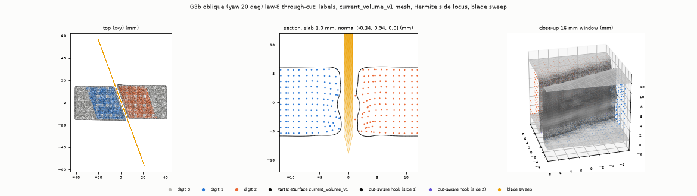
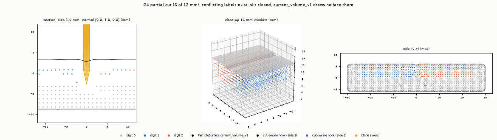
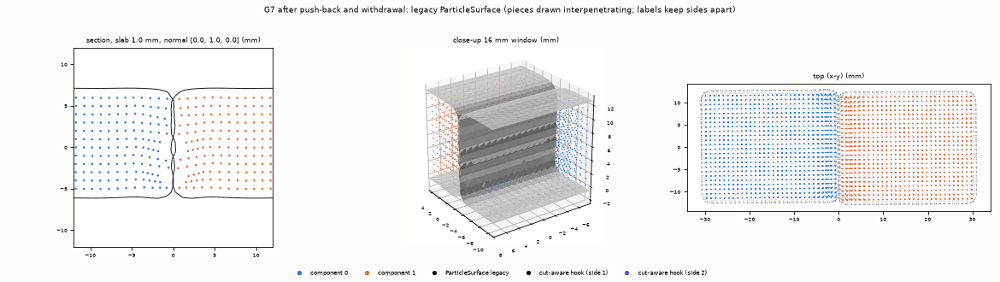

# WP-12 Phase 1 — Cut-surface geometry diagnosis

**Question (spec Phase 1 Gate).** How much of the cut-face unevenness comes from particle physics, label/lattice
discretization, fragmentation/bridges, surface reconstruction and the blade path? Which defects can cut-aware
geometry fix, and which need cutting-law or contact changes?

**Run.** `artifacts/wp12/phase1_001` (protocol written before the run, 2026-10-30T15:37:41Z, git `30e4193` + 26
uncommitted paths of the parallel Phase 2 work and of this step), cuda:1 (RTX 5090), Warp 1.17.0, Newton 1.6.1,
total wall 422 s. Compact evidence: [`phase1_surface_diagnosis_001.json`](../evidence/wp12/phase1_surface_diagnosis_001.json).
Frozen Phase 3 thresholds: [`configs/wp12/surface_protocol_v1.json`](../../configs/wp12/surface_protocol_v1.json).
All lengths are in mm. With 1 mm particles, mm = particle spacings s.

    TMPDIR=/mnt/data/ningan/tmp .venv/bin/python scripts/run_wp12_phase1_geometry.py --device cuda:1 \
        --out artifacts/wp12/phase1_001 --baseline --protocol-copy configs/wp12/phase1_geometry_protocol_v1.json
    .venv/bin/python scripts/summarize_wp12_phase1.py --run artifacts/wp12/phase1_001 \
        --evidence docs/evidence/wp12/phase1_surface_diagnosis_001.json > artifacts/wp12/phase1_001/tables.md

## Result in five lines

1. **Particle physics** is the main source of real unevenness. The solver's cut is flat in material space:
   Hermite reference-locus roughness is 0.004–0.022 mm. After the cut, the 1.5 mm wedge and the opening deform
   the face non-rigidly: face-particle normal residual P95 is 0.63–2.03 mm after a rigid fit per piece, and
   face-particle roughness is 0.15–0.26 mm RMS on 4 mm patches.
2. **Labels and the lattice** add a staircase of up to ½ s. On oblique cuts the P95 is 0.40 mm. An axis plane
   between cell faces gives a constant 0.30 mm offset. This staircase is the largest error of the rendered
   surface when physics is absent (G2). Through-cuts left no code-0 bridges. Partial cuts and chips are where
   **fragmentation and bridges** matter: there the surface is missing (coverage 0.26 and 0.37), not uneven.
3. **Reconstruction** (`current_volume_v1`, the profile every configured/registered task renders) *smooths* the
   material roughness: mesh roughness is 0.07–0.18 mm against 0.15–0.24 mm for the locus. It adds an offset from
   the material face (P95 0.36–0.77 mm), normal noise (P50 7–10°, P95 19–51°), rounded junctions (rim P95
   0.86–1.39 mm) and −1.2…−5.6 % volume. It draws nothing for closed slits or unmeshable chips. `legacy` adds
   +0.56…+1.13 mm of thickness and +10…+17 % volume, and draws touching pieces interpenetrating.
4. **Blade path:** 0 in every kinematic run. The commanded sweep lies exactly on the declared plane, and every
   assignment-instant Hermite point lies on the commanded sweep (max 1e-10 m; no lead-rule or plow assignments).
   Native tracking error was not measured (NOT_RUN).
5. **Cut-aware geometry can fix** the staircase, the extractor offset, thickness, normals and rim, closed-slit
   and chip faces, recontact welding of the drawn surface, and vertex-order instability. **Cutting-law, contact
   or solver work is needed for** wedge-driven face deformation (if it is judged unphysical), oblique/rake residual
   bridges, particle interpenetration on recontact, free-block sliding and slot overflow at triple intersections.

## 1. Method

### 1.1 What is measured against what (spec §1.4)

Nothing is measured against the target plane alone. The analytic plane is used only in G1/G2.

- **Material cut locus** (`surface_metrics_v1.material_locus`). There is one row per conflicting 6-neighbour
  lattice link and cut digit.
  - Reference point P and normal N come from the `cut_events_v1` Hermite record, labelled
    `hermite_cut_events_v1`. Without a recorder, P is the link midpoint and N is the patch mean of signed link
    directions, labelled `link_midpoint_fallback`. The Phase 0 baselines use the fallback.
  - Current side points are q = x_p + F_p (P − X_p) per side, with outward normals F^-T N. The translation-only
    variant x_p + (P − X_p) and the raw face particles are reported alongside.
- **Spaces.**
  - Reference space: P, the midpoints, and the mesh pulled back approximately through the nearest particle's F⁻¹.
  - Assignment-time current space: Hermite points at the substep the solver assigned the digit.
  - Final current space: the side locus vs the mesh.
- **Assignment-instant positions.** `cut_event_snapshots_v1` is a read-only subclass of the recorder. It stores
  x_p and its six neighbours at p's assignment substep, so h_a = x_p + t (x_q − x_p) is exact.
  - Checks: these points lie on the solver's swept plane (o, n) of that substep within 1e-6 m on CPU and
    7e-11 m on GPU. The run is bit-identical with and without the extension.
  - Activation: `installed()` rebinds the module attribute, so `drive_blade` and `kinematic_env` construct it
    unchanged.
- **Cut-face region of a mesh: `region_rule_v1` (fixed in this phase).** Every mechanical component gets
  boundary samples: its cut side points, and cell-face samples x_p + F_p (s/2 e) for every missing 6-neighbour.
  - A mesh vertex takes the component of its nearest particle.
  - It is *cut-face* if its nearest same-component boundary sample is a cut sample within 1.5 s, *exterior* if
    that sample is an exterior sample, and *unmatched* otherwise.
  - *Core* means at least 3 s from every exterior sample.
  - This replaces the Phase 0 nearest-particle rule, which dropped the face rim and could take exterior
    vertices. The Phase 0 function `cut_face_metrics` is kept unchanged for reproduction.

### 1.2 Metrics (`surface_metrics_v1.surface_report`, CPU-tested, no Newton import)

- **Distance:** P50/P95/max to the local plane of the same (component, cut, side) locus samples, radius 2 mm. The
  reverse direction, locus → mesh, is an exact point-triangle distance. **Coverage** is the fraction of locus
  samples within 1 s of the mesh.
- **Signed error:**
  - *shift toward side 2* is the mean offset of both faces along N;
  - *thickness bias* is mean(side 1) − mean(side 2) offset, where > 0 means both faces are drawn outward.
- **Normal error:** core triangles vs the fitted local locus plane (radius 3 mm). The F-mapped Nanson normal is
  a secondary diagnostic.
- **Roughness:** plane-fit RMS on patches of radius 2 mm (4 mm patches, one grid cell), reported as quadratic
  mean and P50/P95.
- **Mesh validity:**
  - degenerate, boundary, non-manifold and inconsistently oriented edges;
  - shells, per-shell signed volume and Euler characteristic;
  - a bounded self-intersection sample (segment-triangle tests over 20,000 triangles).
- **Boundary continuity:** cut-face/exterior corner samples → mesh, plus open edges near the junction.
- **Topological consistency:** shells per mechanical component, taken from the extractor's own
  `component_ranges`. Nearest-particle overlap is reported separately as visual interpenetration.
- **Detached mass and remaining bridges:** `law8_validation.bridge_report` per digit, plus code-0 particles
  lattice-adjacent to both sides.
- **Volume:** mesh vs Σm/ρ (reference) and Σ(m/ρ) det F (current), in total and per component.
- **Temporal stability:** at a fixed state, re-extracted with a cached and with a fresh extractor. Under slow
  motion, the residual is measured after transporting the previous mesh by its nearest particles' displacement.

### 1.3 Layered attribution (`surface_attribution_v1.attribute_cut`)

Each layer is measured on the same core links (at least 3 layers from the exterior; all links for thin
features, flagged `core_relaxed`).

| Layer | Measured | Meaning |
|---|---|---|
| L1 blade path | commanded edge sweep (triangulated from the substep poses) vs declared plane; sweep roughness | trajectory |
| L2 assignment | h_a vs commanded sweep (signed) | the cutting rule's geometric decision |
| L3 pre-assignment | P (reference) vs commanded sweep, solver-local frame | material moved before it was assigned (compression, drag, rigid slide) |
| L4 lattice | link midpoint vs P along N (reference); midpoint vs Hermite side locus in current space | what labels alone resolve |
| L5 post-cut physics | face particles: final vs assignment-instant position after a rigid fit per (piece, side), along the face normal | material behaviour after the cut |
| L6 reconstruction | mesh vs final side locus, both profiles | extractor |
| L7 topology | code-0 near the face, stencil bridges, coverage, shells, skipped fragments | fragmentation/bridges |

**Unevenness budget.** Patch roughness at successive stages on the same links: sweep → h_a → final Hermite side
locus (translation-only) → final midpoint side locus → mesh. Quadrature differences give each layer's share. A
negative reconstruction term means the extractor smooths the material.

### 1.4 Runners and parameters

- **Common settings:** 1 mm particles, 4 mm grid, 0.1 ms, `tlmpm_v5` with law 8, `ruler_knife_v1`, recorder on.
- **G3a:** registered `CUT-01-R` through `kinematic_env` (task material, seed 42, ×2).
- **G1, G3b, G4, G5, G7, G8:** `blade_probe.drive_blade` with TLMPMConfig defaults, cutting energy 5 J/m² and
  the legacy tray.
- **G6:** `sequence_blade_probe.drive_blade_sequence`, which adds a per-phase orientation. With one orientation
  it is bit-identical to `drive_blade` (CPU test).
- **G2:** synthetic codes and Hermite data on analytic planes, with a rigid 3 mm opening (geometry only; never
  physics).
- Material parameters are provisional and uncalibrated.

**Which ParticleSurface profile is live.** `current_volume_v1` is the profile of:
- `kinematic_env`;
- `isaac_sim_runner` and `isaac_lab_env` whenever a `task_id` is set (all CUT/TRIM/CFG tasks and Demos 1–7);
- the Phase 0 baselines.

`legacy` (1 mm voxel, Newton defaults: threshold 0.25, kernel 3 voxels, radius s/2) remains only on the
`task_id=None` legacy D0 path, `research_env` and `scripts/export_cutting_replay.py`. Both profiles are measured
below.

## 2. Geometry tests G1–G8 (criteria declared in `protocol.json` before the run)

| Test | Verdict | Criterion (declared) | Key numbers |
|---|---|---|---|
| G1 uncut box 40×24×12 mm | **PASS** | cv1 closed oriented manifold, 1 shell, χ = 2, \|ΔV\|/V ≤ 5 %, area-weighted P95 ≤ 0.5 s; 0.2 s rest run writes 0 digits and 0 events | cv1: ΔV −1.53 %, P95 0.30 mm, corner distance max 1.21 mm, face normal P95 0.25°, 45,128 triangles (28,088 after a 0.09 mm settle). legacy: ΔV +16.8 %, P95 0.63 mm. Rest: 0 digits, 0 events |
| G2 static analytic cut (unit test) | **FAIL** (1 of 12 sub-checks) | Hermite locus on plane ≤ 1e-9 m; exact mesh distance ≤ 1e-9 m and normal ≤ 1e-3°; staircase ≤ s/2 | Plane (1,2,3)/√14: exact-mesh max 1.18e-9 m > 1e-9 m. The declared tolerance is below the float32 resolution of the recorder log at 20 mm (≈1.2e-9 m). All other sub-checks pass. Post-hoc with 1e-8 m (10 float32 ulps): PASS (diagnostic, not a re-verdict). Measured floors in §4 |
| G3a CUT-01-R ×2 | **PASS, PASS** | 2 components; logged = conflicting; 0 sign-inconsistent; substeps match; cv1 shells = components, closed | 600 links, all logged. Repeat codes identical, max \|dx\| 0.025 mm. 108 s physics each |
| G3b oblique 20° yaw ×2 | **PASS, PASS** | as G3a | 502 links. Repeats differ in 1 of 28,800 codes, max \|dx\| 0.062 mm (GPU nondeterminism, ADR 0012 band 0.06 mm); metrics identical to 0.005 mm |
| G4 partial cut (6 of 12 mm) | **PASS** | 1 mechanical and 1 lattice component; logged = conflicting; Hermite within 1 s of the sweep and not below edge − 1 s | 1 / 1 component; 144 links; deepest assignment z 6.45 mm vs edge 6.0 mm; 6,912 code-0 particles under the kerf (1,152 direct code-0 stencil bridges = the intact bottom, correct). Armed hold: 0 new digits. cv1 draws a face for only 26 % of the conflicting links (closed slit) |
| G5 thin shaving (chip ≤ 2 mm) | **PASS** | logged = conflicting; no shell built from 2 components; every component meshed or recorded skipped | Chip detached: 86 particles, 0.44 % mass; 34 of 120 above-edge particles stayed on the substrate. cv1 **skips the chip** (recorded); legacy draws it at 50 % volume error. 8 lead-rule events |
| G6 two parallel + one perpendicular cut | **PASS** | 6 components; logged = conflicting per digit | First attempt with `slots_per_node` 8: **SlotOverflowError** (508 entries at the triple intersections, recorded). Passed with 16: 6 pieces, 1,680 events |
| G7 cut → disarmed push-back → hold → withdraw | **PASS** | disarmed phases 0 digits/events; components 2 throughout; no shell built from 2 components | Labels keep the sides apart. Particle gap closes to 0.19 mm (contact radius 0.45 mm). cv1 meshes interpenetrate: up to 349 sampled intersecting triangle pairs and 2,298 faces nearer the other piece; 0 after withdrawal. Slow-motion temporal residual P95 ≤ 0.024 mm, max 0.37 mm |
| G8 negative controls ×5 | **PASS** | each: 0 digits, 0 events, 0 unexpected code changes, 1 component, 1 closed cv1 shell | Armed approach, armed flat press (2.9 mm indentation), armed side push (2.7 mm), disarmed slide (13.3 mm plowing), disarmed plunge: all 0/0/0, 1 component, 1 closed shell |

**Temporal stability at a fixed state, every case.** Re-extraction reproduces the geometry to ≤ 3.7e-9 m, but
vertex and face *ordering* differs on every call (`same_topology` false), even with a cached extractor.
ParticleSurface topology is not frame-stable as an index set.

## 3. Attribution per scene (recorder runs; mm; roughness = quadratic-mean patch RMS, radius 2 mm)

| Case | cut | links | L1 path P95 | L2 assign P95/max | L3 pre-assign P95/max (mean) | L4 staircase P95/max | L5 post-cut particle P95/max | Roughness: face particles / Hermite locus / midpoint locus / mesh cv1 / mesh legacy |
|---|---|---|---|---|---|---|---|---|
| G3a_r0 | 0 | 600 | 0.000 | 0.000/0.000 | 0.001/0.001 (−0.000) | 0.001/0.001 | 2.032/2.319 | 0.213 / 0.213 / 0.213 / 0.179 / 0.169 |
| G3a_r1 | 0 | 600 | 0.000 | 0.000/0.000 | 0.001/0.002 | 0.001/0.002 | 2.033/2.317 | 0.213 / 0.213 / 0.213 / 0.179 / 0.169 |
| G3b_r0 | 0 | 502 | 0.000 | 0.000/0.000 | 0.156/0.826 (−0.002) | 0.408/0.465 | 1.027/1.260 | 0.218 / 0.239 / 0.243 / 0.083 / 0.092 |
| G3b_r1 | 0 | 502 | 0.000 | 0.000/0.000 | 0.156/0.827 | 0.408/0.465 | 1.028/1.261 | 0.218 / 0.239 / 0.243 / 0.083 / 0.092 |
| G4 | 0 | 144 | 0.000 | 0.000/0.000 | 0.279/0.281 (−0.218) | 0.178/0.181 | 0.949/0.962 | 0.161 / 0.161 / 0.161 / — / — |
| G5 | 0 | 108 | — | 0.000/0.000 | 1.500/1.500 (+0.273) | 0.387/0.472 | 4.942/6.294 | 0.259 / 0.309 / 0.281 / — / — |
| G6 | 0 | 480 | 0.000 | 0.000/0.000 | 0.296/0.299 (−0.252) | 0.177/0.181 | 0.884/0.974 | 0.154 / 0.155 / 0.154 / 0.078 / 0.061 |
| G6 | 1 | 480 | 0.000 | 0.000/0.000 | 1.317/1.319 (−1.204) | 0.261/0.310 | 0.631/0.949 | 0.164 / 0.154 / 0.164 / 0.066 / 0.050 |
| G6 | 2 | 720 | 0.000 | 0.000/0.000 | 0.326/0.377 (−0.267) | 0.152/0.204 | 0.711/0.948 | 0.203 / 0.204 / 0.203 / 0.097 / 0.093 |
| G7 | 0 | 288 | 0.000 | 0.000/0.000 | 0.311/0.311 (−0.259) | 0.177/0.181 | 0.718/0.731 | 0.158 / 0.159 / 0.158 / 0.084 / 0.041 |

**Reference Hermite-locus roughness** (material-space flatness of what the solver cut): 0.000 (G3a), 0.016
(G3b), 0.004 (G4), 0.004/0.022/0.008 (G6), 0.004 (G7) and 0.298 (G5 chip). The midpoint (labels-only) locus
reads 0.193 on the oblique G3b face.

The "—" entries for G4/G5 mean ParticleSurface drew no core cut face there: a closed slit, and a chip that was
not meshed or is too thin.

Reading the table:
- **L1 and L2 are 0** in every kinematic run (≤ 1e-10 m). The solver assigns exactly on the commanded swept
  plane, and law 8's plow-gated lead never fired. G5 has 8 lead-rule events, also on the sweep.
- **L3** is small (≤ 0.33 mm, mostly a uniform −0.25 mm shift). Exceptions: G6 cut 1, a 1.2 mm rigid slide of the
  free block caused by the previous cut; G5, thin dome material dragged 1.5 mm. L3 cannot separate rigid slide
  from compression. The non-rigid part is the reference roughness above.
- **L4** is 0 on lattice-aligned planes through cell faces (G3a). It is a constant 0.18–0.31 mm offset when the
  edge passes 0.2–0.3 mm off a cell face, and 0.40 P95 / 0.47 max on the 20° oblique face (G3b).
- **L5 dominates.** After a rigid fit per piece and side, the face particles still move 0.6–2.0 mm (P95) normal
  to the face. Examples: CUT-01-R 2.0 mm on a 20 mm-tall face; G5 chip 4.9 mm. This is the wedge pushing and
  bending the face columns: physical behaviour of the uncalibrated material, not a rendering artefact.

Unevenness budget (quadrature increments, mm):

| Case | L1 path | L2 assignment | L5 post-cut physics | L4 lattice (current) | L6 reconstruction cv1 | L6 legacy |
|---|---|---|---|---|---|---|
| G3a | 0 | 0 | 0.213 | 0.000 | −0.116 | −0.130 |
| G3b | 0 | 0 | 0.239 | +0.043 | −0.228 | −0.224 |
| G4 | 0 | 0 | 0.161 | −0.003 | — (no core face drawn) | — |
| G5 | 0 | 0 | 0.309 | −0.129 | — (chip skipped) | — |
| G6 cut 0/1/2 | 0 | 0 | 0.155/0.154/0.204 | −0.021/+0.055/−0.015 | −0.132/−0.150/−0.178 | −0.141/−0.156/−0.181 |
| G7 | 0 | 0 | 0.159 | −0.006 | −0.135 | −0.153 |

So the *material* face is uneven at 0.15–0.24 mm per 4 mm patch, almost all from post-cut physics. Labels add
about 0.04–0.06 mm where the face is oblique. ParticleSurface removes 29 % (CUT-01-R) to 88 % (G3b) of the
material roughness variance; the extractor is a smoother. Its errors are offset, orientation, missing faces and junctions,
not added bumps.

### 3.1 Reconstruction against the material state (L6; mm, angles in degrees)

| Case | cut | cv1 mesh→locus P95/max | locus→mesh P95 | coverage | thickness bias | shift to side 2 | normal P50/P95 | legacy mesh→locus P95 | locus→mesh P95 | coverage | thickness bias | normal P50/P95 |
|---|---|---|---|---|---|---|---|---|---|---|---|---|
| G3a | 0 | 0.702/0.936 | 1.188 | 0.90 | −0.085 | −0.001 | 7.6/51.0 | 0.724 | 1.737 | 0.76 | +0.828 | 8.3/63.1 |
| G3b | 0 | 0.441/1.020 | 1.195 | 0.89 | +0.178 | +0.004 | 7.5/18.7 | 0.799 | 1.736 | 0.72 | +1.012 | 8.7/21.1 |
| G4 | 0 | 0.766/0.867 | 5.303 | **0.26** | +0.143 | −0.113 | — | 0.119 | 6.115 | **0.20** | — | — |
| G5 | 0 | 0.629/0.818 | 13.326 | **0.37** | +0.102 | +0.085 | — | 0.933 | 8.296 | 0.49 | +0.488 | — |
| G6 | 0 | 0.430/0.835 | 0.666 | 0.99 | +0.042 | −0.057 | 6.9/22.1 | 0.781 | 1.099 | 0.87 | +1.028 | 7.2/29.0 |
| G6 | 1 | 0.570/0.935 | 1.038 | 0.94 | +0.263 | −0.184 | 6.6/21.1 | 0.999 | 1.470 | 0.75 | +1.133 | 5.1/22.0 |
| G6 | 2 | 0.386/1.002 | 0.811 | 0.99 | −0.010 | −0.011 | 9.8/27.7 | 0.731 | 1.414 | 0.79 | +0.916 | 9.2/42.6 |
| G7 | 0 | 0.360/0.865 | 0.706 | 1.00 | −0.038 | −0.025 | 8.3/18.9 | 0.610 | 1.278 | 0.84 | +0.562 | 13.2/35.4 |

Whole-mesh numbers (cv1 / legacy):

| Quantity | cv1 | legacy |
|---|---|---|
| Volume vs Σ(m/ρ) det F | −1.2 … −5.6 % (G6 −5.6 %; worst component −6.3 %) | +10.5 … +16.6 % |
| Rim corner → mesh P95 | 0.86–1.39 mm | 0.35–0.76 mm (inflation hides the rounding) |
| Self-intersections (sampled) | 0 in final states | 44 (G6), 282 (G7): pieces drawn interpenetrating |
| Extraction | 0.01–0.04 s | 0.04–0.24 s |

The approximate reference-space pull-back of the cv1 mesh gives P95 0.53–1.17 mm vs the Hermite local plane. It
is diagnostic only: under post-cut deformation the nearest-particle F⁻¹ map is not reliable.

## 4. Zero-physics floor (G2: synthetic labels/Hermite on analytic planes, rigid 3 mm opening)

| Plane | Midpoint staircase P95/max (RMS) | cv1 vs analytic, core P95 | cv1 vs own midpoint locus, core P95 | cv1 normal P50/P95 | cv1 thickness / volume | legacy vs analytic, core P95 | legacy thickness / volume |
|---|---|---|---|---|---|---|---|
| 30° in x-z | 0.404/0.426 (0.216) | 0.196 | 0.085 | 4.6/12.3 | −0.09 / −1.9 % | 0.797 | +1.12 / +16.9 % |
| 45° in x-y | 0/0 | 0.001 | 0.001 | 0.1/0.2 | −0.09 / −2.0 % | 0.603 | +1.02 / +17.6 % |
| (1,2,3)/√14 | 0.401/0.401 (0.217) | 0.137 | 0.068 | 4.1/8.1 | −0.05 / −2.3 % | 0.746 | +1.13 / +20.2 % |
| x, 0.3 mm off a cell face | 0.300/0.300 | 0.302 | 0.002 | 0.1/0.3 | −0.08 / −1.8 % | 0.927 | +1.20 / +17.0 % |

- With no physics at all, `current_volume_v1` reproduces the *label* locus to ≤ 0.09 mm in the face interior.
  Its error against the true plane, 0.14–0.30 mm, is the lattice staircase: the labels quantise the face to cell
  faces.
- Its rim rounding is 0.9–1.25 mm and its oblique-face normal noise is 4–5° (P50) and 8–12° (P95).
- `legacy` draws each face about 0.6 mm outward.
- A Hermite-based reconstruction has a 1e-9 m reference (the float32 log), so the staircase term is removable.

## 5. Phase 0 baselines with the final metrics (midpoint fallback; no recorder in those runs)

Total deformation means final side locus vs reference locus after a rigid fit per piece and side; without a
recorder, pre- and post-assignment motion cannot be separated. The staircase cannot be measured without
Hermite data (P = midpoint by construction).

| Scene | cut | links | Total deformation P95 | Roughness: face particles / midpoint locus / mesh cv1 / mesh legacy | cv1 mesh→locus P95 | cv1 coverage | cv1 / legacy thickness bias | cv1 normal P50/P95 |
|---|---|---|---|---|---|---|---|---|
| S1 CUT-01-R | 0 | 600 | 1.514 | 0.192 / 0.192 / 0.173 / 0.186 | 0.492 | 0.95 | −0.045 / +0.942 | 6.9/29.4 |
| S2 TRIM ρ 10° | 0 | 364 | 0.910 | 0.280 / 0.295 / 0.178 / 0.156 | 0.609 | 0.83 | +0.089 / +0.714 | 16.6/31.5 |
| S3 Test B | 0–3 | 4×532 | 1.22–1.51 | 0.22–0.25 / same / 0.11–0.18 / 0.10–0.16 | 0.415–0.768 | 0.75–0.95 | −0.02…+0.20 / +0.64…+0.98 | 9.8–10.9/24.7–37.8 |
| S4 Test C | 0–2 | 222/362/275 | 0.93–2.22 | 0.24–0.27 / 0.24–0.31 / 0.13–0.21 / 0.13–0.20 | 0.786–1.068 | 0.60–0.70 | +0.17…+0.51 / +0.63…+1.11 | 12–18/32–69 |
| S5 SLICE-PUSH | 0, 1 | 2×476 | 1.22, 1.45 | 0.20–0.21 / same / 0.14–0.16 / 0.13–0.14 | 0.347, 0.707 | 0.95, 0.80 | −0.01, +0.26 / +0.95, +0.83 | 9.5–11.4/25.3–28.4 |
| S6 oblique 35° (1 piece) | 0 | 990 | 1.049 | 0.335 / 0.368 / 0.243 / 0.231 | 0.958 | 0.83 | +0.665 / +1.213 | 15.2/62.3 |
| S8 Test D2 | 0–2 | 650/193/322 | 2.33, 13.7 (chip), 1.23 | 0.20–0.34 / 0.19–0.33 / 0.11–0.14 / 0.12–0.31 | 0.848–1.077 | 0.57–0.74 | +0.25…+0.41 / +0.63…+0.99 | 10–25/22–84 |

Topology in the baselines:
- Code-0 stencil bridges remain in S4 Test C digit 1 (1,161), S6 (2) and S8 digit 2 (2,744; 8 code-0 particles
  lattice-adjacent to both sides). The through-cut scenes have 0.
- `legacy` draws 6 shells for 4 pieces in S4 and 8 for 4 in S8: landed chips spread into clouds.
- S7 (rake 45°, no labels) is drawn as 2 cv1 shells for 1 mechanical component (Phase 0 finding).
- cv1 meshes of chips resting on the substrate interpenetrate it: S2 56 and S4 49 sampled pairs.
- cv1 volume error is −1.0 … −3.6 %, legacy +9.9 … +12.7 %.

## 6. Gate answers

1. **How much comes from particle physics?** Nearly all of the *real* unevenness.
   - The face the solver decides is flat in material space: Hermite reference roughness 0.004–0.022 mm; 0.30 mm
     only for the 1–2-particle chip.
   - After the cut, the face particles deform non-rigidly by 0.6–2.0 mm P95 (13.7 mm for a fallen chip). The
     material face is rough at 0.15–0.26 mm RMS on 4 mm patches.
   - In the budget, post-cut physics carries 0.15–0.24 mm of the 0.15–0.24 mm material roughness.
   - Pre-assignment motion is a near-uniform ≤ 0.33 mm shift (rigid slides up to 1.2 mm in free blocks).
2. **How much from surface reconstruction?**
   - In roughness, `current_volume_v1` *removes* 0.11–0.23 mm of the material roughness (quadrature).
   - In geometry it *adds*:
     - a 0.36–0.77 mm P95 offset from the material face (0.14–0.30 mm with zero physics, all staircase);
     - normal noise, P50 7–10° and P95 19–51°;
     - rim rounding, P95 0.86–1.39 mm;
     - volume −1.2 … −5.6 %;
     - missing faces: closed slits get 26 % coverage, and chips are skipped.
   - `legacy` additionally inflates each piece: thickness +0.56 … +1.13 mm, volume +10 … +17 %, and pieces drawn
     interpenetrating.
   - Labels and the lattice, the staircase the extractor cannot avoid, contribute 0–0.47 mm in offset and
     ≤ 0.055 mm in current-space roughness.
3. **How much from the actual blade path?**
   - 0 in all kinematic runs: path P95 0, assignment-vs-sweep max ≤ 1e-10 m.
   - Native tracking error is **NOT_RUN** here. The tooling (`edge_sweep_mesh` on recorded poses) applies
     unchanged to Native recordings.
4. **Fixable by cut-aware geometry (Phase 3):**
   - the staircase (Hermite points: 0.016 vs 0.193 mm reference roughness on the 20° face);
   - extractor offset, thickness bias and volume error;
   - normal noise from the kernel and staircase;
   - rim rounding, using Hermite boundary data and DC creases;
   - faces of closed slits and partial cuts, from conflicting links (coverage 0.26 → target ≥ 0.99);
   - thin-chip faces (no skipped fragment);
   - recontact (no shared vertices across conflicting codes; per-side representatives);
   - index-stable topology between frames.
5. **Needing cutting-law, contact or solver changes (Phase 4), not geometry:**
   - **Wedge-driven face deformation** (0.6–2.0 mm P95 non-rigid, 0.15–0.24 mm roughness). Cut-aware geometry
     must *preserve* it. Whether it is right for a 1.5 mm blade in this uncalibrated material is a
     material/contact calibration question.
   - **Residual code-0 bridges** in oblique and plowing cuts (S6, S8, S4).
   - **Particle interpenetration on recontact** (gap 0.19 mm against a 0.45 mm contact radius; the mesh overlap
     follows the particles).
   - **Free-block rigid sliding** under the wedge (1.2 mm per cut; a fixture issue).
   - **Slot overflow** at three intersecting cuts with `slots_per_node` 8 (a solver capacity; 16 works).
   - The 45° rake no-label failure (Phase 0).

## 7. Frozen protocol for the Phase 3 comparison

[`configs/wp12/surface_protocol_v1.json`](../../configs/wp12/surface_protocol_v1.json) fixes:
- metrics, region rule, spaces and references;
- expected discretization errors (the G2 floors above);
- measurement uncertainty: ADR 0012 band 0.06 s; measured repeat spread ≤ 0.005 s;
- thresholds in spacings for S0 and S1–S9, plus the comparison gate (B not worse than A beyond the uncertainty
  on any metric; better on current-space P95, coverage and topology);
- the S1–S9 definitions mapped to G3a/G3b, G4, G5, G6, G7 and G8, plus three new Phase 3 setups (S2 compress then
  cut, S3 curved, S6 four slices).

Smoothness alone is never a success criterion, and physical deformation must survive in current space. The
`slots_per_node` 16 requirement for S5 comes from G6.

## 8. Debug viewer

- **Tools:** `scripts/cut_debug_viewer.py` with `src/robotic_cutting_sim/cut_debug_view.py`.
- **Layers:** original, current, labels (per digit), components, sweep (edge lines plus the swept tool
  cross-section), contact (solver cutting progress or contact work > 0), particle_surface (`--profile`),
  cut_aware, and rendered (= current_volume_v1, the live profile).
  - The cut_aware layer is a pluggable `CUT_AWARE_PROVIDERS` entry. In Phase 1 it shows the recorded Hermite side
    locus; Phase 3 registers its surface there.
- **Views:** top, side, blade-aligned, arbitrary section (`--plane-point`, `--plane-normal`, `--slab`), and
  cut-face close-up.
- **Output:** PNG plus one binary PLY per layer (`--ply-dir`), in about 0.5 s per figure.
- **Inputs:** Phase 1 packages and Phase 0 `baseline_compact.npz`.
- **Scope:** debug only. It reads privileged state and is not connected to any observation.

## 9. Limits and open items

- **Kinematic only.** Blade path and tracking error on Native are NOT_RUN.
- **Probe settings differ from the task recipes.** The probe material is TLMPMConfig defaults with cutting energy
  5 J/m²; CUT-01-R uses its task recipe.
- **L3 conflates rigid workpiece slide with compression.** Use the reference-roughness column for the non-rigid
  part.
- **The F map is first order.** F-mapped side points add up to about 0.02 mm RMS over translation-only, so the
  budget uses translation-only. The reference-space pull-back of meshes is approximate.
- **Fixed-geometry G2 tolerance (1e-9 m) was mis-declared** below float32 log resolution. The G2 FAIL stands as
  declared; `surface_protocol_v1` uses 1e-8 m.
- **G6 first attempt** with the default slot count raised `SlotOverflowError`. This is recorded, not hidden.
- **GPU nondeterminism:** 1 of 28,800 codes differs between the G3b repeats (|dx| 0.062 mm).
- **Device pose buffer.** `drive_blade` rebinds `bed.poses` when a chunk of a new length is captured. Pose trails
  for probes are therefore rebuilt on the host from the phases; the recorder kernels are unaffected.
