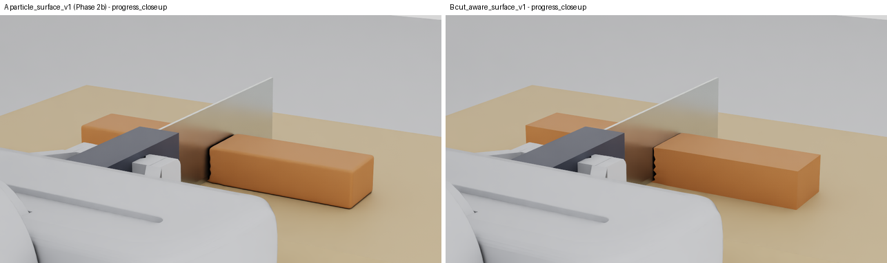
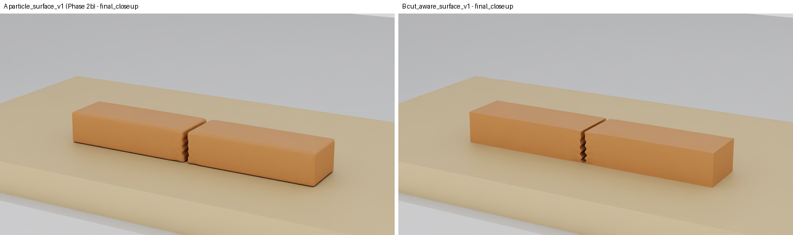
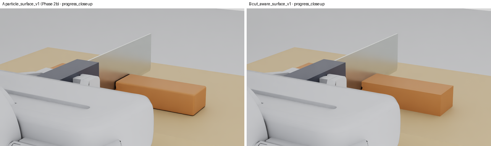
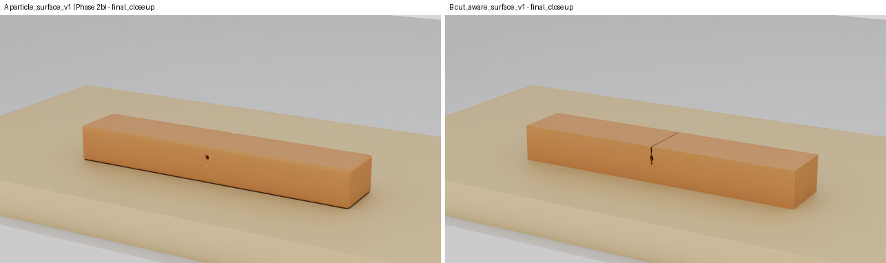
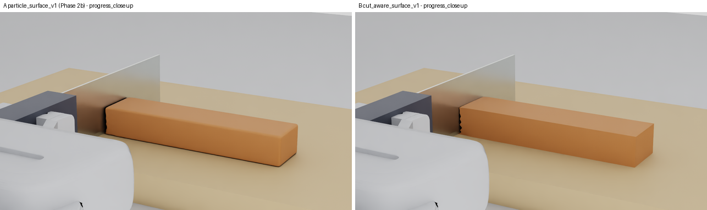
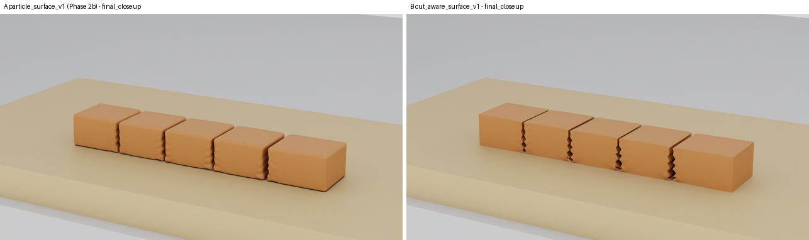
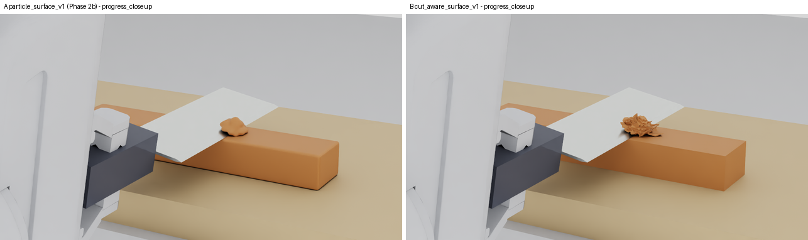
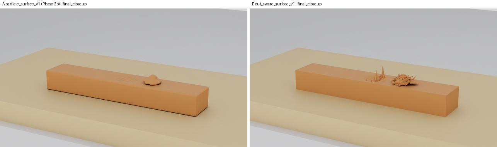

# WP-12 Phase 3 Layer 6 — `cut_aware_surface_v1` in the live environment and Native Isaac Sim

Date: 2026-10-31. Branch `claude/wp12-physical-cut-surfaces`, HEAD `2f299cc` plus an uncommitted tree. Material
parameters are provisional and uncalibrated. No physics, evaluator, threshold, `final_v4`, law 8, WP-11 or Phase 2b
record was changed. `cut_aware_surface.py` (the version the Phase 3 S-tests measure) is **unchanged**. The surface is
one-way render geometry: it reads solver state, writes nothing back, and is never the collider (contact uses
particles and the PhysX colliders).

Protocol (declared before the first `surface_live_NNN` run): [`configs/wp12/surface_live_v1.json`](../../configs/wp12/surface_live_v1.json).
Evidence: [`docs/evidence/wp12/phase3_surface_live_001.json`](../evidence/wp12/phase3_surface_live_001.json). Media:
[`docs/media/wp12/surface_live/`](../media/wp12/surface_live/).

## Live / Native integration

### 1. API (opt-in, versioned)

`surface_profile` selects the rendered specimen surface:

- **`particle_surface_v1`**, the default. It is the existing `cutting_surface.ComponentSurface`, with kernel
  `current_volume_v1` for configured/registered tasks and `legacy` for D0.
- **`cut_aware_surface_v1`**: `surface_runtime.LiveCutAwareSurface` over `cut_aware_surface.CutAwareSurface`.
  It needs `tlmpm_v5`. It turns the read-only `cut_events_v1` recorder on, so the Hermite data are recorder
  quality, and this is recorded.

| Entry point | How |
| --- | --- |
| `open_cutting_env(..., runtime="kinematic" \| "isaac_sim", surface_profile=...)` | backend option |
| `open_cutting_env(..., preset="cutting_research_v1", surface_profile=...)` / `open_policy_env` | passed through to the inner env. `PolicyReadyEnv.surface_profile`; reset info gets `surface_profile` only when non-default; `surface_provenance()` needs `observation_profile="privileged_state"` |
| `KinematicConfig.surface_profile` / `make_kinematic_env(surface_profile=...)` | `None` or `"particle_surface_v1"` gives the default. Cut-aware with a non-v5 solver raises. Cut-aware sets `cut_events="cut_events_v1"` |
| `IsaacSimCuttingConfig.surface_profile` | The existing field. `"particle_surface_v1"` (and `None`) resolve to the same kernel as before, so the recorded config is unchanged. `"cut_aware_surface_v1"` needs a configured `tlmpm_v5` task |
| `scripts/run_wp10_live.py --surface-profile P [--surface-timing-log]` | Configured runs only. Both flags are `argparse.SUPPRESS`, so default runs record the same arguments |
| `scripts/collect_dataset.py --surface-profile P` | Goes into `runtime_options` (replayed by `replay_kinematic`). `episode.json` gets a `surface` block only when non-default |

**Episode isolation.** Kinematic and Native `reset()` each build a new `LiveCutAwareSurface`, with a new
`CutAwareSurface` and an empty incremental cache. No topology state survives a reset.
`test_reset_starts_a_fresh_topology_no_stale_cut_faces` checks this: after a through-cut and a reset, the first
extraction is `full`, has 0 cut triangles, and equals the fresh-episode mesh array for array. A second cut after the
reset meshes cleanly.

**Recorder capacity.** In live episodes the recorder's activation summary is sized to
(task steps + 1000) × substeps, with a minimum of the recorder default 2^18. This uses
`surface_runtime.recorder_summary_capacity` and an additive `LiveCuttingMaterial(cut_events_summary_capacity=)`;
the default is unchanged. The recorder still raises on overflow and never truncates.

**Recording** (`EpisodeRecorder`, also used by `PolicyReadyEnv(recording=...)`). Only with a non-default profile:

- `surface_provenance.json` (`surface_provenance_v1`) holds:
  - the selection: profile, options, recorder on/off, bridge method, frame handling, reference-grid hashes, and the
    SHA256 of the six surface sources;
  - the `cut_events_v1` metadata (counts, overflow, log SHA256, device bytes);
  - a summary;
  - one row per extraction: codes SHA256, Hermite log entries/SHA/max substep, crossings by source, log rejects,
    QEF/embedding/region counts, audit, mesh size and defects, update mode and dirty cells, temporal statistics,
    degenerate-normal repairs, and ms timings;
  - a frame→extraction map with a codes-hash cross-check.
- `cut_events_log.npy` is the final cumulative log. It is append-only and codes are monotone, so with
  `physics_state.npz` codes and the lattice any recorded frame's surface can be rebuilt.
- In Native runs, `actions.jsonl` `privileged_diagnostics.surface` holds a compact per-step row.

`frame_manifest.json`, `physics_state.npz`, `episode_export.npz` and `REQUIRED_EPISODE_FILES` are unchanged (no
schema change). For a Native A run (`surface_live_006`) compared with Phase 2b `workcell_live_001`, these are equal:
`setup.json` config and key set, the episode `manifest.json` config, and the `actions.jsonl` row and diagnostic key
sets. The only added file is the explicitly requested `runtime_timing_trace.json`.

**No leaks.** Surface data never enter `observe()`, step info or the deployable export:

- `PRIVILEGED_KEYS` gains `surface_provenance`, `hermite` and `cut_events`.
- The tests walk observations and reset/step infos for `surface`, `hermite`, `cut_events`, `codes_sha256`, `audit`,
  `surface_selection` and `face_varying_normals_world`.
- `export_episode` keys carry no surface key.

### 2. Native USD path

`LiveIsaacSimCutting._update_cut_aware_surface` handles the cut-aware profile:

1. Extract in the solver's workpiece-local frame with the recorder log.
2. Map the vertices to WORLD with the task's rigid workpiece pose.
3. Compute face-varying normals from the WORLD vertices (crease 30°).
4. Stage the mesh through the additive `DynamicSurfaceBridge.update_face_varying_v1` (faceVarying normals,
   `doubleSided`, right-handed winding).

Extraction is incremental, with dirty cells taken from link-signature changes.

**Frame handling.** `test_frame_rotation_route_equals_rigid_transform_of_the_local_extraction` checks the
equivalent route of the extractor: WORLD positions plus `frame_rotation` R (35° yaw, 4° and −3° tilts). It matches
the local extraction followed by the rigid map to 1e-12 m (vertices) and 1e-9 (normals).

**Orientation.** `test_runner_stages_world_mesh_with_face_varying_normals_double_sided` uses a real in-memory stage.
More than 99.9% of the staged corner normals agree with the right-handed triangle winding (on the B CUT run every
reference mesh has 0 inconsistently oriented edges).

**Zero-area triangles (found live, `surface_live_001`).**

- **Cause.** A current-space triangle can have zero area, for example a slit-tip quad whose two sides use one tip
  representative. It then gets a zero face-varying normal, and `update_face_varying_v1` rightly refused it
  (`ValueError: face_varying_normals must be unit vectors`, step 328, CUT phase).
- **Fix (`surface_runtime`, not `cut_aware_surface.py`).** Such corners get the triangle's reference-space normal
  rotated to WORLD, or world +z if that triangle is degenerate too. The vertices are unchanged and the repair is
  counted per extraction (`degenerate_normal_corners`).
- **Rerun results.** CUT 0, PARTIAL 0, TRIM 6 corners in 2 of 786 extractions (+z, the reference triangle is
  degenerate too).

Timings recorded per extraction (ms): cut-event log fetch, state readback, mechanical partition, topology+QEF,
quads, embedding, audit, validity+metadata, world transform, normals, USD upload. Per step, the runner keeps an
in-memory trace of material, surface-update, capture and step wall times for both profiles. It is written only with
`--surface-timing-log`.

### 3. Native runs (Isaac Sim 6.2, cuda:0, seed 42, `ruler_knife_v2_y` physically grasped, tlmpm_v5 law 8, 1 mm / 4 mm / 0.1 ms)

Inputs were prepared exactly as Phase 2b (same scene, goal, planner overrides, duration and stride). The task id
equals the Phase 2b record in every run. Command:

```
TMPDIR=/mnt/data/ningan/tmp .venv/bin/python scripts/run_wp12_surface_live.py launch --episode <ID> --out artifacts/wp12/surface_live_NNN
.venv/bin/python scripts/run_wp12_workcell_live_analysis.py --root artifacts/wp12/surface_live_NNN   (unchanged Phase 2b tool)
.venv/bin/python scripts/summarize_wp12_surface_live.py --run ID=ROOT ... --out docs/evidence/wp12/phase3_surface_live_001.json
```

| Run | Episode | Result | Physics vs Phase 2b (protocol rule) | Process wall |
| --- | --- | --- | --- | --- |
| `surface_live_001` | B_CUT | **FAIL_EXECUTION** at step 328 (CUT): zero-area-triangle normal rejected by the bridge (§2); kept | — | 227 s |
| `surface_live_002` | B_CUT (rerun with the fix) | TASK_SUCCESS / PASS, home PASS | **PASS**: 2 pieces 0.500 / 0.500; 28 500 labelled particles, 600 / 600 conflicting cross-plane links; **final codes bitwise identical** to `workcell_live_001` | 518 s (A record 385 s) |
| `surface_live_003` | B_PARTIAL | sever verdict FAIL as expected; declared class **PARTIAL_CUT_ACCEPTED**, home PASS | **PASS**: 1 component, 14 400 labelled, 300 conflicting links; final codes bitwise identical to `workcell_live_002` | 450 s (A 331 s) |
| `surface_live_004` | B_TESTB | **FAIL_EXECUTION** at t = 26.2 s (cut 3): `CutEventOverflowError`, activation summary 2^18 substeps < 370 k; kept. Up to the failure: 1310 extractions, 0 audit errors | — | — |
| `surface_live_007` | B_TESTB (rerun, recorder sized per episode) | TASK_SUCCESS / PASS, home PASS | **PASS**: 5 pieces 0.219 / 0.200 / 0.194 / 0.194 / 0.194 (equal); 84 300 labelled, 2 400 / 2 400 conflicting links; codes not bitwise identical (GPU nondeterminism), counts equal | 2 869 s (A 995 s; **GPU contention**, below) |
| `surface_live_005` | B_TRIM_PATH_V3 | TASK_SUCCESS / PASS, home PASS | **PASS**: dome removed 0.979 (equal), substrate share 0.99996; labelled 29 298 vs 29 340, conflicting links 402 vs 393 (GPU nondeterminism, reported) | 607 s (A 426 s) |
| `surface_live_006` | A_CUT_PROFILE (`particle_surface_v1`, timing trace on) | TASK_SUCCESS / PASS, home PASS | **PASS**: 0.500 / 0.500; 28 501 vs 28 500 labelled (A itself is not bitwise repeatable on GPU) | 393 s |

Knife − board minimum (task phase): CUT −0.027 µm (Phase 2b −0.041 µm), Test B −0.053 µm (−0.026 µm).
**Verdict: the surface does not change physics** within GPU nondeterminism (the protocol rule passes for all four
B episodes). CUT and PARTIAL even reproduce the Phase 2b final codes bit for bit. In A the codes vary by one
particle.

**Close-ups.** A (Phase 2b) is on the left and B on the right: the same task, view and frame index. Files are
`docs/media/wp12/surface_live/<episode>/ab_*.png`; B-only stills and a receipt sit in the same directories.

| | Progress | Final |
| --- | --- | --- |
| CUT |  |  |
| PARTIAL |  |  |
| Test B |  |  |
| TRIM (path_v3) |  |  |

MP4s (B, rendered by `scripts/render_packed_episode.py` from the recorded frames):

- [`cut/demo.mp4`](../media/wp12/surface_live/cut/demo.mp4), 1.1 MB;
- [`test_b/demo.mp4`](../media/wp12/surface_live/test_b/demo.mp4), 2.6 MB, with `--wide-piece-palette`.

**What changes visually** (descriptive; the protocol scores no visual metric):

- **CUT and Test B.**
  - B draws flat box faces with sharp edges; A rounds every edge.
  - B shows an open kerf at every cut. Its cut faces come only from conflicting links, with Hermite points from
    the recorder (600 / 2 400 of 600 / 2 400 crossings; 0 midpoint fallbacks).
  - Both profiles show the same serrated kerf edges, where the 1.5 mm wedge pushed the halves apart (−1.3 / +1.2 mm,
    Phase 2b §9.3). That is material deformation, not reconstruction.
- **PARTIAL.** B shows the kerf where the codes conflict: a slit from the top down to about the commanded depth,
  closed at its tip, with the intact lower half still one shell. A closed the kerf and showed only a small hole
  artefact (Phase 2b §9.2).
- **TRIM: B shows spikes on the trimmed face and on the chip.**
  - These are 317 triangles with an edge longer than 3 mm (max 16.2 mm) in the final staged mesh. CUT, PARTIAL and
    both A meshes have none.
  - **Cause (measured).** The solver itself tears the plowed chip material apart without assigning conflicting
    digits. In the final TRIM state, 83 *uncut* lattice links (no conflicting digit) are longer than 3 mm, up to
    19.9 mm. The Phase 2b TRIM state shows the same: 84 links, up to 20.5 mm.
  - `cut_aware_surface_v1` keeps every uncut link connected (its rule: faces only where codes conflict), so it
    stretches triangles across these tears. A's particle-blob surface hides them.
  - This is a physics/labelling finding of the thin-chip / residue class (Phase 4), exposed by the surface rather
    than caused by it. Masking it at render time would violate the "faces only at conflicting links" rule, so it is
    reported and left as is.
  - Side effect: TRIM's quality-layer surface metric `maximum_substrate_surface_residual_height_m` (REPORTED_NOT_SCORED)
    reads 5.45 mm with B vs 0.17 mm with A. Surface-dependent quality metrics depend on the selected profile; the
    verdict does not.

### 4. Surface audit, Hermite sources and temporal stability (B, per extraction)

| | CUT | PARTIAL | Test B | TRIM |
| --- | --- | --- | --- | --- |
| Extractions (every control step + reset) | 741 | 643 | 1 898 | 786 |
| Audit errors | 0 | 0 | 0 | 0 |
| Max mesh shells / mechanical components | 2 / 2 | 1 / 1 | 5 / 5 | 3 / 2 |
| Welded faces (shell spanning components) | 0 | 0 | 0 | 0 |
| Visually separated, mechanically bridged (shown) | 0 | 0 | 1 | 1 |
| Hermite crossings: recorder / sign-inconsistent midpoint / midpoint fallback | 600 / 0 / 0 | 300 / 0 / 0 | 2 400 / 0 / 0 | 344 / 58 / 0 |
| Reference-mesh defects max (non-manifold edges / inconsistently oriented edges / degenerate triangles) | 0 / 0 / 0 | 0 / 0 / 0 | 2 / 4 / 4 | 4 / 8 / 2 |
| Degenerate-normal corners repaired (max per extraction) | 0 | 0 | 12 | 6 |
| Boundary (open) edges | 0 | 0 | 0 | 0 |
| Triangles (max) | 36 800 | 35 600 | 44 000 | 36 760 |
| Extractions at unchanged codes / topology unchanged | 702 / 702 | 630 / 630 | 1 684 / 1 684 | 699 / 699 |
| Vertex step max − particle step max at unchanged codes | +2.9 µm | +7.2 µm | +5.5 µm | +80.6 µm |
| Update modes | 1 full + 740 incremental | 1 + 642 | 1 + 1 897 | 1 + 785 |

**Temporal stability.**

- **B (no flicker).** At unchanged codes the mesh topology never changed (0 of 3 715 extractions in the four
  episodes). The largest per-step vertex motion stays within the largest particle motion of the same step plus
  ≤ 7 µm in CUT, PARTIAL and Test B. TRIM reaches +81 µm: the F-corrected embedding extrapolates in the strongly
  sheared chip.
- **A.** For comparison, A's mesh size changed in 338 of 702 unchanged-code extractions of the same CUT task:
  ParticleSurface re-meshes the moving particle cloud every step.

**Phantom / welded faces.**

- **Welded.** None: 0 shell–component violations in all 4 068 B extractions.
- **Phantom.** Every shell maps to its own lattice piece; the audit errors on any other case, and there were 0
  errors.
- **Visually separated but mechanically bridged.** Test B and TRIM each have one component with several lattice
  pieces (code-0 / diagonal stencil bridge). It is shown, never hidden, and counted.
- **Edge defects.** Test B (2 / 4) and TRIM (4 / 8) have a few non-manifold and inconsistently oriented reference
  edges at multi-cut / plow regions. They are counted, not repaired. TRIM's 58 sign-inconsistent crossings are the
  recorder's lead-rule links (58 `lead_links`), which use t = ½ as designed.

### 5. Profiling (spec §3.7, §6.6): A vs B on the same task (CUT, cuda:0, uncontended)

ms per control step (mean / p95) unless noted. `runtime_timing_trace.json` of `surface_live_006` (A) and
`surface_live_002` (B); 740 control steps each.

| | A `particle_surface_v1` | B `cut_aware_surface_v1` |
| --- | --- | --- |
| TLMPM material step (B includes the recorder kernels in the same CUDA graph) | 269.7 / 274.7 | 270.4 / 274.1 |
| ⇒ cut-event recording on the GPU | — | ≈ +0.7 ms (inside run-to-run noise) |
| Cut-event log fetch (host) | — | 0.8 / 0.8 |
| Surface update total (extraction + normals + USD) | 52.3 / 261.6 | 229.7 / 442.2 |
| … mechanical partition (codes changed; cached otherwise) | in A's extraction | 12.6 / 221.7 |
| … topology + QEF (incremental) | — | 18.5 / 19.8 |
| … quads / embedding / audit | — | 2.7 / 21.7 / 38.1 |
| … reference-mesh validity + metadata | — | 98.4 / 102.2 |
| … face-varying normals | — | 30.2 / 39.2 |
| … world transform | 0.9 | 0.4 |
| … USD upload (`update` vs `update_face_varying_v1`) | 7.0 / 7.9 | 4.3 / 4.5 |
| Robot physics + IK + other (derived: step − material − surface) | 84.1 | 81.9 |
| Runner step total | 406.1 / 612.5 | 582.0 / 795.4 |
| Camera capture (every 10th step; 3 RTX cameras + 2 presentation views) | 384.3 | 367.7 |
| Mesh size (mean) | 73 478 vertices / 146 950 triangles | 17 925 / 35 843 |
| GPU memory of the process at the end (cuda:0) | 6 459 MiB | 6 113 MiB (the recorder's device arrays are 21.9 MB) |
| Episode process wall | 393 s | 518 s |

**Reading.**

- B costs about +175 ms per step on the host CPU (NumPy/SciPy reference implementation). The largest parts:
  - the full-mesh validity check on the reference mesh: 98 ms, diagnostics that a production path could run only
    on recorded frames;
  - the audit: 38 ms;
  - normals: 30 ms;
  - the mechanical partition: 222 ms on the steps where the codes change. A pays the same partition cost: its
    p95 is 262 ms.
- The incremental topology update is 18.5 ms against 104 ms for a full rebuild (measured on the initial bar).
- B uploads 4× fewer triangles than A.
- The cut-event recorder adds no measurable GPU time.
- The Warp port described in `cut_aware_surface.py` is not done here.
- **Test B (`surface_live_007`) timings are not comparable.** From control step ≈ 600, about ten other processes
  (other agents' jobs) were computing on cuda:0. The material step rose from 268 to 1 050–1 450 ms and the capture
  to 2.3 s. The physics outcome is unaffected (identical pieces and fractions). Its surface ms (CPU) are reported in
  the evidence but are also load-affected.

### 6. Tests

New: `tests/test_surface_runtime.py` (15 tests). It covers:

- the defaults, and that the recorded configs are unchanged;
- cut-aware requires v5;
- physics bitwise unchanged on CPU (A vs B, the same through-cut);
- recorder Hermite data and the WORLD mesh;
- the frame-rotation route;
- the reset gives a fresh topology;
- temporal rows;
- that observations and infos carry no surface data;
- recording of `surface_provenance.json` and `cut_events_log.npy`;
- that the default recording writes nothing new;
- the Native runner staging faceVarying, doubleSided, right-handed normals on a real USD stage;
- zero-area normal repair;
- recorder capacity sizing.

Run:

```
TMPDIR=/mnt/data/ningan/tmp .venv/bin/python -m pytest -q tests/test_surface_runtime.py tests/test_cut_aware_surface.py \
  tests/test_cut_events.py tests/test_kinematic_end_to_end.py tests/test_live_env.py tests/test_policy_ready_env.py \
  tests/test_policy_interface.py tests/test_recording.py tests/test_isaac_runner_surface_unmeshable.py \
  tests/test_collector_info_leaks.py tests/test_collector_recycling.py tests/test_cutting_surface.py \
  tests/test_wp12_rigid_probe_camera_refresh.py tests/test_wp12_workcell_live_protocol.py \
  tests/test_wp12_flat_board_workcell.py tests/test_cut_event_snapshots.py tests/test_repo_naming.py
180 passed (355 s)
```

### 7. Open issues

1. **TRIM chip tearing without labels.** The solver separates uncut neighbours by up to 20 mm (the same in A's
   physics). B renders this as spikes, and the surface-dependent TRIM quality metric depends on the profile. This is
   a Phase 4 item. A render-side "stretched uncut link" gap rule would need its own versioned, labelled profile; it
   must not be a silent fix.
2. **Host cost.** About +175 ms per step on CPU. The candidates are the Warp port (cell regions, QEF, embedding),
   and running `mesh_validity` and the audit only at recorded frames. That would be a versioned option, since today
   every extraction is audited.
3. **F-corrected embedding in heavily sheared regions.** It gives up to 81 µm of vertex motion beyond the particle
   motion (TRIM chip). The LSQ estimator variant was not tried live.
4. **Defects at multi-cut / plow regions.** There are a few non-manifold and inconsistently oriented reference edges
   (Test B, TRIM), counted, not repaired. They should be cross-checked against the Phase 3 S-test measurements
   (`WP12_SURFACE_RECONSTRUCTION.md`).
5. **Boundary profile.** The live boundary profile is `cell_face_v1` (the measured default), so a curved workpiece
   (the TRIM dome before cutting) is terraced at 1 mm. `analytic_reference_v1` exists but is not selected live.
6. **Test B timing.** It must be re-measured on an uncontended GPU. Lab (Isaac Lab) runtime: NOT_RUN (cut-aware is
   kinematic and Isaac Sim only).
