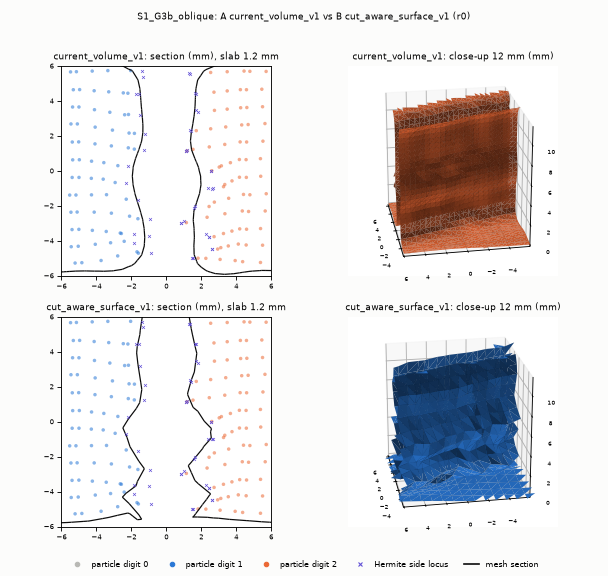
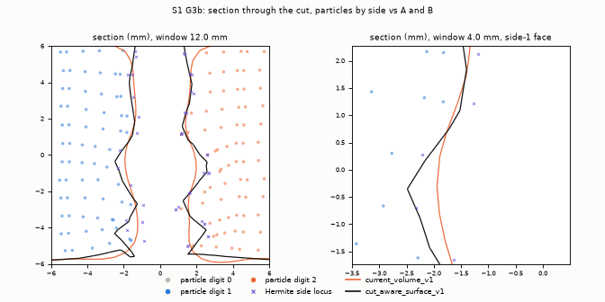
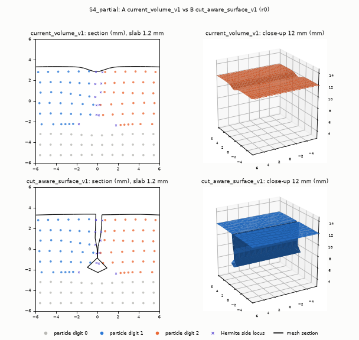
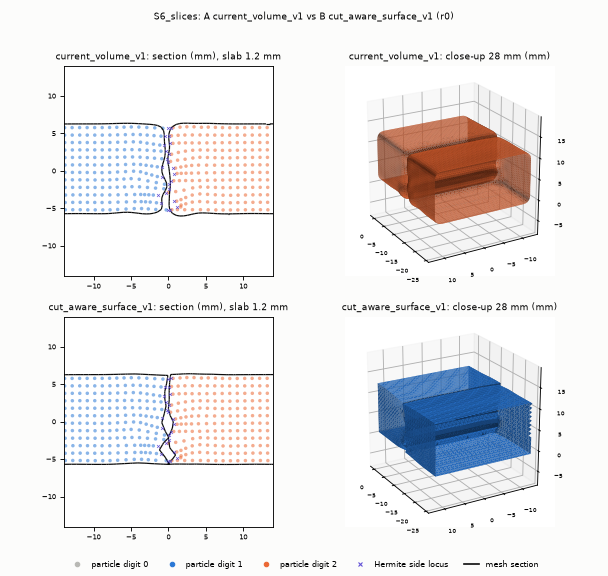
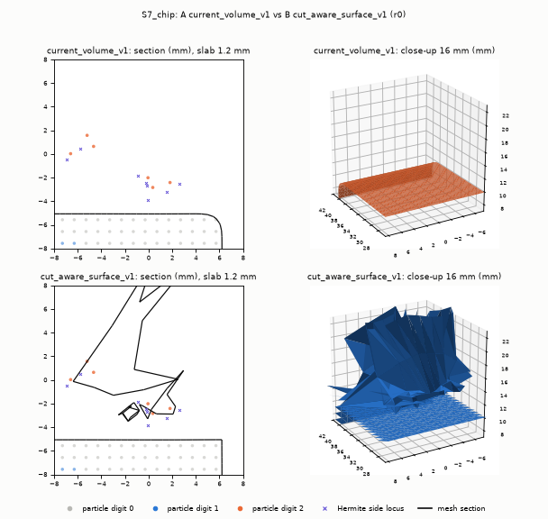
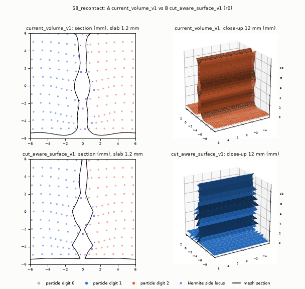

# WP-12 Phase 3 — Cut-aware surface reconstruction: `cut_aware_surface_v1` vs `particle_surface_v1`

**Question (spec Phase 3 gate).** Is `cut_aware_surface_v1` (B) not worse than `particle_surface_v1` (A) on every
frozen metric and better on the cut face, under the protocol frozen before this measurement?

**Run.** `artifacts/wp12/phase3_surface_001`.
- Protocol [`configs/wp12/surface_protocol_v1.json`](../../configs/wp12/surface_protocol_v1.json):
  SHA256 `afc30c75…eeee`, last commit `b31553d`, unchanged since the freeze.
- The protocol hash, the case list and every evaluation reading were written to `protocol_record.json` at
  2026-10-30T16:28:14Z, before the first case ran.
- Git HEAD `f53dc78` (B, the metrics, `tlmpm_v5` and the recorder are byte-identical to `89b289d`), 27 uncommitted
  paths of parallel work.
- Hardware and software: cuda:1 (RTX 5090), Warp 1.17.0, Newton 1.6.1.
- Wall times: total 1,626 s; perf 3 states; diagnostics `diagnostics_002.json`.
- cuda:1 was shared with the Phase 4a jobs (100 % utilisation from other processes), so physics wall times are
  inflated: CUT-01-R took 306–314 s against 108 s in Phase 1. Every number is in spacings s = 1 mm unless marked.
- Compact evidence: [`phase3_surface_001.json`](../evidence/wp12/phase3_surface_001.json).

```
TMPDIR=/mnt/data/ningan/tmp .venv/bin/python scripts/run_wp12_phase3_surface.py run --device cuda:1 --out artifacts/wp12/phase3_surface_001
TMPDIR=/mnt/data/ningan/tmp .venv/bin/python scripts/run_wp12_phase3_surface.py perf --device cuda:1 --out artifacts/wp12/phase3_surface_001
TMPDIR=/mnt/data/ningan/tmp .venv/bin/python scripts/diagnose_wp12_phase3_surface.py --run artifacts/wp12/phase3_surface_001
TMPDIR=/mnt/data/ningan/tmp .venv/bin/python scripts/run_wp12_phase3_surface.py figures --out artifacts/wp12/phase3_surface_001 --media docs/media/wp12/phase3
.venv/bin/python scripts/summarize_wp12_phase3.py --run artifacts/wp12/phase3_surface_001 --perf perf_001 \
    --diagnostics diagnostics_002.json --evidence docs/evidence/wp12/phase3_surface_001.json
```

## Result

**Phase 3 comparison gate: FAIL.**

| Gate part | Result |
|---|---|
| B better on coverage (partial cut, chip) | **PASS** |
| B better on topology | **PASS** (no skipped fragment; A drops the S7 chip) |
| B better on current-space cut-face P95 in every case | **FAIL**: better in S1 G3a, S3 and S5; not different in G3b, S2, S7 and S8; worse in S4 and S6 |
| B not worse on any frozen metric | **FAIL** (see below) |

Where B is worse:
- **normal error** in S1–S3, S5, S6 and S8;
- **sampled self-intersections** in S1 G3b, S3–S8;
- **current-space max distance** in G3b, S2, S4, S7 and S5 cut 0;
- **reference-space max** in G3b and S7;
- **thickness bias** in S3, S4 and S5 cut 2;
- **faces nearer another component** in S5, S6 and S8.

By `thresholds_for_candidate_B`:
- **B passes:** S0, S4, S9 (all five controls and the G4 hold).
- **B fails:** G2 (one plane: crease clamp) and S1, S2, S3, S5, S6, S7, S8.

A fails every case except S9. Both repeats agree on every verdict.

1. **What B fixes.** It removes the A errors the Phase 1 diagnosis attributed to reconstruction:
   - *Exact reference geometry:* reference P95 0.000–0.092 s in every case except the S7 chip (1.05), against A's approximate 0.53–1.17 s.
   - *Complete coverage:* 1.000 in every physical case; 0.972 for the S7 chip, against A's 0.26 for the partial
     cut and 0.37 for the chip.
   - *No skipped fragments.*
   - *Exact reference volume and per-component volumes:* S6 0.01–0.68 %, against A's 2.8–4.2 %.
   - *Rim P95* 0.18–0.38 s (S7 0.79), against 0.80–1.76 s (S7 13.8).
   - *Frame-stable topology:* hash constant at a fixed state and over the S8 recontact frames; A's ordering
     changes on every call.
   - *Exactness in the controls:* S0 is exact to 2e-6 s; the S9 negative controls are bit-identical to the uncut
     extraction.
2. **What B does not fix, because the material does it.** B embeds faithfully, so it inherits:
   - particle-scale roughness of the post-cut face (face particles 0.22–0.39 s RMS on 2 mm patches in the through cuts);
   - wedge-opened, curved and interpenetrating faces.

   Against the frozen 3 mm locus-plane normal and the first-order side locus, this costs normal P95 25–43° (S4 81°; A 14–51°) and current
   P95 0.39–0.62 s (S4 0.96), against A's 0.36–0.77 s. The local planes of B's own vertices
   agree with the locus planes to 2.5–5.4° (P50; S4 10.5°). The excess is triangle-scale tilt on a rough or curved face, not a
   misplaced surface (§6.4).
3. **Failures that are B's own** (no code bug found; each traced with data in §6):
   - **(a) Crease clamping:** G2 (1,2,3)/√14 max 0.40 s against a limit of 0.25.
   - **(b) Crack-tip representative inside an open notch:** S4 current P95 0.96 s, from 23 tip vertices; the rest
     are 0.44.
   - **(c) Folds after embedding:** cut/boundary creases under strongly non-affine wedge deformation fold after
     embedding (G3b, S3 intra-shell self-intersections; 0 in the pre-embedding mesh and in all zero-physics
     planes).
   - **(d) Membrane across an unlabelled tear:** B spans MPM-torn, unlabelled particles with stretched triangles
     (S7 chip volume 5.7×).
   - **(e) Volume rows:** the current-volume rows fail for both methods. det F disagrees with the particle
     positions by 1–5 % (§6.6), so this is a reference inconsistency, not a reconstruction error.

## 1. Method: Layers 1–6

`cut_aware_surface_v1` (B) is Approach B of the technology review
([§6](WP12_SURFACE_TECH_REVIEW.md#6-recommended-architecture--cut_aware_surface_v1)). It is render geometry
computed from the solver state and never writes back.

| Layer | What it is | Code |
|---|---|---|
| 1 Physical material state | `tlmpm_v5` law 8: positions, total F, packed side codes, reference stencil. Unchanged, the only source of truth | [`tlmpm_v5.py`](../../src/robotic_cutting_sim/tlmpm_v5.py) |
| 2 Cut-event tracking | `cut_events_v1` read-only recorder: per newly conflicting lattice link, t along the link, reference normal N, cut id, substep, flags (CPU physics byte-equal on/off, commit `403870f`) | [`cut_events.py`](../../src/robotic_cutting_sim/cut_events.py) |
| 3 Reference-lattice topology | The 1 mm particle lattice is the linked volume. A link is *cut* iff its endpoint codes conflict, *boundary* iff one endpoint site is absent, otherwise uncut (0–1 and 0–2 pairs stay connected) | `ReferenceLattice`, `link_states` in [`cut_aware_surface.py`](../../src/robotic_cutting_sim/cut_aware_surface.py) |
| 4 Local dual contouring | Regions per 2×2×2 dual cell (present corners joined by uncut edges); one QEF representative per region (float64 SVD, truncation 0.1, clamped to the cell, clamps counted); one quad per disconnected link and side; vertices never shared between regions; at a crack front both sides use the same tip representative | `CutAwareSurface._cells`, `_quads` |
| 5 Cut-side-aware embedding | x_r = Σ w_p [x_p + F_p (X_r − X_p)] over the region's own particles (restricted trilinear weights; det F ≤ 0 → translation only, counted). One-way: a pure function of the current state | `CutAwareSurface._embed` |
| 6 USD / rendering | Face-varying normals per region (crease 30°) and the additive bridge method `DynamicSurfaceBridge.update_face_varying_v1` | [`usd_surface_bridge.py`](../../src/robotic_cutting_sim/usd_surface_bridge.py) |

- **Hermite data.** B uses the recorder log when one is given. Without a log it uses the labelled R4 midpoint
  fallback: t = ½, and the normal is the sum of signed same-cut link directions within 3 s. The sources are counted
  per extraction.
- **Boundary.** `cell_face_v1` for every case: t = ½ with the axis normal, consistent with the full-cell mass.
- **Baseline A** is `particle_surface_v1` = `CuttingSurface` profile `current_volume_v1`: Newton ParticleSurface per
  mechanical component, voxel s/2, kernel 3 s, radius (s/2)·∛det F. This is the profile every configured or
  registered task renders. `legacy` is measured on repeat 0 only and is never the comparison target.
- **This phase changes neither B nor any physics.** B is measured as committed in `89b289d`.

## 2. Test setups (protocol `S_test_definitions`)

Common settings for every case:
- 1 mm particles, 4 mm grid, dt 0.1 ms, `tlmpm_v5` with law 8, `ruler_knife_v1`, cutting energy 5 J/m²;
- the `cut_events_v1` + `cut_event_snapshots_v1` recorder on;
- the runners and parameters are those of
  [`run_wp12_phase1_geometry.py`](../../scripts/run_wp12_phase1_geometry.py) (`PROTOCOL`).

Material parameters are provisional and uncalibrated. Physical cases run twice (same seed or deterministic
sampling); the repeats measure GPU nondeterminism.

| Case | Setup | Particles |
|---|---|---|
| S0 | G1 static uncut box 40×24×12 mm (no physics) | 11,520 |
| G2 | Synthetic codes and Hermite log on four analytic planes (30° in x–z, 45° in x–y, (1,2,3)/√14, x plane 0.3 mm off a cell face), rigid 3 mm opening. Geometry unit test, never physics | 15,360 |
| S1 | G3a: registered CUT-01-R scripted edge (`kinematic_env`, seed 42), snapshots every 40 control steps. G3b: `drive_blade`, 80×30×12 mm block, vertical cut yawed 20° | 96,000 / 28,800 |
| S2 (new) | `drive_blade_sequence`: disarmed flat press (FLAT_SKIM, bottom face 2 mm into the top over x ∈ [−28, 8.6] mm), hold 0.2 s, lift, move, reorient clear of the material, vertical cut at x = −9.7 mm through the pressed zone, lift | 17,280 |
| S3 (new) | Vertical cut whose edge yaws about world z at 25°/s during the 1 s stroke (−12.5° → +12.5°; 15° while the edge is inside the 12 mm block). Per-substep rotation with the matching angular twist (`OrientedPhase.angular_velocity_rad_s`, added opt-in to [`sequence_blade_probe.py`](../../src/robotic_cutting_sim/sequence_blade_probe.py); zero angular velocity keeps the old code path). Off-plane edge motion at the block side 14.7° | 17,280 |
| S4 | G4: 6 of 12 mm, armed hold 0.2 s, disarmed withdraw; snapshots at cut end and hold end | 17,280 |
| S5 | G6: two parallel cuts plus one perpendicular, `slots_per_node` 16 | 28,800 |
| S6 (new) | Four vertical slices at x = −35.7, −11.7, 12.3, 36.3 mm (24 mm pitch) of a 120×24×12 mm block whose end faces touch the legacy tray walls (probe_v5_multicut `slices*_walls` plan); snapshot after each lift | 34,560 |
| S7 | G5: 4 mm dome, edge 2 mm above the substrate, rake 25° | 19,700 |
| S8 | G7: cut, disarmed side push closing the kerf, hold, withdraw; snapshots at cut end, lowered, then every 40 ms through push and hold | 17,280 |
| S9 | G8 armed approach, armed flat press, armed side push, disarmed slide, disarmed plunge (40×24×12 mm), and the S4 hold phase | 11,520 |

## 3. Evaluation readings (declared in `protocol_record.json` before the run)

Every reading below was written to `protocol_record.json` before the first case ran. The protocol file was
not edited.

- **Distances.** `surface_metrics_v1.surface_report`, over **all** `region_rule_v1` cut-face vertices; the core
  (≥ 3 s from the exterior) is reported alongside.
  - *Current space:* against the Hermite side locus q = x_p + F_p (P − X_p).
  - *Reference space:* the same cut-face vertices, measured against the local plane (2 mm) of the Hermite P of the
    same cut. For B these are its pre-embedding positions X_r (exact). For A it is the approximate pull-back
    (diagnostic, as the protocol says).
- **Space-independent rows.** Bias, thickness, normal (core triangles, 3 mm locus plane), coverage and rim are the
  current-space numbers of `surface_report`. "closed" means watertight and no negative-volume shell.
  "shells = components" uses extractor provenance.
- **Volume rows ("all").**
  - B reference: the pre-embedding mesh volume vs Σm/ρ, with the bound ½ s·A_cut + 10⁻⁴ V and A_cut taken from
    B's reference cut faces.
  - A reference: A has no reference mesh, so its current mesh volume is compared with Σm/ρ.
  - Current: mesh volume vs Σ(m/ρ) det F, limit 2 %.
- **Temporal.**
  - *Fixed state:* re-extraction with the cached extractor and with a fresh one; topology hash = faces + B
    reference vertices.
  - *Slow motion:* S8 frames 40 ms apart without code change; `temporal_stability` residual after transport, P95.
- **S2 and S3.**
  - S2 "as S1 in current space": the S1 current-space rows with max 2.0 s decide the verdict.
  - S3 "as S1 reference space": the reference rows decide it.
  - Both also report a strict all-S1 verdict.
- **S4.** For B, the links of its cut faces are compared with the independent conflicting-link set. Tip shared
  means:
  - vertices used by cut faces of both sides exist;
  - each lies in a region that holds both side digits;
  - the mesh has 0 boundary edges.

  For A these rows are NOT_APPLICABLE (no link provenance).
- **S7.** The chip is every mechanical component except the largest. Its volume is computed from provenance.
- **S8.** "Vertices shared across conflicting codes" counts B regions whose particles carry both side digits of a
  cut; A is 0 by construction (one mesh per component). Contact-stat penetration is not in the snapshots
  (NOT_AVAILABLE); the minimum particle distance is reported instead.
- **Comparison gate.**
  - Declared bands: 0.06 s, 1°, 0.5 % volume.
  - Metrics without a declared band (coverage, counts, booleans) are decided only beyond the larger repeat spread.
  - **Worse** if beyond the band in **any** repeat; **better** if beyond the band in **every** repeat.
  - Roughness is excluded (smoothness is never a success criterion).
- **Thresholds.** `thresholds_for_candidate_B` decide B's verdict. They are also applied to A and to B's midpoint
  variant, for information only.

## 4. Verdicts per case

The table shows r0 / r1 where the repeats differ. The failing rows are B's; for G2 the plane is named.

| Case | A current_volume_v1 | B cut_aware_surface_v1 | B midpoint fallback | B failing rows (value r0 / r1, threshold) |
|---|---|---|---|---|
| S0 uncut box | FAIL | PASS | — |  |
| G2 static planes | FAIL | FAIL | FAIL | n123 cut_face_max_s 0.401 |
| S1_G3a | FAIL | FAIL | FAIL | current_p95_s 0.526 (<= 0.500); normal_p95_deg 27.539 / 27.511 (<= 10.000) |
| S1_G3b | FAIL | FAIL | FAIL | reference_max_s 1.698 (<= 0.500); abs_thickness_bias_s 0.152 / 0.151 (<= 0.100); normal_p95_deg 41.282 / 41.286 (<= 10.000) |
| S2 | FAIL | FAIL (strict all-S1: FAIL) | FAIL | current_p95_s 0.541 (<= 0.500); abs_thickness_bias_s 0.120 (<= 0.100); normal_p95_deg 24.980 / 24.960 (<= 10.000); all_volume_current_rel 0.037 (<= 0.020) |
| S3 | FAIL | FAIL (strict all-S1: FAIL) | FAIL | reference_max_s 0.903 (<= 0.500) |
| S4 | FAIL | PASS | FAIL |  |
| S9 G4 hold | — | PASS | — | |
| S5 | FAIL | FAIL | FAIL | cut0_reference_max_s 1.035 (<= 0.500); cut0_normal_p95_deg 30.169 / 30.150 (<= 10.000); cut1_reference_max_s 1.319 (<= 0.500); cut1_normal_p95_deg 28.296 / 28.168 (<= 10.000); cut2_reference_max_s 1.063 / 1.062 (<= 0.500); cut2_abs_thickness_bias_s 0.149 / 0.150 (<= 0.100); cut2_normal_p95_deg 35.861 / 35.862 (<= 10.000); all_volume_current_rel 0.051 (<= 0.020) |
| S6 | FAIL | FAIL | FAIL | all_volume_current_rel 0.022 (<= 0.020) |
| S7 | FAIL | FAIL | FAIL | chip_current_volume_rel_error 4.708 / 4.705 (<= 0.050) |
| S8 | FAIL | FAIL | PASS | all_temporal_slow_motion_residual_p95_s 0.072 / 0.052 (<= 0.050) |
| S9 approach_armed | PASS | PASS | — | |
| S9 flat_press_armed | PASS | PASS | — | |
| S9 side_push_armed | PASS | PASS | — | |
| S9 slide_disarmed | PASS | PASS | — | |
| S9 plunge_disarmed | PASS | PASS | — | |

- "S9 G4 hold" is the armed hold of S4:
  - 0 events and 0 new digits;
  - B's topology hash and 576 cut triangles are unchanged from the cut end to the hold end.
- In S2 and S3 the strict reading (all S1 rows) also fails.

## 5. Results matrix

Final state of every case, both repeats; s = 1 mm.
- *cur*: current space against the Hermite side locus, all region_rule_v1 cut-face vertices.
- *ref*: reference space. B uses its exact pre-embedding mesh; A uses an approximate pull-back (diagnostic).
- *abs dV*: |relative volume error|.
- *fixed hash*: topology hash constant at a fixed state.
- *rough*: patch-RMS roughness, reported only and never a criterion.
- *B mid*: B with the labelled midpoint fallback, measured against the same Hermite locus.

| Case | Method | cur P50 | cur P95 | cur max | ref P95 | ref max | coverage | abs bias | abs thick | nrm P50 | nrm P95 | rim P95 |
|---|---|---|---|---|---|---|---|---|---|---|---|---|
| S1_G3a | A | 0.121 | 0.699 / 0.693 | 0.936 / 0.935 | 1.167 / 1.171 | 1.640 / 1.641 | 0.903 | 0.000 / 0.001 | 0.087 / 0.085 | 7.607 | 51.075 / 50.893 | 1.388 / 1.385 |
| S1_G3a | B | 0.100 | 0.526 | 0.679 | 0.000 | 0.000 | 1.000 | 0.001 | 0.097 / 0.098 | 13.298 / 13.285 | 27.539 / 27.511 | 0.315 |
| S1_G3a | B mid | 0.100 | 0.525 / 0.526 | 0.680 / 0.679 | 0.001 | 0.002 / 0.001 | 1.000 | 0.001 | 0.098 | 13.292 / 13.288 | 27.539 / 27.512 | 0.315 / 0.314 |
| S1_G3b | A | 0.150 | 0.441 | 1.020 | 0.650 / 0.651 | 1.424 | 0.887 | 0.004 | 0.178 | 7.506 / 7.500 | 18.679 / 18.673 | 1.036 / 1.037 |
| S1_G3b | B | 0.123 / 0.124 | 0.487 | 1.125 | 0.055 | 1.698 | 1.000 | 0.003 | 0.152 / 0.151 | 21.197 / 21.193 | 41.282 / 41.286 | 0.382 |
| S1_G3b | B mid | 0.130 | 0.495 | 1.125 | 0.283 | 1.698 | 1.000 | 0.005 | 0.139 | 19.330 / 19.316 | 40.003 / 40.001 | 0.435 |
| S2 | A | 0.207 | 0.580 | 0.737 | 0.583 | 1.290 | 0.840 | 0.030 | 0.314 | 4.132 / 4.137 | 13.998 / 13.991 | 0.805 |
| S2 | B | 0.063 | 0.541 | 1.078 / 1.079 | 0.013 | 0.015 | 1.000 | 0.021 | 0.120 | 15.336 / 15.342 | 24.980 / 24.960 | 0.314 |
| S2 | B mid | 0.068 | 0.547 | 1.074 | 0.070 | 0.075 | 1.000 | 0.009 | 0.119 | 14.848 / 14.838 | 25.273 / 25.264 | 0.301 |
| S3 | A | 0.137 | 0.505 | 1.053 / 1.052 | 0.685 | 1.232 / 1.233 | 0.952 | 0.020 | 0.016 | 8.881 / 8.885 | 24.078 | 1.761 |
| S3 | B | 0.122 | 0.390 | 0.706 / 0.704 | 0.092 | 0.903 | 1.000 | 0.002 / 0.003 | 0.124 / 0.123 | 17.315 / 17.317 | 33.010 / 33.016 | 0.334 |
| S3 | B mid | 0.180 | 0.452 | 0.650 / 0.649 | 0.335 | 0.903 | 1.000 | 0.042 | 0.124 | 16.564 / 16.561 | 37.585 / 37.601 | 0.437 |
| S4 | A | 0.234 / 0.220 | 0.767 / 0.766 | 0.867 | 0.608 / 0.611 | 1.224 | 0.264 | 0.105 / 0.113 | 0.159 / 0.143 | — | — | 0.859 |
| S4 | B | 0.066 | 0.964 | 0.982 | 0.036 | 0.037 | 1.000 | 0.091 | 0.283 | 21.455 | 80.597 / 80.594 | 0.201 |
| S4 | B mid | 0.114 | 1.029 | 1.049 | 0.146 | 0.151 | 0.986 | 0.132 / 0.138 | 0.322 / 0.318 | 22.146 | 79.056 / 79.054 | 0.192 |
| S5 | A | 0.117 | 0.523 | 1.005 / 1.013 | 0.663 | 1.428 / 1.429 | 0.980 | 0.071 / 0.070 | 0.075 / 0.076 | 8.180 / 8.179 | 25.180 / 25.141 | 1.079 / 1.080 |
| S5 | B | 0.093 | 0.416 / 0.415 | 0.925 / 0.939 | 0.045 | 1.319 | 1.000 | 0.004 | 0.100 | 14.555 / 14.550 | 32.230 / 32.272 | 0.227 |
| S5 | B mid | 0.123 | 0.432 / 0.430 | 0.925 / 0.924 | 0.155 | 1.319 | 1.000 | 0.042 | 0.089 | 14.997 / 14.988 | 32.067 / 32.027 | 0.276 / 0.277 |
| S6 | A | 0.136 | 0.442 / 0.443 | 1.002 / 1.030 | 0.647 | 1.235 | 0.997 / 0.996 | 0.107 | 0.037 / 0.038 | 8.836 / 8.704 | 25.873 / 25.968 | 0.943 / 0.942 |
| S6 | B | 0.102 / 0.101 | 0.530 / 0.529 | 1.010 | 0.031 | 0.867 | 1.000 | 0.031 | 0.036 / 0.038 | 17.617 / 17.689 | 42.990 / 43.009 | 0.176 / 0.178 |
| S6 | B mid | 0.159 | 0.392 / 0.396 | 0.955 / 0.956 | 0.199 | 0.867 | 1.000 | 0.080 | 0.007 / 0.005 | 16.207 / 16.206 | 32.055 / 32.092 | 0.214 |
| S7 | A | 0.223 | 0.609 / 0.607 | 0.818 | 0.680 / 0.682 | 0.976 | 0.370 | 0.088 / 0.091 | 0.109 / 0.107 | — | — | 13.782 / 13.784 |
| S7 | B | 0.118 / 0.116 | 0.616 / 0.617 | 1.075 / 1.081 | 1.047 / 1.048 | 1.283 / 1.284 | 0.972 | 0.003 / 0.001 | 0.003 / 0.006 | — | — | 0.793 / 0.794 |
| S7 | B mid | 0.169 / 0.168 | 0.759 / 0.735 | 1.246 | 1.056 | 1.283 / 1.284 | 0.954 | 0.029 / 0.012 | 0.127 / 0.112 | — | — | 0.640 / 0.636 |
| S8 | A | 0.082 | 0.362 / 0.361 | 0.869 / 0.865 | 0.529 | 1.029 / 1.030 | 0.998 | 0.025 | 0.037 | 8.289 / 8.343 | 18.926 / 18.975 | 0.933 / 0.932 |
| S8 | B | 0.075 / 0.073 | 0.412 / 0.413 | 0.547 | 0.016 | 0.037 | 1.000 | 0.015 / 0.016 | 0.086 / 0.088 | 16.283 / 16.275 | 28.895 / 28.927 | 0.196 |
| S8 | B mid | 0.143 | 0.400 | 0.549 | 0.146 | 0.149 | 1.000 | 0.037 | 0.116 | 16.015 / 16.022 | 28.672 / 28.705 | 0.206 |

| Case | Method | closed | shells=comp | self-int | abs dV cur | abs dV ref | fixed hash | rough mesh | rough locus |
|---|---|---|---|---|---|---|---|---|---|
| S1_G3a | A | yes | yes | 0 | 0.013 | 0.014 | no | 0.179 / 0.180 | 0.301 |
| S1_G3a | B | yes | yes | 0 | 0.008 | 0.000 | yes | 0.200 | 0.301 |
| S1_G3a | B mid | yes | yes | 0 | 0.008 | 0.000 | yes | 0.200 | 0.301 |
| S1_G3b | A | yes | yes | 0 | 0.022 | 0.022 | no | 0.083 | 0.312 |
| S1_G3b | B | yes | yes | 85 | 0.017 | 0.000 | yes | 0.206 | 0.312 |
| S1_G3b | B mid | yes | yes | 35 | 0.017 | 0.000 | yes | 0.195 | 0.312 |
| S2 | A | yes | yes | 0 | 0.038 | 0.038 | no | 0.049 | 0.389 |
| S2 | B | yes | yes | 0 | 0.037 | 0.000 | yes | 0.044 | 0.389 |
| S2 | B mid | yes | yes | 0 | 0.037 | 0.000 | yes | 0.044 | 0.389 |
| S3 | A | yes | yes | 0 | 0.026 | 0.027 | no | 0.083 | 0.250 |
| S3 | B | yes | yes | 27 | 0.011 | 0.000 | yes | 0.151 | 0.250 |
| S3 | B mid | yes | yes | 17 | 0.011 | 0.000 | yes | 0.150 | 0.250 |
| S4 | A | yes | yes | 0 | 0.012 | 0.013 | no | — | 0.161 |
| S4 | B | yes | yes | 198 | 0.002 | 0.000 | yes | 0.269 | 0.161 |
| S4 | B mid | yes | yes | 198 | 0.002 | 0.000 | yes | 0.289 | 0.161 |
| S5 | A | yes | yes | 0 | 0.056 | 0.056 | no | 0.086 / 0.085 | 0.247 |
| S5 | B | yes | yes | 18 | 0.051 | 0.000 | yes | 0.119 | 0.247 |
| S5 | B mid | yes | yes | 12 | 0.052 | 0.000 | yes | 0.121 / 0.120 | 0.247 |
| S6 | A | yes | yes | 0 | 0.036 | 0.037 | no | 0.097 / 0.099 | 0.246 |
| S6 | B | yes | yes | 1182 / 1169 | 0.022 | 0.000 | yes | 0.168 | 0.246 |
| S6 | B mid | yes | yes | 1107 / 1102 | 0.022 | 0.000 | yes | 0.176 | 0.246 |
| S7 | A | yes | no | 0 | 0.021 | 0.021 | no | — | 0.326 / 0.323 |
| S7 | B | yes | no | 649 / 637 | 0.017 | 0.000 | yes | — | 0.326 / 0.323 |
| S7 | B mid | yes | no | 676 / 675 | 0.017 | 0.000 | yes | — | 0.326 / 0.323 |
| S8 | A | yes | yes | 0 | 0.028 | 0.028 | no | 0.084 | 0.230 |
| S8 | B | yes | yes | 46 | 0.015 | 0.000 | yes | 0.118 | 0.230 |
| S8 | B mid | yes | yes | 46 | 0.015 | 0.000 | yes | 0.117 / 0.118 | 0.230 |

`legacy` (r0, reported alongside only):
- current P95 0.72–0.92 s;
- coverage 0.68–0.81;
- thickness bias +0.83 to +1.01 s;
- volume +10.5 to +16.5 % (S1 G3a, S2, S3, S5).

GPU repeat spread:
- every distance within 0.03 s (B within 0.014 s);
- every normal within 0.2°;
- the S8 slow-motion residual is the exception: 0.072 / 0.052 s.

## 6. Failures kept and explained

All attribution numbers come from [`diagnose_wp12_phase3_surface.py`](../../scripts/diagnose_wp12_phase3_surface.py),
run on the saved r0 states (`diagnostics_002.json`; it re-extracts B bit-identically). `diagnostics_001.json` is kept:
its vertex-reach field compared B's raw labels with mass-ranked labels (a bug in the diagnostic, not in the driver),
and `_002` corrects it.

**No code bug was found in B, and B was not modified.** Each failure below is either a documented design limit of
B, a property of the material state, or a property of the frozen metric. The text says which.

### 6.1 G2: crease clamping (B's own limit, documented in commit `89b289d`)

- **Hermite (recorder) data.** With exact data, B reproduces every analytic plane to ≤ 8e-7 s at all non-clamped
  cut-face vertices, with triangle normals ≤ 2.4e-5° and 0 non-manifold edges.
- **The one failure.** On (1,2,3)/√14 the cut-face max is **0.401 s against the 0.25 s limit**. It comes from 55
  representatives at the cut/boundary crease whose QEF solution lies outside their dual cell and is clamped back
  into it.
  - 30° plane: 6 clamped vertices, max 0.059 s.
  - 45° plane and x plane: 0.000.
- **Midpoint fallback.** P95 0.03–0.40 s, max ≤ 0.45 on three planes. It fails on 30° (max 0.509 against 0.5): this
  is the staircase plus clamping (536 clamped).
- **A.** Cut-face P95 0.21–0.40 s and max 0.66–0.78 s; core P95 0.001–0.30 s, as in Phase 1.

### 6.2 Reference-space max: the region rule takes exterior vertices (metric property)

`region_rule_v1` classifies vertices by *current* positions. Where the wedge crushes the bottom or side face next to
the cut, a few exterior representatives (B provenance "boundary only") end up nearer a cut sample than an exterior
sample. They are then measured against the cut plane.

| Case | Exterior vertices assigned to the cut face | Their reference error | Reference P95 / max of the true cut-face vertices |
|---|---|---|---|
| G3b | 24 | 0.90–1.70 s | 0.048 / 0.17 s (crease) |
| S3 | 4 | — | 0.091 / 0.20 s |
| S5 | 10, plus cut-only vertices up to 1.04 s, probably at the junctions of the intersecting cuts (not separately verified) | — | — |

The protocol metric is reported unchanged.

### 6.3 S4: crack-tip representative in an open notch (B design limit)

**Protocol rows: every S4 row passes.**
- Cut faces exist on exactly the 144 conflicting links: 0 on non-conflicting links, 0 conflicting links without a
  face.
- 25 shared tip vertices, all in regions holding both digits.
- Closed mesh; one mechanical component.

**The current-space P95 of 0.96 s (A 0.77 s on its 26 % coverage) is measured in the open notch.**
- The physical notch is open by up to 3.6 mm at its deepest conflicting row, and 24 links have crossed sides
  (−0.31 mm).
- The design shares one tip representative between the two sides. Embedded by the whole mixed region (sides 1, 2
  and digit 0), it lies in the middle of the opening. The 23 tip vertices are 0.97–0.98 s from either side's locus
  plane; all other cut-face vertices have P95 0.44 s.
- The faces from the deepest representatives to the tip cross the opening. They give the normal P95 of 81°.
- Where the sides interpenetrate, the slit faces cross: 198 self-intersecting pairs, 192 of them cut against cut.

See the figure in §10.

### 6.4 Normal error: a faithful mesh on a rough or curved material face

Core cut triangles (r0, degrees, P50 / P95):

| Case | Triangle vs 3 mm locus plane (the protocol metric) | 3 mm locus plane vs 3 mm plane of B's own vertices | Triangle vs B-vertex plane | Quad non-planarity P50 / P95 (µm) | Face-particle roughness (s) |
|---|---|---|---|---|---|
| S1 G3a | 13.3 / 27.5 | 5.4 / 30.2 | 15.1 / 40.2 | 0 / 10 | 0.30 |
| S1 G3b | 21.2 / 41.3 | 3.8 / 8.5 | 21.7 / 40.4 | 20 / 107 | 0.30 |
| S2 | 15.3 / 25.0 | 3.5 / 5.9 | 17.4 / 29.1 | 0 / 0 | 0.39 |
| S3 | 17.3 / 33.0 | 2.6 / 6.0 | 19.4 / 33.2 | 0 / 40 | 0.25 |
| S5 | 14.6 / 32.2 | 2.5 / 6.9 | 15.5 / 33.5 | 0 / 30 | 0.27 |
| S6 | 17.6 / 43.0 | 2.5 / 5.9 | 17.5 / 45.3 | 0 / 0 | 0.25 |
| S8 | 16.3 / 28.9 | 3.3 / 5.9 | 17.4 / 30.5 | 0 / 0 | 0.23 |

- **B's surface lies where the locus is.** Its local planes match the locus planes to 2.5–5.4° (P50).
- **B's quads are planar.** The excess is the tilt of 1 mm triangles on a face that the wedge has roughened at
  0.23–0.39 s and bent at mm scale.
  - Example, S2 cut face: x zig-zags by 0.8 mm over 1 mm of z; the third singular value of a 3 mm patch is 1.25 mm.
- **A is not more correct here.** Its 3 mm kernel smooths, and its normal P50 is lower, 4–9°.
- The protocol's 10° limit was derived from planar analytic expectations (review §7.2). It is not met by any mesh that
  keeps the physical roughness at particle resolution. The protocol says that roughness must survive in current
  space.

This is reported, not reinterpreted: **B fails the normal threshold and is worse than A on normal error.**

### 6.5 Self-intersections

| Case | B pairs | Kind | Attribution |
|---|---|---|---|
| G3b | 85 | intra-shell | 59 touch crease vertices; 0 in the pre-embedding mesh; bottom crease where the wedge crushes material against the floor (bottom-layer displacement up to 1.9 mm). Folds after embedding |
| S3 | 27 | intra-shell | Folds after embedding, as G3b |
| S4 | 198 | slit faces crossing | Sides interpenetrate (§6.3) |
| S5 | 18 | 6 inter-component | — |
| S6 | 1,198 | all inter-component | 197 links have crossed sides: neighbouring slices between the walls interpenetrate (opening P5 −0.37 mm) |
| S7 | 649 | chip creases | 604 touch crease vertices, 400 clamped vertices; §6.7 |
| S8 | 46 at the final state | inter-shell | Up to 803 during the push, when the particle gap falls to 0.19–0.58 mm |

- **Why B overlaps and A does not.** B draws each face ½ s outside its particles, so two pieces whose particles come
  closer than 1 s are drawn overlapping. A's kernel shrinks each piece and shows 0 in the final states; it shows up to
  338 sampled pairs during the S8 hold.
- **Zero physics gives zero folds.** An ad-hoc check outside the evidence found 0 self-intersections in B on every G2
  plane and on a 20° yawed plane, with both Hermite and midpoint data. The folds are an embedding effect under
  strongly non-affine deformation; B has no fold guard (one-way embedding).

### 6.6 Current-volume rows: det F disagrees with the particle positions (material state)

**Neither method passes the 2 % current-volume row** in S2, S5 and S6 (and A not in G3b, S3, S7 or S8).

Comparison of the current volume of every fully linked lattice cell (six tetrahedra on the particle positions) with
the mean det F of its corners:

| Case | Mean cell volume / det F | Cell volume P5 | B current volume error | A current volume error |
|---|---|---|---|---|
| S1 G3a | 0.992 | 0.97 | −0.8 % | −1.3 % |
| S1 G3b | 0.987 | 0.92 | −1.7 % | −2.2 % |
| S2 | 0.962 | 0.80 | −3.7 % | −3.8 % |
| S3 | 0.989 | 0.83 | −1.1 % | −2.6 % |
| S4 | 0.994 | 0.97 | −0.2 % | −1.2 % |
| S5 | 0.949 | 0.57 | −5.1 % | −5.6 % |
| S6 | 0.975 | 0.75 | −2.2 % | −3.6 % |
| S8 | 0.984 | 0.85 | −1.5 % | −2.8 % |

- The particles cluster at particle scale, with lattice cells compressed to 57 %, while det F stays at 0.999.
- B's volume error tracks this position/det F mismatch, so the frozen reference Σ(m/ρ) det F is inconsistent with
  the positions the mesh follows.
- B's *reference* volume passes its bound in every case: total |ΔV|/V ≤ 0.04 % (S0 5e-8); S6 per component ≤ 0.68 %.

### 6.7 S7 chip: membrane across an unlabelled MPM tear (B design limit)

- **The chip.** 86 particles, 0.44 % of the mass, detached in both repeats.
  - A skips it: 1 skipped fragment, coverage 0.37.
  - B meshes it: 0 skipped fragments, coverage 0.97.
- **The volume failure.** B's chip mesh holds 5.7× the chip volume (limit 5 %). Inside the chip, particles joined by
  *uncut* lattice links are now 2.4 mm apart at the median and up to 19.8 mm apart, against 1 mm in reference;
  |dx − F dX| reaches 19 mm. MPM tore the 1–2-particle-thick sliver apart without assigning digits.
- **Why B draws a membrane.** B draws no face without conflicting codes, by design. It therefore spans the gaps with
  stretched triangles: max vertex distance 5.8 mm from any chip particle, 13 zero-weight fallbacks.
- **Shells.** The chip is also two lattice pieces of one mechanical component. B draws 2 shells and reports it as
  "visually separated, mechanically bridged", so shells = components is false. It is also false for A.

### 6.8 S8 recontact and slow-motion stability

**Rows that pass:**
- 0 vertices shared across conflicting codes;
- shell set unchanged;
- B's topology hash identical over all 22 frames, from the cut end through the push and hold.

**The row that fails.** The slow-motion residual P95 is **0.072 / 0.052 s** against the 0.05 limit (A 0.030).
- Frames are 40 ms apart, and the material moves P95 0.46–0.48 s between them.
- The residual measures B's region-weighted, F-extrapolated vertex motion against the metric's nearest-particle
  transport.
- B's vertices are a continuous function of the state, with fixed topology. The residual is therefore not a re-mesh
  jump; it is the difference between two motion models of a face being pushed and sheared.

### 6.9 Midpoint fallback (labelled, never recorder quality)

- **Reference space:** B_mid is 0.07–0.34 s P95 against B's 0.00–0.09. This is the staircase the recorder removes.
- **Current space:** nearly identical to B; it is dominated by the material.
- **Verdict:** B_mid passes S8 only, because the S8 thresholds do not include the slow-motion row for it.

## 7. Case notes

- **S0.**
  - B: area-weighted P95 = max = 2e-6 s, volume error 5e-8, 6,912 triangles, closed, 1 shell, χ = 2.
  - A: P95 0.30 s, max 0.67 s, −1.5 %, 45,128 triangles.
- **S2.** Embedding estimator total F for all 5,476 representatives: 0 det F ≤ 0, 0 translation-only.
  - B reference P95 0.013 s.
  - Current max 1.08 s, within the S2 limit of 2.0.
  - Fails on current P95 0.541, thickness 0.12, normal and volume.
- **S3.** The Hermite reference locus is far from planar: single-plane residual P95 0.73 s, max 1.05 s, against
  0.13 s on the planar G3b face. B's reference vertices follow it (residual P95 0.75 s, local-plane P95 0.092 s), so
  the curved cut is not flattened. B fails only the reference max: 0.90 s from 4 exterior vertices (§6.2).
- **S5.** Each cut: logged = conflicting (480/480/720), 0 sign-inconsistent, `slots_per_node` 16, no overflow.
- **S6.** Mechanical components after each cut: 2, 3, 4, 5. A and B both draw 2, 3, 4, 5 shells.
  - Per-component reference-volume error, B: 0.43 / 0.01 / 0.08 / 0.18 / 0.68 % (bounds 2.1 / 4.2 / 4.2 / 4.2 /
    2.1 %).
  - A (current mesh vs Σm/ρ): 3.2 / 4.2 / 4.1 / 4.1 / 2.8 %. A fails components 0, 1 and 4.
  - B fails only the current-volume row (2.2 %; §6.6).
- **S9.** Each of the 5 controls × 2 repeats:
  - 0 events, 0 digits, 0 B cut triangles;
  - B faces and reference vertices identical to the S0 box mesh;
  - B current vertices identical to the uncut extraction of the same state.

  The displacements were up to 13.3 mm (disarmed slide), 2.9 mm (armed flat press) and 2.7 mm (armed side push).

## 8. Comparison gate

Verdict **FAIL**; parts: not_worse_on_any_metric = False, better_current_p95_every_case = False, better_coverage_partial_and_chip = True, better_topology = True
| Case | current P95 | coverage | B worse on |
|---|---|---|---|
| S1_G3a | B_BETTER | B_BETTER | normal_p50_deg |
| S1_G3b | NOT_DIFFERENT | B_BETTER | current_max_s, reference_max_s, normal_p50_deg, normal_p95_deg, self_intersections_sampled |
| S2 | NOT_DIFFERENT | B_BETTER | current_max_s, normal_p50_deg, normal_p95_deg |
| S3 | B_BETTER | B_BETTER | abs_thickness_bias_s, normal_p50_deg, normal_p95_deg, self_intersections_sampled |
| S4 | B_WORSE | B_BETTER | current_p95_s, current_max_s, abs_thickness_bias_s, self_intersections_sampled |
| S5 | B_BETTER | B_BETTER | normal_p50_deg, normal_p95_deg, self_intersections_sampled, faces_nearer_other_component |
| S5_cut0 | B_BETTER | B_BETTER | current_max_s, normal_p95_deg |
| S5_cut1 | B_BETTER | B_BETTER | normal_p95_deg |
| S5_cut2 | NOT_DIFFERENT | B_BETTER | abs_thickness_bias_s, normal_p95_deg |
| S6 | B_WORSE | B_BETTER | current_p95_s, current_core_p95_s, normal_p50_deg, normal_p95_deg, self_intersections_sampled, faces_nearer_other_component |
| S7 | NOT_DIFFERENT | B_BETTER | current_max_s, reference_p95_s, reference_max_s, self_intersections_sampled |
| S8 | NOT_DIFFERENT | B_BETTER | current_core_p95_s, normal_p50_deg, normal_p95_deg, self_intersections_sampled, faces_nearer_other_component |
| S8_temporal | — | — | — |

- S5 is also compared per cut digit.
- The full per-metric decisions with A/B values and bands are in the evidence under `comparison_gate.per_case`.

## 9. Performance (spec §3.7)

The perf stage ran in a fresh process on the saved states, on cuda:1, which was shared with the Phase 4a jobs.
- **A:** GPU, Newton ParticleSurface, including the mechanical partition after its first call.
- **B:** CPU NumPy/SciPy reference; there is no Warp port.
- **B full** includes the Hermite signature, topology and QEF, quads, embedding, the audit and the
  reference-mesh validity.

| State | particles | A extract warm (s) | A mesh V/T | A GPU mempool high (MB) | B full (s) | B topology+QEF | B embedding | B audit | B Hermite | B unchanged frame (s) | B mesh V/T | B RSS setup/extract (MB) |
|---|---|---|---|---|---|---|---|---|---|---|---|---|
| S1_G3a_r0 | 96000 | 0.120 | 76890/153772 | 271 | 0.279 | 0.109 | 0.025 | 0.039 | 0.0139 | 0.189 | 18404/36800 | 145/201 |
| S6_r0 | 34560 | 0.242 | 47708/95396 | 271 | 0.154 | 0.063 | 0.016 | 0.016 | 0.0063 | 0.099 | 11530/23040 | 0/0 |
| S5_r0 | 28800 | 0.283 | 44068/88112 | 271 | 0.141 | 0.059 | 0.014 | 0.014 | 0.0062 | 0.090 | 10572/21120 | 0/0 |
Incremental vs full rebuild per recorded frame:
| State | frame | dirty cells | incremental (s) | full (s) | identical |
|---|---|---|---|---|---|
| S1_G3a_r0 | substep_8000 | 104811 (full) | 0.485 | 0.260 | True |
| S1_G3a_r0 | substep_16000 | 0 (incremental) | 0.177 | 0.258 | True |
| S1_G3a_r0 | substep_24000 | 0 (incremental) | 0.176 | 0.261 | True |
| S1_G3a_r0 | substep_32000 | 104 (incremental) | 0.403 | 0.265 | True |
| S1_G3a_r0 | substep_40000 | 239 (incremental) | 0.413 | 0.267 | True |
| S1_G3a_r0 | substep_48000 | 242 (incremental) | 0.418 | 0.276 | True |
| S1_G3a_r0 | substep_56000 | 163 (incremental) | 0.188 | 0.271 | True |
| S1_G3a_r0 | substep_64000 | 0 (incremental) | 0.184 | 0.281 | True |
| S1_G3a_r0 | substep_72000 | 0 (incremental) | 0.187 | 0.280 | True |
| S1_G3a_r0 | substep_80000 | 0 (incremental) | 0.186 | 0.273 | True |
| S1_G3a_r0 | final | 0 (incremental) | 0.186 | 0.275 | True |
| S6_r0 | after_cut_0 | 39325 (full) | 0.210 | 0.132 | True |
| S6_r0 | after_cut_1 | 325 (incremental) | 0.170 | 0.141 | True |
| S6_r0 | after_cut_2 | 325 (incremental) | 0.178 | 0.148 | True |
| S6_r0 | after_cut_3 | 325 (incremental) | 0.103 | 0.156 | True |
| S6_r0 | final | 0 (incremental) | 0.099 | 0.157 | True |
| S5_r0 | final | 32513 (full) | 0.142 | 0.141 | True |

- **Full extraction.** B costs about 2.3× A on the 96k CUT state (0.28 s against 0.12 s) and is cheaper than A on the
  35k and 29k multi-cut states (0.14–0.15 s against 0.24–0.28 s). A's partition costs 0.24 s on its first call at 96k.
- **Embedding.** 0.025 s at 96k (target in the review: ≤ 5 ms on GPU). The LSQ embedding without F costs 0.05 s.
- **Mesh size.** B uses about ¼ of A's triangles (36,800 against 153,772 at 96k).
- **Incremental update.** It reproduces the full rebuild exactly on every frame (17 / 17 identical) but is **not
  faster** in this CPU reference:
  - 0.18–0.42 s against 0.26–0.28 s full at 96k;
  - 0.10–0.18 s against 0.13–0.16 s on S6.
  - The time goes to re-sorting and merging the cached tables, to the per-frame Hermite signature, embedding and
    audit, and to the reference-mesh validity that runs on every extraction. Dirty cells were 104–242 out of 104,811.
- **Cut-event processing** (the Hermite signature) costs 6–14 ms.
- **Memory.** A's GPU mempool high-water mark is 271 MB. B's CPU RSS grew 145 MB for the 96k static tables and
  201 MB over the extractions; process peak 1.3 GB.
- **USD upload: NOT_RUN.** It is measured by the Native integration later.

## 10. Figures

The figures are in [`docs/media/wp12/phase3/`](../media/wp12/phase3/), generated by `cut_debug_view.render_comparison`
and `render_reconstruction_vs_particles`. The debug viewer's cut-aware hook now serves `cut_aware_surface_v1`.
Each figure shows sections through the cut (particles coloured by side digit, Hermite side locus as ×) and 3-D
close-ups, A on top and B below.








Also in the folder: S1 G3a (CUT-01-R), S2 (compress then cut) and S3 (curved).
- **S4:** A closes the slit to a dimple. B draws the slit down to the deepest conflicting link, with the tip
  representative inside the open notch (§6.3).
- **S7:** A drops the chip. B draws it as a membrane across the scattered chip particles (§6.7).

## 11. Limitations

- **The render mesh is not the collider.** Contact uses particles. B's faces sit ½ s outside each piece, so pieces in
  contact (particle gap < 1 s) are drawn overlapping (S6, S8). The mesh never acts on the material.
- **One-way embedding.** It has no fold guard and no tear detection. Strongly non-affine deformation folds creases
  (§6.5), and unlabelled MPM tearing becomes a membrane (§6.7). Two-way coupling or a tear-aware topology would be a
  later version, not a change to v1.
- **Crease clamping and the closed slit tip** are B v1 design limits (§6.1, §6.3).
- **The frozen metrics** use the first-order side locus and 3 mm / 2 mm local planes as the reference.
  - On rough, curved or interpenetrating physical faces they penalise a faithful mesh: normals, slow-motion
    transport, region rule at crushed creases.
  - The current-volume reference disagrees with the positions by 1–5 %.
  - This is recorded, not changed. A v2 protocol would be a separate, reasoned decision.
- **Platform.** B runs on the CPU (NumPy reference implementation). Kinematic blade only: the Native tracking error
  is NOT_RUN. Material parameters are uncalibrated.
- **Timing.** cuda:1 was shared, so the absolute times are upper bounds.

## 12. Files and tests

**New or changed:**
- [`scripts/run_wp12_phase3_surface.py`](../../scripts/run_wp12_phase3_surface.py): driver for the run, perf and
  figures stages.
- [`scripts/diagnose_wp12_phase3_surface.py`](../../scripts/diagnose_wp12_phase3_surface.py),
  [`scripts/summarize_wp12_phase3.py`](../../scripts/summarize_wp12_phase3.py).
- `sequence_blade_probe.py`: opt-in `OrientedPhase.angular_velocity_rad_s` and `phase_trajectory`. With zero angular
  velocity it takes the old code path, which stays bit-identical to `drive_blade` (tested).
- `cut_debug_view.py`: loads every `mesh_*` key; `cut_aware_surface_v1` provider; comparison renderers.
- Tests:
  - `tests/test_cut_event_snapshots.py`: rotating phase trajectory, CPU rotating cut logs every conflicting link;
  - `tests/test_cut_debug_view.py`: hook and comparison figures;
  - `tests/test_wp12_phase3_driver.py`: threshold rows, comparison rule, frozen thresholds read from the protocol
    file.
- Evidence and media: [`phase3_surface_001.json`](../evidence/wp12/phase3_surface_001.json), `docs/media/wp12/phase3/`.

**Not changed:** `cut_aware_surface.py`, `surface_metrics_v1.py`, `tlmpm_v5.py`, `cut_events.py`, the protocol file,
and every threshold.

**Tests:**

    TMPDIR=/mnt/data/ningan/tmp .venv/bin/python -m pytest -q tests/test_cut_aware_surface.py tests/test_surface_metrics_v1.py \
        tests/test_cut_debug_view.py tests/test_repo_naming.py tests/test_wp12_phase3_driver.py tests/test_cut_event_snapshots.py

## Addendum (2026-10-31, after the decision review)

**Scope.** This addendum records the corrections of the Phase 3 decision review
([`WP12_PHASE3_DECISION_REVIEW.md`](WP12_PHASE3_DECISION_REVIEW.md), commit `b67e80c`). It corrects attributions only.
**Every v1 verdict and number above stays as recorded, and the Phase 3 comparison gate FAIL under the frozen
`surface_protocol_v1` stands.** Nothing in `phase3_surface_001` was rewritten; no B, metric or physics code changed.

**Evidence.** The reviewer's ad-hoc checks are now in
[`diagnose_wp12_phase3_surface.py`](../../scripts/diagnose_wp12_phase3_surface.py) (`review_checks`,
`s8_frame_motion`, `data_reads`, `review_reproduction`). They ran read-only on the saved r0 states, CPU only, 10.6 s:

```
TMPDIR=/mnt/data/ningan/tmp .venv/bin/python scripts/diagnose_wp12_phase3_surface.py --run artifacts/wp12/phase3_surface_001 \
    --cases S1_G3a_r0,S1_G3b_r0,S2_r0,S3_r0,S4_r0,S5_r0,S6_r0,S7_r0,S8_r0 --jobs 9
```

- Output: `artifacts/wp12/phase3_surface_001/diagnostics_003.json`. `diagnostics_001/002` are kept, and every
  `diagnostics_002` field reappears in `_003` unchanged.
- `review_reproduction` compares 68 numbers printed in the review with the measured values, at the printed precision.
- **66 reproduce. Two are flagged:**
  - **F3, S2 deficit share within 3 mm:** measured 0.644, printed 65 %. The review added rounded bins
    (0.43 + 0.22). Read 64 %.
  - **F5, G2 QEF rank counts:** a key-order error in the `_003` comparison table. It read the ranks as 3/2/1; the
    review lists them as 1/2/3. The stored values match: rank 1 / 2 / 3 = 6,274 / 610 / 20. The script is corrected.
    A rerun would write `diagnostics_004.json`; `_003` is kept as written.

### A.1 Corrections

| # | Section corrected | Correction (diagnostics_003) |
|---|---|---|
| F1 | §4, §5, §6.5, §8 (S6 current P95 `B_WORSE`; S6/S8 "faces nearer another component") | **Metric artefact, not physics.** `region_rule_v1` takes a vertex's component from its nearest particle. B draws each face ½ s outside its piece, and the S6 slices are within 1 s of each other (opening P50 0.56 mm, 197 links with crossed sides). As a result, **492 of 2,194** S6 cut-face vertices are assigned to the neighbouring slice. Measured against B's own cut faces, all 492 sit on the right cut but the wrong side. S8 has 18 of 577 and S5 2 of 3,386. **Without these vertices**, B's current P95 is **0.345 s in S6** (recorded 0.530; A 0.442) and 0.392 s in S8 (recorded 0.412). S5 also has 62 junction vertices with the wrong cut digit; without them its P95 is 0.415 s (recorded 0.416). Both extractors record each vertex's component (`component_ranges`), so the rule did not need to guess. The recorded v1 decision `B_WORSE` stands; it is not evidence that B places the S6 faces worse |
| F2 | §6.3 (S4 tip) | **Mechanism sharpened.** Each of the 25 tip regions has 1–2 side-1, 1–2 side-2 and 2–4 code-0 corners; 14 of 25 are clamped. The restricted trilinear weight of the code-0 (joined hinge) corners is **0 in 20 of 25** regions. The vertex therefore sits 2.40 mm from side 1, inside an opening of 4.60 mm (centre to centre). Under the tip, the code-0 links along N are 0.99 mm long: the physical notch closes within one link. §6.3's "embedded by the whole mixed region (sides 1, 2 and digit 0)" is corrected: digit 0 carries no weight in 20 of 25 regions. This is a B placement limit, not a bug |
| F3 | §2 item 2, §6.4, §6.6 (volume rows; "particle-scale roughness") | **The det F / position disagreement is localised at the cut.** In reference, the mean cell volume is 1.000000. In S5, cells within 1.5 mm of the Hermite locus have mean V/J **0.77** (P5 0.15); 86.5 % of the deficit is within 3 mm, and the far field is 1.006. In S2 the near-cut mean is 0.52 and 64 % of the deficit is within 3 mm; most of the rest (39 %) is beyond 6 mm, in the pressed zone. Near the cut, the particle positions collapse while the solver's F keeps det F ≈ 0.999. **The wording "real material roughness" / "particle-scale roughness of the post-cut face" (§2, §6.4) is too strong.** The 0.22–0.39 s face roughness that B follows lies in this same layer: it is position roughness of the solver state, which F does not see. It is a solver-state finding for Phase 4 (with F7), possibly a resolution effect (4 mm grid against 1 mm particles) |
| F4 | §6.4 (normal and current-distance rows) | **The v1 rows cannot all be met on these states, by any method.** The protocol's own current-space reference (side-locus samples, core) has these residuals against its own 2 mm plane, with each sample inside its own fit: P95 **0.512 (G3b)**, 0.402 (S2), 0.437 (S6), 0.315 (S8). G3b alone exceeds the 0.5 s limit. A Delaunay mesh built exactly through the locus samples has triangle-normal error against the 3 mm locus plane of P50 16.5–28.4° and P95 **32.1–61.3°**. So any 1 mm mesh that keeps the distance rows fails the 10° row, and only a smoothed mesh could pass it. B's own 3 mm planes match the locus planes at P50 2.5–5.4°. **Open:** the P95 outliers of that agreement, G3a 30.2° and S4 27.8°, are not explained |
| F6 | §6.2 (S5 reference max: "not separately verified") | **Now verified.** 14 S5 vertices have a reference error > 0.5 s (0.85–1.32 s). 7 are exterior representatives with no cut face. The other 7 are cut vertices that the region rule assigns to the wrong cut digit at a junction; against B's own face digit their error is ≤ 0.018 s. In G3b, the 24 exterior vertices in the cut region carry P50 0.90 / max 1.70 s, and the true cut-face max is 0.17 s (crease) |
| F7 | §6.7 (S7 chip) | **The cause sits upstream of B.** All 86 chip particles carry code 2, so every link inside the chip is uncut by definition. Yet those uncut links are 2.4 mm long at P50 and up to 19.8 mm, with \|dx − F dX\| up to 19.2 mm. This is the position/F inconsistency of F3 in its extreme form. It goes to Phase 4 as a thin-chip item |
| F9 | §2 item 3(c), §6.5 ("0 in the pre-embedding mesh") | That holds for G3b and S3 only. **S4 has 95 intersecting pairs in its reference (pre-embedding) mesh**, already in `diagnostics_002`. They come from the zero-thickness slit: both sides' faces coincide in reference space |
| F10 | §6.8 (S8 slow motion) | The frames are 40 ms apart. "The material moves P95 0.46–0.48 s between them" is the **per-repeat maximum** (r1 0.459, r0 0.479), not every frame. The median is 0.36 s; at the frame of B's maximum residual it is 0.38 (r0) and 0.39 s (r1); 5 of 21 pairs per repeat (hold frames) move ≤ 0.10 s. The metric's premise (slow motion) is unmet on the push frames. Nearest-particle transport is a piecewise-constant field, so its own error grows with the strain increment. The B repeat spread of the row is 0.020 s (0.072 / 0.052) |
| F11 | §4 table (B midpoint fallback, S8 PASS), §6.9 ("B_mid passes S8 only") | **Read NOT_RUN; never cite this PASS.** `s8_rows` returned no rows for B_mid, because the recontact frames are evaluated for A and B only. The case verdict was therefore built from the four `all_*` rows alone. The driver is fixed (below). The stored `S8_r0/r1.json` and `summary.json` keep their original PASS as recorded |
| F12 | §5 (thickness bias) | **Untraced.** The thickness bias of G3b 0.152, S2 0.120, S3 0.124, S4 0.283 and S5 cut 2 0.149 s is not attributed. *Hypothesis (review, untested):* the same-side corners one layer inside the face are extrapolated with F across the collapsed near-cut layer of F3, which places the face outward. It must be attributed before a v2 method is designed against it |

### A.2 Driver fix: unevaluated rows read NOT_RUN

`scripts/run_wp12_phase3_surface.py` now has a `not_run(reason)` row. `verdict_of` ranks
FAIL > NOT_EVALUABLE > NOT_RUN > PASS, so a method whose case rows were not all evaluated never reads PASS. For B_mid,
`s8_rows` now returns the three S8 rows as NOT_RUN ("recontact frames not evaluated for B_mid").

- Test: `tests/test_wp12_phase3_driver.py::test_unevaluated_rows_read_not_run_never_pass`.
- `diagnostics_003.json` → `data_reads.stored_verdicts_rederived` re-derives all 54 stored method × case verdicts
  (S1–S8, both repeats) with the fixed driver. **Exactly two differ:** B_mid S8 in r0 and r1, PASS → NOT_RUN.

### A.3 What stays as recorded

- Every number and verdict in §1–§12, including the B v1 FAIL rows, `B_WORSE` on normals and the gate FAIL.
- The physics and negative controls:
  - Phase 3 changed no physics (`tlmpm_v5`, law 8 and `cut_events` are untouched);
  - S0 is exact; S9 is bit-identical to the uncut extraction;
  - 0 Hermite points outside the swept region;
  - the S4 provenance rows put faces exactly on the 144 conflicting links.
- The honest Phase 3 claim is that of the review (§4 there). B is render geometry from solver state, not the contact
  surface.

### A.4 Next (not measured here)

- [`configs/wp12/surface_protocol_v2.json`](../../configs/wp12/surface_protocol_v2.json) implements review §3:
  - changes P1–P7, each with its justification;
  - the unchanged v1 rows;
  - the matrix {A, B v1, B v2} × {protocol v1, v2} on the saved states and on held-out states (H1 = new placement
    seed, H2 = new geometry);
  - the v2 gate.
- The v2 metric definitions are in the new module `surface_metrics_v2.py`; `surface_metrics_v1.py` is unchanged.
  Tests: `tests/test_surface_metrics_v2.py`.
- v2 is frozen by the commit that adds the file, and only then may any v2 number be measured. No v2 number exists yet.
- F3, F7 and the F12 hypothesis go to Phase 4 (xhigh) as solver-state questions for the resolution study.

## Phase 3 v2 results (2026-10-31): `cut_aware_surface_v2` and the {A, B v1, B v2} × {protocol v1, v2} matrix

**Question.** Does `cut_aware_surface_v2` (B v2: the review's §2 fixes M1–M4) pass the frozen `surface_protocol_v2`
comparison gate against `particle_surface_v1` (A)? The gate is checked on the saved `phase3_surface_001` states and on
the declared held-out states H1/H2. Everything above this section (v1 numbers, v1 verdicts, the v1 gate FAIL) stays as
recorded.

**Answer: Phase 3 comparison gate FAIL under protocol v2 (B v2 vs A), on the saved, H1 and H2 sets, both repeats.**
The v1 verdicts are printed beside it and also FAIL:

| Gate (decided on saved AND H1 AND H2) | saved | H1 | H2 | verdict |
|---|---|---|---|---|
| **B v2 vs A, protocol v2 (decides)** | FAIL | FAIL | FAIL | **FAIL** |
| B v1 vs A, protocol v2 (metric relief only) | FAIL | FAIL | FAIL | FAIL |
| B v2 vs A, protocol v1 | FAIL | FAIL | FAIL | FAIL |
| B v1 vs A, protocol v1 (as `phase3_surface_001`) | FAIL | FAIL | FAIL | FAIL |

Gate parts are the same on every set. The per-case "B worse" lists are in `tables_001.md`.

| Gate part | B v2, protocol v2 | B v1, protocol v2 |
|---|---|---|
| not worse than A on any `GATE_METRICS_V2` metric | FAIL | FAIL |
| better current-space P95 in every case | FAIL | FAIL |
| better coverage in S4 and S7 | PASS | PASS |
| better topology in ≥ 1 case and never worse | FAIL | saved / H1 PASS; H2 FAIL |

### R.1 What B v2 is, and how it was frozen

- **Code.** New module [`cut_aware_surface_v2.py`](../../src/robotic_cutting_sim/cut_aware_surface_v2.py), class
  `CutAwareSurfaceV2(CutAwareSurface)`. `cut_aware_surface.py` (v1) is **byte-identical**: git blob `3dccc993…`, the
  same as HEAD. B v1 stays the default for every existing record.
- **The fixes as implemented.** Everything is render geometry only: no target plane, no particle edit, no face on a
  non-conflicting link. Every activation is counted in `info['v2']`.
  - **M1:** the exact box-constrained minimiser of v1's truncated QEF, by enumerating all 26 faces, edges and
    vertices of the cell. Where v1's solution lies inside the cell it is kept bit-identical.
  - **M2:** a region holding both side digits moves its representative along the QEF null space, in plane, toward
    the mean of its code-0 hinge corners (fraction 1.0, limited to the cell).
  - **M3:** a triangle is flipped when `n_cur · (cof F_side n_ref) ≤ 0`. Flipped representatives are re-embedded by
    `lsq_affine`, then translation-only; nothing is done where det F ≤ 0.
  - **M4:** an uncut link is flagged when its length is > 2 s **and** `|dx − F̄ dX|` > s. The thresholds are those of
    review §2; protocol v2 declares none, so they were frozen with the code. Both endpoints of a flagged link become
    labelled particle cells (`unlabelled_separation_v1`: a cube of volume (m/ρ) det F with the polar rotation of F).
    Their lattice sites become absent: boundary faces with `cell_face_v1`, and a conflicting link keeps its cut face
    on the kept side.
  - **M5:** a separately labelled variant, `cut_aware_surface_v2_position_consistent` (`lsq_affine` where
    |det F_lsq / det F − 1| > 0.10). Report only.
- **CPU tests.** [`tests/test_cut_aware_surface_v2.py`](../../tests/test_cut_aware_surface_v2.py), 23 tests on
  synthetic data:
  - v2 without fixes equals v1;
  - v2 equals v1 bit for bit on uncut, affine and rotated-frame states;
  - M1 matches `scipy.optimize.lsq_linear` (BVLS) on the same truncated QEF;
  - M2 moves in plane toward the hinge;
  - M3 detects and repairs an F-extrapolation fold, and never acts where det F ≤ 0;
  - M4: tear, F-recorded stretch, kept-side cut face, and disabled without F;
  - M5;
  - incremental update equals full rebuild;
  - inputs are never modified.

  The v1 suites are unchanged and pass: 113 passed across `test_cut_aware_surface`, `_v2`, `test_surface_metrics_v1/v2`
  and `test_wp12_phase3_driver`; `test_repo_naming` passes 2.
- **Freeze.** `artifacts/wp12/phase3_surface_002/METHOD_FROZEN.txt` was written before any physical-state
  measurement. It records:
  - B v2 sha256 `b078c2b4…`;
  - the v1 file unchanged, with an empty `git diff` (sha256 of the empty diff `e3b0c442…`);
  - the frozen parameters.

  B v2 was not changed afterwards: the module hash matches at the end of the run. Pre-freeze development used only
  analytic planes and random synthetic fuzz states.
- **Protocol record.** `protocol_record.json` was written before any measurement. It holds:
  - protocol v1 sha256 `afc30c75…` (b31553d) and v2 sha256 `d73c95b2…` (9157725), both unchanged since their freeze;
  - the case list;
  - the held-out offsets recomputed from the seeds, which match the protocol.
- **Disclosure: `protocol_record_addendum_001.json`.** One smoke evaluation of saved S1_G3b r0 into a scratch
  directory (not an artifact) ran after the record. It showed that my v2 reading counted M4 particle-cell vertices
  as cut-face vertices, which review §2 M4 forbids. Before the official evaluations, the addendum declared two
  things:
  1. particle-cell vertices are removed from the v2 cut-face rows (P1–P3 and the reference rows); they stay in P6,
     topology and volume, and in every protocol v1 reading;
  2. a labelled **diagnostic ablation** `cut_aware_surface_v2_ablation_no_M4`: the same frozen class with
     `fixes=('M1','M2','M3')`. It is report-only, never gated, and never a method.

  S0 and G2 were evaluated before the addendum, so they have no ablation column.

### R.2 Commands, environment, wall times

TMPDIR=/mnt/data/ningan/tmp; device cuda:0 (RTX 5090, shared with other users' jobs, which inflates the wall times); Warp 1.17.0; Newton 1.6.1.

```
.venv/bin/python scripts/run_wp12_phase3_surface_v2.py record
.venv/bin/python scripts/run_wp12_phase3_surface_v2.py static   --device cuda:0                 # S0, G2: 17 s
.venv/bin/python scripts/run_wp12_phase3_surface_v2.py heldout  --variant H1 --device cuda:0    # physics, recorder on
.venv/bin/python scripts/run_wp12_phase3_surface_v2.py heldout  --variant H2 --device cuda:0
.venv/bin/python scripts/run_wp12_phase3_surface_v2.py evaluate --set saved|H1|H2 --device cuda:0
.venv/bin/python scripts/run_wp12_phase3_surface_v2.py gate                                      # summary_002.json (summary_001 = saved-only, provisional)
.venv/bin/python scripts/run_wp12_phase3_surface_v2.py figures
.venv/bin/python scripts/summarize_wp12_phase3_v2.py --run artifacts/wp12/phase3_surface_002 --summary summary_002.json \
    --evidence docs/evidence/wp12/phase3_surface_002.json                                         # tables_001.md
```

**Held-out physics.**
- Seeds 43/44 (CUT-01-R) and 3101–3109 / 3201–3209; offsets as protocol v2 `held_out_states`.
- Two GPU repeats per (case, variant), recorder on.
- 36 physical runs + 2 × 2 × 5 S9 controls; no run failed.
- Physics wall time:
  - CUT-01-R 381–542 s;
  - S6 160–194 s;
  - S5 89–98 s;
  - others 11–90 s.
- S8 uses `drive_blade(chunk=40)`, because the recorder hook can snapshot only at chunk ends. The chunk is
  graph-launch granularity, not a physics parameter. This gives 203 (H1) / 178 (H2) dense frames at 4 ms.

**Evaluation.** Every repeat was bitwise reproducible for B on the same state. Analysis took:
- 7–15 s per final frame for all five meshes;
- dense S8 about 4 min per repeat at about 1.1 s per frame.

### R.3 Zero-physics controls (rows unchanged from v1)

| Control | A | B v1 | B v2 |
|---|---|---|---|
| S0 static box | FAIL | PASS | **PASS**, bit-identical to B v1 |
| S9, five controls × 2 repeats × {saved re-run at the v1 offsets, H1, H2} | PASS | PASS | **PASS**: 0 events, 0 cut faces, mesh = uncut extraction |
| S9 G4 hold of S4: saved, H1 | — | PASS | PASS |
| S9 G4 hold of S4: H2 | — | PASS | **FAIL** (see R.5 (d)) |

G2 cut-face max, s (numeric tolerance 1e-8 m; limit 0.25):

| Plane | B v1 | B v2 |
|---|---|---|
| n30_xz | 0.059 | 0.000 |
| n45_xy | 0.000 | 0.000 |
| n123 | 0.401 FAIL | **0.281 FAIL** |
| axis_x | 0.000 | 0.000 |
| n213 (held out) | 0.454 FAIL | **0.265 FAIL** |
| n60_xz (held out) | 0.415 FAIL | **0.237 PASS** |

M1 reduces the crease error by 30–43 %, but the cut/boundary crease line misses the dual cell. The constrained QEF
optimum therefore still sits 0.24–0.28 s from the cut plane, so **G2 stays FAIL for B v2** (n123, n213). A's G2 is FAIL
on every plane.

In G2, B v2 midpoint fallback passes every plane, and B v1 midpoint fallback fails n30 (0.509, as in `phase3_surface_001`).

### R.4 Threshold verdicts: counts over 9 cases × 2 repeats

Per-case r0/r1 tables are in `tables_001.md`. Each cell lists the count per verdict; INC = INCONCLUSIVE_REFERENCE.

| Set | Protocol | A | B v1 | B v2 | B v2 pc (label) | B v2 no-M4 (ablation) |
|---|---|---|---|---|---|---|
| saved | v1 | 18 FAIL | 2 PASS, 16 FAIL | 2 PASS, 16 FAIL | 2 PASS, 14 FAIL, 2 NOT_RUN | 2 PASS, 14 FAIL, 2 NOT_RUN |
| saved | v2 | 18 FAIL | 4 PASS, 8 INC, 6 FAIL | 6 INC, 12 FAIL | 6 INC, 12 FAIL | 4 PASS, 8 INC, 6 FAIL |
| H1 | v1 | 18 FAIL | 4 PASS, 14 FAIL | 4 PASS, 14 FAIL | 2 PASS, 16 FAIL | 2 PASS, 14 FAIL, 2 NOT_RUN |
| H1 | v2 | 18 FAIL | 3 PASS, 6 INC, 9 FAIL | 6 INC, 12 FAIL | 6 INC, 12 FAIL | 3 PASS, 6 INC, 9 FAIL |
| H2 | v1 | 18 FAIL | 4 PASS, 14 FAIL | 4 PASS, 14 FAIL | 2 PASS, 16 FAIL | 2 PASS, 14 FAIL, 2 NOT_RUN |
| H2 | v2 | 18 FAIL | 4 PASS, 6 INC, 8 FAIL | 2 PASS, 6 INC, 10 FAIL | 2 PASS, 6 INC, 10 FAIL | 4 PASS, 8 INC, 6 FAIL |

Which case-repeats pass:

- **B v1, protocol v2:** S1_G3a (saved 2/2, H1 1/2, H2 2/2) and S4 (2/2 on every set).
- **B v2, protocol v2:** only H2 S4 (2/2). There M4 did not fire and M2 moved all 29 tip regions.
- **B v2, protocol v1:** S7 passes on saved and H1 (the M4 chip, see R.5 (c)). S8 passes on H1 and H2, as does B v1.

INC rows:
- **P4:** the det F / position precondition is INCONSISTENT in every state except G3a and S4, on all three sets.
  Every current-volume row there reads INCONCLUSIVE_REFERENCE, never PASS.
- **P7:** the S7 chip row is INCONCLUSIVE everywhere: the chip components are unverified or inconsistent.

### R.5 Attribution: which fix did what (B v2 activations are identical in both repeats ± 2)

**(a) M4 fires in every through-cut, not only on the S7 tear. This is the dominant effect and the main reason B v2
is worse than B v1.**

M4 flagged links / particle cells:

| Case | saved | H1 | H2 |
|---|---|---|---|
| G3a | 140 / 276 | 140 / 276 | 140–144 / 276–284 |
| G3b | 27 / 53 | 33 / 65 | 35 / 66 |
| S3 | 29 / 50 | 27–28 / 47–49 | 74 / 128 |
| S4 | 48 / 96 | 46 / 92 | **0** |
| S5 | 97 / 167 | 105 / 185 | 621 / 1,107 |
| S6 | 2 / 4 | 1 / 2 | 595 / 1,140 |
| S7 | 134 / 124 | 134 / 124 | 165–167 / 190–192 |
| S2, S8 | 0 | 0 | 0 |

- **Cause.** The flagged links are near-cut links 2.15–2.6 s long and 1.9–2.5 s inconsistent with F (saved G3b).
  This is exactly the near-cut layer where the positions disagree with F (review F3), so the second test (`|dx − F̄
  dX|` > s) does not separate a real tear from that layer.
- **Consequences**, each measured:
  - `shells = components` FAIL in every case where M4 fires (the cells are extra shells of their component), which
    makes the topology part of the gate worse than A;
  - unexplained P6 pairs of 1,000–28,000: overlapping cells. On the lattice faces alone, B v2's raw pairs are
    comparable to the ablation's (G3a 0 against 0; G3b 64–97 against 85–103);
  - reference P95 0.77–1.29 s instead of 0.00–0.13 s. The cavity boundary faces of removed sites sit next to the
    cut face and are classified as cut-face vertices;
  - S4 (saved, H1): **M4 converts both tip sides into cells.** 24 deepest conflicting links lose their cut face, so
    `slit_extent` and `tip_representatives_shared` FAIL and M2 never activates (0 mixed regions).
- **The no-M4 ablation** reproduces B v1 to within the band everywhere except S4, where M2 acts.

**(b) M2 works when it can act.**

| S4 state | Regions moved | Current P95 (s) | Matched normal P95 | v1 triangle normal P95 | S4 v2 rows |
|---|---|---|---|---|---|
| saved, ablation | 25 / 25, 1.00 mm each | 0.96 → **0.44** | 27.8° → 14.8° | 80.6° → 73.5° | all pass |
| H1, ablation | — | 0.88 → **0.45** | 34.7° → 12.4° | — | — |
| H2, B v2 itself (smaller 4 mm notch, M4 off) | 29 / 29 | 0.37 → 0.36 | 9.9° → 15.7° | — | 2/2 PASS |

With fraction 1.0, M2 puts the tip vertex on the hinge (code-0) row: the far end of the review's "≤ 1 link"
uncertainty (visible in `phase3v2_saved_S4_partial_A_B1_B2.png`). The S4 normal rows stay report-only, as declared.

**(c) S7 chip: M4 does what the review intended.**
- The membrane across the scattered chip particles is replaced by labelled cells (`phase3v2_H2_S7_chip_A_B1_B2.png`).
- The P7 lattice-faced chip volume error falls from 4.71 (B v1) to **0.24** on saved and H1 (70 cell particles
  excluded as "by construction"). On H2 it falls from 0.83–0.85 to 0.82–0.83 (138 cells).
- The P7 row still reads INCONCLUSIVE_REFERENCE everywhere: the chip fails the P4 precondition.
- Under protocol v1, B v2 passes S7 on saved and H1.

**(d) M4 is position-dependent, so B v2's topology can change at a fixed code state.**
- The H2 S4 armed hold has 0 events and 0 new digits, but M4 flags 4 particles by the hold end.
- Cut triangles go 448 → 440 and the topology hash changes: **S9 G4 hold FAIL (2/2)**.
- B v1 passes the hold. This violates the review's "must not move any tip on a closed (G4 hold) state".

**(e) M1:** 2–140 representatives are constrained per state (G3b 52–87, S3 11–24, H2 S5 139–140, H2 S4 14, S7 2;
0 elsewhere). It is the only fix acting on G2. On the physical states its effect is within the band of B v1; the ablation equals B v1 there.

**(f) M3 rarely acts and does not remove the folds.**

| State | Flipped triangles before → after | Representatives re-embedded (LSQ, translation-only) | Intra-shell pairs, ablation vs B v1 |
|---|---|---|---|
| saved G3b | 53 → 43 | 138, 103 | 90 vs 85 |
| H2 S5 | 333 → 333 | — | — |
| S3 (saved) | 11 → 15 | — | 46 vs 27 |
| S3 (H1) | 8 → 11 | — | — |

- Re-embedding sometimes adds flips (S3 above).
- Most of v1's intra-shell intersections are not orientation flips, so a flip guard cannot remove them.
- The unexplained P6 pairs of the ablation equal or exceed B v1's.

**(g) M5 (labelled):** worse than B v2 on current P95 in most cases (for example G3a 0.89 against 0.71, S2 0.74
against 0.54) and adds intersections. It is not recommended.

### R.6 Metric relief (B v1 under v2 against v1) and held-out against saved

- **Protocol v2 removes the triangle-normal failures.** B v1's matched-scale normal is better than A's in most
  cases (for example G3b 8.4° against 14.7°; v1 triangle normals 41° against 19°).
- **It also removes the S6 region-rule artefact.** S6 current P95 is NOT_DIFFERENT on saved and B_BETTER on H1/H2,
  where v1 read B_WORSE on saved and H1.
- **B v1 still fails the v2 gate**, on:
  - unexplained intra-shell intersections (folds) in G3b, S3–S7;
  - S4 current P95 (saved, H1), i.e. the tip-in-notch problem;
  - S7 maxima;
  - S8 current P95 on H1/H2;
  - faces nearer another component without physical proximity (S5, S6, S8).
- **Held-out against saved.** Verdicts and B activations agree between saved and H1, which share the geometries.
  - H2 (new geometries) is harder for B v2: M4 fires on 1,100+ particles in S5 (75° crossing cut) and S6 (20 mm
    pitch).
  - H2 is easier for B v1: current P95 B_BETTER in 10 of 12 comparisons (S2 not different, S8 B_WORSE).
  - The repeats agree on every verdict except B v1 / ablation H1 S1_G3a under v2 (PASS r0, FAIL r1).
- **P5 (dense S8).**
  - H1: 201 of 201 4 ms pairs eligible; H2: 176 of 176.
  - B v1 and B v2 max P95 0.0008 s against A 0.0043–0.0049 s (limit 0.05).
  - The pushed piece moved 3.9 s cumulative P95 and recontacted to a 0.63 mm gap, so the premise is met.
  - Saved S8 had 5 eligible hold pairs (the push frames are not slow).
  - Topology hash and shell set were constant over all S8 frames for B v1 and B v2 (M4 never fired in S8).

### R.7 Timing (A = particle_surface_v1, B v2)

Extraction wall time per final frame, from `reports[*].extract_wall_s`:

| Method | Runs on | Median (s) | Sum over 18 frames per set (s) |
|---|---|---|---|
| A | cuda:0, incl. GPU | 0.19–0.27 | 5.8–8.6 |
| B v1 | CPU NumPy | 0.12 | 3.1 |
| B v2 | CPU NumPy | 0.15–0.17 | 3.8–4.0 |

- B v2 is 1.2–1.9× B v1: the M4 detector, M3 recheck and particle cells.
- B v2 remains faster than A in every case except CUT-01-R, where it takes 0.61–0.64 s against A's 0.40–0.51 s.
- No fresh-process perf stage was run for v2.

### R.8 Failures kept, and what follows

- **Kept, never overwritten:**
  - every repeat and every FAIL / INCONCLUSIVE row in `artifacts/wp12/phase3_surface_002/` (`eval_{static,saved,H1,H2}`,
    `heldout_{H1,H2}`);
  - `summary_001.json` (provisional, saved-only) and `summary_002.json` (final).
  - No ERROR file was produced.
- **B v2 as frozen is not an improvement over B v1.** It is worse on most current-space and topology rows, because
  M4's tear test cannot tell an MPM tear from the near-cut position/F collapse (F3). It also fails S4 provenance on
  saved/H1 and the G4 hold on H2. No code bug was found; B v2 behaves as specified.
- **Not done (would be method changes, not bugs).** A v2a that restricts M4, for example to particles whose links are
  inconsistent on most sides or to pieces separated from the main body, or that excludes the conflicting-link layer,
  would be designed against these states. Under the rules it needs a new frozen proposal and fresh held-out states.
  It should be decided at the Phase 4 / xhigh level together with F3/F7. **The ablation is the evidence:**
  - M1+M2+M3 equals B v1 except at the S4 tip, where M2 helps;
  - M3 is ineffective;
  - M1 alone cannot pass G2.
- **Honest claim.** The Phase 3 gate is FAIL under protocol v1 and under protocol v2. B v1 remains the best B; B v2
  is a labelled, opt-in experiment. B is render geometry from solver state, not the contact surface.
- **Evidence and figures.**
  - Evidence: [`phase3_surface_002.json`](../evidence/wp12/phase3_surface_002.json).
  - Tables: `artifacts/wp12/phase3_surface_002/tables_001.md`.
  - Figures in `docs/media/wp12/phase3/` (`index_phase3v2.json`). Each figure's rows are A / B v1 / B v2 /
    no-M4 ablation:
    - `phase3v2_saved_{S4_partial,S7_chip,S1_G3b_oblique,S6_slices}_A_B1_B2.png`;
    - `phase3v2_H1_S4_partial_A_B1_B2.png`;
    - `phase3v2_H2_{S4_partial_yaw10,S7_chip,S1_G3b_yaw35,S5_cross75}_A_B1_B2.png`.

## Addendum 2 (2026-10-31, xhigh decision)

**Scope.** This addendum records the Phase 3 decision taken at xhigh effort
([`WP12_PHASE3_XHIGH_DECISION.md`](WP12_PHASE3_XHIGH_DECISION.md), commit `a94bd9f`). It also records the reproduction
of that decision's read-only checks from the repository. **Every v1 and v2 number and verdict above (§1–§12, Addendum
A.1–A.4, R.1–R.8) stays as recorded.** Nothing in `phase3_surface_001` or in the run directories of
`phase3_surface_002` was rewritten. No surface method, metric, protocol, threshold or physics code changed.

### B.1 Decision

- **Phase 3 is CLOSED. No v3 runs now.**
- The comparison gate is **FAIL under the frozen `surface_protocol_v1` and `surface_protocol_v2`**. Both FAILs are
  kept.
- **Shipped profile:** `cut_aware_surface_v1` (B v1), opt-in.
- `particle_surface_v1` stays the default everywhere (env, Native, Demos 1–7, frozen records).
- `cut_aware_surface_v2` stays a labelled opt-in experiment and is never used in demos.
- Neither M2 nor any M-subset (including the no-M4 ablation) is promoted to a method.
- **Why.** The remaining failures share one upstream cause: a solver-state inconsistency at the cut face (F3/F7). That
  belongs to Phase 4. The v2 gate also has a defect (D1) that fails any method by construction. A v3 would cost 1–2
  days and is predicted to FAIL on every set.
- **Reopen only if** Phase 4 shows, under a supported solver configuration that passed the full law-8 acceptance,
  that the first-layer inconsistency (P50 and P99 of |dx − F̄dX| at ≤ 1 s) falls by at least 2×. The user may also
  reopen it.
- The deferred v3 plan, with H3 seeds 3301–3309 / 3401–3409 and CUT-01-R seeds 45 and 46, is in decision §3.3.

### B.2 Evidence: `scripts/diagnose_wp12_phase3_v2.py`

The four ad-hoc reviewer checks are now one read-only repository script with no dependency on the scratchpad:
M4 location and codes, fragmentation, fold/F3 correlation and the counterfactual ablation gate. It also adds the
stored-evaluation reads that the decision cites.

- **Coverage:** the final frame of all 54 states (9 cases × saved / H1 / H2 × r0 / r1), CPU only
  (`CUDA_VISIBLE_DEVICES=""`).
- **Wall time:** 188.5 s on 12 processes. HEAD at run time was `bdcd257`, with unrelated Phase 4–6 work uncommitted in
  the tree.

```
CUDA_VISIBLE_DEVICES="" TMPDIR=/mnt/data/ningan/tmp OMP_NUM_THREADS=2 \
    .venv/bin/python scripts/diagnose_wp12_phase3_v2.py --jobs 12
```

- **Outputs** (new files; the script refuses to overwrite):
  - `artifacts/wp12/phase3_surface_002/diagnostics_001.json` (sha256 `060a438c…3ea48074`);
  - compact evidence: [`phase3_closure_001.json`](../evidence/wp12/phase3_closure_001.json).
- **The flag rule is imported, not copied.** It uses `SEPARATION_LENGTH_S` and `SEPARATION_INCONSISTENCY_S` from
  `cut_aware_surface_v2.py`. The per-state flagged-link count equals B v2's own recorded M4 count in **54 / 54**
  states.
- **r1 meshes are faithful.** The B v1 r1 meshes, which have no package, are re-extracted through the v2 runner's own
  `make_b` / `b_extract`. On the 27 r0 states this re-extraction equals the stored package exactly: faces 27 / 27,
  state 27 / 27, vertex difference at most 3.7e-9 m.
- **Reproduction:** 73 decision numbers checked at their printed precision. **65 reproduce. 3 reproduce only with
  mixed repeats. 5 do not reproduce.**
  - Link-layer and fold numbers are compared on r0, as the decision's scripts were.
  - For numbers read from stored evaluations, the decision names no repeat. The check therefore accepts r0, r1 or the
    repeat mean, and records which one matched.

| Decision number (section) | Decision | Measured | Status |
|---|---|---|---|
| First-layer \|dx − F̄dX\| P50, m4_where states (§1 F3) | 0.07–0.71 s | 0.073–0.708 | reproduced |
| First-layer P99 excluding S7 (§1 F3) | 1.3–2.5 s | **0.92**–2.545 | **not reproduced**: H2 S4 (0 flagged links) is 0.92. The states with flagged links give 1.30–2.55 |
| First-layer P99, S7 (H2 / saved) | 7.5–11.4 s | 7.53 / 11.41 | reproduced |
| P50 beyond 6 s | 0.001–0.026 s | 0.0009–0.0263 | reproduced |
| det F at flagged endpoints (P5 min, P95 max) | 0.95–1.07 | 0.946–1.074 | reproduced |
| P4 CONSISTENT only for G3a and S4, every set | yes | yes (saved, H1, H2; r0 and r1) | reproduced |
| saved G3a / G3b / S6: flagged, ≤ 1 s, in plane, same code, pieces | 140/27/2; all; 140/26/2; all; 0 | identical; reference distance 0.501–0.708 s | reproduced |
| saved S4: 48 flagged, all ≤ 1 s, in plane, 0-vs-digit, z = 6 mm, 0 pieces | as stated | identical | reproduced |
| saved S3 / S5: 29 / 97 flagged, 22 / 67 ≤ 1 s, S5 61 same / 36 mixed, 2 single particles each | as stated | identical | reproduced |
| H2 S5: 621, 232 ≤ 1 s, 238 at 3–6 s, 271 along N, 393 / 228, 0 pieces | as stated | identical | reproduced |
| H2 S6: 595, 8, 581 at 3–6 s, 593 along N, 301 exterior, 444 / 151, 0 pieces | as stated | identical | reproduced |
| S7 saved / H2: 134 / 167 flagged, 106 / 92 ≤ 1 s, 48 / 35 pieces, 80 / 88 particles | as stated | identical | reproduced |
| S7 endpoint codes | "all code 2" | every flagged link joins equal codes, but **1-1: 54 / 38**, 2-2: 80 / 129 | **not reproduced**: read "identical code (main body 1-1 and chip 2-2)" |
| "Splits off nothing in any through-cut" | 0 | at most **4 particles** | **not reproduced**: 1–4 particles in 12 of 48 through-cut states (saved S3 / S5 2, H1 S3 3, H1 / H2 G3b 1, H2 S3 4), against 80–88 in S7. The decision's own table already lists saved S3 / S5 |
| S2 and S8 flag 0, every set | 0 | 0 (both repeats) | reproduced |
| S7 flagged length P50 (H2 / saved) | 2.9–4.8 s | 2.94 / 4.84 | reproduced |
| B v2 M4 cells, H2 S5 / S6 | 1,107 / 1,140 | r0 1,107 / 1,142; r1 1,109 / 1,140 | mixed repeats (S5 r0 with S6 r1) |
| Folds: pair triangles with inconsistency > 0.5 s (§2) | G3b 83/83, S3 22/22, S5 19/19, S4 145/163 | identical | reproduced |
| Folds: share of all triangles | 16 / 29 / 43 / 5 % | 16.0 / 29.2 / 42.7 / 4.9 % | reproduced |
| Folds: median inconsistency at folds | 2.0–3.1 s | **1.67**–3.09 | **not reproduced**: S4 is 1.67 s; G3b / S3 / S5 are 2.02–3.09 |
| Folds: overall median | 0.006–0.35 s | 0.0061–0.348 | reproduced |
| F1 S6 current P95, B v1 / A: saved, H1, H2 | 0.381/0.424; 0.38/0.45; 0.356/0.55 | saved r0 0.381/0.423, mean 0.382/0.424; H1 r0 0.380/0.450; H2 r0 0.356/0.559, r1 0.357/0.549 | H1 reproduced; saved and H2 only with mixed repeats |
| F2: S4 current P95, B v1 → ablation (saved, H1); A | 0.96 → 0.44, 0.88 → 0.45; A 0.77 / 0.69 | 0.964 → 0.441, 0.884 → 0.446; 0.767 / 0.686 | reproduced |
| F2: M2 regions moved (saved S4); H2 S4 matched normal B v1 → ablation | 25 / 25; 9.9° → 15.7° | 25 / 25; 9.87° → 15.66° | reproduced |
| F2/D5: ablation G4 hold | NOT_RUN | NOT_RUN on every set and repeat | reproduced |
| F4: saved matched-normal P95, B v1 vs A (7 cases) | G3a 30 / 49 … S8 5.9 / 6.3 | all 7 match (G3b 8.4 from r1; r0 8.47) | reproduced |
| §3.1 counterfactual parts and verdicts | listed below | identical | reproduced |
| §3.1 S7 P7, B v1 → B v2 (saved) | 4.71 → 0.24 | 4.708 → 0.239 | reproduced |
| D1 floors and A / B v1, saved G3b, S2, S8 | 0.654 0.441/0.487; 0.878 0.58/0.54; 0.578 0.36/0.39 | identical | reproduced |
| D1: both A and B v1 below the floor in 7 of 9 cases on every set (all but G3a and S4) | every set | saved r0, H1 r0 / r1: yes. **H2: no**, S7 is also an exception (A 0.884 / 0.885 s above floor 0.660 / 0.661) | **not reproduced on H2**. G3a is borderline everywhere (A 0.692–0.699 against floor 0.694–0.695) |
| D6: S7 P7 B v1 verdict | INCONCLUSIVE on every set | INCONCLUSIVE_REFERENCE, every set and repeat | reproduced |

**Effect on the decision.** None of the eight deviations changes it:
- the M4 attribution and the solver-state reading hold;
- through-cuts split off at most 4 single particles, against 80–88 in the chip, so only topology separates a tear;
- D1 still applies on H2, because B v1 is below the floor in S7 there (0.615 / 0.622 s against 0.66).

The corrected readings above replace the decision's wording where they differ.

**Beyond the decision's case list.** The diagnostic covers all 54 states (`extension_all_states`):
- **First layer, excluding S7:** P50 0.073–0.499 s, P99 0.92–2.55 s. **S7:** P99 7.53–11.41 s. **Beyond 6 s:**
  P50 0.0009–0.027 s.
- **Folds:** in every one of the 42 states that has intersecting B v1 pairs, the pair triangles are more often next to
  a > 0.5 s inconsistent link than triangles overall. The lowest pair share is 0.89 (saved S4). The fold-triangle
  median ranges from 0.75 s (H2 S4) to 11.0 s (S7).

### B.3 Corrections to R.5 (a): where M4 fires

The attribution in R.5 (a) is **right**: M4 causes the B v2 regression, and the no-M4 ablation reproduces B v1
everywhere except at the S4 tip (M2) and in some extra M3 folds. Its *location* is corrected as follows (final frames,
r0, reproduced above):

- **"Every through-cut" is overstated.** S2 and S8 flag 0 links on every set and repeat; saved S6 flags 2.
- **S4 (saved, H1).** All 48 flagged links lie on the hinge row (z = 6 mm) along the crack front, between code 0 and a
  side digit. M4 therefore removes exactly the hinge links that M2 needs: the two fixes conflict by construction.
- **H2 S5 and S6** (1,107 and 1,140–1,142 cells; the largest regressions) come mostly from links 3–6 s *inside* the
  slices, oriented along N:
  - H2 S6: 581 of 595 at 3–6 s and 593 along N;
  - H2 S5: 238 at 3–6 s and 271 along N.
  They do not come from the face layer.
- **The common property** is position/F inconsistency *without* topological separation. No per-link (length,
  inconsistency) pair separates it from a tear, because the S7 chip links sit in the same low mode (flagged length
  P50 2.94–4.84 s). Only topology separates them:
  - removing the flagged links splits the S7 chip into 35–48 pieces (80–88 particles);
  - it splits at most 4 single particles off any through-cut.

### B.4 Fold/F3 correlation and the hand-off to Phase 4

- **B v1 folds sit in the F3 layer.** Every triangle of a B v1 self-intersecting pair has, among its 8 nearest
  particles, one whose incident uncut link is > 0.5 s inconsistent with F:
  - G3b 83 / 83, S3 22 / 22 and S5 19 / 19;
  - S4 145 / 163;
  - against 16 %, 29 %, 43 % and 5 % of all triangles.
  The median inconsistency is 1.67–3.09 s at the folds and 0.006–0.35 s overall. The dominant remaining B v1 gate
  failure therefore lies in the solver's near-face layer, not in the embedding rule.
- **F3/F7 are solver state, not a metric artefact.** The per-link reading uses no region rule, locus, plane fit or
  mesh. It agrees with P4's cell V/J and is about 0 in the far field. Contact uses the particle positions and stress
  uses F, so where the two disagree no render can be honest to both.
- **Mechanism (hypothesis, untested):** 95 % FLIP positions against an F updated from the gradient of the 4 mm grid
  velocity.
- **Handed to Phase 4 as solver-state items, not law items** (decision §2 and §6 step 4; all report-only):
  - (a) a near-face consistency diagnostic over the saved `resolution_002` states, declared before the summarizer
    reads them;
  - (b) a labelled counterfactual with pic ∈ {0.5, 1.0} on CUT-01-R, G3b and the S7 dome;
  - (c) a spec §4.2 classification of F7.
  These are not a law-8 failure region and are no reason for a law 9. Any solver change would be a new versioned
  opt-in profile, with the full law-8 acceptance and the negative controls.
- **Completion criterion 4 stays OPEN** until Phase 4 resolves or bounds F7.

### B.5 Counterfactual no-M4 ablation (`COUNTERFACTUAL_NOT_A_GATE`)

`gate_v2` of the v2 runner was applied, read-only, to the labelled ablation `cut_aware_surface_v2_ablation_no_M4`
(M1 + M2 + M3) from the stored evaluations. **This is never a gate verdict and never a method result.**

| Set | Not worse on any metric | Better current P95 in every case | Better coverage (S4, S7) | Better topology | Would read |
|---|---|---|---|---|---|
| saved | False | False | True | True | FAIL |
| H1 | False | False | True | True | FAIL |
| H2 | False | False | True | False | FAIL |

- The B v1 protocol-v2 gate, recomputed beside it, reads FAIL on all three sets, as recorded in `summary_002.json`.
- The ablation's worse rows are the unexplained intersections (G3b, S3–S7), faces nearer another component (S5–S8),
  thickness bias and the S7 maxima.
- A v3 that adds a fragment-only tear rule would leave all of these rows unchanged except S7. "Better P95 in every
  case" fails by construction (D1).

### B.6 Open metric and protocol defects (none to be fixed by loosening)

| # | Defect | Blocks a v3? |
|---|---|---|
| D1 | Gate part "better current P95 in every case": in most cases both A and B v1 lie below the locus's own leave-one-out floor (saved G3b floor 0.654 / A 0.441 / B 0.487; S2 0.878 / 0.58 / 0.54; S8 0.578 / 0.36 / 0.39). That is 7 of 9 cases on saved and H1; on H2, S7 (A above the floor) and G3a are also exceptions | Yes: FAIL by construction |
| D2 | The current-space reference (side locus) is built from the F3 layer it judges; P4 is INCONCLUSIVE in 7 of 9 cases | Yes, until Phase 4 |
| D3 | "Better topology in ≥ 1 case" depends on A failing somewhere. On H2 A drops no fragment, so the part FAILs while B is never worse | No (fix in v3) |
| D4 | M4 thresholds frozen in code, not in the protocol | No (process) |
| D5 | M2 (ablation) never run on the G4 hold: NOT_RUN on every set and repeat | Yes, for shipping M2 |
| D6 | S7 chip row INCONCLUSIVE_REFERENCE on every set and repeat (P7 with the P4 precondition) | Yes, for any tear rule |

### B.7 What may be claimed, and what stays

- **README / acceptance wording:** decision §4, verbatim.
  - Surface: **PARTIAL**.
  - Deformation: **PASS (scoped)**.
  - Completion criterion 4: **OPEN**.
- **README must not say** "physically accurate", "clean/smooth cut" or "Phase 3 passed". It must not cite the
  ablation or M2 numbers as a method result, show B v2 as an improvement, or hide TRIM.
- **Phase 7:**
  - run the Demos 1–7 regression with the default profile;
  - pair each demo with a `cut_aware_surface_v1` Native run on the same inputs, with TRIM and its spikes included;
  - never use B v2.
- **Not done, by decision:**
  - no v3 or protocol v3;
  - no hybrid;
  - no default changed;
  - `phase3_surface_00{1,2}` run data, law 8, `final_v4` and the WP-11 evidence untouched.
- **Stays exactly as recorded:** every number in §1–§12, Addendum A.1–A.4 and R.1–R.8, including R.5's
  "621 / 1,107" and "595 / 1,140" cells, which lie within the ± 2 repeat band that R.5 states (r0 / r1: H2 S5
  1,107 / 1,109, H2 S6 1,142 / 1,140).
