# WP-12 Phase 2 — `blade_master_flat_board_v1` workcell (draft, part 1)

Date: 2026-10-30. Branch `claude/wp12-physical-cut-surfaces`. Decision: [ADR 0017](../adr/0017-blade-master-flat-board-workcell.md).
Evidence: [`phase2_workcell_001.json`](../evidence/wp12/phase2_workcell_001.json) (geometry, layout preflight,
Native) and [`phase2_throughcut_001.json`](../evidence/wp12/phase2_throughcut_001.json) (kinematic through-cut study).
Material parameters remain provisional and uncalibrated. Nothing in `tlmpm*.py`, law 8, `final_v4`, WP-11 records or
any v1–v4 threshold was changed.

## 1. What changed

| Layer | `wp11_workcell_v1` (kept, unchanged) | `blade_master_flat_board_v1` (new, opt-in) |
| --- | --- | --- |
| Supports | Each support segment: a wood board (10 mm) plus a grey riser down to the table | ONE continuous board (360 × 190 × 20 mm) lying on the table |
| Workpiece bottom | World z = 0.10 m (+100 mm) | World z = 0.01 m (board top); validated, never floating or inside the board |
| Table | 1.8 × 1.2 m, top at z = −0.01 m, centred at the origin | Same top (the Franka mounting plane); y from −0.075 to 0.6 m so the hand can hang past the front edge |
| HOME | q_home (C2), edge at local (0, 0, 0.188) m | New q_home by the runtime IK, same local edge pose (world z 0.198 m) |
| Action workspace floor | Local z ≥ −12 mm | Local z ≥ 0 (board top); ≥ −slot depth for the explicit slotted variant |
| Preflight blade vs board | 1 mm clearance in every sample | 1 mm in free space; contact samples may touch (distance ≥ 0), never enter |
| Slotted board | Gaps between separate boards | Only when declared: through-width grooves in one continuous board |

Scenes: `configs/wp12/scenes/{bar_flat_board, bar_flat_board_slotted, trim01_flat_board, bar_three_bumps_flat_board}.json`.
Goals: `configs/wp12/goals/{divide_5_slices, remove_all_protrusions_rho10}.json`; the wp11 goals `sever_mid` and
`trim_bump_rho10` are reused.

## 2. Scene geometry

Side view at the cut plane (world x = 0), not to scale. The knife edge line is along +y, with the grip at −y:

```
                          z (m)
   hand + D405 hang  ...  0.198  HOME edge (hand straight down, blade hanging)
   past the table edge
          |               0.030 ... 0.038  bar top / dome top (local 0.020 / 0.028)
          |     +----------------+
          |     |   workpiece    |  160 x 30 x 20 mm, bottom = board top
   ======= +====+================+=========================+   0.010  board top  (local z = 0)
   |   (overhang)|      cutting board 360 x 190 x 20 mm     |
   |  y=-0.075  +------------------------------------------+  -0.010  board bottom = table top
   +=========================================================================+
   |   table top z = -0.010 (Franka bases at (-/+0.46, 0.12, -0.01) stand on it)   |
   +=========================================================================+  -0.060
   y: -0.075 table edge, -0.065 board edge, -0.015..+0.015 bar, +0.125 board back, +0.6 table back
```

There is one source for all of it, `configs/wp12_workcells_v1.json` → `flat_board_workcell.resolve`:

| Consumer | Built from | Code |
| --- | --- | --- |
| TLMPM fixture contact | `fixture_boxes_local` (board box in workpiece-local coordinates) | `scene_config.raw_support_boxes` → `ConfiguredTaskSpec.fixture_boxes_local` → `LiveCuttingMaterial` |
| PhysX board collider and visual | The same boxes; one Cube per box, scale = half extents, `CollisionAPI` on that Cube | `isaac_sim_runner._author_task_fixture` (unchanged code path) |
| PhysX table collider and visual | `table_box_world` | `_author_task_fixture` (opt-in branch) |
| Planner support (through-cut end) | `raw_support_boxes` | `goal_planner._relief_end` (unchanged) |
| Collision preflight | `task.fixture_boxes_local` and `task.table_box_world` | C2 `GeometryModel` (opt-in table), `motion_preflight` |
| HOME and action workspace | The record | `scene_config.workcell_home` / `workcell_action_workspace` |

The CPU tests (§7) check that these all agree, including after a thickness or position change.

## 3. Why WP-11 raised the workpiece +100 mm, and the layout chosen here

C2 (ADR 0013) chose +100 mm because of the hand, not the reach. With the end-held `ruler_knife_v2_y`, the edge line is
the approach axis. At ρ = 10° the finger-closing axis is nearly vertical, and the 200 mm Franka hand hangs below the
trim plane. At +50 mm the hand capsule was 16.5–17.3 mm inside the table.

Layout study: `artifacts/wp12/workcell_002`. Command:
`.venv/bin/python scripts/preflight_wp12_flat_board.py --out artifacts/wp12/workcell_002`. It uses the WP-11 motion
preflight (runtime Newton IK plus C2 MuJoCo distances) from the workcell HOME. Test C uses the staged per-protrusion
hulls (`staged_v2`). Geometry only; deterministic; 250 s. Lowest points of Franka 0 relative to the board top:

| Task | Hand | Link 6/7 | Wrist D405 | Finger | Pad | Blade |
| --- | --- | --- | --- | --- | --- | --- |
| CUT (sever_mid) | −12.0 mm (y −0.204…−0.124) | −16.2 mm (y −0.382…−0.249) | +62.2 | +17.5 | +19.3 | 0.0 |
| TRIM ρ = 10° | −80.4 mm (y −0.204…−0.124) | −64.3 mm (y −0.249…−0.194) | −30.4 mm (y −0.197…−0.174) | −13.7 mm (y −0.135…−0.081) | −2.4 mm (y −0.098…−0.082) | +20.0 |

Everything below the board top is on the grip side, at world y < −0.08 m. The layout therefore:

- keeps the table top at the Franka mounting plane, so the bases, HOME family and cameras stay where they were;
- puts the board front edge at y = −0.065 m and the table front edge at −0.075 m, so the hand hangs past the table
  edge during skims;
- keeps the same workpiece-relative HOME as wp11.

Verdicts (PASS = every C2 check passes on the dense IK chain):

| Task | Default layout | Full table (front edge −0.6 m) | Board 30 mm (workpiece raised with it) |
| --- | --- | --- | --- |
| CUT-01-R-like sever | PASS (table clearance 60.8 mm, joint margin 0.618 rad) | FAIL: link 6 3.8 mm from table (< 5 mm) | PASS |
| TRIM ρ = 10° | PASS (table 48.7 mm, pad 16.4 mm from board) | FAIL: hand −56.5 mm, D405 −10.4 mm into table | PASS |
| Test B 4 slices, solid board | PASS (blade-board 0.3 µm at HOLD) | FAIL: link 6 3.8 mm | PASS |
| Test B 4 slices, slotted variant | PASS (blade in groove, 3.25 mm from groove walls/floor) | FAIL: link 6 −0.2 mm | PASS |
| Test C 3 bumps ρ = 10° | PASS (staged_v2) | FAIL: hand −56.5 mm | PASS |

The first run (`workcell_001`) is kept. In it, Test C failed blade vs bump by −7.95 mm at `PRE_CUT:p1`. That is the
known C2 single-hull artefact (one hull over three bumps bridges the gaps; WP-11 Phase E round 1, rule 2), not a
workcell problem. `workcell_002` uses the staged preflight.

IK residuals are ≤ 3.3 µm and ≤ 1.4 µrad. The smallest joint-limit margin is 0.547 rad, so the reach is comfortable
at board level.

## 4. Contact architecture

| Pair | Solver | Friction | Notes |
| --- | --- | --- | --- |
| Material ↔ board (and table plane) | TLMPM fixture contact (grid boundary) | Task material friction (0.3) | Same boxes as PhysX |
| Knife, hand, robot ↔ board and table | PhysX | Record value (`task_material` = 0.3) | The tool meshes have contact offset 0.2 mm and rest offset 0 |
| Knife ↔ material | TLMPM blade coupling (law 8) | — | Reaction is applied to the knife body |
| Workpiece in PhysX | — | — | The material is not a PhysX body, so nothing is counted twice |

TLMPM blade vs board: see §5. The TLMPM blade is kinematic and does not know about the board.

## 5. Through-cut versus solid board (spec §2.4)

**Setup.** Kinematic ideal tracking, `tlmpm_v5`, law 8, 1 mm particles, 4 mm grid, 0.1 ms, seed 42, cuda:0.
- Workpiece: the CUT-01-R bar (cutting_tasks_v1, provisional) and `ruler_knife_v2_y`.
- Motion: a single vertical through-cut at x = 0, a hold, a withdraw and a settle.
- Physics: no edits. The study is a new script, `scripts/run_wp12_board_throughcut.py`; its summary script is
  `scripts/summarize_wp12_board_throughcut.py`.
- Runs: `artifacts/wp12/workcell_throughcut_001…010`, 400–553 s each.
- Evidence and figure: `docs/evidence/wp12/phase2_throughcut_001.json`,
  `docs/media/wp12/phase2_throughcut_bottom_layers_001.png`.
- The lowest point of the vertical TLMPM blade polygon is its edge vertex; this is checked per row.

**Columns.**
- *L0/L1/L2*: lattice links crossing x = 0 that carry conflicting side digits, out of 30, in particle layers 0/1/2.
- *Bridges*: code-0 particles connecting both sides.
- *Below top*: particle centres below the board top.
- *Fz*: material–board force during the hold, from the material momentum balance. The bar weighs 1.413 N.

| row | h (mm) | comp hold/settle | mass fractions (settle) | L0 conflict/links | L1 | L2 | bridges | min z (mm) | below top | Fz hold mean/max (N) | min detF | wall (s) | result |
|---|---|---|---|---|---|---|---|---|---|---|---|---|---|
| S_P100 | +1.000 | 1/1 | 1.000 | 24/30 | 30/30 | 30/30 | 172 | 0.378 | 0 | 1.41/1.41 | 0.957 | 552 | FAIL |
| S_P050 | +0.500 | 1/1 | 1.000 | 28/30 | 30/30 | 30/30 | 16 | 0.378 | 0 | 1.41/1.41 | 0.957 | 553 | FAIL |
| S_P0375 | +0.375 | 2/2 | 0.500, 0.500 | 30/30 | 30/30 | 30/30 | 0 | 0.379 | 0 | 1.41/1.41 | 0.957 | 540 | PASS |
| S_P025 | +0.250 | 2/2 | 0.500, 0.500 | 30/30 | 30/30 | 30/30 | 0 | 0.378 | 0 | 1.41/1.41 | 0.957 | 551 | PASS |
| S_000 | +0.000 | 2/2 | 0.500, 0.500 | 30/30 | 30/30 | 30/30 | 0 | 0.377 | 0 | 1.41/1.41 | 0.957 | 525 | PASS |
| S_M025_DIAG DIAG | -0.250 | 2/2 | 0.500, 0.500 | 30/30 | 30/30 | 30/30 | 0 | 0.377 | 0 | 1.41/1.41 | 0.957 | 532 | DIAGNOSTIC |
| D8_M400 | -4.000 | 2/2 | 0.500, 0.500 | 30/30 | 30/30 | 30/30 | 0 | 0.377 | 0 | 1.41/1.41 | 0.957 | 532 | PASS |
| D8_000 | +0.000 | 2/2 | 0.500, 0.500 | 30/30 | 30/30 | 30/30 | 0 | 0.367 | 0 | 1.41/1.41 | 0.957 | 408 | PASS |
| D40_M400 | -4.000 | 2/2 | 0.500, 0.500 | 30/30 | 30/30 | 30/30 | 0 | -0.651 | 808 | 1.41/1.42 | 0.941 | 403 | PASS |
| D40_000 | +0.000 | 1/1 | 1.000 | 24/30 | 30/30 | 30/30 | 48 | -0.894 | 1088 | 1.41/1.42 | 0.940 | 403 | FAIL |

S_* rows use the solid board, D8_* an explicit 8 mm slot at the cut and D40_* the CUT-01-R 40 mm gap. h is the edge's
lowest point minus the board top. D*_M400 rows go 4 mm below the workpiece bottom, as the existing slotted plans do.
`S_M025_DIAG` is **DIAGNOSTIC_PENETRATION_NOT_ADOPTABLE**: the edge is 0.25 mm inside the rigid board. It is never a
candidate.

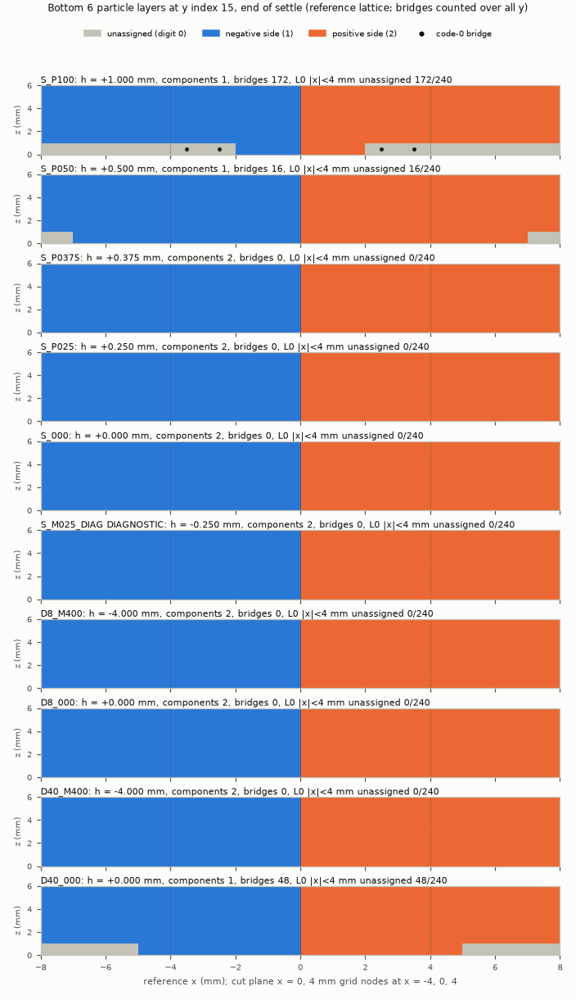

**Findings.**
- **The solid board cuts cleanly with the edge on the board top.**
  - At h = 0, +0.25 and +0.375 mm: two persistent pieces (0.500/0.500), all 30 layer-0 links conflicting, 0 bridges.
  - At h = +0.5 mm, 16 layer-0 particles stay unassigned and the bar remains one component.
  - At h = +1.0 mm, 172 stay unassigned.
  - Only layer 0 is ever bridged.
  - Penetrating the board (h = −0.25 mm) gives exactly the same topology as h = 0, so it would gain nothing.
- **The margin above the board is material-dependent.**
  - Bottom-layer particles rest with their centres 0.43 mm above the board (contact radius).
  - Near the cut they lift to 0.80–0.92 mm, because the wedge spreads the soft halves.
  - The law-4 band used by law 8 labels particles by their current position, so part of the +0.375 mm margin comes
    from this lift. It is not a robust tolerance: re-measure it for other materials, spacings and live tracking.
- **Material–board contact is real.** No particle centre ends inside the board on the solid or the 8 mm board. The
  penalty-shell overlap is 72–101 µm, and the hold force (1.41 N) equals the weight.
- **The 40 mm gap (CUT-01-R semantics) needs the overtravel.**
  - At h = 0 the unsupported bar sags 0.65–0.9 mm into the gap and 48 bridges remain (FAIL).
  - At h = −4 mm it separates (the M1a equivalent). Its "below top" count is material sagging into the open gap,
    not into a board.
- **The 8 mm slotted variant** separates at both h = −4 mm and h = 0.

**What the TLMPM blade does at the board** (code reading at `dd1538b`, file:line in the evidence):
- TLMPM does not know that the board is rigid for the blade. The kinematic blade is a prescribed SDF that acts only on
  material particles (`tlmpm_v5.py` `_rigid_contacts` :185–296). Nothing compares the blade pose with a fixture box,
  so nothing stops, resists or reports a blade entering the board.
- Fixture boxes and the table plane act only on material particles, through a per-particle penalty impulse with
  Coulomb friction (`fixture_contacts.py`:11–28, `tlmpm.py` `_contact_impulse` :113–123). There is no grid boundary
  condition.
- The board impulse is not part of `bed.reaction`, so no runtime output reports board forces.
- The board's x/y size does not change the TLMPM grid (the domain comes from the particles: 5850 nodes in every row).

So the only guards against a blade inside the board are:
- planning: `goal_planner._relief_end` ends a solid-board cut on the board top;
- the action workspace floor at the board top;
- the preflight blade–board rule (distance ≥ 0 in contact phases);
- PhysX in Native. In §6 the commanded edge went 2 mm below the board top and the knife stayed on it.

**Recommendation: Option A with B (A+B).**
- **Option A.** End the armed descent with the edge's lowest point at the board top (h = 0). This is what the
  compiled flat-board sever plans already do; the reference edge never goes below local z = 0.
- **Option B.** The knife meets the board through real PhysX contact. Native measured 0.06 µm of penetration and a
  3–5 N reaction with the edge commanded 2 mm into the board.
- **Clean-cut window.** The kinematic window is h ∈ [0, +0.375] mm. A live controller that leaves the edge ≥ 0.5 mm
  above the board leaves a layer-0 bridge, which must be reported as an Option-B limitation, never hidden. WP-11 C5
  saw PRE-CUT oscillations of about ±0.2 mm.
- **Option C** (sacrificial or compliant board) needs a new deformable board model, which is a physics change. It is
  a documented study item only; the h = −0.25 mm diagnostic shows no cutting benefit.
- **Option D** (explicit slotted board) stays opt-in for cuts that must pass below the workpiece bottom (oblique or
  tilted planes, overtravel plans). It is never a hidden default.

## 6. Native checks

**Command:**

```
.venv/bin/python scripts/run_logged.py artifacts/wp12/logs/workcell_004_native.log -- \
  .deps/isaacsim-venv/bin/python scripts/run_wp12_flat_board_native.py --out artifacts/wp12/workcell_004 --gpu 0
```

**Run conditions:**
- Isaac Sim 6.2 Native, cuda:0, seed 42, 794 s wall (cuda:0 was shared with the kinematic study).
- Task `CFG-bar_flat_board-sever_mid-74cbdae6`.
- `ruler_knife_v2_y`, physical two-finger grasp (pregrasp PASS_STABLE_GRASP), HOME reset.
- The runner is unchanged except the opt-in flat-board table/appearance authoring.
- Kit exits through `app.close()`, so a return code of 0 is not task success. The status is in `result.json`.

| Check | Result | Verdict |
| --- | --- | --- |
| Start render: global D455, both wrist D405 and presentation overview/close-up | 5 PNGs per stage (start, after settle, knife over board) | PASS |
| Gravity settle: 2.0 s coupled, knife at HOME, cutting disabled | Horizontal centroid drift 4.2e-8 m; vertical settle −0.112 mm (elastic compression); max particle displacement 0.146 mm; 0 particles below the board top (lowest particle centre 0.43 mm above it); max speed 3.4 µm/s at the end; min det F 0.9977; no labels written | PASS |
| Knife cannot enter the board: rigid-only descent at 2 mm/s at local x = +0.12 m (beside the bar), commanded edge down to 2 mm **below** the board top, 1 s hold, lift | Knife lowest point (blade hull on the measured tool body pose) − board top: min −5.7e-8 m. The board reaction on the tool, inferred, averages (−0.43, −0.02, 3.03) N over the hold, max normal 3.45 N | PASS |
| Grasp slip during the press | Max 1.6 µm, 0.085 mrad; both fingers loaded throughout | PASS |
| Render after rigid-only controls | `capture()` fails the runner's wrist-camera extrinsic check, because extrinsics are refreshed only in coupled steps | NOT_RUN (runner limitation) |

**How the board force was measured.**
- The native tool contact sensor reports 1098 tool–board pair entries, but with zero impulse.
- Its tensor view is filtered to the fingers and palm only, so the "fixture tensor force" reads 0 by construction.
- The board reaction is therefore inferred quasi-statically: F_board = −(F_fingers,hold − F_fingers,free hover).
- Check: the free-hover finger force is 0.870 N, and the tool weight is 0.869 N.

**First run `workcell_003` (kept, FAIL).**
- The final render after the rigid-only probe failed the extrinsic check.
- Its measurements before that are valid. It used a rigid-only IK transfer from HOME:
  - penetration 8.3e-8 m;
  - inferred hold reaction (−0.99, 0.16, 4.97) N;
  - slip 23.8 µm / 1.62 mrad.
- The larger slip comes with the larger press force. In both runs the knife lever is the full 120 mm blade.

**The coupled approach did not fully converge.** The approach to the probe pose (runner Cartesian controller, cutting
disabled, 400 steps) ended 2.58 mm / 15.5 mrad from its target. The rigid descent started from there, so first
contact happened at commanded edge z = −0.76 mm. This is a controller tracking residual, reported as is.

**Images** (copied, ≤ 640 px):

| Before (wp11_workcell_v1, risers, +100 mm) | After (blade_master_flat_board_v1) |
| --- | --- |
| 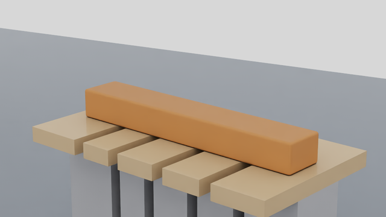 |  |
| 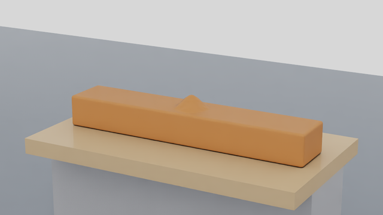 |  |
| | 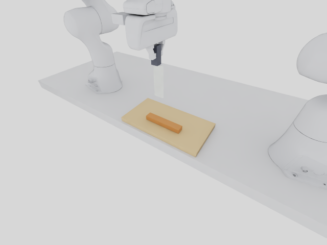 |
| | 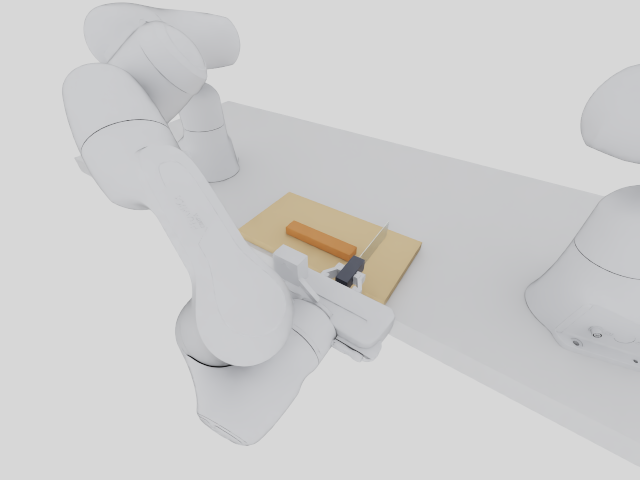 |

**Compared with b.png:**
- Table, board, workpiece and the parked second Franka match.
- The knife looks different. In b.png a knife hangs vertically below the hand. With the end-held `ruler_knife_v2_y`, a
  vertical cut puts the edge line horizontal along +y and the hand beside the blade at −y. That hand pose is exactly
  why the table's front edge matters.
- The board colour is a light wood PreviewSurface, not a bamboo texture.

## 7. CPU tests

`tests/test_wp12_flat_board_workcell.py` covers:

- board bottom = table top; workpiece bottom = board top; particles neither below the board top nor floating;
- no riser or pedestal box in any layer;
- fixture boxes = board record in world;
- the Native authoring plan (visual/collider) and the PhysX/TLMPM friction come from the same numbers;
- the runner and the C2 model read the declared table, and the MuJoCo `static_table` and `static_flat_board` geoms
  have the record's sizes and positions (needs the Franka asset cache);
- a thickness or position change moves the contact plane, the deepest IK target and the preflight together, and a
  stale workpiece z is refused;
- off-board, yawed, table-top-mismatched, overhanging, implicitly slotted, through-slotted and negative-threshold
  configs are refused;
- the default board is solid and the slotted variant must be explicit, with grooves at the four slice planes;
- the action-workspace floor at the board top clamps a commanded edge below it;
- HOME is at local (0, 0, 0.188) with the hand pointing down;
- CUT, TRIM ρ = 10°, Test B (solid and slotted) and Test C compile, with payload round-trips;
- the wp11 compiled outputs are pinned (`tests/fixtures/wp12_wp11_compile_pin.json`, computed at `1c91605` before
  this change).

## 8. Failures and open items

**Failures (kept).**
- **`workcell_001` layout preflight: Test C FAIL** (blade vs bump −7.95 mm at `PRE_CUT:p1`). This is the C2
  single-hull artefact. The rerun `workcell_002` uses the staged per-protrusion hulls and passes.
- **`workcell_003` Native: FAIL.**
  - The end-of-run `capture()` after rigid-only controls failed the runner's own wrist-camera extrinsic check.
    `LiveIsaacSimCutting` refreshes wrist-camera extrinsics only in coupled `step()` calls.
  - Its measurements before that point are valid: penetration 8.3e-8 m, inferred hold reaction 5.0 N, slip 23.8 µm /
    1.62 mrad.
  - `workcell_004` renders after a coupled approach instead and skips the post-probe render (NOT_RUN).
- **Kinematic rows that fail by design:** S_P100 and S_P050 (h ≥ 0.5 mm leaves a bridge) and D40_000 (40 mm gap
  without overtravel).

**Runner and measurement limitations (reported, not fixed here).**
- **No render after rigid-only controls.** `rigid_probe_step` does not refresh camera extrinsics, so `capture()`
  afterwards raises. A fix would be a runner change (refresh extrinsics in `rigid_probe_step`), left for an opt-in
  follow-up.
- **The board-force sensor filter.** The native tool tensor contact view is filtered to the fingers and palm. The
  contact sensor lists tool–board pairs but with zero impulse. The board force is therefore inferred quasi-statically
  from the finger forces; the tool weight checks the inference to 0.6 mN. A direct reading needs the fixture/table
  paths in the tensor filters, which would be an opt-in change in `physical_contacts.py`.
- **TLMPM board forces are not reported at runtime.** The fixture impulse is not in `bed.reaction`. The kinematic
  study used a material momentum balance.
- **Controller tracking residual.** The coupled approach (runner Cartesian controller, cutting disabled) ended
  2.58 mm / 15.5 mrad from its target after 400 steps (581 s). The live through-cut on the flat board therefore has to
  show that the edge really reaches the board top within the clean-cut window (h ≤ 0.375 mm).
- **TLMPM has no blade–board contact** (§5). The guards are planning, the action workspace, the preflight and PhysX.
  An external controller that drives joints directly (as the probe does) relies on PhysX alone.

**Open items (next steps).**
- A live Native through-cut (sever_mid) on the flat board, with the measured edge–board distance during the cut.
  TRIM ρ = 10°, Test B and Test C live; return-home on the new HOME; friction/sliding; partial cut. Old-versus-new
  comparison of the spec §2.6 metrics (penetration, contact forces, displacement, success, bridges, grasp, IK and
  preflight failures, performance). Only the geometric preflight and the static/contact checks are done here.
- Near-horizontal skims depend on the table's front edge. A yawed workpiece or one far from the front edge can fail
  the preflight, and Phase 5 must count that as infeasible.
- The workpiece yaw must equal the board yaw: an oriented TLMPM fixture box does not exist.
- Wrist-camera framing on the lower workpiece has not been audited; the pictures exist but no visibility metric was
  computed. The board colour is a flat PreviewSurface; there is no bamboo texture.
- The compiled task id hashes the profile name and overrides, not the resolved record (same practice as
  `from_scenario`). Record changes need a new record version.

## 9. Phase 2b — Native acceptance (live episodes on the flat board)

Date: 2026-10-31. Protocol (declared before the first episode, two dated amendments, neither loosens a rule):
[`configs/wp12/workcell_live_v1.json`](../../configs/wp12/workcell_live_v1.json). Evidence:
[`phase2b_native_001.json`](../evidence/wp12/phase2b_native_001.json). Media:
[`docs/media/wp12/workcell_live/`](../media/wp12/workcell_live/). Material parameters remain provisional and
uncalibrated. No physics, evaluator, threshold, `final_v4`, law 8 or WP-11 record was changed.

**How the episodes ran.** Every episode is a live Native Isaac Sim 6.2 run (`runtime_source = live_isaac_sim`) of the
unchanged WP-11 live path `scripts/run_wp10_live.py --runtime isaac_sim --scene/--goal`, launched by
`scripts/run_wp12_workcell_live.py launch`. It uses:

- `ruler_knife_v2_y` held by the physical two-finger grasp, pregrasped at the workcell HOME (`PASS_STABLE_GRASP` in
  every episode);
- `tlmpm_v5`, law 8, 1 mm particles, 4 mm grid, 0.1 ms; seed 42; cuda:0, one Native process at a time;
- the WP-11 Phase E live controller: goal planner, `path_v2`, 1 mm / 1° per 20 ms step, measured edge feedback,
  the same duration rule (⌈(1.1 × plan end + 1 s) / 0.5 s⌉ × 0.5 s); `path_v2` is applied as a planner override, so
  the old/new comparison differs only in the workcell;
- the runner's C2 plan preflight before launch (PASS in every episode), hold with cutting disabled to the time limit,
  then the Phase D physical return-to-home (`home_outcome`, scored separately);
- cameras recorded every 10 control steps (global D455 and both wrist D405 RGB-D, presentation overview and close-up).

The goal evaluator is `env.evaluate()` = `goals.evaluate_goal` with each goal's declared thresholds. None of these
goals is a `sequence`, so `goal_eval_v1` and `goal_eval_v2a` run the same code path. The outcome class uses the WP-11
live precedence and gates (IK not ok or workspace clamp → IK_FAILURE; slip > 2 mm or rotation > π/60 → GRASP_FAILURE).

Analysis: `scripts/run_wp12_workcell_live_analysis.py` (read-only; oracle material and privileged tool state are used
for evaluation only). Definitions:

- *Knife − board*: the lowest blade-hull vertex on the measured tool body pose, minus the board top (world z = 0.010 m).
- *Blade reaction*: the TLMPM material reaction on the knife.
- *Board reaction (inferred)*: quasi-static, as §6: −(F_fingers − F_fingers,free) − F_material,applied. It includes
  inertia, so the first-contact step shows an impact transient.
- *Bridges*: reference x-links across the kerf with conflicting digits, and direct code-0 bridges
  (`scripts/analyze_cut_bridges.py` rule). The kerf is located as the lattice column pair with the most conflicting
  links for that digit, and its offset from the declared plane is reported.

Commands (TMPDIR=/mnt/data/ningan/tmp, `.venv/bin/python`):

```
scripts/run_wp12_workcell_live.py launch --episode <ID> --out artifacts/wp12/workcell_live_NNN
scripts/run_wp12_workcell_live_analysis.py --root artifacts/wp12/workcell_live_NNN [--out .../analysis_002]
scripts/export_wp12_workcell_media.py --root artifacts/wp12/workcell_live_NNN --media docs/media/wp12/workcell_live/<name>
scripts/render_packed_episode.py artifacts/wp12/workcell_live_NNN/run/episode_000 --out .../render_001 [--wide-piece-palette]
scripts/summarize_wp12_workcell_live.py --out docs/evidence/wp12/phase2b_native_001.json
```

### 9.1 Episodes

| Run | Episode | Task id | Class / verdict | Key result | home_outcome | Wall (process) |
| --- | --- | --- | --- | --- | --- | --- |
| `workcell_live_001` | CUT (`sever_mid`) | `CFG-bar_flat_board-sever_mid-c32f94a4` | **TASK_SUCCESS** / PASS | 2 pieces 0.500 / 0.500; 600/600 cross-plane links conflicting; 0 bridges; frozen location statistic 1.5 mm ≤ 2 mm | PASS | 385 s |
| `workcell_live_002` | PARTIAL (`partial_cut_mid_depth`) | `CFG-bar_flat_board-partial_cut_mid_depth-c393ad75` | **PARTIAL_CUT_ACCEPTED** (declared rule); sever verdict FAIL as expected | 1 component; 14 400 particles labelled, the lowest at reference z = 10.5 mm (floor 6 mm); layers 10–19 conflicting, layers 0–9 intact | PASS | 331 s |
| `workcell_live_003` | TRIM ρ = 10° (`trim_bump_rho10`) | `CFG-trim01_flat_board-trim_bump_rho10-13827418` | **TASK_SUCCESS** / PASS | dome removed 0.977; substrate share 0.99998; measured ρ 10.000° | PASS | 351 s |
| `workcell_live_004` | Test B (`divide_5_slices`) | `CFG-bar_flat_board-divide_5_slices-c19e742e` | **TASK_SUCCESS** / PASS | 5 pieces (0.219 / 0.200 / 0.194 / 0.194 / 0.194); every kerf 600/600 conflicting; 0 bridges | PASS | 995 s |
| `workcell_live_005` | Test C (`remove_all_protrusions_rho10`) | `CFG-bar_three_bumps_flat_board-remove_all_protrusions_rho10-e0441d65` | **TASK_SUCCESS** / PASS | p0 0.958, p1 0.979, p2 0.960; substrate share 0.99996; one substrate component | PASS | 645 s |
| `workcell_live_006` | WP-11 CUT reproduction (`wp11_workcell_v1`, E1_CUT_s1101 inputs) | `CFG-E1_CUT_s1101-E1_CUT_s1101_sever-85f34a04` (= WP-11 record) | **TASK_SUCCESS** / PASS (WP-11: TASK_SUCCESS / PASS) | 2 pieces 0.639 / 0.361 and location 1.5 mm, both identical to the WP-11 record; 612/612 links conflicting; 0 bridges | PASS | 394 s (WP-11: 575 s) |
| `workcell_live_007` | TRIM, `path_v3` variant | `CFG-trim01_flat_board-trim_bump_rho10-4f7c00e6` | **TASK_SUCCESS** / PASS | dome removed 0.979; lowest blade point at PRE_CUT −0.022 mm vs the bar top (path_v2: −0.165 mm); measured-path C2 PASS (+0.076 mm) | PASS | 426 s |

Every episode had 0 IK failures, 0 workspace clamps and no grasp loss. The plan finished (`CONTROLLER_DONE`) in
every episode, and the task id recompiled on CPU equals the recorded one.

**Close-ups (presentation camera, never an observation) and MP4s** (`docs/media/wp12/workcell_live/<episode>/`,
`demo.mp4` 1.0–2.6 MB each, rendered by `scripts/render_packed_episode.py` from the recorded frames):

| | Start | Progress (last armed frame of the first operation) | Final |
| --- | --- | --- | --- |
| CUT | 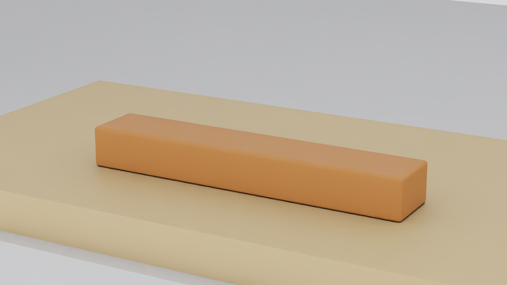 | 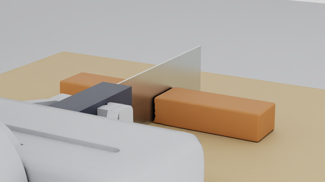 | 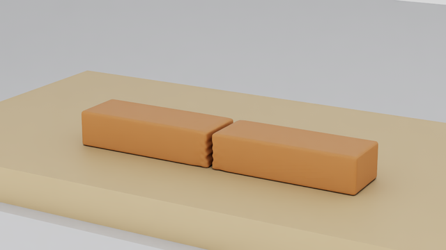 |
| PARTIAL |  | 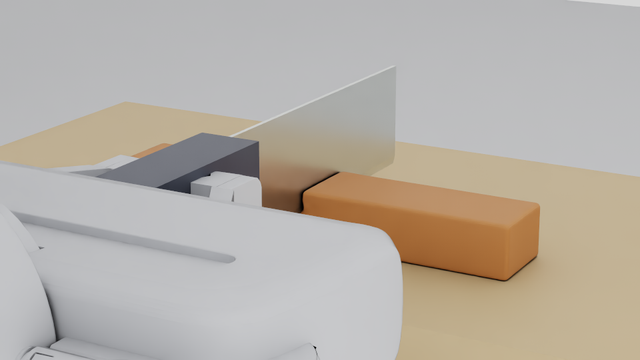 |  |
| TRIM |  | 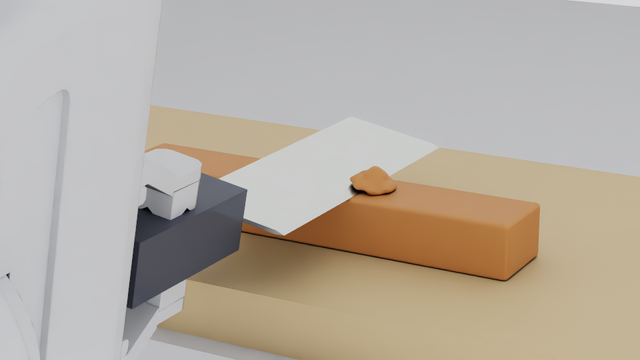 | 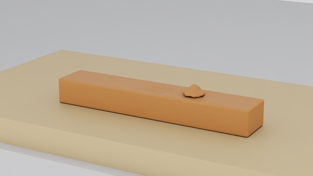 |
| Test B |  | 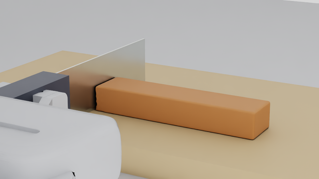 | 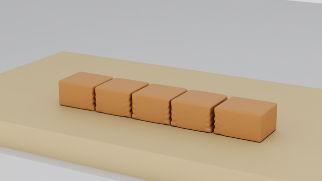 |
| Test C |  | 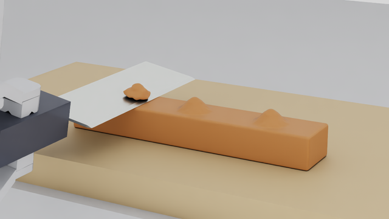 | 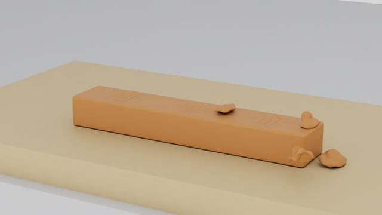 |

Each episode directory also holds the global D455 and both wrist D405 RGB and depth stills at the start and the end
(`start_/final_<camera>_{rgb,depth}.png`) and a `media_receipt.json`.

### 9.2 Physical measurements on the flat board

| Measurement | CUT | PARTIAL | TRIM | Test B (4 cuts) | Test C (3 skims) |
| --- | --- | --- | --- | --- | --- |
| Knife − board, min over the task phase | −0.04 µm | +9.85 mm | +19.80 mm | −0.03 µm | +19.73 mm |
| Knife − board at the end of the armed descent | +0.276 mm | +10.28 mm | — | +0.276 / +0.163 / +0.240 / +0.208 mm | — |
| Knife − board during HOLD (mean) | +0.012 mm | +9.99 mm | — | +0.009 / +0.007 / +0.009 / +0.012 mm | — |
| Control steps with knife–board contact pairs (native sensor) | 19 | 0 | 0 | 77 | 0 |
| Blade reaction, armed (mean / max) | 0.009 / 0.040 N | 0.004 / 0.034 N | 0.022 / 0.070 N | 0.010–0.018 / 0.039–0.057 N | 0.022–0.034 / 0.067–0.089 N |
| Board reaction, inferred, HOLD mean z | 0.63 N | — | — | 0.77 / 1.45 / 0.35 / 0.47 N | — |
| Board reaction, inferred, max (first-contact transient) | 2.1 N | — | — | 12.7 N (one step at cut 1) | — |
| Lowest particle centre − board top (all frames) | +0.377 mm | +0.417 mm | +0.423 mm | +0.305 mm | **−0.597 mm** (2 chip particles, see below) |
| Workpiece centroid drift (horizontal) | 0.08 mm | 0.08 mm | 0.46 mm | 0.92 mm | 3.04 mm (chips leaving) |
| Pieces / kerf | halves −1.32 / +1.17 mm in x (wedge spread) | — | chip carried 32 mm along +x; it stays on the bar top | kerf offsets 0 / −1 / −2 / −3 mm from the declared planes | chips p0 and p2 pushed past the +x bar end onto the board; chip p1 on the bar top at x ≈ +52 mm; 4 fragments (59 particles) on the bar top |
| Grasp slip / rotation, task phase | 2.7 µm / 0.30 mrad | 1.4 µm / 0.13 mrad | 0.7 µm / 0.09 mrad | 15.2 µm / 0.45 mrad | 0.8 µm / 0.09 mrad |
| Measured-path C2 check (report-only) | PASS | PASS | FAIL (blade 0.177 mm below the bar top at PRE_CUT) | FAIL (blade −12.5 µm into the board, C2 nominal grasp) | FAIL (staged: blade 0.209 mm below the bar top at PRE_CUT:p2) |
| ms per control step (material part) | 404 (270) | 392 (270) | 424 (273) | 428 (269) | 471 (281) |

**Findings.**

- **Knife–board contact is real and clean.**
  - In every through-cut, PhysX stopped the knife on the board. The deepest measured point of the blade hull is 0.04 µm
    below the board top, at the solver's contact tolerance.
  - The live edge finished each armed descent 0.16–0.28 mm above the board, inside the kinematic clean-cut window
    [0, +0.375] mm of §5. It then settled onto the board during HOLD (mean 0.007–0.012 mm).
  - All five live through-cuts severed every cross-plane link of the bottom layers with 0 bridges. So the Option-B
    risk of §5 (a live edge ≥ 0.5 mm above the board) did not occur with this controller.
  - The commanded edge during HOLD was 0.17–0.44 mm *above* the board (the path_v2 target sits at the board top plus
    the tracking bias). The knife sank onto the board under gravity and the joint-PD sag. No action was clamped by the
    board-level workspace floor.
- **Board reaction.**
  - The settled hold force is 0.35–1.45 N.
  - At first contact the knife arrives at the cut speed (10–20 mm/s). The quasi-static inference then shows an impact
    transient for one control step: 2.1 N in CUT, 12.7 N in Test B cut 1 (finger z force −11.6 N in that step).
  - The free-hover reference reads 0.90 N in CUT (tool weight 0.87 N) but 1.08 N in Test B, so Test B's hold values
    carry about 0.2 N of bias. These are inferred values, not a direct sensor reading (§8).
- **Material–board contact.**
  - In CUT, PARTIAL, TRIM and Test B no particle centre ever went below the board top (lowest +0.31 to +0.42 mm, the
    contact shell).
  - **Test C** recorded two particle centres down to −0.597 mm below the board top (frames at 14.0–14.8 s).
    - They are chip-p1 particles (reference z 24.5 mm, digit 1 = side 2). The p1 skim carried them along +x, and
      they passed *through* the already-cut substrate down to the board. TLMPM decouples particles with conflicting
      digits, so the separated chip and the substrate do not collide.
    - The board penalty held them within 0.6 mm. They end the episode embedded inside the substrate volume
      (local z ≈ 7 mm).
    - Two chip-p0 particles touched the board past the +x bar end: −0.08 mm transiently, and −0.05 mm at the end
      (resting on it).
    - This is a cut-topology/contact property of the material model (no contact between separated sides), not a board
      collider problem. It is listed for Phase 4. It cannot be compared with WP-11 Test C, whose `physics_state.npz`
      was deleted on 2026-10-30.
- **Partial cut (no false separation).**
  - The edge stopped at local z = 10.28 mm (HOLD 9.99 mm). Labelling stopped at reference z = 10.5 mm: the ten upper
    layers conflict across the plane and the ten lower ones are untouched.
  - The material stays one mechanical component. The 1 440 "direct code-0 bridges" are the intact lower half of the
    bar, which is the intended uncut ligament.
  - The presentation mesh (`ParticleSurface`) closes the 1.5 mm kerf almost completely (a small hole artefact in
    `partial/final_closeup.png`). Only the physics shows the slit. This is a Phase 3 (cut-aware surface) issue, not a
    physics one.
- **TRIM / Test C clearance at PRE_CUT.** On the flat board the blade dips 0.09–0.25 mm below the uncut bar top at
  PRE_CUT (cutting disabled), the same as WP-11 C5 (−0.11 mm) and Test C live_003 (−0.11 / −0.18 / −0.21 mm). This
  is the `path_v2` measured-feedback integrator (WP-11 C5b), not the workcell. The declared `path_v3` variant
  (`workcell_live_007`, same scene, goal and thresholds) confirms it on the flat board: dome removed 0.979, lowest blade
  point at PRE_CUT −0.022 mm, measured-path C2 PASS (+0.076 mm). The cost is 221 translation-clamped steps (geometric
  slow-down) and 785 instead of 637 control steps.
- **Test B C2 path check FAIL (−12.5 µm, report-only).** The C2 model places the knife at the *nominal* grasp on the
  measured joints. The real knife had slipped 15 µm in the hand while pressing on the board (gates: 2 mm). The
  measured knife never entered the board (−0.03 µm). The FAIL is therefore the nominal-grasp model meeting a
  knife that really rests on the board. A contact-allowed check with a 0 mm threshold cannot absorb 15 µm of in-hand
  slip.
- **Native "unintended contact" flag.** The tool contact sensor counts knife–board contact (role `fixture`) as an
  unintended tool contact: 19 steps in CUT, 77 in Test B. On the flat board, edge–board contact at the end of a
  through-cut is the intended Option A+B behaviour. The task outcome does not use this count. `home_outcome` requires
  0 such contacts only during the return-home path, and it passed.

### 9.3 Friction and sliding (spec §2.6)

Same friction as WP-11 (task material μ = 0.3 for material–board and PhysX board). The bar is not clamped:

- **CUT.** The two halves were pushed apart symmetrically by the 1.5 mm blade wedge (−1.32 / +1.17 mm in x). The whole
  workpiece moved 0.08 mm.
- **Test B.** In every cut the block on the +x side moved +0.94 to +1.13 mm and the −x side −0.43 to −1.39 mm. The
  remaining bar therefore *slides about 1 mm per cut*.
  - Each later cut lands 1 mm further from its declared plane in reference coordinates: kerf offsets 0 / −1 / −2 /
    −3 mm. The +x end piece ends 4.23 mm from its start.
  - The goal still passes (five pieces), and its quality-layer location statistic is 5.0 mm. WP-11 Test B s1502 on
    the risers had 4.93 mm, and WP-11 Phase M reported "about +1.0 mm per cut" on separate supports.
- **Conclusion.** The flat board does **not** change the sliding. The full-width solid board offers the same
  Coulomb friction as the WP-11 board segments, and the wedge displacement of an unclamped bar is the same about
  1 mm per cut. The next step would be a clamp, a fence or the ADR 0016 wrist-depth relocation, not a different board.

### 9.3a Runner fix: render after rigid-only controls (Phase 2a limitation)

**Change.** `LiveIsaacSimCutting.rigid_probe_step(joint_targets, *, refresh_camera_extrinsics=False)` gains an
opt-in, keyword-only flag. When it is True (and the wrist D405 / global D455 rig exists), the step recomposes the
camera extrinsics from the measured hands after the rigid step, exactly as a coupled `step()` does. The default is
False, which keeps the historical behaviour and every existing caller byte-for-byte on the same path.

- CPU test `tests/test_wp12_rigid_probe_camera_refresh.py`: the default does not refresh; the opt-in refreshes once
  per step with the measured hands and issues the same joint targets and physics steps; it is a no-op without the
  wrist rig.
- `scripts/run_wp12_flat_board_native.py --end-render` (opt-in) uses it and renders `after_probe`.

**Native check** `artifacts/wp12/workcell_005`:

```
.venv/bin/python scripts/run_logged.py artifacts/wp12/logs/workcell_005_native.log -- \
  .deps/isaacsim-venv/bin/python scripts/run_wp12_flat_board_native.py --out artifacts/wp12/workcell_005 --gpu 0 \
  --skip-settle --end-render
```

HEAD `f53dc78` (dirty tree), seed 42, cuda:0, 62 s. The run used the rigid IK transfer from HOME (as `workcell_003`),
the descent to 2 mm below the board top, a hold and a lift, then `capture()`. Status EXECUTED:

- `capture()` passed its own checks: runtime vs current USD prim ≤ 1.4e-16 m; runtime vs measured-hand composition
  9.9e-9 m / 1.1e-7 rad for wrist D405 0; physics not advanced by rendering.
- Wrist D405 0 moved 0.331 m between the start and the after-probe render. The D455 and wrist D405 1 did not move.
- Depth valid fractions after the probe: wrist 0 0.350 (median 0.17 m, the knife and board seen from close), D455
  0.156, wrist 1 0.103.
- The probe numbers repeat `workcell_003`: penetration 6.4e-8 m (003: 8.3e-8); inferred hold reaction
  (−1.02, 0.18, 5.01) N (003: 4.97 N); slip 21 µm / 1.44 mrad (003: 23.8 µm / 1.62 mrad).
- Stills: `docs/media/wp12/workcell_live/probe_end_render/`.

**Verdict: PASS.** The limitation is fixed opt-in, with the default unchanged.

### 9.4 Cameras

In every episode, between the first and the last recorded frame:

- The wrist D405 of Franka 0 followed the hand: its optical centre moved up to 0.28–0.40 m during the episode. It
  returned to within 0.09 mm after return-to-home.
- The recomposed extrinsics matched the moving USD prim to ≤ 2.2e-8 m.
- The D455 and the parked Franka 1 wrist camera did not move (0.0 m).
- Depth was valid in every frame: D455 valid fraction 0.210, median 0.789 m; wrist D405 0 0.573, median 0.361 m;
  wrist D405 1 0.103.
- Start/end RGB and depth stills are in `docs/media/wp12/workcell_live/<episode>/`.
- Presentation views are never observations.

### 9.5 Old versus new workcell (spec §2.6 comparison)

Old = `wp11_workcell_v1` (separate boards on grey risers, workpiece +100 mm, 40 mm relief gap under each through-cut).
The old values come from the preserved WP-11 live records, re-analysed read-only with the same script
(`artifacts/wp12/wp11_reference_002/`):

| Task | Old record | New record |
| --- | --- | --- |
| CUT | Phase E `E1_CUT_s1101` (yaw +13°, cut at +20 mm) and its reproduction `workcell_live_006` | `workcell_live_001` (`sever_mid`) |
| TRIM | C5 `live_trim_rho10_001` (`trim01_wp11_workcell` + `trim_bump_rho10`; C5 stopped after WITHDRAW, so its class is not comparable, verdict PASS) | `workcell_live_003` |
| Test B | Phase E `E1_TEST_B_s1502` | `workcell_live_004` |
| Test C | Phase E live_003 `E1_TEST_C_s1602` | `workcell_live_005` |

The WP-11 `physics_state.npz` files were deleted on 2026-10-30 (`artifacts/wp11/phaseE/DELETED_NPZ_20261030.txt`).
For WP-11 Test B, Test C and TRIM, the material-side rows therefore come from the evaluator results only. The CUT
reproduction recorded a fresh state.

| Metric | Old: wp11_workcell_v1 | New: blade_master_flat_board_v1 |
| --- | --- | --- |
| Knife vs support | The edge goes 3.75–4.20 mm *below* the workpiece bottom, into the open 40 mm relief gap. It never touches a support (0 knife–support contact steps). | The edge stops *on* the board: lowest blade point −0.03 to −0.04 µm (solver tolerance), end of descent +0.16 to +0.28 mm, HOLD ≈ +0.01 mm |
| Material vs support | CUT reproduction: 0 particles inside a support box. 150 particles sag up to 0.28 mm below the support plane into the relief gap (x = 9–31 mm), where nothing supports them. | 0 particles below the board top in CUT, PARTIAL, TRIM and Test B (lowest +0.31 mm). Test C: 2 chip particles to −0.60 mm, which passed through the cut substrate (§9.2) |
| Blade reaction (max, armed) | CUT 0.055 N; TRIM 0.071 N; Test B 0.032–0.052 N; Test C 0.040 / 0.099 / 0.154 N | CUT 0.040 N; TRIM 0.070 N; Test B 0.039–0.057 N; Test C 0.067 / 0.084 / 0.089 N |
| Support reaction on the knife | None: the knife never touches a support. The inferred value is noise (HOLD \|mean\| ≤ 0.20 N). | Board hold 0.35–1.45 N; first-contact transient 2.1 N (CUT) and 12.7 N (Test B, one step) |
| Object displacement | Test B location statistic 4.93 mm; the bar slides about 1 mm per cut (Phase M). Test C: the bar slid 0.77 mm in x (live_003 R1). CUT reproduction: halves −0.84 / +0.74 mm. | Test B 5.0 mm; kerf offsets 0 / −1 / −2 / −3 mm, i.e. about 1 mm per cut. Test C substrate +0.80 mm in x. CUT halves −1.32 / +1.17 mm (no gap, both halves on the board) |
| Cutting success | CUT, TRIM (0.979), Test B (5 pieces), Test C (0.962 / 0.997 / 0.972): all PASS | CUT, TRIM (0.977), Test B (5 pieces), Test C (0.958 / 0.979 / 0.960): all PASS; partial cut accepted |
| Remaining bridges | CUT reproduction: 612/612 conflicting, 0 bridges. Others: separation PASS per the evaluator; bridges NOT_AVAILABLE (state deleted) | CUT 600/600 and 0 bridges; Test B 4 × 600/600 and 0 bridges |
| Grasp stability (task phase) | Slip ≤ 0.9 µm, rotation ≤ 0.10 mrad | Slip ≤ 2.7 µm (≤ 15.2 µm in Test B, from pressing on the board), rotation ≤ 0.45 mrad; gates 2 mm / 52 mrad; never lost |
| IK / preflight failures | 0 IK not ok, 0 workspace clamps; plan preflight PASS. Measured-path C2 (report-only): CUT, Test B PASS; TRIM, Test C FAIL (PRE_CUT dip 0.11–0.23 mm) | 0 / 0; plan preflight PASS. Measured-path C2: CUT, PARTIAL PASS; TRIM, Test C FAIL (same PRE_CUT dip); Test B FAIL (−12.5 µm nominal-grasp model at the board, §9.2) |
| HOME / return-home | All PASS | All PASS (joint error ≤ 0.49 mrad, tool ≤ 0.12 mm) |
| Performance (ms per control step) | Recorded: CUT 559, TRIM 453, Test B 607, Test C 657 (cuda:0 or cuda:1; the CUT, Test B and Test C launches recorded another active GPU job). CUT reproduction on cuda:0 in this session: **398 ms** (material 235), 394 s | CUT **404** (material 270), TRIM 424, Test B 428, Test C 471 ms; 331–995 s per episode |

Performance is comparable only within one session and device. The old/new CUT pair here (398 vs 404 ms/step) shows
no workcell cost. The older recorded numbers are higher, probably because the GPU was shared at the time (not measured). The flat-board tasks
use `tlmpm_v5` with K = 4/3/1 digits; the reproduction uses `tlmpm_v4`.

### 9.6 Spec §2.6 acceptance list

| Item | Verdict | Evidence |
| --- | --- | --- |
| Static material-on-board stability | **PASS** | §6 (2.0 s coupled settle: drift 4.2e-8 m, 0 particles below the board); live, from reset to the first armed step (4.0–4.4 s) in all five episodes: horizontal centroid drift ≤ 0.13 µm, vertical −0.112 to −0.116 mm (elastic settle, as §6), 0 particles below the board top |
| Gravity settling | **PASS** | §6 |
| Board collision | **PASS** | §6 rigid probe (−0.06 µm); live cuts −0.03 to −0.04 µm with PhysX contact pairs on the knife; no particle centre enters the board except the Test C chip-through-substrate case (−0.60 mm, a material-model property, §9.2) |
| Friction and sliding | **PARTIAL** | Measured (§9.3): the unclamped bar slides about 1 mm per cut on the flat board, the same as WP-11; Test B kerfs land 0 / −1 / −2 / −3 mm from the declared planes. The goal passes, but the location is not held; no clamp/fence exists |
| Knife–board contact | **PASS** | §6 probe; live HOLD on the board in 5 through-cuts; settled reaction 0.35–1.45 N; first-contact transient up to 12.7 N (reported) |
| Partial cut | **PASS** | `workcell_live_002`: PARTIAL_CUT_ACCEPTED, one component, labels stop at 10.5 mm |
| Complete through-cut | **PASS** | `workcell_live_001`: TASK_SUCCESS, 0 bridges, edge end +0.28 mm inside the clean-cut window |
| TRIM | **PASS** | `workcell_live_003`: TASK_SUCCESS 0.977. The PRE_CUT dip (0.165 mm, report-only path FAIL) is inherited from WP-11 `path_v2`; the `path_v3` variant (`workcell_live_007`) passes the goal (0.979) and the path check (dip −0.022 mm) |
| Multiple slices | **PASS** | `workcell_live_004`: five pieces, 0 bridges (sliding, see Friction) |
| Multiple protrusions | **PASS** | `workcell_live_005`: 0.958 / 0.979 / 0.960 |
| Arm return-home | **PASS** | Every live episode: `home_outcome` PASS (the HOME reset pregrasp is `PASS_STABLE_GRASP` in every episode) |
| Wrist cameras follow the arm; RGB and depth usable | **PASS** | §9.4 |
| Render after rigid-only controls (Phase 2a runner limitation) | **PASS** (opt-in fix) | §9.3a, `workcell_005` |
| Old vs new comparison | **PASS** (reported) | §9.5; WP-11 CUT reproduced in this checkout (`workcell_live_006`, identical verdict and pieces) |

### 9.7 Failures and limitations kept

- **No failed episode** in this stage. Report-only FAILs are kept as recorded:
  - measured-path C2 FAIL for TRIM, Test B and Test C (§9.2);
  - the PARTIAL episode's sever verdict FAIL (expected for a partial cut);
  - the Test C chip particles below the board top.
- **Analysis reruns.** `analysis_002` of `workcell_live_001`, `002` and `004` adds the kerf locator; `004` also skips
  the path check, which is taken from `analysis_001`. Every `analysis_001` is kept.
- **Protocol amendments** (both recorded in the protocol file):
  - the GRASP_FAILURE gates were corrected to the stricter WP-11 warning gates while `workcell_live_001` was running;
  - `TRIM_PATH_V3` was added after `workcell_live_003`.
- **Git state.** `workcell_live_001`–`005` ran at HEAD `30e4193`, `006`–`007` and `workcell_005` at `f53dc78`, all
  with a dirty tree. Each `attempt.json` records `git status --porcelain`. The tree held:
  - this stage's opt-in `rigid_probe_step` change, which is not called by the live runner;
  - another agent's uncommitted Phase 1/3 work: `surface_metrics_v1.py` and `sequence_blade_probe.py`, which the live
    runner does not import.
  - **`usd_surface_bridge.py`**, which the runner does import (camera calibration, surface USD), modified while
    `003`–`005` were launched. It was committed in `89b289d` as 43 added lines and 0 removed lines (an additive USD
    method). The modified file was not snapshotted at launch, so this is recorded as a provenance caveat for `003`–`005`.
  - The WP-11 reproduction `006` at `f53dc78` reproduced its record exactly.
- **Not measured directly.** The board force is inferred, not read: the native tensor view is filtered to the fingers
  and palm. TLMPM still has no blade–board interaction. The guards remain planning, the workspace floor, the
  preflight and PhysX.
- **CPU tests.** `.venv/bin/python -m pytest -q -x` on the working tree after all runs: 1327 passed, 5 xfailed,
  0 failed (1566 s). The tree included the other agent's uncommitted files. New tests:
  `tests/test_wp12_rigid_probe_camera_refresh.py` and `tests/test_wp12_workcell_live_protocol.py`.
- **One seed per task.** There are no repeat statistics. Native is repeatable only at verdict level (WP-11 Phase H:
  float32 atomics).

### 9.8 Default workcell recommendation

**Recommend `blade_master_flat_board_v1` as the default workcell for new WP-12 scenes**, with `wp11_workcell_v1` kept
selectable and unchanged. The reasons:

- every §2.6 cutting task passes live on it with the same controller, success level and grasp stability as the
  old workcell;
- the knife really rests on a rigid board (PhysX, ≤ 0.04 µm) instead of plunging 4 mm into an open gap;
- through-cuts end inside the clean-cut window with 0 bridges;
- no hidden supports, risers or slots;
- no measurable performance cost.

Conditions:

1. A through-cut controller must keep the end of the armed descent within h ≤ 0.375 mm (here 0.16–0.28 mm with
   `path_v2`). Re-verify this for other controllers, materials or resolutions.
2. Multi-cut tasks on an unclamped bar keep the about 1 mm per cut slide. Use a clamp/fence (new physics fixture,
   future work) or the ADR 0016 wrist-depth relocation when location matters.
3. Report knife–board contact as intended contact (not "unintended tool contact") in flat-board analyses, and keep
   the first-contact transient in view: a slower final approach (`path_v3`) would reduce it.
4. TLMPM chip-through-substrate interpenetration (Test C) and the presentation mesh closing a partial kerf are
   Phase 4 and Phase 3 items.
