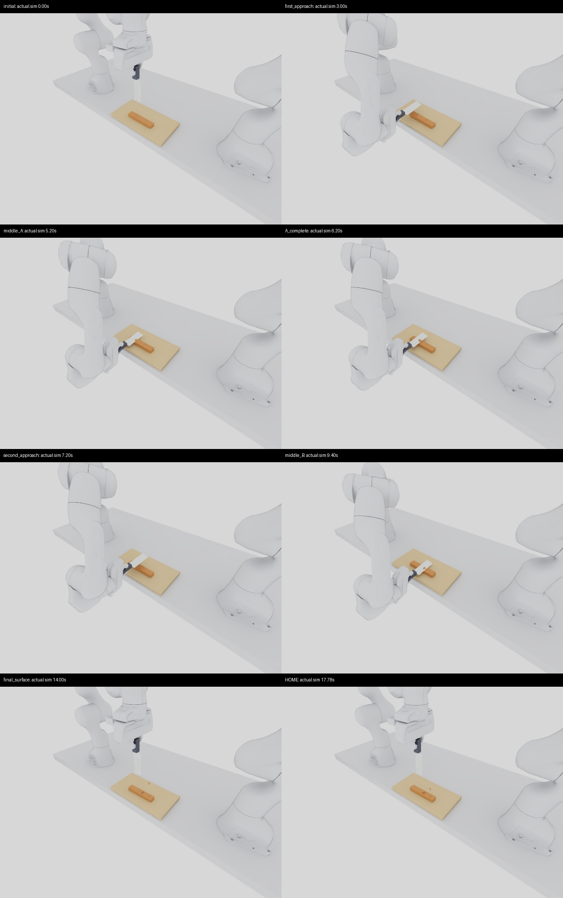

# v7 workflow, sequential two-protrusion Native demo and multiview publication

The normal Scene / Goal / Environment API now supports the original, source-bound
`v7_cut_research_v1` for its measured Straight CUT scope. The new Native demonstration
uses an explicitly versioned **experimental `tlmpm_v7_2`** and genuinely detaches both
protrusions. Untagged v5 / Law 8, the original v7 CUT profile, all earlier physics
sources, and historical WP-12 / WP-13 / WP-14 evidence remain unchanged.
This follow-up is separate from PR #5 and its original completion gate. PR #5 is
merged at 74dd9397 with exact-main CI 1,712 passed / 12 skipped / 6 expected failures,
and its original remote media verification passed.
[Original phase publication receipt](../evidence/wp14_followup/original_phase_publication_001.json).

[Full synchronized Native MP4](../media/wp14_followup/two_bumps_v2/two_bumps_v7_2_native.mp4) ·
[Normal v7 API](../V7_RESEARCH_WORKFLOW.md) · [Complete multiview gallery](../NATIVE_MULTIVIEW_GALLERY.md).

## Frozen scene and genuine separation

One continuous `heightfield_v2` specimen rests on the solid wooden board of
`blade_master_flat_board_v1`. The 160 × 32 × 20 mm base has exactly two protrusions:

| Protrusion | Declared geometry | Target particles / mass |
| --- | --- | --- |
| A | 9 mm dome, radii 13 × 11 mm, centre (−30, −1) mm | 1,200 / 1.8 g |
| B | 5.5 mm irregular cap, radii 9 × 7 mm, centre (28, 1) mm, yaw 25°, peak offset 0.35 | 333 / 0.4995 g |

The material is the existing uncalibrated `cutting_tasks_v1` recipe, without tuning.
Franka 0 physically grasps `ruler_knife_v2_y` with two fingers; Franka 1 stays at its
normal park. The declared planner performs A, lift/retract, B, and HOME using separate
cut digits. No material oracle is provided to that controller.

The predeclared acceptance is at least 90% detached mass for **each** protrusion,
at least 99% of the substrate retained in its original main body, and at most 1%
detached substrate. Separation is the actual positive-weight/gradient eight-node
reference-stencil compatibility graph, including code-zero bridges. Height reduction
alone cannot pass it.

| Measured Native checkpoint | Components | A detached | B detached |
| --- | ---: | ---: | ---: |
| Initial | 1 | 0% | 0% |
| After A, before B | 2 | 100% | 0% |
| After B | 3 | 100% | 100% |
| Final / HOME | 3 | 100% | 100% |

All 103,933 particles retain their mass. The 102,400-particle substrate remains one
body; detached substrate mass is zero. No material surface was skipped in 826
extractions. The two shavings may curl and settle on the bar; the film retains this
behaviour and all visible surface artifacts. It does not depict a repaired or
artificially emptied surface.

Task **PASS**, physical return HOME **PASS**, grasp held, zero IK failures, maximum
grip slip 0.754 µm. The knife never contacts the board; its lowest point remains
19.75 mm above the board. The minimum recorded particle centre is 0.443 mm above
that board, a centre measurement rather than a contact-shell penetration bound.
Native position-only local-locus roughness P95 spans approximately 0.029–0.387 mm
across the six reported component/side patches. Native F was not recorded, so
Native x/F consistency is **NOT_RUN**. Forces and material parameters are uncalibrated.

[Native task, contacts, grasp, HOME and source receipts](../evidence/wp14_followup/native_001.json) ·
[Per-protrusion checkpoint audit](../evidence/wp14_followup/native_detachment_001.json) ·
[Download the exact measured topology/state arrays](../evidence/wp14_followup/native_two_bumps_states_v1.npz) ·
[Array provenance](../evidence/wp14_followup/native_two_bumps_states_v1.json).
The public arrays independently reproduce graph counts 1 → 2 → 3 → 3 in CPU tests;
these tests audit the saved episode and are not additional physics trials.

## Bounded correction and retained failures

The scene, seed and physical thresholds were frozen before the first attempt.
Original v7 fails this scene in both ideal tracking and Native: A stays connected,
B detaches. The original Native failure and its movie remain available.

Existing actual WP-14 substep traces show 216 selected code-zero bridges whose
particle centres cross without engagement; 152 corresponding finite support
interfaces later cross during engagement. The immutable corrected `v7_1` interface
candidate passes this new two-bump ideal-tracking case with A/B 100% detached.
Its translation-only guard nevertheless excludes the small measured rotations of
Native servo motion: sampled SKIM angular speed has median 0.000941 rad/s and
maximum 0.01360 rad/s.

`v7_2` changes only this angular admission: each material substep may rotate at
most 10⁻⁴ rad. The old/new rigid-transform chord is the same finite interpolation
used by the original v7 front. At the 25 mm edge half-width, the admitted arc/chord
sagitta is below 3.2 × 10⁻¹¹ m. This is a bounded approximation, **not general
rotational CCD**. Large rotations clear pending evidence. Actual finite interface
crossing, endpoint directional contact work, stroke/segment engagement, side band,
bevel and pending-event lifetime conditions are retained. No task names, target
planes, selected bridge IDs, geometric deletion or renderer masks enter the solver.
Original v7 grid-consistent x/F and contact updates remain shared.

| Follow-up experiment / control | Result |
| --- | --- |
| Original v7, two bumps, ideal tracking | FAIL: A 0%, B 100%; final two components |
| Original v7, two bumps, Native | FAIL: A 0%, B 100%; HOME PASS |
| Parent v7_1 v1_2, two bumps, ideal tracking | PASS: A/B 100%; 1 → 2 → 3 components |
| v7_2, two bumps, Native | PASS: A/B 100%; 1 → 2 → 3 components; HOME PASS |
| v7_2, frozen C00 Straight CUT | PASS: true two-part sever, unchanged evaluator |
| v7_2, T00 single-bump ideal tracking | FAIL: one connected body; retained as unsupported |
| v7_2, P01 shallow partial | Partial control PASS; one body with a kerf and intact ligament. Generic sever goal FAIL, as expected |
| Six actual CPU contact negatives | PASS: no-contact, side push, flat press, blunt, stop and withdraw assertions |

The completed follow-up material-episode count is seven. The two Native episodes
are **1/2 task successes and 2/2 HOME passes**, including the retained original
failure; the versioned demo is one selected Native success, not a random success
rate. One earlier Native startup fails before its first recorded frame because
new proposed optics lack a validated registration profile. That failure is retained,
not counted as a completed episode or a pass. Static optical controls and CPU
negative probes have separate denominators.

The new demo/CUT/T00 use seed 42; frozen P01 uses seed 13037. The controls protocol's
common seed field does not override per-case seeds. The frozen P01 row, depth and
seed were reused; there was no seed search. The protocol's plain-text P00 label is
clarified by its separate predeclared control-row file selecting WP-14 P01.

[Controls and separate partial rule](../evidence/wp14_followup/controls_003.json) ·
[Existing trace audit](../evidence/wp14_followup/existing_trace_audit_001.json) ·
[Original Native failure MP4](../media/wp14_followup/two_bumps_v2/two_bumps_original_v7_failure.mp4) ·
[Original ideal failure](../evidence/wp14_followup/original_ideal_detachment_001.json) ·
[Parent ideal success](../evidence/wp14_followup/parent_ideal_detachment_001.json).

An auxiliary analysis initially treated kinematic world reference positions as
material-local points. Those outputs are preserved and explicitly invalidated.
The corrected audit uses exact saved local reference points, verifies their world
transform and cross-checks the graph against the live solver summary. Native's
explicit local-reference audit was unaffected.
[Preserved analysis/tool corrections](../evidence/wp14_followup/analysis_corrections_001.json).

## CUT advantages retained

C00 reuses the frozen original-v7 baseline on the same GPU, declared scene, goal,
controller, seed and numerics. All 700 actual commands independently replay from
the compiled planner. The unchanged sever evaluator passes, with two true parts,
finite x/F and no slot overflow.

| Candidate / original v7 | Ratio |
| --- | ---: |
| Near-cut x/F P95 | 0.99918 |
| Local physical-locus roughness P95, two sides | 1.00004 / 1.00195 |
| Whole-face planarity P95, two sides | 0.99909 / 1.00035 |

The predeclared candidate regression bound was 1.2× for x/F and local roughness;
the measured differences are much smaller. The original v7 CUT profile and its
source bindings remain byte-identical. No general TRIM support or global default
promotion follows: T00 remains a counterexample.
[CUT regression](../evidence/wp14_followup/cut_regression_001.json) ·
[Additional whole-face review](../evidence/wp14_followup/cut_face_regression_001.json).

## Fixed Global camera and actual synchronized movies

The final **`wrist_camera_rig_v8`** changes only fixed Global world pose, to eye
(0.36, −0.44, 0.55) m looking at (0, 0, 0.025) m. It retains the exact controlled v5
D455 optics/native-depth recipe: 640 × 480, actual fx = fy ≈ 317.04312 px, logical
range 0.60–6 m and native range 0.52–6 m. Sampled material optical Z is
0.7246–0.8296 m. Both D405 hand-local mounts remain v5 identity rotation with
translation (−0.085, 0.045, 0.020) m. Franka 1 joint change is below 2.1 × 10⁻¹¹ rad.
There is no secondary object-visibility gate.

Eight actual Native phases were reviewed: initial, first approach, middle/end A,
second approach, middle B, final surface and HOME. The elevated front-right view
keeps the leading edge and adjacent material visible, with the arm outside the
main material area. The blade naturally covers its own immediate contact footprint.
RGB colour coverage is reported only as a diagnostic, not an acceptance classifier.
No robot, tool or gripper was hidden.



A prior v6 narrow optical proposal fails independent controls: approximately 85%
near-distance valid coverage and 1 px feature error. Its thresholds were not changed.
The behind-the-tool pose7 also fails visibility and is retained. Final pose8 returns
to the already controlled v5 optics. v1–v7 configurations and recordings remain.
[Actual camera audit](../evidence/wp14_followup/camera_audit_001.json) ·
[Visual review](../evidence/wp14_followup/visibility_review_001.json) ·
[Rejected optics](../evidence/wp14_followup/rejected_optics_001.json) ·
[New Global-only configuration](../../configs/wrist_camera_rig_v8.json).

Every current full MP4 includes Global RGB and both measured hand-mounted wrist
RGB/depth streams. Physics, surface, extrinsics and Native clocks are checked;
Global is fixed and each wrist equals its measured hand × recorded mount. Depth
uses a fixed 70–500 mm colour scale with invalid samples black. Wrist 1's limited
view is shown honestly. Physical D405/D455 calibration remains unvalidated.

The Hero adds an actual synchronized **presentation-only close-up** to make the
height/shape difference clear. Its larger Global pane is a labelled fixed digital
pixel crop, with the complete unaltered Global view inset. No camera substitution
or generated motion is used. Full movies retain every captured Global frame and
exact irregular capture timestamps; previews have explicit speeds.
[Hero media/source receipts](../evidence/wp14_followup/two_bumps_media_002.json).

## Reproduce through the normal API or maintained Native runner

The following JSONs are byte-identical exports of the inputs saved before the
successful Native launch, including its 16.5 s planned episode duration:

```python
from robotic_cutting_sim.scene_config import compile_task

task = compile_task("configs/wp14_followup/two_bumps_native_scene_v2.json",
                    "configs/wp14_followup/two_bumps_native_goal_v2.json", seed=42)
assert task.solver_module == "tlmpm_v7_2"
assert task.task_id == "CFG-two_distinct_bumps_v1-sequential_two_bumps_rho10_v1-9a7b24d9"
```

```bash
PYTHONPATH=src .venv/bin/python scripts/run_wp14_native.py \
  --protocol configs/wp14_followup/two_bumps_protocol_candidate_v2.json \
  --root artifacts/wp14/my_two_bumps --gpu 0
```

The runner keeps full motion preflight, measured edge feedback, physical grasp,
three real camera streams, optional presentation streams, retained material,
independent evaluation and HOME. Use a fresh output directory. Normal Native API
users select `camera_rig_profile="wrist_camera_rig_v8"` explicitly; the untagged
legacy camera default remains v5. Bump positions, dimensions, yaw and offset stay
configurable in Scene JSON; changes require new validation.
[Exact launch inputs](../evidence/wp14_followup/native_inputs_001.json).

## Engineering verification and publication

Focused API/camera/media tests, actual contact negatives and the public topology
bundle pass. The first full collection has 1,739 passes and one stale solver-list
assertion failure; its expected registry was updated and the related 29 tests pass.
Nine skips and six expected failures are separate. [Test accounting](../evidence/wp14_followup/tests_001.json).
Exact-commit GitHub publication checks are
recorded separately; skips and expected failures are not passes. Main merge,
exact-main CI and actual remote GIF/MP4 playback remain publication gates until
the final verification receipt is written. Original WP-14 completion never
substitutes for this follow-up's release checks.
