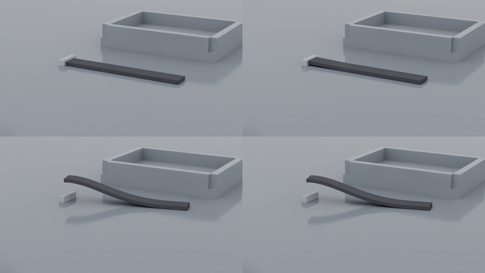

# P2-6 rubber RL — RL-ready rubber environment (P6.0 – P6.6)

Branch `claude/rl-rubber-p26` (Native work merged from `claude/rl-rubber-p26n`; `origin/main` merged for RL-11).
Material status everywhere: **SIMULATOR_ONLY_UNCALIBRATED**. Coupling `kinematic_grip_ideal_tracking` (no wrench
feedback; `robot_feedback_coupling: NOT_IMPLEMENTED_PHASE2`), perception `ideal_marker_tracking`, self-contact
`NOT_IMPLEMENTED_V1` (detector `surface_grid_v1`). Status words: PASS / FAIL / BLOCKED / NOT_RUN / REPORTED.

| Declaration | sha256 | Committed alone at | Status |
| --- | --- | --- | --- |
| `configs/rubber/contact_envelope_v1.json` (ENV1) | `08f68f70…a77a` | `887c08a` | data from formal records only |
| `configs/rubber/rubber_contact_envelope_v1.json` (ENV2, law v3) | `d7ecbd31…e92c` | `c208864` | run `contact_envelope_v1_001`: **PASS** (μ ≤ 0.8 at n_t 4 / 5 / 6) |
| `configs/rubber/rubber_contact_envelope_v2.json` (ENV2, law v2, after K2-1) | `1f616399…1e18` | `08b9dcd` | run `contact_envelope_v2_001`: **FAIL** at the 0.4 target |
| `configs/rubber/rl/rubber_strip_drag_v1.json` + `rubber_rl_tests_v1.json` | `fba43424…4397`, `8e4b2593…fd4c` | `130ccd4` | **superseded by K2-1, never run formally** |
| `configs/rubber/rl/rubber_strip_drag_v2.json` + `rubber_rl_tests_v2.json` | `7395e610…addb`, `6db54681…9548` | `400f5c5` | the P2-6 declarations of record |
| `configs/rubber/rubber_rl_tests_v3.json` (RL-05 only) | `7dc07763…6e2f` | `ba41461` | RL-05 v3 FAIL |
| `configs/rubber/rubber_rl_tests_v4.json` (RL-05 only; the last scripted attempt) | `ce8dcc1a…acc0b` | `386cfbc` | RL-05 v4 **PASS** |

## 0. Verdicts

| Row | Verdict | Evidence |
| --- | --- | --- |
| RL-01 contract (CPU N 1 / 3, GPU N 1 / 8, both profiles) | **PASS** | pytest; `gpu_rl_a_001` |
| RL-02 a CPU L0 byte-wise (N 1, N 3 heterogeneous + partial reset) | **PASS** | pytest |
| RL-02 b GPU L2, 60 steps | **PASS** | `gpu_rl_a_001` |
| RL-02 c GPU L3 `rubber_l3_band_v4` | **PASS** (0 / 90 outside, max M/U 0.774; held-out 0 / 10 outside) | `gpu_rl_d_001` |
| RL-03 randomisation (CPU (i)-(vi), GPU (vii)) | **PASS** | pytest; `gpu_rl_a_001` |
| RL-04 a CPU L1 + masked reset = fresh env | **PASS** | pytest |
| RL-04 b GPU -09 v2 rule, N 4 | **PASS** (3,780 scalars, worst d / limit 0.469) | `gpu_rl_a_001` |
| RL-05 CPU clauses (bits → MATERIAL_INVALID, NaN env, reward recomputation, truncation, evaluator, S1 (a)-(f)) | **PASS** | pytest |
| RL-05 GPU sanity, v2 (`rubber_scripted_drag_v1`) | **FAIL** (scripted better in 4 / 8, 0 successes) — preserved | `gpu_rl_a_001` |
| RL-05 GPU sanity, v3 (`rubber_scripted_pivot_v1`) | **FAIL** (better in 8 / 8, 0 successes) — preserved | `gpu_rl05_v3_001` |
| RL-05 GPU sanity, v4 (`rubber_scripted_pivot_hold_v1`, last attempt) | **PASS** (better in 7 / 8, 5 successes) | `gpu_rl05_v4_001` |
| RL-06 long rollout N 8, 400 steps | **PASS** (53 partial resets, VRAM growth 0, 0 invalid; reset p95 5.0 s) | `gpu_rl_c_001` |
| RL-06 reset re-measure (`OPENBLAS_NUM_THREADS=1`) | PASS (reset median 0.081 s, p95 **0.093 s**; 53 partial resets, VRAM growth 0, invalid 0) | `gpu_rl06_reset_remeasure_001` |
| RL-07 throughput / VRAM | **PASS** (N 8 / N 1 gain 1.46; VRAM 1,228 MiB at N 8) | `gpu_rl_b_001` (+ note `p2_6_rubber_rl_001_note_001`) |
| RL-08 dt (scored) / spacing (reported) | **PASS** (ΔO1 / L 8.8e-6, ΔO3 / O3 3.2e-5) | `gpu_rl_b_001` |
| RL-08 b Q1w bias at L/t 37.5 | REPORTED: +0.71 % (the 1 % trigger is not met) | `gpu_rl_b_001` |
| RL-09 Native | **PASS** | §9, `p2_6_native_rubber_001.json` |
| RL-10 provenance | **PASS** | `artifacts/rl_ready/p2_6/rl10_provenance_001.json` |
| RL-11 Phase 1 non-regression | **PASS** | §10 |

Evidence files (`docs/evidence/rl_ready/`):

- `p2_6_contact_envelope_001.json` (ENV2, v3) and `p2_6_contact_envelope_002.json` (ENV2, v2);
- `p2_6_rubber_rl_001.json` (P6.3 rows) with `p2_6_rubber_rl_001_note_001.json` (the RL-07 label erratum);
- `p2_6_rubber_rl_002.json` (RL-05 v3) and `p2_6_rubber_rl_003.json` (RL-05 v4);
- `p2_6_native_rubber_001.json` (RL-09);
- `p2_6_rubber_rl_p66_001.json` (RL-06 re-measure, RL-10, RL-11).

## 1. Contact law and the friction range (ENV1 / ENV2, K2-1)

- **ENV1** (`contact_envelope_v1`) holds formally scored rows only:
  - law v2 at n_t 3: sliding 0.6, static 0.8 (`contact_v2_001`);
  - law v3 at n_t 3 / 4: 0.8 / 0.8 (`contact_v3_001`, with the declared -01 d FAIL);
  - every other row is NOT_ESTABLISHED. DIAGNOSTIC rows may only narrow a row.

  The loader `rubber_contact_envelope.py` refuses μ ≥ 1.0, values above a row, and missing or not-established rows
  (`UNSUPPORTED_FRICTION_OUT_OF_ENVELOPE`).
- **ENV2 for v3** (`rubber_contact_envelope_v1`; 85 jobs, 984 s, CPU, clean tree `a79f7db`): **PASS**. Law v3 holds
  sliding and static μ ≤ 0.8 at n_t 5 / 6, on INC2 and on an unseen 48 × 16 × t strip; the strip also passes at n_t 4.
  Recorded in `contact_envelope_v2`.
- **K2-1** (MAJOR, combined review): the v3 patch slip-rate equalisation exerts an unbounded torque that does not depend
  on μ, and it removes rotation and in-plane bending in slip. v3 is accepted for translational sliding only and is not
  the P2-6 law. The v1 P2-6 declarations (v3 law, μ up to 0.8) were superseded before any formal run.
- **ENV2 for v2** (`rubber_contact_envelope_v2`; 61 jobs, 622 s, clean tree `40ad8d4`): **FAIL at the 0.4 target**.
  - μ 0.4 sliding fails on the strip at n_t 4 (dissipation 0.948 < 0.95) and at n_t 6 (slip error 1.43 %,
    dissipation 0.929).
  - μ 0.3 passes everywhere; static holds pass at μ ≤ 0.4.
  - The K2-1 spin-down passes: deceleration ratio 0.966–0.980 of rigid Coulomb, no reversal.
  - The lateral drag is reported. The formal row had a recording bug and is preserved; the labelled rerun
    `contact_envelope_v2_002_drag` shows the tip first moving back 0.46 mm, then lagging and swinging (bending and yaw).

  Recorded in `contact_envelope_v3` (`036008ef…3763`): v2 sliding 0.3 / 0.4 / 0.3 and static 0.4 at n_t 4 / 5 / 6. The
  v3 rows are scoped `translational_sliding_only` and refused for general slip.
- **P2-6 friction is fixed at 0.3, not randomised** (`contact_friction_envelope_v2_fixed_0.3`). Real rubber–table
  friction (often 0.6–1.0+) lies outside the supported range. This is a declared Phase 2 limitation.

## 2. What was built (P6.1 / P6.2)

| File | Role |
| --- | --- |
| `rl/rubber_family.py` | `RubberStripTaskFamily`: config, recipe and envelope pins; the slot set (L 100 / 125 / 150 × t 4 / 5 / 6 mm, W 16 mm, dx 1 mm, `rubber_ref_v1`); seeded slot selection; per-reset draws in a declared order (μ0, ρ, Prony g / τ scales, friction, tip traction, preload sweep / yaw, goal); `build_life` (profile `rubber_rl_env_v2`); the test configuration `cpu_parity_v1`; the labelled `rubber_rl_v1` resolution variant; the K2-2 resolution label per slot n_t |
| `rl/rubber_env.py` | `RubberVectorEnv` (`rl_rubber_vector_env_v1`). Device-side step: `grip_delta_v1` → float64 commanded pose, workspace hold, smootherstep preload, staging into Warp arrays → `BatchedRubberMaterial.advance_device`. 78-dim deployable `policy`, opt-in 106-dim `critic`. Reward `rubber_tip_tracking_v1` (0 during preload; a non-finite distance term counts −1). Rubber invalid bits → `TERM_MATERIAL_INVALID`; truncation at the horizon. Host-staged masked reset with resampling (slot changes refused). `evaluate()` = `rubber_tracking_eval_v1` (10 mm for the last 25 steps). Receipts with labels, envelope rows, resolution label and source hashes |
| `rl/rubber_contract.py` | `rubber_vector_contract_v1` checker (RL-01) |
| `rl/rubber_scripted.py` | RL-05 controllers on the deployable observation (`drag_v1`, `pivot_v1`, `pivot_hold_v1`) |
| `batched/rubber_material_batch.py` | opt-in `set_group_motions_device` / `set_traction_device` / `advance_device`, byte-identical to the host path (tested); `projection_assembly_v2`, an order-preserving vectorised F8 block accumulation, byte-identical to `projection_blocks` |
| `rl/vector_env.py` | the only Phase 1 file touched: one lazy dispatch branch (13 lines vs `main`) for `backend="kinematic_grip_batched"` or a `RubberStripTaskFamily`. Refusals: `UNSUPPORTED_BACKEND` / `_TASK` / `_OPTION` / `_SENSOR` / `_RECORDER` / `_RUNTIME` |
| `rubber_contact_envelope.py` | envelope loader and refusals (ENV1) |

Nothing frozen changed:

- the Phase 1 `batched/{constitutive,errors,material_batch,particle_contacts}.py`;
- `configs/rl_benchmark/*` and `scripts/rl_ready/*` (now equal to `main`);
- the frozen rubber modules and every earlier protocol.

The P2-6 modules are pinned in `tests/test_rubber_p2_6_frozen_sources.py`.

## 3. CPU tests (P6.1 / P6.2; `cpu_parity_v1`, Torch venv)

- **`tests/test_rubber_rl_env.py`:**
  - RL-01 CPU: N 1 / 3 × both profiles;
  - RL-02 a: L0 at N 1, and N 3 heterogeneous with a partial reset. After every step: every state / contact / visco /
    S1 array, markers, marker velocities, wrench and invalid bits;
  - RL-03 (i)-(vi), including a KS test over 2,000 samples per non-degenerate draw;
  - RL-04 a;
  - RL-05 CPU;
  - the workspace clamp and the quaternion helpers.
- **Other test files:**
  - `tests/test_rubber_rl_dispatch.py`
  - `tests/test_rubber_device_staging.py`
  - `tests/test_rubber_scripted.py`
  - `tests/test_rubber_projection_assembly.py`
  - `tests/test_rubber_contact_envelope*.py`
  - `tests/test_rubber_rl_p6_0_declarations.py` (pins)
  - `tests/test_rubber_p2_6_frozen_sources.py`

Final-head counts are in §10.

## 4. GPU rows (P6.3; RTX 5090, driver 570.211.01, blocking per-GPU flock, ≥ 4 GB free, clean trees)

| Run | Rows | GPU | Commit | Window (KST) | Sharing |
| --- | --- | --- | --- | --- | --- |
| `gpu_rl_a_001` | RL-03, RL-01, RL-02 b, RL-04 b, RL-05 (v2) | 1 | `a95da89` | 11-11 20:24–21:09 | EXCLUSIVE_AT_SAMPLES (RL-05: SHARED, PID 3871658) |
| `gpu_rl_b_001` | RL-07, RL-08, RL-08 b | 0 | `3807912` | 21:11–22:30 | SHARED (PID 642659) |
| `gpu_rl_c_001` | RL-06 | 1 | `3807912` | 21:09–22:04 | SHARED (PID 3871658) |
| `gpu_rl_d_001` | RL-02 c | 1 | `3807912` | 22:06–23:41 | EXCLUSIVE_AT_SAMPLES |
| `gpu_rl05_v3_001` | RL-05 v3 | 0 | `ae38c9e` | 11-12 03:35–03:57 | SHARED (PID 642659) |
| `gpu_rl05_v4_001` | RL-05 v4 | 1 | `e0bce4e` | 11-12 06:58–07:36 | SHARED (PID 1778327, an external training process) |
| `rl11_workload_a_contract_n2_001` | RL-11 workload A contract, N 2 | 1 | `e0bce4e` | 11-12 07:36 | (see §10) |
| `gpu_rl06_reset_remeasure_001` | RL-06 re-measure | 1 | `8b8e905` | 11-12 07:37–09:12 | SHARED (PID 1778327) |

The rows of run `a` ran before the K2-2 merge and the others after it. Only the receipt label differs; the physics and
env code are identical.

- **RL-01**: contract PASS at N 1 (L125_t4) and N 8 (slot_seed 0), for the state and privileged profiles. Build
  1.6–17 s; 12 control steps took 22–131 s.
- **RL-02 b**: 60 scripted steps at N 8. Every observation, reward and state was finite; mass constant; audits 0;
  contact audit 0; invalid bits 0.
- **RL-02 c**: an N 8 batch (L100_t4, L100_t6, L125_t4, L125_t5, L125_t6, L150_t4, L150_t5, L150_t6), 50 open-loop
  steps. Envs 0 and 1 were compared with 20 single GPU repeats each (90 statistics, α_stat 5.6e-4): 0 outside, max M/U
  0.774 (env0 marker0_z). The 10 held-out singles per env: 0 outside.
- **RL-03 GPU**: two resets with the same seeds gave identical params, mass, params64, traction, goal and preload
  rows. Every draw was in range and inside the envelope.
- **RL-04 b**: N 4 (L100_t4, L100_t5, L125_t4, L100_t6), 10 interleaved 15-step episodes; episode B changes env 1's
  seed and actions. 3,780 scalars, 0 failing, worst d / limit 0.469; invalid 0.
- **RL-06**: N 8, 400 batch steps, 60-step horizon, staggered and done resets (53 partial resets). Envs 0–3 scripted,
  4–7 random.
  - No non-finite value and no infrastructure error.
  - VRAM 1,198 MiB, flat from step 10 (growth 0 ≤ 64 MiB).
  - 0 invalid terminations.
  - Reset median 0.40 s, **p95 5.0 s** (the OpenBLAS pool, §8).
- **RL-07**: 1 cold + 5 warm steps, open-loop actions, synchronised walls; no cameras, no recording. VRAM is the
  nvidia-smi process used memory, including the CUDA context.

| Set | N | particles / env | Hz | material dt | substeps | n_t | env-steps/s | sim-time / wall | VRAM MiB | ms / substep | reset s | physics |
| --- | --- | --- | --- | --- | --- | --- | --- | --- | --- | --- | --- | --- |
| full slot set | 1 | 52,224 | 50 | 3.827 µs | 5226 | 4 | 0.658 | 0.0132 | 812 | 0.291 | 1.19 | finite, invalid 0 |
| full slot set | 4 | 65,216 | 50 | 3.827 µs | 5226 | 4,5,6 | 1.019 | 0.0204 | 972 | 0.751 | 4.07 | finite, invalid 0 |
| full slot set | 8 | 76,848 | 50 | 3.827 µs | 5226 | 4,5,6 | 0.960 | 0.0192 | 1228 | 1.595 | 12.39 | finite, invalid 0 |
| full slot set | 16 | 78,064 | 50 | 3.827 µs | 5226 | 4,5,6 | 1.009 | 0.0202 | 1676 | 3.036 | 22.12 | finite, invalid 0 |
| uniform L125_t4 | 1 | 65,024 | 50 | 3.827 µs | 5226 | 4 | 0.624 | 0.0125 | 876 | 0.307 | 1.28 | finite, invalid 0 |
| uniform L125_t4 | 4 | 65,024 | 50 | 3.827 µs | 5226 | 4 | 1.044 | 0.0209 | 1004 | 0.733 | 8.43 | finite, invalid 0 |
| uniform L125_t4 | 8 | 65,024 | 50 | 3.827 µs | 5226 | 4 | 1.160 | 0.0232 | 1196 | 1.320 | 8.20 | finite, invalid 0 |
| uniform L125_t4 | 16 | 65,024 | 50 | 3.827 µs | 5226 | 4 | 1.235 | 0.0247 | 1548 | 2.480 | 17.87 | finite, invalid 0 |
| `rubber_rl_v1` (reduced fidelity, n_t 3) | 1 | 22,176 | 50 | 5.102 µs | 3920 | 3 | 1.221 | 0.0244 | 908 | 0.209 | 0.32 | finite, invalid 0 |
| `rubber_rl_v1` (reduced fidelity, n_t 3) | 8 | 27,576 | 50 | 5.102 µs | 3920 | 3 | 3.277 | 0.0655 | 1004 | 0.623 | 3.34 | finite, invalid 0 |

  - Common settings: β 20, M 2 Prony terms, contact law v2 (table plane), S1 on.
  - Scored: the N 8 / N 1 env-steps/s gain is 1.46 > 1, and VRAM is 1,228 MiB ≤ 4,096 at N 8 → **PASS**.
  - S1 detector cost −0.08 % (noise). Plane-only contact cost +17.0 %, below the 25 % trigger of plan §2.3, so no
    early-out was added.
  - Phase 1 workload A, re-measured with the frozen harness in the same session: N 1 7.1 / N 8 9.7 env-steps/s
    (aggregate sim-time / wall 0.142 / 0.193). It ran as a child of the rubber process, which is therefore listed as its
    co-tenant.
  - At N 8 the rubber env is about 10× slower per env-step than workload A, almost entirely because it runs 5,226
    substeps per control step instead of 200. No single speedup figure is claimed.
  - The reset column ran with the default OpenBLAS pool (§8).
- **RL-08** (single env L125_t4, nominal material; lift 10 mm, hold, drag 30 mm):
  - dt, CFL 0.5 → 0.25: ΔO1 / L 8.8e-6 (limit 1e-3) and ΔO3 / O3 3.2e-5 (limit 1 %) → **PASS**.
  - Spacing, t 4 mm at n_t 4 / 6 / 8 (65k / 218k / 516k particles), reported with the -11 rule block:

    | Observable | Convergence | p_obs | GCI fine |
    | --- | --- | --- | --- |
    | O1 tip z | monotone | 1.42 | 2.9e-6 |
    | O1 tip x | monotone | 0.96 | 0.31 % |
    | O2 peak grip force | monotone | 2.44 | 0.57 % |
    | O3 slip | oscillatory | — | 0.05 % |

  - The material's scored spacing test remains RUBBER-PHYS-11.
- **RL-08 b (K2 Q1w condition 3)**: Q1 static sag on the L150_t4 geometry (L/t 37.5, W/t 4; α 0.05, μ0 0.4 MPa) at
  n_t 4 / 6 / 8 on the GPU, scored with the -11 rule.
  - φ = 0.91873 / 0.91478 / 0.91367 mm, monotone; p_obs 2.62 (p_eff 2, Fs 1.25); φ_ext 0.91225 mm.
  - **bias(n_t 4) = +0.71 %**, GCI coarse 0.97 %.
  - The declared fallback trigger (|bias| > 1 %) is not met. The measured bias joins the label: `rubber_ref_v1` Q1w is
    +0.62 % at L/t 20 and +0.71 % at L/t 37.5.

## 5. RL-05 GPU sanity: three declared controllers (the pass criterion and success definition never changed)

| Version | Controller | Seeds | Scripted better than zero | Successes | Verdict |
| --- | --- | --- | --- | --- | --- |
| v2 | `rubber_scripted_drag_v1`: grip moved by the tip error | 2000 + e | 4 / 8 | 0 | FAIL (preserved) |
| v3 | `rubber_scripted_pivot_v1`: grip yaw toward the goal bearing plus radial move along the grip axis; developed on a coarse CPU stand-in, seeds 5000–5011 | 7000 + e | 8 / 8 | 0 | FAIL (preserved) |
| v4 (last attempt) | `rubber_scripted_pivot_hold_v1`: the v3 approach plus a latched hold phase (hysteresis r_in 8 mm / r_out 30 mm, no yaw while holding, PD on the tip error with the observed tip velocity, deadband 3 mm); developed on the full-resolution GPU model, seeds 5000–5007, ≈ 1.0 GPU-h | 8000 + e | 7 / 8 | 5 | **PASS** |

- **v3 failure.** The tip reached 0.7–6.5 mm of the goal by step 20 in 6 envs, then swung 10–35 mm. The controller
  switched its yaw loop on and off at a single radius, and the coarse stand-in had damped that swing.
- **v4 run** `gpu_rl05_v4_001`:
  - Scripted returns −14.2 / −0.7 / −5.1 / −7.0 / −4.0 / −6.0 / −16.5 / −30.3; zero-action returns −44.3 / −1.7 /
    −45.1 / −56.8 / −39.7 / −53.5 / −11.5 / −39.7.
  - Final tip distances, scripted: 9.9 / 1.0 / 0.4 / 1.2 / 1.9 / 2.0 / 28.8 / 75.0 mm.
  - Env 6 is the one env where the scripted controller was not better.
  - The zero action also succeeded in env 1, whose goal lies near the tip's drift.
- **Failure modes left in v4:**
  - goals ahead of the tip (pushing) stall;
  - approaches that settle 12–17 mm away never latch.

## 6. Errata and defects (all preserved; nothing re-scored)

1. The RL-07 cost-arm text said "contact v3"; the arms ran law v2, the family's law. Additive note
   `p2_6_rubber_rl_001_note_001.json`; script fixed in `94288d2`.
2. ENV2 (v2), reported DRAG row: the reference markers were a view of the live CPU array, so zeros were recorded.
   Fixed in `7a36690`; labelled rerun `contact_envelope_v2_002_drag`.
3. A development run of the CPU RL tests failed `test_rl04a`: the test advanced env A two steps without the fresh env.
   Fixed before the formal suites.
4. The ENV2 (v3) smoke `contact_envelope_smoke_001_failed_patch` hit a runner patch bug; preserved.
5. The Torch-venv selection initially included `tests/test_rl_lab_*`, which needs the Isaac Lab venv; the first attempt
   is preserved.
6. `tests/test_native_rubber_compare.py::test_physics_deterministic_reference_needs_bitwise_native` failed in the Torch
   venv (numpy 2.3.1 / scipy 1.17.0) on identical repeats.
   - Fixed on `claude/rl-rubber-p26n` (`14435ee`): deterministic statistics now take an explicit bitwise branch.
   - The RL-09 evidence reproduces exactly. Merged here.

## 7. Limitations (Phase 2 Done boxes 2 / 3)

- Table friction is fixed at 0.3 (the law-v2 envelope at n_t 4–6). Law v3 covers translational sliding only (K2-1).
- `rubber_ref_v1` bending bias: Q1w +0.62 % at L/t 20 (GCI 2.16 %; the RUBBER-PHYS-11 v5 FAIL is kept) and +0.71 % at
  L/t 37.5.
- Self-contact physics is NOT_IMPLEMENTED_V1 (detector only); robot feedback coupling is NOT_IMPLEMENTED_PHASE2.
- RL-05 sanity passed only on the third declared controller. The v2 / v3 FAILs stay recorded, and scripted success
  depends on the goal direction (§5).
- Throughput is ≈ 1 env-step/s aggregate at N 8–16 (5,226 substeps per 20 ms). The labelled `rubber_rl_v1` variant is
  ≈ 3× faster.

## 8. User-facing note: BLAS threads and reset cost

- **Where the time goes.** The host-staged reset recomputes the F8 block inverses (`np.linalg.inv` of three ≈ 360-node
  blocks per env) after a density change.
  - With OpenBLAS's default all-core thread pool on a loaded host, this took up to 6.5 s per env (DIAGNOSTIC, CPU under
    load), against 0.06 s single-threaded.
  - RL-06's reset p95 of 5.0 s is consistent with this.
- **What to do.** `threadpoolctl` is not installed in either venv, so the library cannot limit the pool itself. **Set
  `OPENBLAS_NUM_THREADS=1` (or a small value) in the environment of any process that opens the rubber env.**
  - The GPU queue wrapper `scripts/rubber/p2_6/queue_gpu_rows.sh` does this, and run metas record the BLAS variables.
- **Bit reproducibility.** The inverse's bits depend on the BLAS thread count.
  - Single and batched solvers in one process always agree (L0).
  - Bits are not comparable across processes with different settings.
- Measured (§10): RL-06 with `OPENBLAS_NUM_THREADS=1` has a reset median of 0.081 s and a p95 of 0.093 s, against 0.401 / 5.004 s with the default pool (same 53 resets).

## 9. RL-09 Full Native verification (P6.4 / P6.5; merged from `claude/rl-rubber-p26n`)

Protocol `rubber_rl_tests_v2`, sha256 `6db54681…89548`. Task config `rubber_strip_drag_v2`, sha256 `7395e610…2addb`.
Profile `rubber_rl_env_v2`:

- contact law `grid_node_penalty_coulomb_v2`;
- table friction fixed at 0.3 (labelled limitation `contact_friction_envelope_v2_fixed_0.3`).

Branch `claude/rl-rubber-p26n`. Material status: **SIMULATOR_ONLY_UNCALIBRATED**.

The declarations were pinned at `400f5c5` and merged here in `1615285` before the formal run. An earlier 5-step Kit smoke
under the superseded v1 profile was a pipeline check only. It is labelled smoke and preserved in
`artifacts/rl_ready/p2_6/native_rubber_smoke_001`; it is never a result.

**Verdict: RL-09 PASS. All five declared clauses hold.**

### 9.1 What was built (P6.4)

| File | Role |
| --- | --- |
| `src/robotic_cutting_sim/native_rubber_host.py` | The Kit host. It uses the same material as the P2-6 env: `RubberStripTaskFamily.build_life`, with the same recipe, slot, profile and contact law. The loop keeps the shape of the TLMPM Native bridge; the steps are listed below. |
| `src/robotic_cutting_sim/rubber_native_compare.py` | RL-09 clauses (a)–(e), pure numpy / scipy (`rubber_l3.evaluate` for (c)). |
| `scripts/rubber/p2_6/launch_native_rubber.py` | Launcher (T5.8 pattern). It refuses with BLOCKED unless 14 GiB plus the 4 GiB reserve are free. Runs the Kit host with `--gpu`. |
| `scripts/rubber/p2_6/run_native_rubber.py` | The Kit run: Native arrays, `rcs_rubber_record_v1`, bridge rows, captures, receipts, nvidia-smi samples. |
| `scripts/rubber/p2_6/replay_native_rubber.py` | Headless GPU replays without Kit. Each repeat builds a fresh life and feeds it the recorded measured poses through the same `advance_measured` call. |
| `scripts/rubber/p2_6/compare_native_rubber.py` | CPU comparison. Writes `rl09.json` and the read-only evidence file, and never overwrites. |
| `scripts/rubber/p2_6/native_meta.py` | RL-10 run metadata and the GPU sharing sampler. |
| `tests/test_native_rubber_host.py`, `tests/test_native_rubber_compare.py` | CPU tests. Their contents are listed in §5. |

The Native loop, per control step:

1. Set the kinematic clamp target with the PhysX tensor `set_kinematic_targets`.
2. Step PhysX: 10 × 2 ms steps, with both Frankas held at the shared safe park.
3. Read the measured clamp pose. It comes from the tensor `get_world_poses` as float32 and is converted to float64 with
   `isaac_sim_runner.pose_from_wxyz`.
4. Convert it to the strip frame (a pure float64 translation).
5. Call `LiveRubberMaterial.advance(motions={0: grip_motion(measured)})` on `cuda:0` inside the Kit process.
6. Update the strip surface with `DynamicSurfaceBridge`. Its vertices are the surface particles under the strip pose.
7. Capture the overview and close-up RGB-D every 10 steps.

Feedback is off: the wrench is reported and never applied. `isaac_sim_runner.py`, `live_material.py`, the Phase 1
frozen modules, `configs/rl_benchmark/*`, `scripts/rl_ready/*` and the rubber protocols are unchanged.

### 9.2 Run `native_rubber_001` (P6.5)

Episode `native_rubber_episode_v1`, from plan §4.6:

- Slot L125_t4: 125 × 16 × 4 mm, n_t 4, 65,024 particles.
- Material: recipe nominal, friction 0.3, zero traction.
- Steps 0–24: hold.
- Steps 25–49: lift 20 mm and yaw 0.3 rad (smootherstep).
- Steps 50–99: hold. The tip stays on the table and is dragged sideways by the yaw: tip y moves 8.0 → 40.8 mm and tip
  z stays at t/2.

Commands (the T5.8 lock pattern; the chain script is in the session scratchpad):

```bash
flock /mnt/data/ningan/lab_records/rcs_rl_runner/gpu0.lock .venv/bin/python scripts/rubber/p2_6/launch_native_rubber.py \
    --gpu 0 --task-config rubber_strip_drag_v2 --task-config-sha256 7395e610…2addb \
    --protocol configs/rubber/rubber_rl_tests_v2.json --protocol-sha256 6db54681…89548
flock /mnt/data/ningan/lab_records/rcs_rl_runner/gpu1.lock env CUDA_VISIBLE_DEVICES=1 CUDA_DEVICE_ORDER=PCI_BUS_ID \
    PYTHONPATH=src .deps/isaacsim-venv/bin/python scripts/rubber/p2_6/replay_native_rubber.py \
    --native artifacts/rl_ready/p2_6/native_rubber_001/run --out artifacts/rl_ready/p2_6/native_rubber_001_replays \
    --repeats 30 --gpu-index 1 --task-config rubber_strip_drag_v2 … --protocol configs/rubber/rubber_rl_tests_v2.json …
CUDA_VISIBLE_DEVICES='' PYTHONPATH=src .venv/bin/python scripts/rubber/p2_6/compare_native_rubber.py \
    --native artifacts/rl_ready/p2_6/native_rubber_001 --replays artifacts/rl_ready/p2_6/native_rubber_001_replays \
    --out artifacts/rl_ready/p2_6/native_rubber_001_rl09 --evidence docs/evidence/rl_ready/p2_6_native_rubber_001.json
```

The replays first queued on GPU0. On the coordinator's request they were moved to GPU1. GPU1 is the same model
(RTX 5090), which is what plan §4.6 asks for ("same GPU model").

#### Native row

| Field | Value |
| --- | --- |
| Run | `artifacts/rl_ready/p2_6/native_rubber_001` (17 MB). Launcher wall 188.9 s; episode 181.5 s; Kit start 4.1 s (warm caches) |
| GPU | #0 NVIDIA GeForce RTX 5090 (PCI 21:00), driver 570.211.01 |
| Render device | GPU0: Kit `active_gpu=0`, `physics_gpu=0`, `multi_gpu` False, RaytracedLighting (`isaac_sim_runner.launch_app`, unchanged) |
| PhysX | CPU, dt 2 ms × 10 per control step, no GPU dynamics, no fabric |
| Material device | `cuda:0`, PCI 21:00, `CUDA_DEVICE_ORDER=PCI_BUS_ID`, no `CUDA_VISIBLE_DEVICES` |
| Free memory at launch | 31,435 MiB (≥ 14 GiB + 4 GiB rule met) |
| Sharing | **SHARED_GPU**: PID 642659 (another project, 766 MiB, untouched) in all 38 samples; GPU util peak 100 % |
| Job VRAM peak | 5,334 MiB |
| Commit / dirty | `1615285`, clean tree (`git status --porcelain` empty for src / scripts / configs / tests) |
| Protocol | `rubber_rl_tests_v2` sha256 `6db5468172e0cf7c507c51b97757550442715ef80221cf818f6fb69cdd189548` |
| Task config | `rubber_strip_drag_v2` sha256 `7395e6104cab16a247dc03afb133f8bd65c96d68a0d01d058bc59e6fbbf2addb` |
| Runtime | Isaac Sim 6.2.0.0; Kit `omni.warp.core` 1.17.0 (the replays use the venv `warp-lang` 1.17.0; same kernel module hashes); Python 3.12.12 |

The throughput row is reported only, never scored:

- N 1, 65,024 particles per env, control 50 Hz, material dt 3.827 µs (5,226 substeps);
- cameras: overview and close-up RGB-D at 960 × 540, every 10 steps (11 captures);
- recording: records, arrays and the surface every step;
- warm step (steps 2–100) 1.81 s, of which material 1.74 s;
- GPU0 shared, warm caches.

#### Replays

`artifacts/rl_ready/p2_6/native_rubber_001_replays` (8.2 MB):

- 30 repeats: 0–19 form the band, 20–29 are held out.
- Commit `5e64347`, clean tree.
- GPU1 (PCI F1:00), `cuda:0` under `CUDA_VISIBLE_DEVICES=1`.
- **SHARED_GPU**: the external agentic optimizer's acceptance processes were present.
- Job VRAM peak 714 MiB; 1.72–2.11 s per step; invalid bits 0 in all 30.

Between `1615285` and `5e64347` only the Kit-only `KitRubberScene` changed (the rendering fix in §4) plus scripts. The
replay path (`advance_measured`, `replay_bridge_inputs`, `statistics_row`) is byte-identical.

### 9.3 RL-09 result (`rl09.json` sha256 `11106fca…2ff7`, evidence `docs/evidence/rl_ready/p2_6_native_rubber_001.json`)

| Clause | Declared | Measured | Verdict |
| --- | --- | --- | --- |
| completeness | 100 Native steps, 20 band replays | 100 / 100 steps, 20 band + 10 held-out | PASS |
| (a) receipts | identical to the headless reference except device / timing | 30 / 30 receipts identical leaf by leaf; exempt leaves only `material/build_wall_s`, `material/graph/capture_wall_s`, `material/solver/device` | PASS |
| (b) inputs | material inputs = recorded measured clamp poses, bitwise float64 | Native strip-frame pose = recorded measured pose minus placement, bitwise. Material pose, motion (R, b) and solver-staged `group_q1` / `group_b1` are bitwise equal in 30 / 30 replays | PASS |
| (c) physics | 46 statistics inside `rubber_l3_band_v4` (20 replays, α_family 0.05) | 0 / 46 outside. α_stat 1.087e-3. Max M/U **0.654** (marker1_z: M 1.8e-7 m, U 2.75e-7 m). Next: marker0_z 0.550, plane_wrench_ty 0.535, plane_wrench_fz 0.489, clamp_wrench_fz 0.477. Bound method: lognormal 45, Cantelli fallback 1 | PASS |
| (c) held-out (reported) | — | 10 / 10 within; max M/U 0.488–0.978 | reported |
| (d) invalid bits | 0 | 0 at all 100 steps (NONFINITE, J_DOMAIN, CFL, S1 self-penetration) | PASS |
| (e) bridge integrity | mesh vertices = surface particles under the strip pose ≤ 1e-6 m | 101 / 101 updates, max 7.45e-9 m, 19,664 vertices, topology equal | PASS |
| camera consistency | reported, not scored | 10 captures × 9 markers per camera, all visible. Rendered depth minus marker optical depth: overview −8.6 … +2.7 mm, close-up −7.8 … +1.6 mm | reported |

How to read the camera residuals:

- The markers are cross-section centroids 2 mm below the top face.
- At the cameras' ≈ 17° elevation, the ray reaches the top surface ≈ 6 mm before the centroid, so the expected
  residual is about −6 mm, and that is what is measured.
- The tip marker sits on the end face, and its ray passes the end onto the table, which gives the positive values.

The command-to-measured clamp distance is at most 2.2e-9 m (the float32 PhysX pose). The Frankas stayed within
1.7e-10 rad of the park pose.

Media (reported, not physics):

- `docs/media/p2_6/native_rubber_001_closeup_steps_0_30_50_100.png`
- `docs/media/p2_6/native_rubber_001_overview_step100.png`



### 9.4 Defects found and fixed after the formal run (rendering / reported quantities only; preserved, not re-scored)

1. **Rendered clamp jaw stayed at its reset pose** (visible in the media above).
   - Cause: PhysX does not write kinematic-body poses back to USD. In `native_rubber_001` the jaw cube was a child of
     the kinematic body (`clamp_visual rigid_child_v0`).
   - The material input is the PhysX tensor pose, so no scored clause is affected.
   - Fixed in `071d5bb`: the jaw is now a separate non-physics prim posed from the measured pose after every PhysX step
     (`measured_pose_v1`, now the default).
   - A labelled 100-step visual smoke with the fix was queued, then cancelled to free the shared GPU0 queue. It is
     NOT_RUN.
2. **Camera consistency at step 0 used the uncomputed marker buffer.** All 9 markers projected to one point.
   - Fixed in `5e64347`: step 0 now uses the reference centroids.
   - The `native_rubber_001` summary excludes step 0. Camera consistency is reported only.

### 9.5 Tests

CPU suites `tests/test_native_rubber_host.py` (12) and `tests/test_native_rubber_compare.py` (7), with `.venv`, run
twice (`CUDA_VISIBLE_DEVICES=''` and `=0`):

- With the P6.5 artifacts present: **19 passed** both times. This includes the recomputation of this evidence from the
  artifacts.
- Without the artifacts: 18 passed, 1 NOT_RUN skip.

What the tests check, without Kit:

- **Bridge**, with a fake PhysX that adds a tracking offset and a fake USD sink:
  - call order;
  - the material receives the measured pose, not the command;
  - motion and staged rows;
  - surface vertices = surface particles ≤ 1e-6 m;
  - the surface mesh is a closed outward 2-manifold with the exact lattice volume;
  - a CPU replay is bitwise, and one ulp is detected.
- **Family profile:** a `RubberStripTaskFamily.build_life` run on the cpu_parity slot.
- **Compare logic:**
  - receipt exemptions and type / sign / NaN rules;
  - one-ulp input detection on every key;
  - L3 band accept, shift-reject, NaN-reject, and a deterministic band;
  - invalid and bridge clauses;
  - end-to-end PASS / FAIL paths.

`tests/test_repo_naming.py` passed before each commit.

### 9.6 Open

- The rendered-clamp fix (`measured_pose_v1`) has not been exercised in a Kit run yet (visual smoke NOT_RUN).
- Both GPU rows are SHARED_GPU. No EXCLUSIVE Native row exists.
- Robot feedback coupling stays `NOT_IMPLEMENTED_PHASE2`. The clamp is kinematic and its wrench is reported only.
- Friction is the fixed 0.3 of `rubber_strip_drag_v2`, the labelled limitation.

## 10. P6.6 at the final head: RL-06 reset re-measure, RL-10, RL-11

Evidence: `docs/evidence/rl_ready/p2_6_rubber_rl_p66_001.json`.

### RL-06 reset re-measure (`gpu_rl06_reset_remeasure_001`)

The same RL-06 row, unchanged protocol `rubber_rl_tests_v2`, run at `8b8e905` (clean). Only the environment variable
`OPENBLAS_NUM_THREADS=1` differs from the formal run.

| Run | Commit | OPENBLAS_NUM_THREADS | Partial resets | Reset median s | Reset p95 s | VRAM growth MiB | Invalid | Wall s | GPU / sharing |
| --- | --- | --- | --- | --- | --- | --- | --- | --- | --- |
| `gpu_rl_c_001` (formal) | `3807912` | unset (all cores) | 53 | 0.401 | 5.004 | 0 | 0 | 3,243 | GPU1, SHARED (PID 3871658) |
| `gpu_rl06_reset_remeasure_001` | `8b8e905` | 1 | 53 | 0.081 | **0.093** | 0 | 0 | 5,697 | GPU1, SHARED (PID 1778327, an external training process) |

- The re-measure also passes RL-06. The verdict of record stays the formal run's PASS.
- The reset p95 drops about 54× with single-threaded BLAS.
- The longer wall time comes from the co-tenant training process on GPU1. RL-06 does not score wall time.

### RL-10 provenance (`artifacts/rl_ready/p2_6/rl10_provenance_001.json`): **PASS**

The check is `scripts/rubber/p2_6/check_rl10_provenance.py --v4-run artifacts/rl_ready/p2_6/gpu_rl05_v4_001
--v4-declaration 386cfbc`. Runs checked:

- `gpu_rl_a_001` / `_b_001` / `_c_001` / `_d_001`;
- `gpu_rl05_v3_001`;
- `gpu_rl05_v4_001`.

Each run has:

- a complete meta (commit, dirty flag, protocol and task-config sha256, the sha256 of each rubber module, Warp / Torch /
  Python, GPU and driver, command, start time);
- a clean tree;
- its declaration committed before the run start and contained in the run commit;
- protocol and config bytes at the run commit equal to the recorded sha;
- module hashes equal to the files at the run commit;
- every row labelled SHARED / EXCLUSIVE with nvidia-smi samples.

Every evidence writer refuses to overwrite. The re-measure run above has the same meta fields (clean, `8b8e905`).

### RL-11 Phase 1 non-regression: **PASS**

| Check | Head | Result |
| --- | --- | --- |
| `.venv` full suite, `CUDA_VISIBLE_DEVICES=''` | `d92550d` | 2,911 passed, 40 skipped, 6 xfailed, 0 failed (2,917 s) |
| Torch selection, `CUDA_VISIBLE_DEVICES=''` | `d92550d` | 385 passed, 3 skipped (656 s) |
| `.venv` full suite, `CUDA_VISIBLE_DEVICES=''` | `73c624b` | 2,914 passed, 40 skipped, 6 xfailed, 0 failed (2,878 s) |
| Torch selection, `CUDA_VISIBLE_DEVICES=''` | `73c624b` | 386 passed, 3 skipped (640 s) |
| `.venv` full suite, `CUDA_VISIBLE_DEVICES=1` (GPU1 lock) | `73c624b` | 2,914 passed, 40 skipped, 6 xfailed, 0 failed (2,894 s) |
| Torch selection, `CUDA_VISIBLE_DEVICES=1` (GPU1 lock) | `73c624b` | 388 passed, 2 skipped (612 s) |
| Phase 1 workload A contract, GPU N 2 (`run_p1_2b_smoke.py --backend kinematic_ideal_tracking_batched --tasks 512 15 --steps 50 --reset-step 25 --evaluation-stream`) | `e0bce4e` | **PASS** (clauses: receipt / spaces / metadata, full reset, partial reset, steps, evaluate; 102,732 / 103,898 particles; 50 Hz; dt 100 µs × 200; no cameras; no recording; RTX 5090 GPU1, driver 570.211.01, 23.7 s; SHARED with PID 1778327) |
| acceptance_v2 judge self-test (`tests/test_perf_acceptance.py`) | both heads | in the Torch selection, passed |
| Frozen paths vs `origin/main` (`bfe6d5e`): `configs/rl_benchmark`, `scripts/rl_ready`, Phase 1 `batched/{constitutive,errors,material_batch,particle_contacts}.py` | `73c624b` | empty diff. `rl/vector_env.py`: +13 lines, the single dispatch branch |
| Frozen-source pins (Phase 1, rubber, P2-6) | both heads | in the suites, passed |

- The Torch selection covers the Phase 1 vector env, RL actions / benchmark / observations / policies / replay / reward /
  stability / supervision / termination, `test_perf_acceptance`, every `test_rubber_rl_*`, rubber device staging, the
  scripted controllers and the Native rubber tests.
- The skips are artifact- or venv-gated NOT_RUN cases (for example, workload B needs the Isaac Lab venv); they are not
  passes.
- Deviation: the CUDA-visible suites ran with `CUDA_VISIBLE_DEVICES=1` under the GPU1 lock, not `=0`, because P2-5
  held GPU0. The source is the same and only the visible device index differs.
- `73c624b` differs from `d92550d` only by the v4 declaration and runner pin, the evidence and the P2-6 pin test.
  `src/` is identical.

## 11. Open (for P6.7)

- The xhigh review P6.7, then Z1–Z3: the PR to `main` and the new versioned external descriptor.
- Friction above 0.3 needs a law and an envelope that pass at μ 0.4 or more. Law v3 stays translational-only (K2-1).
- Throughput: ≈ 1 env-step/s at N 8–16 at full resolution. No early-out or substep reduction is claimed.
- `threadpoolctl` is not in either venv. The OpenBLAS limit is a documented user setting (§8), not enforced in code.
